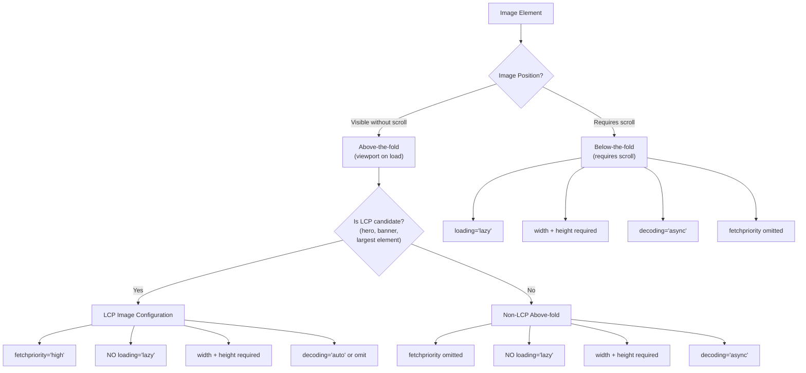
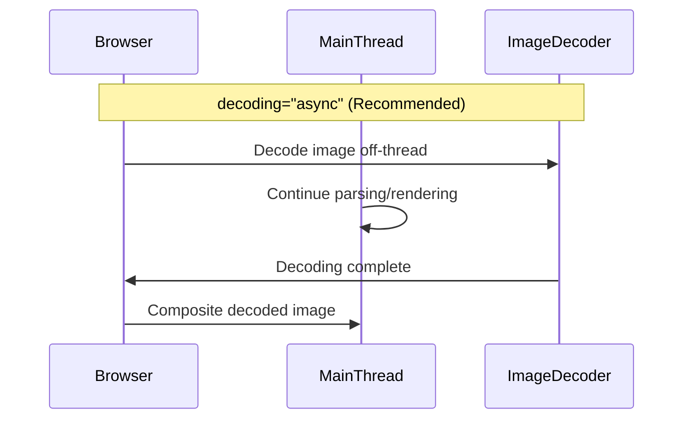
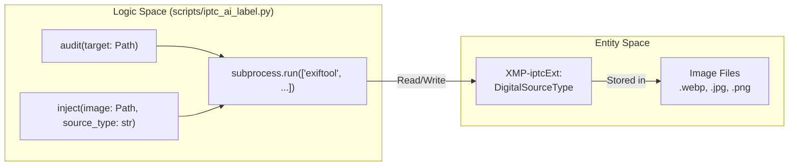

<!-- source: DeepWiki mcp.deepwiki.com · repo AgriciDaniel/claude-seo · page 9.2 Image Loading and Performance · fetched 2026-10-26 -->

# Image Loading and Performance

<details>
<summary>Relevant source files</summary>

The following files were used as context for generating this wiki page:

- [scripts/analyze_visual.py](scripts/analyze_visual.py)
- [scripts/capture_screenshot.py](scripts/capture_screenshot.py)
- [scripts/fetch_page.py](scripts/fetch_page.py)
- [scripts/iptc_ai_label.py](scripts/iptc_ai_label.py)

</details>


## Purpose and Scope

This document covers image loading strategies and performance optimization techniques implemented in the `claude-seo` system. It focuses on HTML attributes that control browser loading behavior (`loading`, `fetchpriority`, `decoding`), dimension specifications for layout stability, and their impact on Core Web Vitals metrics. Additionally, it details the automated auditing and injection of IPTC metadata for AI-generated images to comply with modern search engine policies via the `iptc_ai_label.py` utility.

For image format selection (WebP, AVIF, JPEG) and the `<picture>` element pattern, see [Image Format Strategy](9.1). For detailed Core Web Vitals thresholds and evaluation methodology, see [Core Web Vitals](8.1).

Sources: [scripts/iptc_ai_label.py:1-31](), [scripts/analyze_visual.py:59-63]()

---

## Loading Strategy Overview

The system enforces a position-based loading strategy: above-the-fold images use eager loading with high priority, while below-the-fold images use lazy loading with async decoding. This strategy directly impacts two Core Web Vitals metrics: **LCP** (Largest Contentful Paint) and **CLS** (Cumulative Layout Shift).

### Image Loading Decision Tree



Sources: [scripts/analyze_visual.py:106-152](), [scripts/capture_screenshot.py:137-141]()

---

## Critical Path: LCP Image Optimization

### `fetchpriority="high"` Attribute

The `fetchpriority` attribute elevates an image's priority in the browser's network queue. The system identifies LCP (Largest Contentful Paint) candidates using `analyze_visual.py`, which targets hero images and the first images in the main content area.

**Implementation:**

```html

```

[scripts/analyze_visual.py:135-152]()

### Anti-Pattern: Lazy Loading LCP Images

The system flags configurations where `loading="lazy"` appears on above-the-fold images. This is a critical LCP anti-pattern that delays the browser's discovery and fetching of the LCP element. Visual analysis via Playwright in `analyze_visual.py` checks for `h1_visible` and `hero_image` within the initial 1920x1080 viewport.

[scripts/analyze_visual.py:101-112]()

**Blocked Configuration:**
```html
<!-- ❌ WRONG: Lazy-loading LCP image adds significant delay -->

```

Sources: [scripts/analyze_visual.py:59-63](), [scripts/analyze_visual.py:106-112]()

---

## Below-Fold: Lazy Loading Strategy

### Playwright-Based Detection

The system uses `capture_screenshot.py` with a `networkidle` wait state and an additional 1000ms delay to ensure lazy-loaded content is properly rendered during audits.

[scripts/capture_screenshot.py:137-141]()

### `decoding="async"` Attribute

The `decoding="async"` attribute prevents image decoding from blocking the main thread. The system recommends this for all non-LCP images to maintain layout fluidity.



Sources: [scripts/capture_screenshot.py:137-141](), [scripts/fetch_page.py:36-56]()

---

## Dimension Attributes and CLS Prevention

The system requires `width` and `height` attributes on all `` elements to prevent Cumulative Layout Shift (CLS). `analyze_visual.py` evaluates the `bounding_box` of elements to detect if they are properly sized within the viewport.

[scripts/analyze_visual.py:109-111]()

**Implementation Patterns:**

```html
<!-- Pattern 1: Explicit dimensions (preferred) -->


<!-- Pattern 2: CSS aspect-ratio -->

```

Sources: [scripts/analyze_visual.py:107-112](), [scripts/analyze_visual.py:126-130]()

---

## AI-Generated Images: IPTC Metadata

Google Merchant Center and Search require AI-generated images to carry specific metadata. The `scripts/iptc_ai_label.py` utility automates the auditing and injection of these labels using `exiftool`.

[scripts/iptc_ai_label.py:1-31]()

### Metadata Vocabulary

| Label | Description | IPTC URI |
|-------|-------------|----------|
| `trainedAlgorithmicMedia` | Fully AI-generated | `.../digitalsourcetype/trainedAlgorithmicMedia` |
| `compositeSynthetic` | Captured + AI mix | `.../digitalsourcetype/compositeSynthetic` |
| `digitalCapture` | Standard photo | `.../digitalsourcetype/digitalCapture` |

[scripts/iptc_ai_label.py:44-52]()

### Automated Workflow

The `iptc_ai_label.py` script maps system commands to `exiftool` operations to manage `XMP-iptcExt:DigitalSourceType`.



Sources: [scripts/iptc_ai_label.py:97-135](), [scripts/iptc_ai_label.py:138-175]()

---

## Performance Auditing Tools

The codebase provides specialized scripts to measure and verify image performance:

| Script | Function | Key Code Entity |
|--------|----------|-----------------|
| `fetch_page.py` | Fetches HTML with Googlebot UA to check for dynamic rendering/cloaking. | `fetch_page()` [scripts/fetch_page.py:107-113]() |
| `analyze_visual.py` | Uses Playwright to verify H1 and Hero image visibility above the fold. | `analyze_visual()` [scripts/analyze_visual.py:46-56]() |
| `capture_screenshot.py` | Captures multi-viewport screenshots to audit layout shifts and lazy loading. | `capture_screenshot()` [scripts/capture_screenshot.py:73-79]() |

Sources: [scripts/fetch_page.py:46-48](), [scripts/analyze_visual.py:59-63](), [scripts/capture_screenshot.py:45-50]()

---

