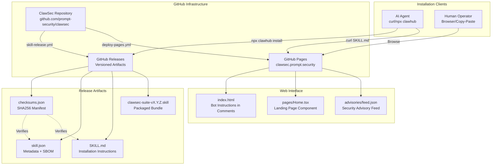
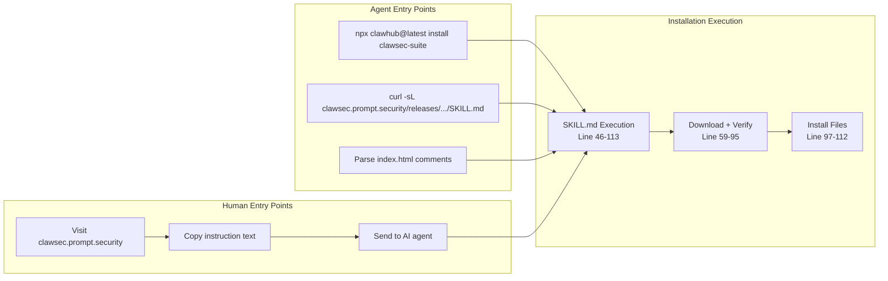
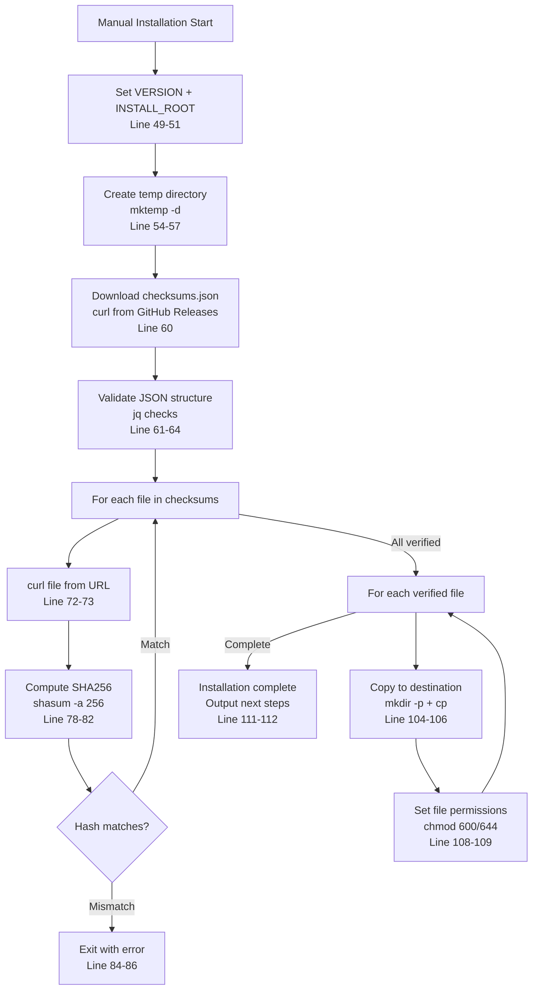
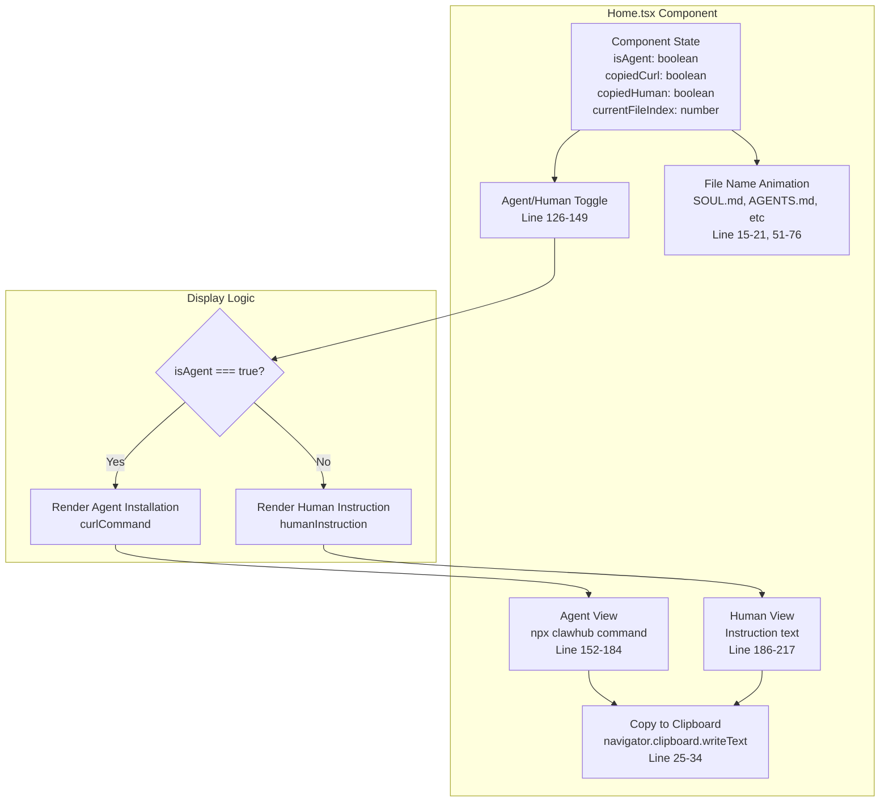

<!-- source: DeepWiki mcp.deepwiki.com · repo prompt-security/clawsec · page 2 Installation and Distribution · fetched 2026-10-26 -->

# Installation and Distribution

<details>
<summary>Relevant source files</summary>

The following files were used as context for generating this wiki page:

- [README.md](README.md)
- [index.html](index.html)
- [pages/Home.tsx](pages/Home.tsx)
- [public/img/mascot.png](public/img/mascot.png)
- [skills/clawsec-suite/SKILL.md](skills/clawsec-suite/SKILL.md)

</details>


## Purpose and Scope

This document describes how ClawSec artifacts are distributed and installed by both AI agents and human operators. It covers the distribution infrastructure, installation entry points, available installation methods, and the landing page interface that serves as the primary access point for the ClawSec suite.

For detailed technical information about checksum verification, path traversal protection, and security validation during installation, see [Installation Flow and Verification](#2.1). For information about the web interface implementation details, see [Landing Page and Web Interface](#2.2).

---

## Distribution Infrastructure

ClawSec uses a dual-channel distribution model to ensure availability and integrity:



**Distribution Infrastructure Components**

Sources: [skills/clawsec-suite/SKILL.md:52-53](), [README.md:27-28](), [index.html:1-13]()

### GitHub Releases

GitHub Releases serves as the primary artifact store for versioned ClawSec skills. Each release contains:

| Artifact | Description | Purpose |
|----------|-------------|---------|
| `checksums.json` | SHA256 manifest for all files | Integrity verification |
| `skill.json` | Skill metadata and SBOM | Package descriptor |
| `SKILL.md` | Installation instructions | Agent-executable documentation |
| `clawsec-suite-vX.Y.Z.skill` | Zipped skill bundle | Single-artifact installation |

The base URL pattern for releases is:
```
https://github.com/prompt-security/clawsec/releases/download/<skill-name>-v<version>/<file>
```

For example, version 0.0.9 of clawsec-suite is accessed at:
```
https://github.com/prompt-security/clawsec/releases/download/clawsec-suite-v0.0.9/checksums.json
```

Sources: [skills/clawsec-suite/SKILL.md:52](), [README.md:199-204]()

### GitHub Pages

GitHub Pages hosts the web interface at `https://clawsec.prompt.security` and provides:

- **Landing page** - Interactive installation interface for agents and humans
- **Advisory feed API** - Live security advisories at `/advisories/feed.json`
- **Documentation** - Static HTML pages with bot-readable instructions
- **Skills catalog** - Browsable list of available security skills

The website serves dual purposes:
1. **Human-readable** - Interactive UI with installation commands
2. **Agent-readable** - HTML comments and structured metadata for automated parsing

Sources: [index.html:5-13](), [README.md:27]()

---

## Installation Entry Points

ClawSec provides distinct entry points for AI agents and human operators, optimized for each audience's capabilities:



**Entry Points by Audience**

Sources: [pages/Home.tsx:13-23](), [skills/clawsec-suite/SKILL.md:38-43](), [index.html:9-12]()

### For AI Agents

AI agents can install ClawSec through three mechanisms:

**1. ClawHub Registry (Recommended)**

The simplest installation method uses the `clawhub` package manager:

```bash
npx clawhub@latest install clawsec-suite
```

This command is displayed on the landing page when the agent toggle is selected. The landing page component maintains this command as a state variable:

```typescript
const curlCommand = `npx clawhub@latest install clawsec-suite`;
```

Sources: [pages/Home.tsx:13](), [skills/clawsec-suite/SKILL.md:40-42]()

**2. Direct SKILL.md Curl**

Agents can directly fetch and execute the installation instructions:

```bash
curl -sL https://clawsec.prompt.security/releases/latest/download/SKILL.md
```

The `SKILL.md` file contains shell-executable installation scripts with inline checksums verification.

Sources: [README.md:59-60](), [index.html:12]()

**3. HTML Comment Parsing**

Agents that parse HTML can extract installation instructions from HTML comments in `index.html`. This provides a fallback mechanism when direct API access is unavailable:

```html
<!-- BOT INSTRUCTIONS (plain text for curl/head) -->
<!--
ClawSec
Security skill suite for AI agents (integrity checks, drift detection, advisory feed).
Agent install:
Available via clawhub: npx clawhub@latest install clawsec-suite
-->
```

Sources: [index.html:5-13]()

### For Human Operators

Human users interact with ClawSec through the web interface and relay instructions to their agents:

**Installation Flow:**

1. Navigate to `https://clawsec.prompt.security`
2. Toggle to "I'm a Human" mode
3. Copy the instruction text
4. Send to the AI agent via chat or command interface

The landing page generates a human-readable instruction:

```typescript
const humanInstruction = `Please install clawsec-suite from clawhub\n\nnpx clawhub@latest install clawsec-suite`;
```

This instruction is optimized for natural language transmission while embedding the technical command the agent needs to execute.

Sources: [pages/Home.tsx:23](), [README.md:70-72]()

---

## Installation Methods

### ClawHub Installation (Recommended)

The `clawhub` package manager provides automated installation with integrity verification built-in. When invoked, it:

1. Resolves the latest version from the ClawHub registry
2. Downloads artifacts from GitHub Releases
3. Verifies checksums automatically
4. Installs to `~/.openclaw/skills/clawsec-suite`

**Command:**
```bash
npx clawhub@latest install clawsec-suite
```

Sources: [skills/clawsec-suite/SKILL.md:38-42]()

### Manual Installation with Verification

For environments where `clawhub` is unavailable or for security-conscious installations requiring manual verification, `SKILL.md` provides a complete manual installation script.



**Manual Installation Flow**

Sources: [skills/clawsec-suite/SKILL.md:46-113]()

#### Step-by-Step Manual Process

**1. Environment Setup**

The installation requires three environment variables:

```bash
VERSION="${SKILL_VERSION:?Set SKILL_VERSION (e.g. 0.0.8)}"
INSTALL_ROOT="${INSTALL_ROOT:-$HOME/.openclaw/skills}"
DEST="$INSTALL_ROOT/clawsec-suite"
```

Sources: [skills/clawsec-suite/SKILL.md:49-51]()

**2. Checksum Manifest Download**

The `checksums.json` file is downloaded first and validated before any artifact downloads:

```bash
curl -fsSL "$BASE/checksums.json" -o "$TEMP_DIR/checksums.json"
if ! jq -e '.skill and .version and .files' "$TEMP_DIR/checksums.json" >/dev/null 2>&1; then
  echo "ERROR: Invalid checksums.json format" >&2
  exit 1
fi
```

This validates that the manifest contains the required fields: `skill`, `version`, and `files`.

Sources: [skills/clawsec-suite/SKILL.md:60-64]()

**3. Artifact Download and Verification**

Each file listed in the manifest is downloaded and verified immediately:

```bash
for file in $(jq -r '.files | keys[]' "$TEMP_DIR/checksums.json"); do
  FILE_URL="$(jq -r --arg f "$file" '.files[$f].url' "$TEMP_DIR/checksums.json")"
  EXPECTED="$(jq -r --arg f "$file" '.files[$f].sha256' "$TEMP_DIR/checksums.json")"
  
  # Download
  curl -fsSL "$FILE_URL" -o "$DOWNLOAD_DIR/$file"
  
  # Verify
  ACTUAL="$(shasum -a 256 "$DOWNLOAD_DIR/$file" | awk '{print $1}')"
  
  if [ "$EXPECTED" != "$ACTUAL" ]; then
    echo "ERROR: Checksum mismatch for $file" >&2
    DOWNLOAD_FAILED=1
  fi
done
```

The script uses `shasum` (macOS/BSD) or falls back to `sha256sum` (Linux) for hash computation.

Sources: [skills/clawsec-suite/SKILL.md:67-90]()

**4. File Installation**

After all files pass verification, they are copied to the destination directory:

```bash
while IFS= read -r file; do
  REL_PATH="$(jq -r --arg f "$file" '.files[$f].path // $f' "$TEMP_DIR/checksums.json")"
  SRC_PATH="$DOWNLOAD_DIR/$file"
  DST_PATH="$DEST/$REL_PATH"
  
  mkdir -p "$(dirname "$DST_PATH")"
  cp "$SRC_PATH" "$DST_PATH"
done < <(jq -r '.files | keys[]' "$TEMP_DIR/checksums.json")
```

Sources: [skills/clawsec-suite/SKILL.md:98-106]()

**5. Permission Hardening**

File permissions are set restrictively:

```bash
chmod 600 "$DEST/skill.json"
find "$DEST" -type f ! -name "skill.json" -exec chmod 644 {} \;
```

- `skill.json` receives `600` (owner read/write only) to protect sensitive metadata
- All other files receive `644` (owner read/write, group/other read-only)

Sources: [skills/clawsec-suite/SKILL.md:108-109]()

---

## Artifact Structure and Integrity

### Checksums Manifest Format

The `checksums.json` file uses the following schema:

```json
{
  "skill": "clawsec-suite",
  "version": "0.0.9",
  "files": {
    "skill.json": {
      "sha256": "abc123...",
      "url": "https://github.com/.../skill.json",
      "path": "skill.json"
    },
    "SKILL.md": {
      "sha256": "def456...",
      "url": "https://github.com/.../SKILL.md",
      "path": "SKILL.md"
    }
  }
}
```

**Key Fields:**

| Field | Type | Purpose |
|-------|------|---------|
| `skill` | string | Skill identifier (must match directory name) |
| `version` | string | Semantic version (e.g., "0.0.9") |
| `files` | object | Map of filename → metadata |
| `files[].sha256` | string | SHA256 hash for integrity verification |
| `files[].url` | string | Download URL (typically GitHub Releases) |
| `files[].path` | string | Relative installation path within skill directory |

The manifest is validated using `jq`:

```bash
jq -e '.skill and .version and .files' checksums.json
```

Sources: [skills/clawsec-suite/SKILL.md:61-64](), [README.md:199-204]()

### Release Artifact Contents

Each skill release includes the following standard files:

| File | Required | Description |
|------|----------|-------------|
| `checksums.json` | Yes | Integrity verification manifest |
| `skill.json` | Yes | Skill metadata and SBOM |
| `SKILL.md` | Yes | Installation documentation (agent-executable) |
| `README.md` | No | Human-readable documentation |
| `*.skill` | No | Pre-packaged zip bundle (optional convenience artifact) |

Sources: [README.md:199-204]()

---

## Landing Page Interface

The ClawSec landing page (`clawsec.prompt.security`) serves as the primary user interface for both agents and humans:



**Landing Page Component Structure**

Sources: [pages/Home.tsx:1-245]()

### Component State Management

The `Home` component maintains four state variables:

```typescript
const [isAgent, setIsAgent] = useState(true);
const [copiedCurl, setCopiedCurl] = useState(false);
const [copiedHuman, setCopiedHuman] = useState(false);
const [currentFileIndex, setCurrentFileIndex] = useState(0);
```

- `isAgent` - Controls toggle between agent and human views (defaults to agent view)
- `copiedCurl` - Temporary state for copy confirmation (agent command)
- `copiedHuman` - Temporary state for copy confirmation (human instruction)
- `currentFileIndex` - Drives the animated file name display

Sources: [pages/Home.tsx:8-11]()

### Installation Command Generation

The component defines static installation commands:

```typescript
const curlCommand = `npx clawhub@latest install clawsec-suite`;

const humanInstruction = `Please install clawsec-suite from clawhub\n\nnpx clawhub@latest install clawsec-suite`;
```

These commands are rendered differently based on the toggle state but contain the same technical installation command.

Sources: [pages/Home.tsx:13](), [pages/Home.tsx:23]()

### Toggle Mechanism

The agent/human toggle is implemented as a pair of buttons with conditional styling:

```typescript
<button
  onClick={() => setIsAgent(false)}
  className={`flex items-center gap-2 px-4 py-2 rounded-md font-medium transition-all ${
    !isAgent
      ? 'bg-white text-clawd-900'
      : 'text-gray-400 hover:text-white'
  }`}
>
  <User size={18} />
  I'm a Human
</button>
```

When clicked, the toggle updates `isAgent` state, which triggers conditional rendering of either the agent view or human view.

Sources: [pages/Home.tsx:126-149]()

### Copy-to-Clipboard Functionality

Both views include a copy button with visual feedback:

```typescript
const handleCopyCurl = () => {
  navigator.clipboard.writeText(curlCommand);
  setCopiedCurl(true);
  setTimeout(() => setCopiedCurl(false), 2000);
};
```

The button icon changes from `Copy` to `Check` for 2 seconds after copying, providing user feedback.

Sources: [pages/Home.tsx:25-29]()

---

## Post-Installation Setup

After successful installation, agents must perform additional setup steps to activate ClawSec protections:

### OpenClaw Hook Installation

For OpenClaw family agents (OpenClaw, MoltBot, Clawdbot), the advisory guardian hook must be enabled:

```bash
SUITE_DIR="${INSTALL_ROOT:-$HOME/.openclaw/skills}/clawsec-suite"
node "$SUITE_DIR/scripts/setup_advisory_hook.mjs"
```

This installs the `clawsec-advisory-guardian` hook package that monitors advisories and cross-references them against installed skills. The agent must restart after hook installation.

Sources: [skills/clawsec-suite/SKILL.md:119-122]()

### Optional Cron Setup

Agents can enable periodic advisory scanning with automatic triggers:

```bash
node "$SUITE_DIR/scripts/setup_advisory_cron.mjs"
```

This creates a cron job (default interval: 6 hours) that triggers advisory scans in the main session context.

Sources: [skills/clawsec-suite/SKILL.md:124-129]()

### Next Steps Output

The installation script outputs next steps to guide the agent:

```bash
echo "Installed clawsec-suite v${VERSION} to: $DEST"
echo "Next step (OpenClaw): node \"$DEST/scripts/setup_advisory_hook.mjs\""
```

This ensures agents know what to do after installation completes.

Sources: [skills/clawsec-suite/SKILL.md:111-112]()

---

## Distribution URLs and Endpoints

### Primary URLs

| URL | Purpose | Content-Type |
|-----|---------|--------------|
| `https://clawsec.prompt.security` | Landing page | HTML |
| `https://clawsec.prompt.security/advisories/feed.json` | Security advisory feed | JSON |
| `https://github.com/prompt-security/clawsec/releases` | Release artifacts | Various |
| `https://github.com/prompt-security/clawsec/releases/latest/download/SKILL.md` | Latest installation instructions | Markdown |

### Release URL Pattern

Individual artifacts follow this pattern:

```
https://github.com/prompt-security/clawsec/releases/download/<skill>-v<version>/<file>
```

Example:
```
https://github.com/prompt-security/clawsec/releases/download/clawsec-suite-v0.0.9/checksums.json
```

Sources: [skills/clawsec-suite/SKILL.md:52]()

### Advisory Feed URL

The embedded feed configuration uses:

```bash
FEED_URL="${CLAWSEC_FEED_URL:-https://raw.githubusercontent.com/prompt-security/clawsec/main/advisories/feed.json}"
```

This allows override via environment variable while providing a sensible default.

Sources: [skills/clawsec-suite/SKILL.md:165]()

---

## Installation Requirements

### Binary Dependencies

ClawSec installation requires the following binaries to be available in the agent's environment:

| Binary | Purpose | Fallback |
|--------|---------|----------|
| `curl` | Download artifacts from GitHub | None (required) |
| `jq` | Parse and validate JSON manifests | None (required) |
| `shasum` | Compute SHA256 checksums | `sha256sum` (Linux) |

These requirements are declared in the skill metadata:

```yaml
clawdis:
  emoji: "📦"
  requires:
    bins: [curl, jq, shasum]
```

Sources: [skills/clawsec-suite/SKILL.md:6-9]()

### File System Requirements

The installation process requires:

- Write permissions to `INSTALL_ROOT` (default: `~/.openclaw/skills`)
- Ability to create temporary directories (`mktemp -d`)
- Sufficient disk space for skill artifacts (typically < 10MB per skill)

Sources: [skills/clawsec-suite/SKILL.md:50-51]()

---

