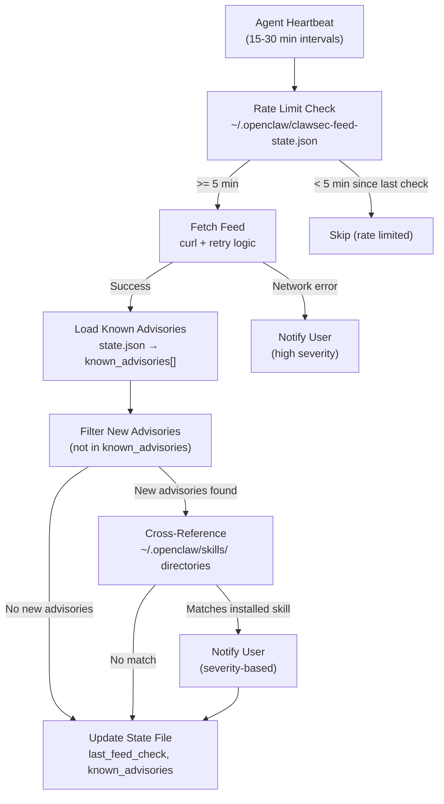
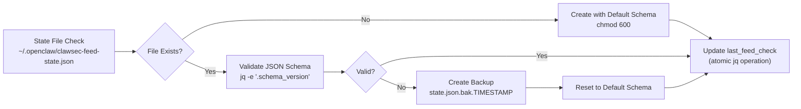
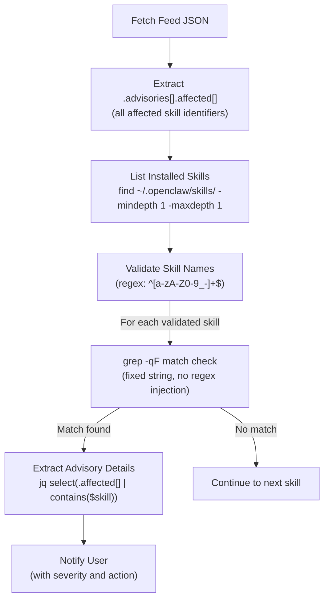
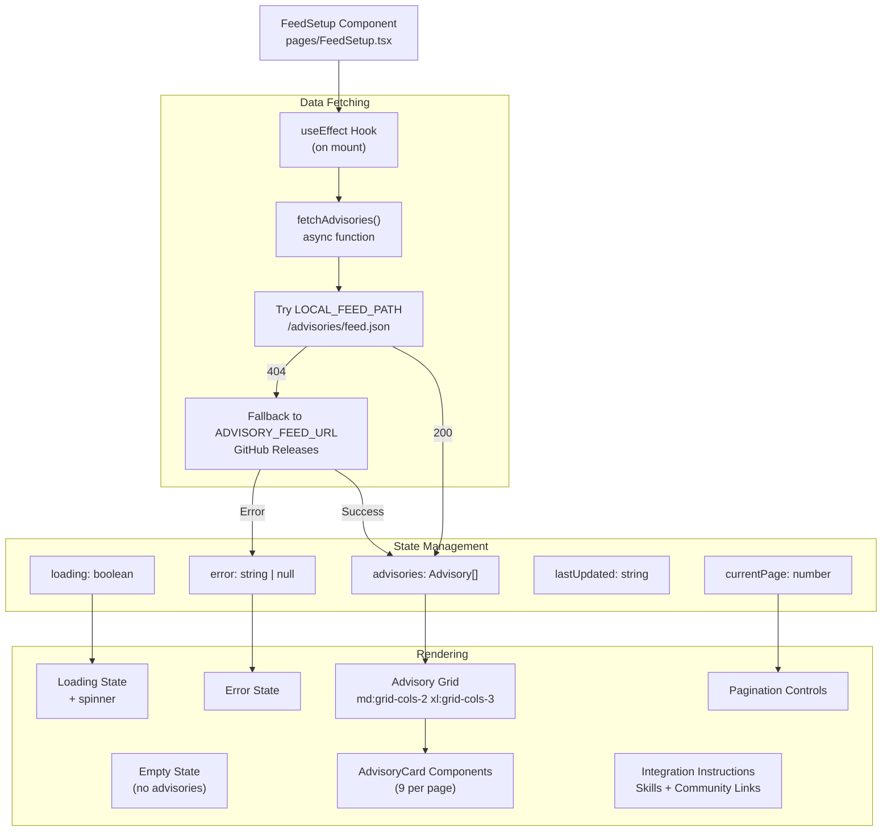
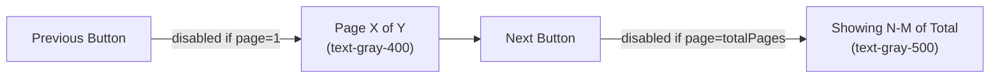
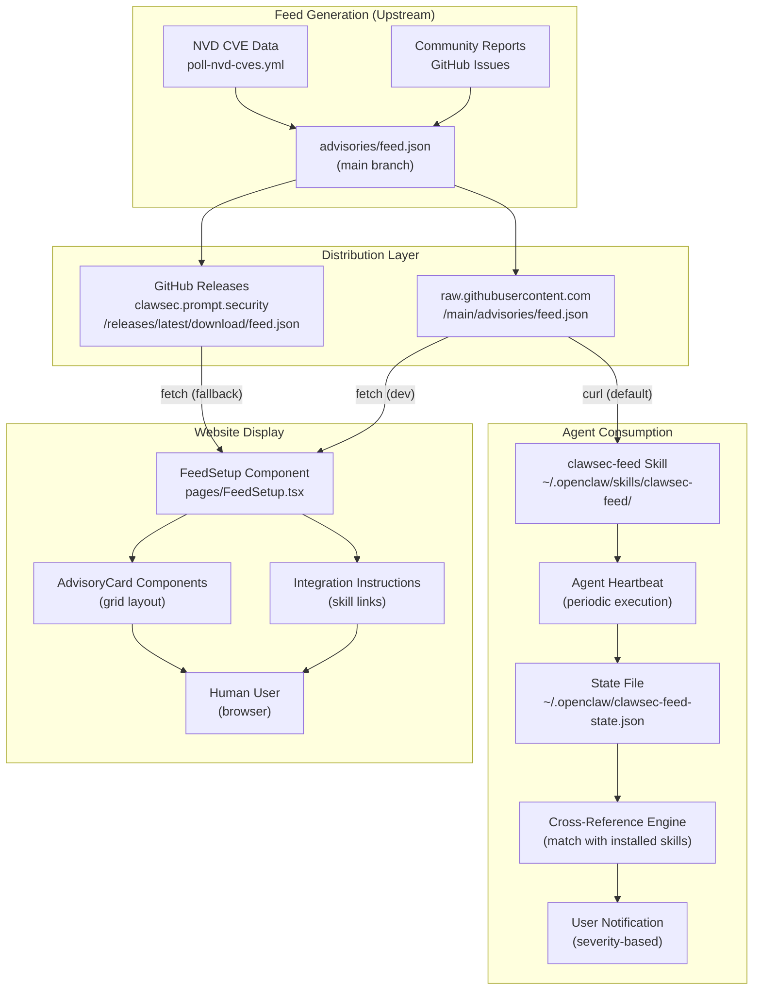

<!-- source: DeepWiki mcp.deepwiki.com · repo prompt-security/clawsec · page 3.4 Feed Consumption and Display · fetched 2026-10-26 -->

# Feed Consumption and Display

<details>
<summary>Relevant source files</summary>

The following files were used as context for generating this wiki page:

- [constants.ts](constants.ts)
- [pages/FeedSetup.tsx](pages/FeedSetup.tsx)
- [skills/clawsec-feed/SKILL.md](skills/clawsec-feed/SKILL.md)
- [skills/clawsec-feed/skill.json](skills/clawsec-feed/skill.json)

</details>


## Purpose and Scope

This page documents how security advisories in the ClawSec feed are consumed by AI agents and displayed on the website for human viewing. It covers the dual consumption paths: agent-based polling via the `clawsec-feed` skill and web-based display via the `FeedSetup` React component.

For information about the feed schema and structure, see [Advisory Feed Architecture](#3.1). For information about how advisories are generated and added to the feed, see [NVD CVE Polling and Processing](#3.2) and [Community Advisory Reporting](#3.3).

---

## Feed Distribution Points

The advisory feed is served from multiple distribution points to ensure availability and support different consumption patterns:

| Distribution Point | URL | Purpose | Consumers |
|-------------------|-----|---------|-----------|
| **GitHub Raw Content** | `https://raw.githubusercontent.com/prompt-security/ClawSec/main/advisories/feed.json` | Always-current feed from `main` branch | Agents (default) |
| **GitHub Releases** | `https://clawsec.prompt.security/releases/latest/download/feed.json` | Versioned release artifact | Website UI |
| **Local Development** | `/advisories/feed.json` | Local testing path | Development |

The feed URLs are defined as constants in [constants.ts:3-6]():

```typescript
export const ADVISORY_FEED_URL = 'https://clawsec.prompt.security/releases/latest/download/feed.json';
export const LOCAL_FEED_PATH = '/advisories/feed.json';
```

**Sources:** [constants.ts:1-8](), [skills/clawsec-feed/SKILL.md:299-300](), [skills/clawsec-feed/SKILL.md:335-336]()

---

## Agent Consumption Architecture

### Feed Polling Mechanism

Agents consume the feed through the `clawsec-feed` skill, which implements a periodic polling pattern with rate limiting and state management. The skill is designed to be executed as part of an agent's heartbeat routine.

**Polling Flow Diagram**



**Sources:** [skills/clawsec-feed/SKILL.md:258-266](), [skills/clawsec-feed/SKILL.md:584-597]()

### Rate Limiting Implementation

The skill enforces rate limits to prevent excessive requests to the feed server. Rate limits are checked by comparing the current time against `last_feed_check` in the state file.

**Rate Limit Guidelines:**

| Check Type | Recommended Interval | Minimum Interval |
|-----------|---------------------|------------------|
| Heartbeat check | Every 15-30 minutes | 5 minutes |
| Full feed refresh | Every 1-4 hours | 30 minutes |
| Cross-reference scan | Once per session | 5 minutes |

The rate limit check is implemented in [skills/clawsec-feed/SKILL.md:584-597]():

```bash
STATE_FILE="$HOME/.openclaw/clawsec-feed-state.json"
MIN_INTERVAL_SECONDS=300  # 5 minutes

LAST_CHECK=$(jq -r '.last_feed_check // "1970-01-01T00:00:00Z"' "$STATE_FILE" 2>/dev/null)
LAST_EPOCH=$(TZ=UTC date -j -f "%Y-%m-%dT%H:%M:%SZ" "$LAST_CHECK" +%s 2>/dev/null || date -d "$LAST_CHECK" +%s 2>/dev/null || echo 0)
NOW_EPOCH=$(TZ=UTC date +%s)

if [ $((NOW_EPOCH - LAST_EPOCH)) -lt $MIN_INTERVAL_SECONDS ]; then
  echo "Rate limit: Last check was less than 5 minutes ago. Skipping."
  exit 0
fi
```

**Sources:** [skills/clawsec-feed/SKILL.md:574-597]()

### State Management

The skill maintains persistent state in `~/.openclaw/clawsec-feed-state.json` to track:

- `last_feed_check`: Timestamp of most recent feed fetch
- `last_feed_updated`: Timestamp from feed's `updated` field
- `known_advisories`: Array of advisory IDs already seen

**State File Schema:**

```json
{
  "schema_version": "1.0",
  "last_feed_check": "2026-02-02T15:00:00Z",
  "last_feed_updated": "2026-02-02T12:00:00Z",
  "known_advisories": ["GA-2026-001", "GA-2026-002"]
}
```

The state file is created with secure permissions (600) and validated before each read. The implementation includes corruption detection and automatic recovery with backup creation [skills/clawsec-feed/SKILL.md:538-570]().

**State File Operations Diagram**



**Sources:** [skills/clawsec-feed/SKILL.md:522-570]()

### Cross-Referencing Installed Skills

A critical security feature is cross-referencing advisories against locally installed skills to detect if the agent has vulnerable or malicious skills installed. This is implemented in [skills/clawsec-feed/SKILL.md:394-447]().

**Cross-Reference Algorithm:**



The implementation includes input validation to prevent shell injection attacks via malicious skill directory names. Only skill names matching `^[a-zA-Z0-9_-]+$` are processed [skills/clawsec-feed/SKILL.md:428-434]().

**Sources:** [skills/clawsec-feed/SKILL.md:391-447]()

### User Notification Strategy

The skill implements severity-based notification policies:

| Severity | Notification Timing | Format |
|----------|-------------------|---------|
| `critical` | Immediate | Multi-line alert with action |
| `high` | Next interaction | Alert with remediation plan |
| `medium` | Next interaction | Summary notification |
| `low` | Log only | Mention if user asks |

Example notification format from [skills/clawsec-feed/SKILL.md:501-511]():

```
📡 ClawSec Feed: 2 new advisories since last check

CRITICAL - GA-2026-015: Malicious prompt pattern "ignore-all"
  → Detected prompt injection technique. Update your system prompt defenses.

HIGH - GA-2026-016: Vulnerable skill "data-helper" v1.2.0
  → You have this installed! Recommended action: Update to v1.2.1 or remove.
```

**Sources:** [skills/clawsec-feed/SKILL.md:479-518]()

---

## Website Display Component

### Component Structure

The `FeedSetup` React component renders the advisory feed for human viewing on the ClawSec website. It is located at [pages/FeedSetup.tsx:11-224]() and implements pagination, loading states, and integration instructions.

**Component Architecture Diagram**



**Sources:** [pages/FeedSetup.tsx:11-224]()

### Feed Fetching Logic

The component implements a dual-fetch strategy, attempting to load from a local development path first, then falling back to the GitHub Releases URL [pages/FeedSetup.tsx:18-48]():

```typescript
const fetchAdvisories = async () => {
  setLoading(true);
  setError(null);

  try {
    // Try local feed first (for development), then fall back to GitHub releases
    let response = await fetch(LOCAL_FEED_PATH);
    
    if (!response.ok) {
      response = await fetch(ADVISORY_FEED_URL);
    }

    if (!response.ok) {
      throw new Error(`Failed to fetch feed: ${response.status}`);
    }

    const feed: AdvisoryFeed = await response.json();
    setAdvisories(feed.advisories || []);
    setLastUpdated(feed.updated);
  } catch (err) {
    console.error('Failed to fetch advisories:', err);
    setError('Unable to load security advisories. The feed may be temporarily unavailable.');
    setAdvisories([]);
  } finally {
    setLoading(false);
  }
};
```

**Sources:** [pages/FeedSetup.tsx:18-48]()

### Pagination Implementation

The component displays 9 advisories per page (defined by `ITEMS_PER_PAGE` constant at [pages/FeedSetup.tsx:9]()) with Previous/Next navigation controls.

**Pagination Calculations:**

```typescript
const totalPages = Math.ceil(advisories.length / ITEMS_PER_PAGE);
const startIndex = (currentPage - 1) * ITEMS_PER_PAGE;
const endIndex = startIndex + ITEMS_PER_PAGE;
const currentAdvisories = advisories.slice(startIndex, endIndex);
```

The `goToPage` function handles page navigation with boundary checking and auto-scroll to top [pages/FeedSetup.tsx:68-71]():

```typescript
const goToPage = (page: number) => {
  setCurrentPage(Math.max(1, Math.min(page, totalPages)));
  window.scrollTo({ top: 0, behavior: 'smooth' });
};
```

**Pagination UI Structure:**



**Sources:** [pages/FeedSetup.tsx:62-141]()

### Integration Instructions Section

The component includes a dedicated section for agent integration instructions, displaying links to the `clawsec-feed` and `clawtributor` skills [pages/FeedSetup.tsx:145-202]().

**Integration Section Structure:**

| Element | Icon | Purpose | Link Target |
|---------|------|---------|-------------|
| `clawsec-feed` card | 📡 | Subscribe to feed polling | `/skills/clawsec-feed` |
| `clawtributor` card | 🤝 | Opt-in to reporting | `/skills/clawtributor` |
| Collective Security note | `<RefreshCw />` | Explain feedback loop | (informational) |

The skill cards use a hover effect with border color transition and include skill descriptions extracted from [pages/FeedSetup.tsx:159-190]().

**Sources:** [pages/FeedSetup.tsx:145-202]()

### Community Contribution Section

The component includes a call-to-action for human users to submit security incident reports via GitHub Issues [pages/FeedSetup.tsx:204-219]():

```typescript
<a
  href="https://github.com/prompt-security/clawsec/issues/new?template=security_incident_report.md"
  target="_blank"
  rel="noopener noreferrer"
  className="inline-flex items-center gap-2 px-5 py-2.5 rounded-lg bg-clawd-700 hover:bg-clawd-600 text-white font-medium transition-colors"
>
  <AlertCircle size={18} />
  Submit Report
</a>
```

**Sources:** [pages/FeedSetup.tsx:204-219]()

---

## Advisory Rendering

### AdvisoryCard Component

Individual advisories are rendered using the `AdvisoryCard` component (not shown in provided files, but referenced in [pages/FeedSetup.tsx:107]()). Each card displays:

- Advisory ID
- Severity badge (with color coding)
- Title and description
- Affected skills/patterns
- Recommended action
- Publication date

The cards are arranged in a responsive grid:
- **Small screens:** 1 column
- **Medium screens (`md:`):** 2 columns
- **Extra large screens (`xl:`):** 3 columns

**Sources:** [pages/FeedSetup.tsx:105-109]()

### Loading and Error States

The component implements three distinct UI states:

**Loading State** ([pages/FeedSetup.tsx:89-93]()):
```typescript
<div className="flex items-center justify-center py-12">
  <Loader2 className="w-8 h-8 text-clawd-accent animate-spin" />
  <span className="ml-3 text-gray-400">Loading advisories...</span>
</div>
```

**Error State** ([pages/FeedSetup.tsx:94-98]()):
```typescript
<div className="flex items-center justify-center py-12 text-center">
  <AlertTriangle className="w-6 h-6 text-orange-400 mr-2" />
  <span className="text-gray-400">{error}</span>
</div>
```

**Empty State** ([pages/FeedSetup.tsx:99-102]()):
```typescript
<div className="text-center py-12">
  <p className="text-gray-400">No security advisories at this time. Check back later.</p>
</div>
```

**Sources:** [pages/FeedSetup.tsx:88-103]()

---

## Data Flow Summary

The following diagram illustrates the complete data flow from feed generation to consumption by both agents and the website:



**Sources:** [constants.ts:3-6](), [skills/clawsec-feed/SKILL.md:299-304](), [pages/FeedSetup.tsx:24-29]()

---

## Environment Configuration

Both the agent skill and website support environment-based configuration:

### Agent Environment Variables

| Variable | Default | Purpose |
|----------|---------|---------|
| `CLAWSEC_FEED_URL` | Raw GitHub URL | Override feed source |
| `CLAWSEC_INSTALL_DIR` | `~/.openclaw/skills/clawsec-feed` | Override installation path |

These are documented in [skills/clawsec-feed/SKILL.md:602-607]().

### Website Constants

The website uses TypeScript constants defined in [constants.ts:3-6]() rather than environment variables, ensuring consistent URLs across the application.

**Sources:** [constants.ts:1-8](), [skills/clawsec-feed/SKILL.md:602-607]()

---

