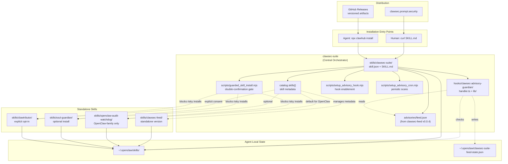
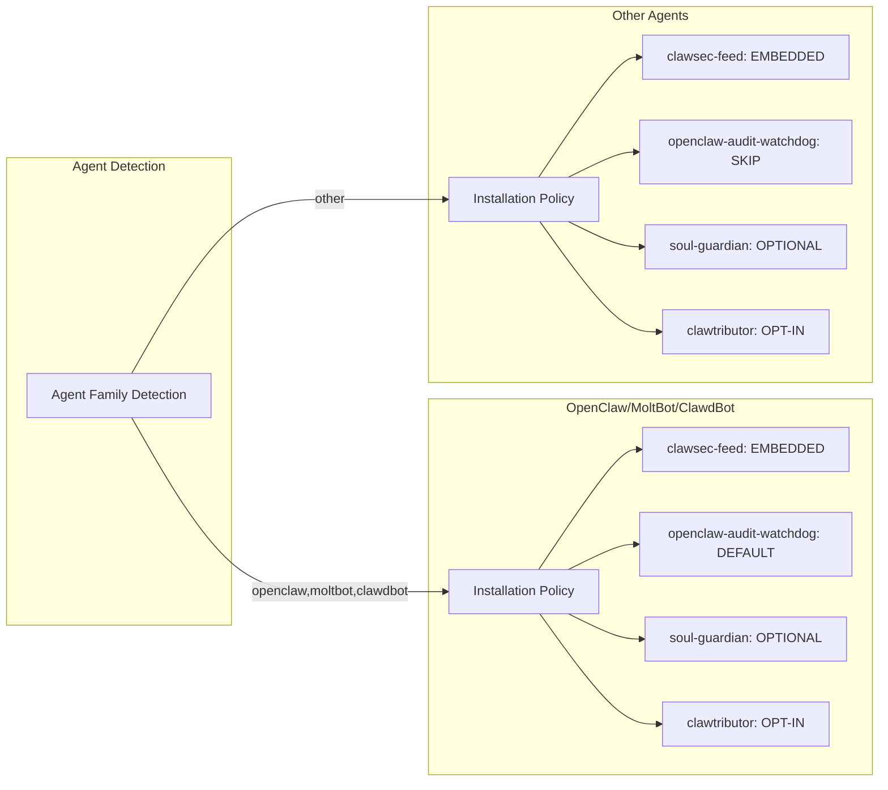
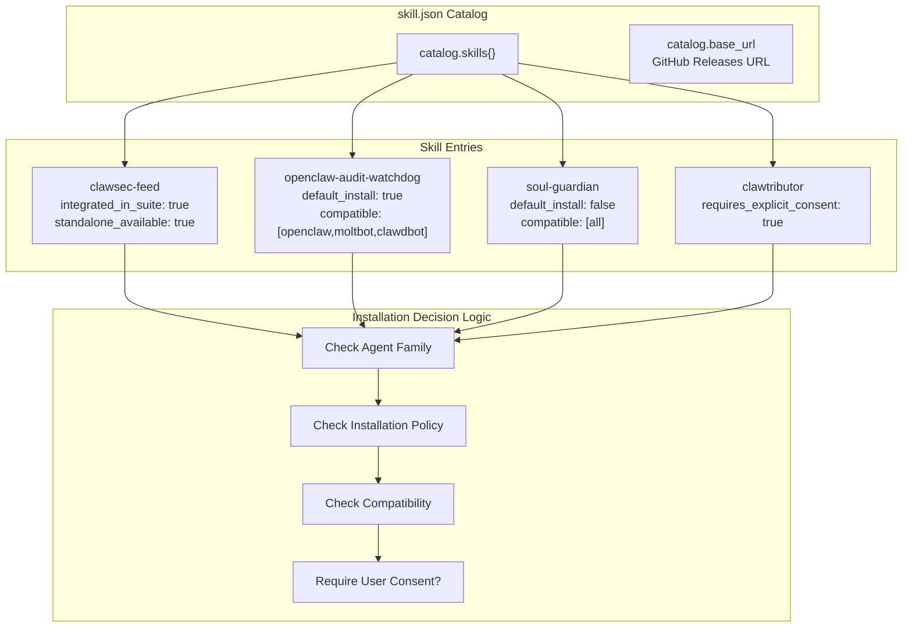

<!-- source: DeepWiki mcp.deepwiki.com · repo prompt-security/clawsec · page 4 Skills Ecosystem · fetched 2026-10-26 -->

# Skills Ecosystem

<details>
<summary>Relevant source files</summary>

The following files were used as context for generating this wiki page:

- [README.md](README.md)
- [skills/clawsec-suite/SKILL.md](skills/clawsec-suite/SKILL.md)
- [skills/clawsec-suite/skill.json](skills/clawsec-suite/skill.json)

</details>


## Purpose and Scope

This document provides an overview of the modular security skills that comprise ClawSec and how they work together to protect AI agents. It covers the architecture of the skill system, the five core skills, their relationships and dependencies, installation policies, and common structural patterns. For detailed information about individual skills, see the child sections: [clawsec-suite](#4.1), [clawsec-feed](#4.2), [soul-guardian](#4.3), [openclaw-audit-watchdog](#4.4), and [clawtributor](#4.5). For information about the advisory data that feeds these skills, see [Security Advisory System](#3).

---

## Skill Architecture Overview

ClawSec implements a modular skill architecture where each skill is a self-contained security capability that can be installed and managed independently. The skills are distributed as versioned packages with integrity verification and follow a common structural pattern.

### Core Design Principles

**Modular and Composable**: Each skill provides a specific security capability and can be installed independently. The `clawsec-suite` acts as a meta-skill that orchestrates the installation and management of other skills.

**Integrity-Verified**: All skills include SHA256 checksums in `checksums.json` files that are validated during installation to prevent tampering [skills/clawsec-suite/SKILL.md:59-95]().

**Agent-Aware**: Skills detect the agent family (OpenClaw/MoltBot/ClawdBot vs other) and adjust their behavior accordingly [skills/clawsec-suite/skill.json:109-145]().

**Non-Destructive by Default**: Skills that modify files or remove components require explicit user approval before taking action [skills/clawsec-suite/SKILL.md:223-234]().

**Sources**: [skills/clawsec-suite/SKILL.md](), [skills/clawsec-suite/skill.json](), [README.md]()

---

## The Five Core Skills

ClawSec consists of five specialized security skills that work together to provide comprehensive protection for AI agents.

| Skill | Emoji | Purpose | Default Install | Agent Compatibility |
|-------|-------|---------|-----------------|---------------------|
| **clawsec-suite** | 📦 | Central orchestrator and skill manager with embedded advisory feed monitoring | ✅ Entry point | Universal |
| **clawsec-feed** | 📡 | Security advisory feed monitoring (now embedded in suite) | ✅ Embedded in suite | Universal |
| **openclaw-audit-watchdog** | 🔭 | Automated daily security audits with email/DM reporting | ✅ Default for OpenClaw family | OpenClaw/MoltBot/ClawdBot only |
| **soul-guardian** | 👻 | Drift detection and auto-restore for critical agent files | ⚙️ Optional | Universal |
| **clawtributor** | 🤝 | Community incident reporting with telemetry sharing | ❌ Explicit opt-in required | Universal |

**Sources**: [README.md:80-91](), [skills/clawsec-suite/SKILL.md:23-34](), [skills/clawsec-suite/skill.json:101-147]()

---

## Skill Relationships and Dependencies



**Key Relationships**

**Embedding**: `clawsec-suite` directly embeds the advisory feed from `clawsec-feed` v0.0.4, eliminating the need to install `clawsec-feed` as a separate skill [skills/clawsec-suite/skill.json:84-99](). The embedded feed file is located at `skills/clawsec-suite/advisories/feed.json` [skills/clawsec-suite/skill.json:37-40]().

**Orchestration**: The suite acts as a skill manager, maintaining a catalog of available skills in its `skill.json` under the `catalog.skills` object [skills/clawsec-suite/skill.json:101-147](). It provides installation helpers and approval gates for risky installations.

**Hook Integration**: The suite includes an OpenClaw hook package at `hooks/clawsec-advisory-guardian/` that monitors advisories, cross-references installed skills, and implements approval-gated responses [skills/clawsec-suite/skill.json:42-65]().

**State Management**: Advisory polling state is tracked in `~/.openclaw/clawsec-suite-feed-state.json` [skills/clawsec-suite/SKILL.md:167-169](), separate from the skills directory to survive reinstallation.

**Sources**: [skills/clawsec-suite/SKILL.md:14-34](), [skills/clawsec-suite/skill.json:84-99](), [skills/clawsec-suite/skill.json:101-147]()

---

## Installation Policies and Compatibility

Different skills have different installation policies based on their purpose, compatibility, and privacy implications.

### Installation Policy Matrix



### Policy Definitions

| Policy | Behavior | Approval Required | Example Skills |
|--------|----------|-------------------|----------------|
| **EMBEDDED** | Bundled directly in `clawsec-suite`, no separate install needed | No | `clawsec-feed` |
| **DEFAULT** | Automatically installed for compatible agents | No | `openclaw-audit-watchdog` |
| **OPTIONAL** | User can choose to install, recommended but not required | No | `soul-guardian` |
| **OPT-IN** | Requires explicit user consent, shares anonymized data | Yes | `clawtributor` |
| **SKIP** | Not installed, incompatible with agent family | N/A | `openclaw-audit-watchdog` on non-OpenClaw agents |

**Compatibility Constraints**: The `openclaw-audit-watchdog` skill uses OpenClaw-specific commands (`openclaw security audit`) and is only compatible with the OpenClaw/MoltBot/ClawdBot agent family [skills/clawsec-suite/skill.json:116-125](). Other skills are universal and work with any agent.

**Privacy-Sensitive Skills**: `clawtributor` is marked with `requires_explicit_consent: true` because it submits security incident reports to GitHub Issues, which may include anonymized agent state information [skills/clawsec-suite/skill.json:136-145]().

**Sources**: [skills/clawsec-suite/skill.json:101-147](), [README.md:80-91]()

---

## Skill File Structure

All ClawSec skills follow a common file structure pattern that enables consistent installation, validation, and integrity verification.

### Standard Skill Directory Layout

```
skills/<skill-name>/
├── skill.json           # Metadata, SBOM, OpenClaw configuration
├── SKILL.md             # Agent-readable installation instructions
├── README.md            # Human-readable documentation
├── checksums.json       # SHA256 hashes for all files (generated during release)
├── scripts/             # Executable scripts (if applicable)
├── hooks/               # OpenClaw hook packages (if applicable)
└── <additional files>   # Source code, configs, data files
```

### skill.json Structure

Every skill includes a `skill.json` file with the following required fields:

```json
{
  "name": "skill-name",
  "version": "X.Y.Z",
  "description": "Short description of the skill's purpose",
  "author": "prompt-security",
  "license": "MIT",
  "homepage": "https://clawsec.prompt.security/",
  "keywords": ["security", "..."],
  "sbom": {
    "files": [
      {
        "path": "SKILL.md",
        "required": true,
        "description": "Purpose of this file"
      }
    ]
  },
  "openclaw": {
    "emoji": "🔭",
    "category": "security",
    "requires": {
      "bins": ["curl", "jq"]
    },
    "triggers": ["keyword1", "keyword2"]
  }
}
```

**Key Sections**:

**Metadata** (`name`, `version`, `description`, `author`, `license`, `homepage`): Basic skill identification [skills/clawsec-suite/skill.json:1-7]().

**SBOM** (`sbom.files`): Software Bill of Materials listing all files that comprise the skill, their paths, whether they're required, and descriptions [skills/clawsec-suite/skill.json:24-81]().

**OpenClaw Integration** (`openclaw`): Configuration for OpenClaw family agents, including emoji, category, binary dependencies, and trigger keywords [skills/clawsec-suite/skill.json:149-174]().

**Extended Metadata**: Skills like `clawsec-suite` may include additional sections like `embedded_components` and `catalog` for managing other skills [skills/clawsec-suite/skill.json:83-147]().

**Sources**: [skills/clawsec-suite/skill.json:1-175]()

---

## Skill Catalog Management

The `clawsec-suite` maintains a catalog of available ClawSec skills in its `skill.json` that provides metadata for installation decisions.

### Catalog Structure



### Catalog Fields

The catalog for each skill includes:

| Field | Type | Purpose | Example |
|-------|------|---------|---------|
| `description` | string | Human-readable purpose | "Advisory monitoring is now embedded in clawsec-suite" |
| `integrated_in_suite` | boolean | Whether skill is embedded in suite | `true` for `clawsec-feed` |
| `standalone_available` | boolean | Whether standalone install is possible | `true` for `clawsec-feed` |
| `default_install` | boolean | Whether to install automatically | `true` for `openclaw-audit-watchdog` |
| `requires_explicit_consent` | boolean | Whether user must explicitly approve | `true` for `clawtributor` |
| `compatible` | array | Agent families that support this skill | `["openclaw", "moltbot", "clawdbot"]` or `["openclaw", "moltbot", "clawdbot", "other"]` |
| `note` | string | Additional context for installation decision | "Tailored for OpenClaw/MoltBot family" |

**Deprecation Handling**: The catalog indicates that standalone `clawsec-feed` installations are being deprecated in favor of the embedded version in `clawsec-suite`, but the standalone skill remains available for backwards compatibility [skills/clawsec-suite/skill.json:84-99]().

**Sources**: [skills/clawsec-suite/skill.json:101-147]()

---

## Common Patterns Across Skills

All ClawSec skills follow consistent patterns for state management, installation verification, and user interaction.

### State Management Pattern

Skills that need to persist state across executions use JSON state files in the home directory:

- **Suite feed state**: `~/.openclaw/clawsec-suite-feed-state.json` [skills/clawsec-suite/SKILL.md:167]()
- **Standalone feed state**: `~/.openclaw/clawsec-feed-state.json`
- **Guardian baselines**: `~/.openclaw/skills/soul-guardian/baselines.json`
- **Contributor reports**: `~/.openclaw/skills/clawtributor/clawtributor-reports/`

State files are stored outside the `~/.openclaw/skills/` directory when they need to survive skill reinstallation [skills/clawsec-suite/SKILL.md:167-169]().

### Installation Verification Pattern

All skills follow a common verification workflow during installation:

1. **Download checksums.json**: Fetch the checksums manifest first [skills/clawsec-suite/SKILL.md:59-64]()
2. **Validate manifest format**: Ensure required fields (`skill`, `version`, `files`) are present [skills/clawsec-suite/SKILL.md:61-64]()
3. **Download each file**: Fetch files listed in the manifest [skills/clawsec-suite/SKILL.md:66-76]()
4. **Immediate verification**: Verify SHA256 checksum after each file download [skills/clawsec-suite/SKILL.md:78-90]()
5. **Install verified files**: Copy files to destination using paths from manifest [skills/clawsec-suite/SKILL.md:97-106]()
6. **Set permissions**: Apply secure permissions (600 for skill.json, 644 for others) [skills/clawsec-suite/SKILL.md:108-109]()

### Approval Gate Pattern

Skills that perform destructive actions or share data implement explicit user approval gates:

- **Double confirmation**: First request establishes intent, second request after seeing details confirms action [skills/clawsec-suite/SKILL.md:139-159]()
- **Exit code signaling**: Scripts exit with code `42` when approval is blocked, allowing agents to detect and handle the gate [skills/clawsec-suite/SKILL.md:150]()
- **Advisory context**: Display full advisory details (severity, description, affected versions) before requesting confirmation [skills/clawsec-suite/SKILL.md:148-150]()
- **Non-destructive default**: No destructive action occurs without explicit approval [skills/clawsec-suite/SKILL.md:233]()

**Sources**: [skills/clawsec-suite/SKILL.md:59-159](), [skills/clawsec-suite/SKILL.md:223-234]()

---

## Skill Distribution and Versioning

Skills are distributed through multiple channels with consistent versioning across all distribution points.

### Distribution Channels

| Channel | URL Pattern | Purpose | Verification |
|---------|-------------|---------|--------------|
| **GitHub Releases** | `github.com/prompt-security/clawsec/releases/download/<skill>-v<version>/` | Primary artifact hosting | checksums.json |
| **ClawHub Registry** | `npx clawhub@latest install <skill>` | NPM-based installer | Built-in |
| **GitHub Pages** | `clawsec.prompt.security/releases/` | Web interface and API | checksums.json |
| **Raw Content** | `raw.githubusercontent.com/prompt-security/clawsec/main/advisories/feed.json` | Advisory feed polling | Feed version field |

### Version Synchronization

All skill artifacts must maintain version consistency:

- **skill.json version**: `"version": "X.Y.Z"` [skills/clawsec-suite/skill.json:3]()
- **SKILL.md frontmatter**: `version: X.Y.Z` [skills/clawsec-suite/SKILL.md:3]()
- **Git tag**: `<skill-name>-vX.Y.Z` format
- **checksums.json**: `"version": "X.Y.Z"` in manifest

The CI pipeline enforces version synchronization through the `validate-pr-version-sync` job that checks consistency between `skill.json` and `SKILL.md` during pull requests. See [Skill Release Pipeline](#5.1) for details.

**Sources**: [skills/clawsec-suite/SKILL.md:1-10](), [skills/clawsec-suite/skill.json:1-7]()

---

