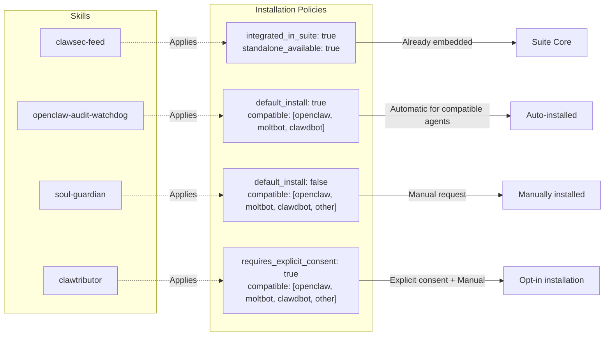
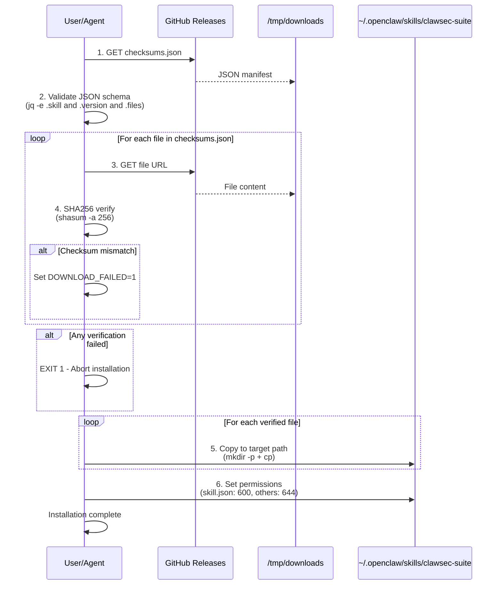
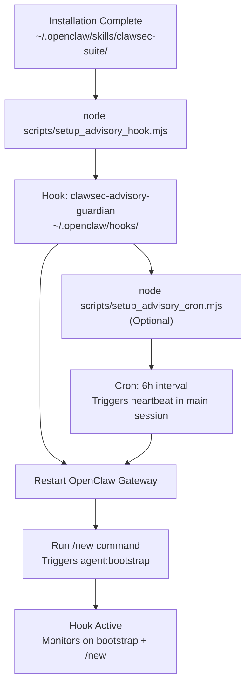
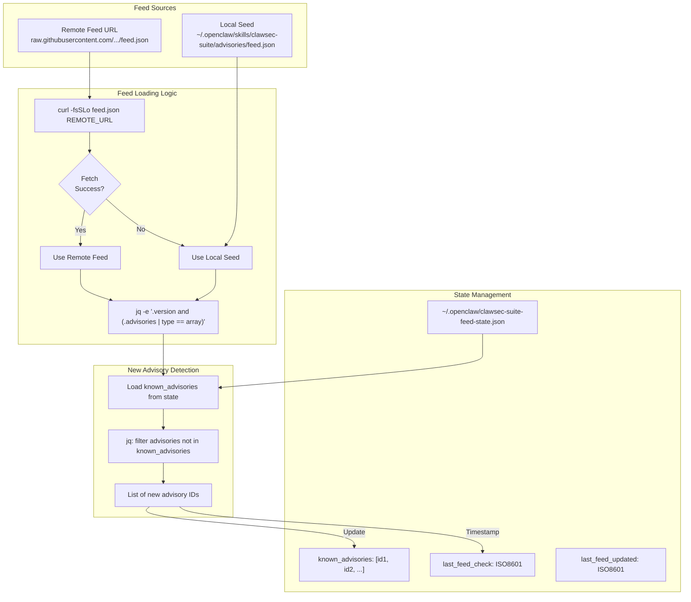
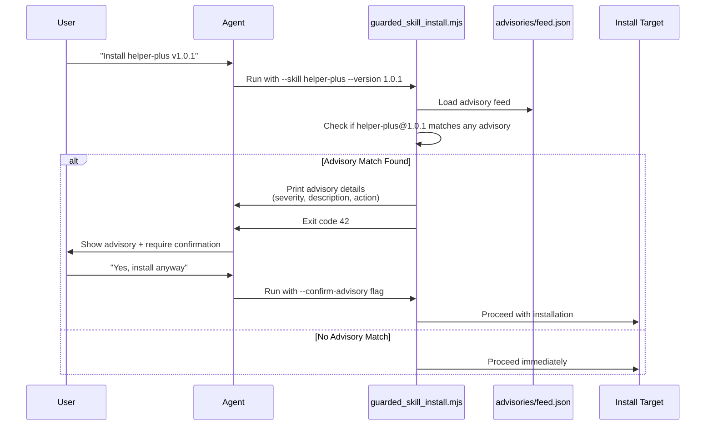
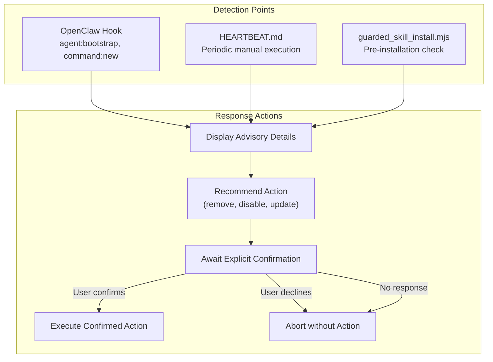

<!-- source: DeepWiki mcp.deepwiki.com · repo prompt-security/clawsec · page 4.1 clawsec-suite: The Central Orchestrator · fetched 2026-10-26 -->

# clawsec-suite: The Central Orchestrator

<details>
<summary>Relevant source files</summary>

The following files were used as context for generating this wiki page:

- [README.md](README.md)
- [skills/clawsec-suite/SKILL.md](skills/clawsec-suite/SKILL.md)
- [skills/clawsec-suite/skill.json](skills/clawsec-suite/skill.json)

</details>


## Purpose and Scope

The **clawsec-suite** is a meta-skill that orchestrates the installation, configuration, and management of the ClawSec security ecosystem. It serves as the primary entry point for deploying security protections to AI agents and acts as a "skill-of-skills" manager.

This page documents the suite's architecture, embedded components, skills catalog, and core orchestration mechanisms. For detailed information on specific subsystems:
- Setup automation: see [Suite Installation and Setup Scripts](#4.1.1)
- Double-confirmation gating: see [Guarded Skill Installation](#4.1.2)
- OpenClaw hook integration: see [Advisory Guardian Hook](#4.1.3)
- Periodic security checks: see [Heartbeat Workflow](#4.1.4)

For the standalone advisory feed skill that was merged into the suite, see [clawsec-feed: Advisory Feed Monitoring](#4.2).

**Sources:** [skills/clawsec-suite/SKILL.md:1-19](), [skills/clawsec-suite/skill.json:1-23](), [README.md:76-99]()

---

## Architecture Overview

The suite operates as a centralized manager with three primary responsibilities: (1) embedding core security functionality, (2) maintaining a catalog of optional skills, and (3) providing security-gated installation workflows.

### Component Architecture

```mermaid
graph TB
    subgraph "clawsec-suite Core"
        SKILLMD["SKILL.md<br/>Installation Instructions"]
        SkillJSON["skill.json<br/>Metadata + Catalog"]
        HEARTBEAT["HEARTBEAT.md<br/>Periodic Checks"]
        
        subgraph "Embedded Feed"
            FeedJSON["advisories/feed.json<br/>v0.0.4 from clawsec-feed"]
        end
        
        subgraph "Hook Package"
            HookMD["hooks/clawsec-advisory-guardian/HOOK.md"]
            HookHandler["hooks/clawsec-advisory-guardian/handler.ts"]
            HookUtils["hooks/clawsec-advisory-guardian/lib/utils.mjs"]
            HookVersion["hooks/clawsec-advisory-guardian/lib/version.mjs"]
            HookFeed["hooks/clawsec-advisory-guardian/lib/feed.mjs"]
        end
        
        subgraph "Setup Scripts"
            SetupHook["scripts/setup_advisory_hook.mjs"]
            SetupCron["scripts/setup_advisory_cron.mjs"]
            GuardedInstall["scripts/guarded_skill_install.mjs"]
        end
    end
    
    subgraph "External Skills Catalog"
        CatalogDef["skill.json:catalog"]
        FeedStandalone["clawsec-feed<br/>standalone_available: true"]
        Watchdog["openclaw-audit-watchdog<br/>default_install: true"]
        Guardian["soul-guardian<br/>default_install: false"]
        Contributor["clawtributor<br/>requires_explicit_consent: true"]
    end
    
    subgraph "Runtime State"
        StateFile["~/.openclaw/clawsec-suite-feed-state.json<br/>Advisory tracking"]
        InstalledSkills["~/.openclaw/skills/<br/>Installed skill directories"]
    end
    
    SKILLMD -->|"References"| SkillJSON
    SkillJSON -->|"Defines"| CatalogDef
    CatalogDef -->|"Lists"| FeedStandalone
    CatalogDef -->|"Lists"| Watchdog
    CatalogDef -->|"Lists"| Guardian
    CatalogDef -->|"Lists"| Contributor
    
    SetupHook -->|"Installs"| HookHandler
    SetupCron -->|"Schedules"| HEARTBEAT
    GuardedInstall -->|"Reads"| FeedJSON
    GuardedInstall -->|"Checks"| StateFile
    
    HookHandler -->|"Reads"| FeedJSON
    HookHandler -->|"Updates"| StateFile
    HookHandler -->|"Cross-refs"| InstalledSkills
    
    HEARTBEAT -->|"Polls"| FeedJSON
    HEARTBEAT -->|"Updates"| StateFile
    
    style "clawsec-suite Core" fill:#f9f9f9,stroke:#333,stroke-width:2px
    style "Embedded Feed" fill:#e8f4f8,stroke:#333
    style "Hook Package" fill:#fff8e8,stroke:#333
    style "Setup Scripts" fill:#f8e8ff,stroke:#333
```

**Diagram: clawsec-suite Component Architecture**

The suite's architecture separates concerns into four primary layers:

1. **Core Documentation Layer** (`SKILL.md`, `skill.json`, `HEARTBEAT.md`) - Provides agent-readable instructions and metadata
2. **Embedded Feed Layer** (`advisories/feed.json`) - Bundled advisory data eliminating external dependency
3. **Hook Package** (`hooks/clawsec-advisory-guardian/*`) - OpenClaw integration for real-time advisory monitoring
4. **Setup Scripts** (`scripts/*.mjs`) - Automation for hook installation, cron scheduling, and guarded installs

**Sources:** [skills/clawsec-suite/skill.json:24-81](), [skills/clawsec-suite/SKILL.md:23-34]()

---

## Embedded vs Optional Components

The suite distinguishes between built-in functionality and installable skills to balance security coverage with agent compatibility.

### Built-in Components

| Component | Path | Function |
|-----------|------|----------|
| **Advisory Feed** | `advisories/feed.json` | Embedded seed from `clawsec-feed` v0.0.4 |
| **Guardian Hook** | `hooks/clawsec-advisory-guardian/` | Real-time advisory monitoring and response |
| **Heartbeat** | `HEARTBEAT.md` | Portable periodic security check procedure |
| **Setup Scripts** | `scripts/setup_advisory_*.mjs` | Hook and cron installers |
| **Guarded Installer** | `scripts/guarded_skill_install.mjs` | Double-confirmation skill installer |

**Sources:** [skills/clawsec-suite/SKILL.md:23-29](), [skills/clawsec-suite/skill.json:37-40]()

### Optional Skills Catalog

The suite maintains a catalog of additional security skills with different installation policies:



**Diagram: Skills Catalog Installation Policies**

**Sources:** [skills/clawsec-suite/skill.json:101-147](), [README.md:82-91]()

### Catalog Structure

The catalog is defined in `skill.json` under the `catalog` key:

```json
{
  "catalog": {
    "description": "Available protections in the ClawSec suite",
    "base_url": "https://clawsec.prompt.security/releases/download",
    "skills": { ... }
  }
}
```

Each skill entry includes:
- `description` - Brief capability summary
- `default_install` - Automatic installation flag
- `compatible` - List of compatible agent families
- `requires_explicit_consent` - Data sharing consent requirement
- `integrated_in_suite` - Embedded vs external flag

**Sources:** [skills/clawsec-suite/skill.json:101-147]()

---

## Installation Flow

The suite provides two installation methods with identical security verification steps.

### Installation Methods Comparison

| Method | Command | Use Case |
|--------|---------|----------|
| **ClawHub** | `npx clawhub@latest install clawsec-suite` | Recommended, automatic verification |
| **Manual** | Bash script with curl + checksum verification | Offline/air-gapped environments |

**Sources:** [skills/clawsec-suite/SKILL.md:36-113]()

### Manual Installation Flow



**Diagram: Manual Installation Verification Flow**

Key security checks:
1. **JSON Schema Validation** - Ensures checksums manifest is well-formed [skills/clawsec-suite/SKILL.md:61-64]()
2. **Per-File Verification** - Each file verified before proceeding [skills/clawsec-suite/SKILL.md:66-90]()
3. **Fail-Fast on Mismatch** - Any checksum failure aborts entire installation [skills/clawsec-suite/SKILL.md:92-95]()
4. **Restrictive Permissions** - `skill.json` set to `600`, others to `644` [skills/clawsec-suite/SKILL.md:108-109]()

**Sources:** [skills/clawsec-suite/SKILL.md:46-113]()

---

## Post-Installation Setup

After installation, the suite requires setup scripts to activate advisory monitoring.

### Setup Script Execution Order



**Diagram: Post-Installation Setup Sequence**

### Required Setup: Advisory Hook

The advisory guardian hook enables automatic monitoring:

```bash
SUITE_DIR="${INSTALL_ROOT:-$HOME/.openclaw/skills}/clawsec-suite"
node "$SUITE_DIR/scripts/setup_advisory_hook.mjs"
```

This installs the hook to `~/.openclaw/hooks/clawsec-advisory-guardian/` and configures it to:
- Scan on `agent:bootstrap` event (agent startup)
- Scan on `command:new` event (`/new` command)
- Cross-reference advisories with installed skills
- Request user approval before any removal action

**Sources:** [skills/clawsec-suite/SKILL.md:115-137]()

### Optional Setup: Cron Scheduling

The cron setup script creates periodic nudges:

```bash
node "$SUITE_DIR/scripts/setup_advisory_cron.mjs"
```

Default interval: 6 hours. This triggers a main-session advisory scan without requiring agent restart.

**Sources:** [skills/clawsec-suite/SKILL.md:124-129]()

For detailed setup script behavior, see [Suite Installation and Setup Scripts](#4.1.1).

---

## Embedded Advisory Feed Integration

The suite embeds the full `clawsec-feed` v0.0.4 functionality, eliminating external dependencies.

### Feed Architecture



**Diagram: Advisory Feed Loading and State Tracking**

**Sources:** [skills/clawsec-suite/SKILL.md:162-207]()

### Feed Configuration

| Parameter | Default | Environment Variable |
|-----------|---------|---------------------|
| **Remote URL** | `https://raw.githubusercontent.com/prompt-security/clawsec/main/advisories/feed.json` | `CLAWSEC_FEED_URL` |
| **Local Seed** | `~/.openclaw/skills/clawsec-suite/advisories/feed.json` | N/A |
| **State File** | `~/.openclaw/clawsec-suite-feed-state.json` | `CLAWSEC_SUITE_STATE_FILE` |
| **Hook Rate Limit** | 300 seconds | `CLAWSEC_HOOK_INTERVAL_SECONDS` |

**Sources:** [skills/clawsec-suite/SKILL.md:162-169]()

### State File Schema

The state file tracks advisory history:

```json
{
  "schema_version": "1.0",
  "known_advisories": ["CVE-2026-12345", "CLAW-2026-0042"],
  "last_feed_check": "2026-02-01T12:00:00Z",
  "last_feed_updated": "2026-02-01T11:30:00Z"
}
```

The `known_advisories` array enables detection of new advisories since the last check. Permissions: `600` (owner read/write only).

**Sources:** [skills/clawsec-suite/SKILL.md:189-193]()

### Quick Feed Check Example

The suite provides a standalone feed check command:

```bash
FEED_URL="${CLAWSEC_FEED_URL:-https://raw.githubusercontent.com/prompt-security/clawsec/main/advisories/feed.json}"
STATE_FILE="${CLAWSEC_SUITE_STATE_FILE:-$HOME/.openclaw/clawsec-suite-feed-state.json}"

TMP="$(mktemp -d)"
trap 'rm -rf "$TMP"' EXIT

# Fetch and validate
curl -fsSLo "$TMP/feed.json" "$FEED_URL"
jq -e '.version and (.advisories | type == "array")' "$TMP/feed.json"

# Initialize state if missing
mkdir -p "$(dirname "$STATE_FILE")"
[ ! -f "$STATE_FILE" ] && echo '{"schema_version":"1.0","known_advisories":[],"last_feed_check":null,"last_feed_updated":null}' > "$STATE_FILE"

# Detect new advisories
jq -r --argfile state "$STATE_FILE" '($state.known_advisories // []) as $known | [.advisories[]?.id | select(. != null and ($known | index(.) | not))] | .[]?' "$TMP/feed.json" > "$TMP/new_ids.txt"

# Output results
if [ -s "$TMP/new_ids.txt" ]; then
  echo "New advisories detected:"
  # ... format output
else
  echo "FEED_OK - no new advisories"
fi
```

**Sources:** [skills/clawsec-suite/SKILL.md:171-207]()

---

## Guarded Installation: Double-Confirmation Flow

The suite provides `guarded_skill_install.mjs` to block risky skill installations until explicit user approval.

### Confirmation Flow



**Diagram: Double-Confirmation Installation Flow**

### Exit Code Contract

| Exit Code | Meaning | Agent Action |
|-----------|---------|--------------|
| **0** | No advisory match, installation proceeded | Continue workflow |
| **42** | Advisory match found, blocked pending confirmation | Require explicit second confirmation |
| **1** | Error (invalid arguments, feed load failure) | Abort installation |

The exit code `42` is a deliberate signal that distinguishes "blocked by advisory" from "error occurred". Agents must detect this code and prompt for explicit confirmation.

**Sources:** [skills/clawsec-suite/SKILL.md:139-159]()

### Usage Example

First request (initial intent):
```bash
SUITE_DIR="$HOME/.openclaw/skills/clawsec-suite"
node "$SUITE_DIR/scripts/guarded_skill_install.mjs" \
  --skill helper-plus \
  --version 1.0.1
# Exit 42 if advisory found
```

Second request (explicit confirmation after advisory shown):
```bash
node "$SUITE_DIR/scripts/guarded_skill_install.mjs" \
  --skill helper-plus \
  --version 1.0.1 \
  --confirm-advisory
# Proceeds with installation
```

For detailed implementation, see [Guarded Skill Installation](#4.1.2).

**Sources:** [skills/clawsec-suite/SKILL.md:144-155]()

---

## Approval-Gated Response Contract

The suite implements a non-destructive-by-default security model.

### Response Policy

When an advisory matches an installed skill:

1. **Notify** - Display advisory details (ID, severity, title, description, recommended action)
2. **Recommend** - Suggest removal or disabling for `malicious_skill` or `removal_recommended` types
3. **First Intent Recognition** - Original install request = first confirmation only
4. **Require Explicit Second Confirmation** - Ask user "Are you sure?" with full context
5. **Proceed Only After Confirmation** - No automatic removal/disable actions

This contract applies to:
- OpenClaw advisory guardian hook (see [Advisory Guardian Hook](#4.1.3))
- Heartbeat workflow guidance (see [Heartbeat Workflow](#4.1.4))
- Guarded installer (see [Guarded Skill Installation](#4.1.2))

**Sources:** [skills/clawsec-suite/SKILL.md:223-234]()

### Policy Enforcement Points



**Diagram: Approval-Gated Response Enforcement**

**Sources:** [skills/clawsec-suite/SKILL.md:223-234]()

---

## File Organization

The suite's file structure reflects its modular architecture.

### Directory Layout

```
~/.openclaw/skills/clawsec-suite/
├── SKILL.md                                 # Main documentation
├── skill.json                               # Metadata + catalog (600 perms)
├── HEARTBEAT.md                             # Portable heartbeat procedure
├── advisories/
│   └── feed.json                            # Embedded feed seed
├── hooks/
│   └── clawsec-advisory-guardian/
│       ├── HOOK.md                          # Hook metadata
│       ├── handler.ts                       # TypeScript hook handler
│       └── lib/
│           ├── utils.mjs                    # Utility functions
│           ├── version.mjs                  # Semver matching
│           └── feed.mjs                     # Feed loading
└── scripts/
    ├── setup_advisory_hook.mjs              # Hook installer
    ├── setup_advisory_cron.mjs              # Cron installer
    └── guarded_skill_install.mjs            # Guarded installer
```

### File Permissions

| File | Mode | Rationale |
|------|------|-----------|
| `skill.json` | `600` | Contains metadata, prevent unauthorized modification |
| All others | `644` | Standard read-only files |

**Sources:** [skills/clawsec-suite/SKILL.md:108-109](), [skills/clawsec-suite/skill.json:24-81]()

### SBOM (Software Bill of Materials)

The `skill.json` includes a complete SBOM listing all required files:

| File Path | Required | Description |
|-----------|----------|-------------|
| `SKILL.md` | ✓ | Suite skill documentation and installation guide |
| `HEARTBEAT.md` | ✓ | Portable heartbeat and update-check procedure |
| `advisories/feed.json` | ✓ | Embedded advisory feed seed (merged from clawsec-feed) |
| `hooks/clawsec-advisory-guardian/HOOK.md` | ✓ | OpenClaw hook metadata |
| `hooks/clawsec-advisory-guardian/handler.ts` | ✓ | OpenClaw hook handler for approval-gated actions |
| `hooks/clawsec-advisory-guardian/lib/utils.mjs` | ✓ | Shared utility functions |
| `hooks/clawsec-advisory-guardian/lib/version.mjs` | ✓ | Shared semver parsing and version matching |
| `hooks/clawsec-advisory-guardian/lib/feed.mjs` | ✓ | Shared advisory feed loading and validation |
| `scripts/setup_advisory_hook.mjs` | ✓ | Installer script for enabling the advisory guardian hook |
| `scripts/setup_advisory_cron.mjs` | ✓ | Installer script for optional periodic advisory scan cron |
| `scripts/guarded_skill_install.mjs` | ✓ | Two-step confirmation installer |

**Sources:** [skills/clawsec-suite/skill.json:24-81]()

---

## Heartbeat Integration

The suite provides `HEARTBEAT.md` as a single entrypoint for periodic security checks.

### Heartbeat Responsibilities

| Task | Description |
|------|-------------|
| **Suite Update Checks** | Compare local version with latest release |
| **Feed Polling** | Fetch remote feed, validate, detect new advisories |
| **New Advisory Detection** | Diff against `known_advisories` in state file |
| **Affected Skill Cross-Reference** | Match advisories against `~/.openclaw/skills/` |
| **Approval-Gated Response Guidance** | Recommend actions, require confirmation |
| **Persistent State Updates** | Update state file with new advisory IDs |

The heartbeat is designed to be portable and can be invoked:
- Manually by user request
- Via cron (installed by `setup_advisory_cron.mjs`)
- Via agent self-scheduled tasks

For detailed workflow, see [Heartbeat Workflow](#4.1.4).

**Sources:** [skills/clawsec-suite/SKILL.md:209-222](), [skills/clawsec-suite/skill.json:32-35]()

---

## OpenClaw Metadata and Triggers

The suite declares OpenClaw-specific metadata for agent integration.

### Declared Triggers

The following trigger phrases activate the suite in OpenClaw agents:

```json
"triggers": [
  "clawsec suite",
  "security suite",
  "security advisories",
  "malicious skill alert",
  "remove malicious skills",
  "safe skill install",
  "confirm skill install",
  "check advisories",
  "advisory feed",
  "install security skills",
  "verify skills",
  "check skill integrity",
  "update skills"
]
```

These phrases enable natural language activation: "Check security advisories" or "Remove malicious skills" will invoke suite functionality.

**Sources:** [skills/clawsec-suite/skill.json:149-174]()

### Required Binaries

| Binary | Purpose |
|--------|---------|
| `curl` | Fetching remote feeds and downloads |
| `jq` | JSON parsing and manipulation |
| `shasum` | SHA256 checksum verification |

The suite verifies these are available during installation.

**Sources:** [skills/clawsec-suite/skill.json:152-158](), [skills/clawsec-suite/SKILL.md:7-10]()

---

## Embedded Component: clawsec-feed v0.0.4

The suite embeds the complete functionality of the standalone `clawsec-feed` skill.

### Embedding Details

```json
"embedded_components": {
  "clawsec-feed": {
    "source_skill": "clawsec-feed",
    "source_version": "0.0.4",
    "paths": ["advisories/feed.json"],
    "capabilities": [
      "advisory-feed monitoring",
      "new-advisory detection",
      "affected-skill cross-reference",
      "approval-gated malicious-skill removal recommendations",
      "double-confirmation gating for risky skill installs"
    ],
    "standalone_available": true,
    "deprecation_plan": "standalone skill may be retired after suite migration is verified"
  }
}
```

### Migration Strategy

| Aspect | Status |
|--------|--------|
| **Standalone Availability** | Yes, `clawsec-feed` remains available |
| **Suite Integration** | Complete, all feed functionality embedded |
| **State File Location** | Changed: `~/.openclaw/clawsec-suite-feed-state.json` |
| **Deprecation Timeline** | TBD, pending migration verification |

Agents migrating from standalone `clawsec-feed` to `clawsec-suite` should:
1. Keep the existing state file or migrate to the new location
2. Remove the standalone skill after confirming suite operation
3. Update any cron jobs to reference the suite's heartbeat

**Sources:** [skills/clawsec-suite/skill.json:83-100](), [skills/clawsec-suite/SKILL.md:14-19]()

---

## Security Notes and Best Practices

### Rate Limiting

Always maintain rate limits on advisory polling:
- **Minimum Interval**: 5 minutes (300 seconds)
- **Hook Rate Limit**: Controlled by `CLAWSEC_HOOK_INTERVAL_SECONDS` environment variable
- **Cron Default**: 6 hours between main-session nudges

**Sources:** [skills/clawsec-suite/SKILL.md:249]()

### Checksum Verification

Manual installations must verify every file:
```bash
# Verify checksums.json is valid JSON
jq -e '.skill and .version and .files' checksums.json

# Verify each file
shasum -a 256 "$file" | awk '{print $1}'
# Compare with expected from checksums.json
```

Never skip checksum verification, even in automated scripts.

**Sources:** [skills/clawsec-suite/SKILL.md:248]()

### Advisory Severity Handling

| Severity | Action |
|----------|--------|
| **Critical** | Immediate user notification + action recommendation |
| **High** | Immediate user notification + action recommendation |
| **Medium** | Notify during next heartbeat |
| **Low** | Log only |

Treat `critical` and `high` advisories affecting installed skills as immediate action items.

**Sources:** [skills/clawsec-suite/SKILL.md:250]()

### State File Consistency

If migrating from standalone `clawsec-feed`:
- Merge or migrate the state file to avoid duplicate notifications
- Maintain one canonical state file location
- Ensure file permissions remain `600`

**Sources:** [skills/clawsec-suite/SKILL.md:251]()

---

## Related Subsystems

For detailed information on suite subsystems:
- [Suite Installation and Setup Scripts](#4.1.1) - `setup_advisory_hook.mjs`, `setup_advisory_cron.mjs`
- [Guarded Skill Installation](#4.1.2) - `guarded_skill_install.mjs` double-confirmation flow
- [Advisory Guardian Hook](#4.1.3) - OpenClaw hook integration and handler implementation
- [Heartbeat Workflow](#4.1.4) - Periodic security check procedure

For external skills in the catalog:
- [clawsec-feed: Advisory Feed Monitoring](#4.2) - Standalone feed skill (deprecated in favor of suite)
- [soul-guardian: Drift Detection and File Integrity](#4.3) - Optional drift detection skill
- [openclaw-audit-watchdog: Automated Daily Audits](#4.4) - OpenClaw family audit skill
- [clawtributor: Community Incident Reporting](#4.5) - Opt-in reporting skill

For distribution and installation mechanics:
- [Installation Flow and Verification](#2.1) - Checksum verification and security checks
- [Skill Release Pipeline](#5.1) - How suite releases are packaged and published

---

