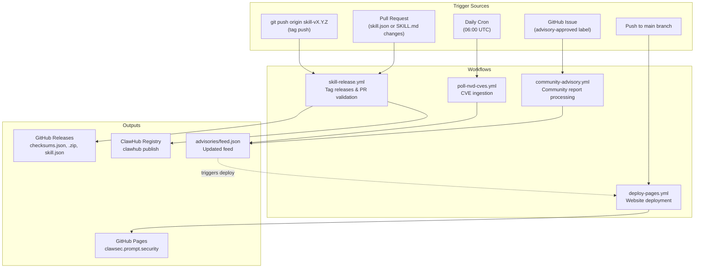
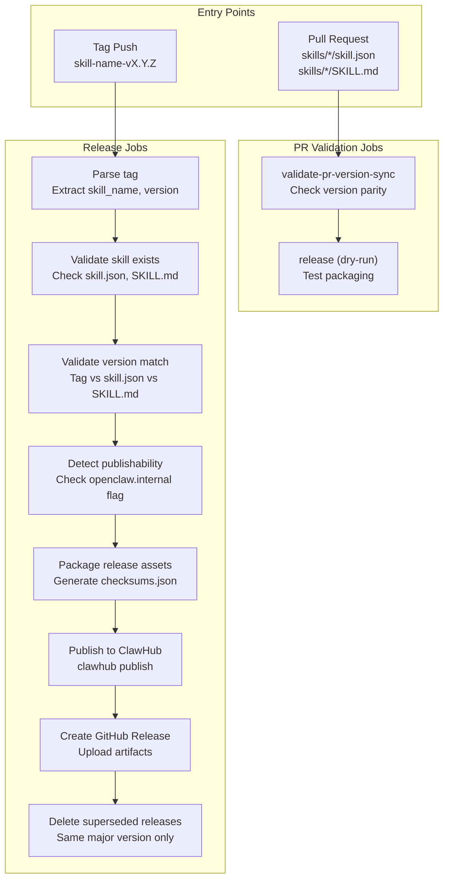
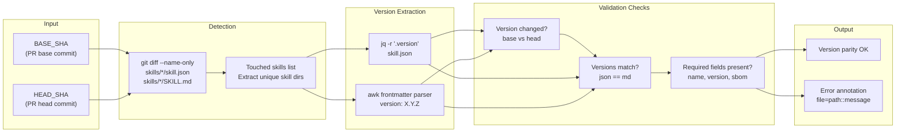
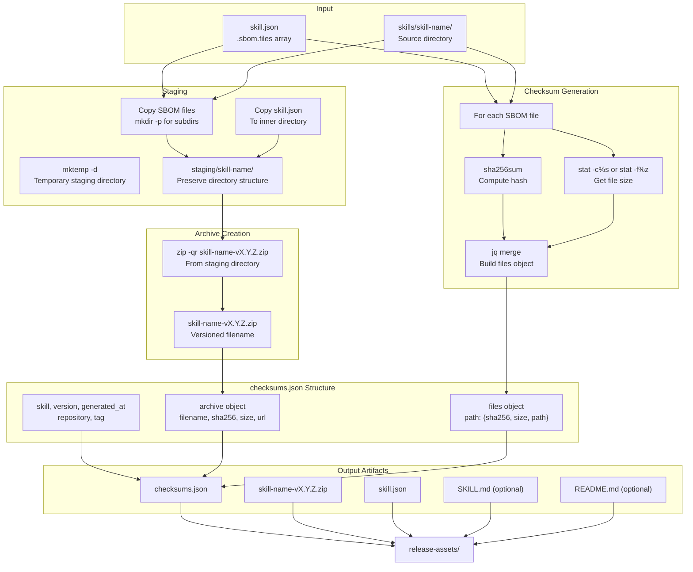
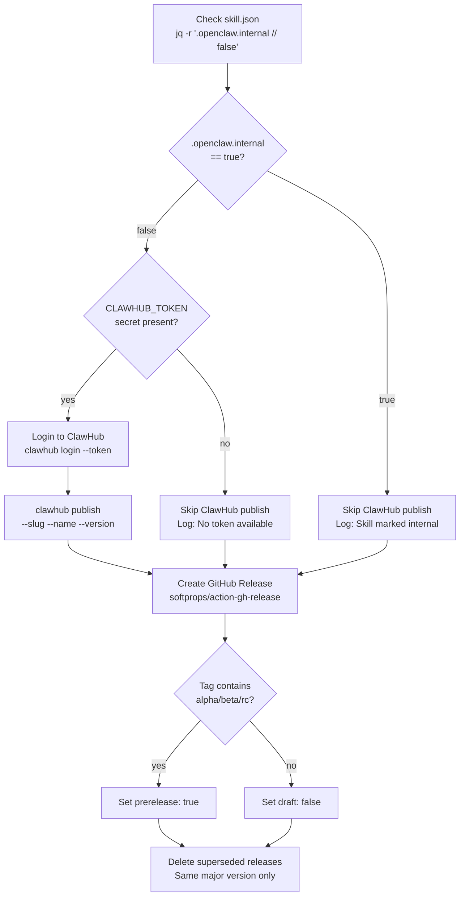
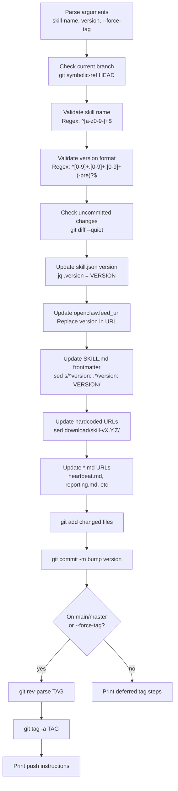
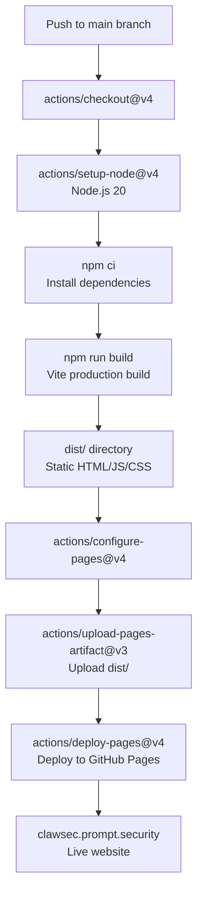

<!-- source: DeepWiki mcp.deepwiki.com · repo prompt-security/clawsec · page 5 CI/CD and Automation · fetched 2026-10-26 -->

# CI/CD and Automation

<details>
<summary>Relevant source files</summary>

The following files were used as context for generating this wiki page:

- [.github/workflows/skill-release.yml](.github/workflows/skill-release.yml)
- [README.md](README.md)
- [scripts/release-skill.sh](scripts/release-skill.sh)

</details>


## Purpose and Scope

This page documents the automated workflows that power ClawSec's continuous integration and deployment infrastructure. It covers the GitHub Actions workflows that handle skill releases, advisory feed updates, and website deployment. For information about local development tools and validation utilities, see [Development Guide](#6). For details on the advisory feed schema and consumption patterns, see [Security Advisory System](#3).

---

## Workflow Architecture

ClawSec's automation is built around four primary GitHub Actions workflows that execute on different triggers and serve distinct purposes in the release lifecycle.

### Workflow Overview



**Sources:** [.github/workflows/skill-release.yml:1-706](), [README.md:158-180]()

### Workflow Trigger Matrix

| Workflow | Trigger | Frequency | Primary Purpose |
|----------|---------|-----------|----------------|
| `skill-release.yml` | Tag push matching `*-v[0-9]*.[0-9]*.[0-9]*` | On-demand | Skill packaging and release |
| `skill-release.yml` | PR modifying `skills/*/skill.json` or `skills/*/SKILL.md` | Per PR | Version validation |
| `poll-nvd-cves.yml` | Daily cron at 06:00 UTC | Daily | NVD CVE polling |
| `community-advisory.yml` | Issue labeled `advisory-approved` | On-demand | Community advisory publication |
| `deploy-pages.yml` | Push to `main` branch | Per push | Website deployment |

**Sources:** [.github/workflows/skill-release.yml:3-10](), [README.md:162-169]()

---

## Skill Release Pipeline

The `skill-release.yml` workflow orchestrates the complete release lifecycle for ClawSec skills, from version validation through artifact distribution. It operates in two modes: **PR validation** (dry-run) and **tag-based release** (production).

### Pipeline Architecture



**Sources:** [.github/workflows/skill-release.yml:21-705]()

---

## Version Validation and PR Checks

The `validate-pr-version-sync` job enforces version consistency between `skill.json` and `SKILL.md` frontmatter during pull requests. This prevents release failures caused by version mismatches.

### Validation Logic



**Sources:** [.github/workflows/skill-release.yml:22-168]()

### Version Extraction Functions

The workflow uses shell functions to extract versions from both `skill.json` and `SKILL.md` frontmatter:

**JSON version extraction:**
```bash
jq -r '.version // empty' "${json_path}"
```

**Markdown frontmatter version extraction:**
```bash
awk '
  NR == 1 && $0 == "---" { in_frontmatter = 1; next }
  in_frontmatter && $0 == "---" { exit }
  in_frontmatter && $0 ~ /^version:[[:space:]]*/ {
    sub(/^version:[[:space:]]*/, "", $0)
    gsub(/[[:space:]]+$/, "", $0)
    print $0
    exit
  }
' "$md_file"
```

**Sources:** [.github/workflows/skill-release.yml:40-66](), [.github/workflows/skill-release.yml:87-101]()

### Validation Failure Modes

| Failure Condition | Error Output | Exit Code |
|-------------------|--------------|-----------|
| `skill.json` missing | `::error file=${json_path}::Missing skill.json after version bump.` | 1 |
| `SKILL.md` missing | `::error file=${md_path}::Missing SKILL.md after version bump.` | 1 |
| Missing `.version` in JSON | `::error file=${json_path}::Missing .version in skill.json.` | 1 |
| Missing `version:` in frontmatter | `::error file=${md_path}::Missing version in SKILL.md frontmatter.` | 1 |
| Version mismatch | `::error file=${json_path}::Version mismatch. skill.json=${head_json_version}, SKILL.md=${head_md_version}` | 1 |

**Sources:** [.github/workflows/skill-release.yml:122-150]()

---

## Release Asset Packaging

The `Package release assets` step in the `release-tag` job generates the complete set of release artifacts: checksums, zip archives, and metadata files. This process preserves directory structure and implements integrity verification.

### Packaging Pipeline



**Sources:** [.github/workflows/skill-release.yml:494-599]()

### Directory Structure Preservation

The packaging process creates a nested directory structure to maintain file hierarchy:

```
staging/
└── skill-name/
    ├── skill.json
    ├── SKILL.md
    ├── scripts/
    │   └── setup.mjs
    └── advisories/
        └── feed.json
```

This structure is created using:
```bash
STAGING_DIR="$(mktemp -d)"
INNER_DIR="$STAGING_DIR/$SKILL_NAME"
mkdir -p "$INNER_DIR"

# For each SBOM file:
mkdir -p "$INNER_DIR/$(dirname "$file")"
cp "$FULL_PATH" "$INNER_DIR/$file"
```

**Sources:** [.github/workflows/skill-release.yml:505-522]()

### checksums.json Schema

The generated `checksums.json` file provides cryptographic integrity verification for all release artifacts:

```json
{
  "skill": "skill-name",
  "version": "1.0.0",
  "generated_at": "2026-02-01T00:00:00Z",
  "repository": "prompt-security/clawsec",
  "tag": "skill-name-v1.0.0",
  "archive": {
    "filename": "skill-name-v1.0.0.zip",
    "sha256": "abc123...",
    "size": 12345,
    "url": "https://github.com/prompt-security/clawsec/releases/download/skill-name-v1.0.0/skill-name-v1.0.0.zip"
  },
  "files": {
    "SKILL.md": {
      "sha256": "def456...",
      "size": 1234,
      "path": "SKILL.md"
    },
    "scripts/setup.mjs": {
      "sha256": "789abc...",
      "size": 567,
      "path": "scripts/setup.mjs"
    }
  }
}
```

This schema is constructed using nested `jq` operations to build the JSON incrementally:

```bash
FILES_JSON="{}"
while IFS= read -r file; do
  SHA256=$(sha256sum "$FULL_PATH" | awk '{print $1}')
  SIZE=$(stat -c%s "$FULL_PATH" 2>/dev/null || stat -f%z "$FULL_PATH")
  FILES_JSON="$(echo "$FILES_JSON" | jq \
    --arg key "$file" \
    --arg sha "$SHA256" \
    --argjson sz "$SIZE" \
    '. + {($key): {sha256: $sha, size: $sz, path: $key}}')"
done < "$TEMPFILE"
```

**Sources:** [.github/workflows/skill-release.yml:529-581]()

---

## Publishing and Distribution

After packaging, the release pipeline distributes artifacts to two destinations: **ClawHub Registry** (for `clawhub install`) and **GitHub Releases** (for manual download and verification).

### Publishing Decision Tree



**Sources:** [.github/workflows/skill-release.yml:459-705]()

### ClawHub Publishing

Skills marked as public (`openclaw.internal != true`) are automatically published to the ClawHub registry:

```bash
SKILL_PATH="${{ steps.parse.outputs.skill_path }}"
SKILL_NAME="${{ steps.parse.outputs.skill_name }}"
VERSION="${{ steps.parse.outputs.version }}"
NAME=$(jq -r '.name' "$SKILL_PATH/skill.json")

CLAWHUB_DISABLE_TELEMETRY=1 clawhub publish "$SKILL_PATH" \
  --slug "$SKILL_NAME" \
  --name "$NAME" \
  --version "$VERSION" \
  --changelog "Release ${VERSION} via CI" \
  --tags "latest" \
  --no-input
```

The `--slug` parameter must match the directory name, while `--name` comes from the `skill.json` `.name` field (which may be more human-readable).

**Sources:** [.github/workflows/skill-release.yml:600-621]()

### GitHub Release Creation

The workflow uses `softprops/action-gh-release@v1` to create releases with auto-generated installation instructions:

```yaml
- name: Create GitHub Release
  uses: softprops/action-gh-release@v1
  with:
    name: "${{ steps.parse.outputs.skill_name }} ${{ steps.parse.outputs.version }}"
    tag_name: ${{ github.ref_name }}
    files: release-assets/*
    body: |
      ## ${{ steps.parse.outputs.skill_name }} ${{ steps.parse.outputs.version }}
      
      ### Quick Install
      
      **Via clawhub (recommended):**
      ```bash
      npx clawhub@latest install ${{ steps.parse.outputs.skill_name }}
      ```
      
      **Manual download with verification:**
      ```bash
      curl -sLO https://github.com/${{ github.repository }}/releases/download/${{ github.ref_name }}/${{ steps.parse.outputs.skill_name }}-v${{ steps.parse.outputs.version }}.zip
      curl -sLO https://github.com/${{ github.repository }}/releases/download/${{ github.ref_name }}/checksums.json
      echo "$(jq -r '.archive.sha256' checksums.json)  ${{ steps.parse.outputs.skill_name }}-v${{ steps.parse.outputs.version }}.zip" | sha256sum -c
      unzip ${{ steps.parse.outputs.skill_name }}-v${{ steps.parse.outputs.version }}.zip
      ```
    draft: false
    prerelease: ${{ contains(github.ref_name, 'alpha') || contains(github.ref_name, 'beta') || contains(github.ref_name, 'rc') }}
```

**Sources:** [.github/workflows/skill-release.yml:622-668]()

### Superseded Release Cleanup

To maintain a clean release history, the pipeline automatically deletes older releases with the same major version:

```bash
SKILL_NAME="${{ steps.parse.outputs.skill_name }}"
CURRENT_VERSION="${{ steps.parse.outputs.version }}"
CURRENT_MAJOR=$(echo "$CURRENT_VERSION" | cut -d. -f1)

gh release list --limit 100 | grep "^${SKILL_NAME} " | while read -r line; do
  TAG=$(echo "$line" | awk -F'\t' '{print $3}')
  VERSION="${TAG#${SKILL_NAME}-v}"
  
  if [ "$VERSION" = "$CURRENT_VERSION" ]; then
    continue
  fi
  
  RELEASE_MAJOR=$(echo "$VERSION" | cut -d. -f1)
  
  if [ "$RELEASE_MAJOR" = "$CURRENT_MAJOR" ]; then
    echo "Deleting $TAG (superseded by v$CURRENT_VERSION)"
    gh release delete "$TAG" --yes
  else
    echo "Keeping $TAG as latest for major version $RELEASE_MAJOR"
  fi
done
```

This ensures:
- **Only the latest patch/minor version** within a major version is kept
- **Different major versions coexist** for backward compatibility
- **Git tags are preserved** (only releases are deleted)

Example: Releasing `skill-v1.2.0` deletes `skill-v1.1.0` and `skill-v1.0.0`, but preserves `skill-v0.5.0`.

**Sources:** [.github/workflows/skill-release.yml:670-705](), [README.md:181-196]()

---

## Manual Release Tools

The `release-skill.sh` script provides a manual release workflow that automates version updates across multiple files and handles branch-aware tagging.

### Release Script Architecture



**Sources:** [scripts/release-skill.sh:1-290]()

### Branch-Aware Workflow

The script implements different behaviors based on the current branch:

| Branch Type | Mode | Actions | Output |
|-------------|------|---------|--------|
| `main` or `master` | Full release | Update versions → Commit → Create tag | `git push origin main && git push origin TAG` |
| Feature branch | Prep only | Update versions → Commit → Skip tag | Instructions to create tag after merge |
| Any branch with `--force-tag` | Force release | Update versions → Commit → Create tag | `git push origin BRANCH && git push origin TAG` |

```bash
CURRENT_BRANCH="$(git symbolic-ref --quiet --short HEAD || true)"
IS_RELEASE_BRANCH=false
if [[ "$CURRENT_BRANCH" == "main" || "$CURRENT_BRANCH" == "master" ]]; then
  IS_RELEASE_BRANCH=true
fi

if [[ "$IS_RELEASE_BRANCH" == "true" || "$FORCE_TAG" == "true" ]]; then
  git tag -a "$TAG" -m "$SKILL_NAME version $VERSION"
  echo "Done! To release, push the tag:"
  echo "  git push origin $TAG"
else
  echo "Done! Version updated and committed (tag deferred)."
  echo "Next steps:"
  echo "  1. Push your branch for CI validation"
  echo "  2. After PR merge, create tag on main"
fi
```

**Sources:** [scripts/release-skill.sh:44-289]()

### Version URL Pattern Updates

The script updates hardcoded version URLs across multiple files to ensure consistency:

**Pattern matching:**
```bash
PATTERN="/download/${SKILL_NAME}-v[0-9]+\.[0-9]+\.[0-9]+(-[a-zA-Z0-9]+)?/"
```

**Replacement:**
```bash
sed -E "s|$PATTERN|/download/${TAG}/|g" "$md_file"
```

Files updated:
- `skill.json` (`.openclaw.feed_url` field)
- `SKILL.md` (frontmatter + body URLs)
- `*.md` files in skill directory (e.g., `heartbeat.md`, `reporting.md`)

**Sources:** [scripts/release-skill.sh:109-193]()

### Atomic File Updates

The script uses a temporary directory pattern to ensure atomic file updates:

```bash
TEMP_DIR=$(mktemp -d)
trap 'rm -rf "$TEMP_DIR"' EXIT

# Update file
jq --arg v "$VERSION" '.version = $v' "$SKILL_PATH/skill.json" > "$TEMP_DIR/skill.json"
mv "$TEMP_DIR/skill.json" "$SKILL_PATH/skill.json"
```

This prevents partial updates if the script is interrupted mid-execution.

**Sources:** [scripts/release-skill.sh:93-106]()

---

## Advisory Update Workflows

Two workflows maintain the security advisory feed: `poll-nvd-cves.yml` (automated CVE ingestion) and `community-advisory.yml` (community report processing). For detailed information about the advisory feed schema and consumption, see [Advisory Feed Architecture](#3.1).

### Advisory Workflow Coordination

```mermaid
graph LR
    subgraph "Data Sources"
        NVD["NIST NVD API<br/>CVE database"]
        Issues["GitHub Issues<br/>advisory-approved label"]
    end
    
    subgraph "Ingestion Workflows"
        PollCVE["poll-nvd-cves.yml<br/>Daily cron 06:00 UTC"]
        CommAdv["community-advisory.yml<br/>Label trigger"]
    end
    
    subgraph "Processing"
        CVEFilter["Keyword filter<br/>OpenClaw, Moltbot, etc"]
        CVEParse["Extract CVSS, severity"]
        IssueValidate["Validate issue template"]
        IssueParse["Generate CLAW-ID"]
    end
    
    subgraph "Feed Update"
        FeedMerge["Merge into feed.json<br/>Sort by published date"]
        FeedCommit["git commit + push<br/>Update main branch"]
    end
    
    subgraph "Distribution"
        DeployTrigger["Trigger deploy-pages.yml<br/>Push to main"]
        Website["clawsec.prompt.security<br/>/advisories/feed.json"]
    end
    
    NVD --> PollCVE
    Issues --> CommAdv
    
    PollCVE --> CVEFilter
    CVEFilter --> CVEParse
    CVEParse --> FeedMerge
    
    CommAdv --> IssueValidate
    IssueValidate --> IssueParse
    IssueParse --> FeedMerge
    
    FeedMerge --> FeedCommit
    FeedCommit --> DeployTrigger
    DeployTrigger --> Website
```



**Sources:** [README.md:162-169]()

### NVD CVE Polling Workflow

The `poll-nvd-cves.yml` workflow executes daily to fetch new CVEs related to OpenClaw agents. The workflow is documented in detail in [NVD CVE Polling and Processing](#3.2).

**Key characteristics:**
- **Trigger:** Daily cron at `06:00 UTC`
- **Keywords:** `OpenClaw`, `clawdbot`, `Moltbot`, `prompt injection`
- **Output:** Updates `advisories/feed.json` with new CVE entries
- **API:** NIST NVD API 2.0 with rate limiting

### Community Advisory Workflow

The `community-advisory.yml` workflow processes approved security reports from GitHub Issues. The workflow is documented in detail in [Community Advisory Reporting](#3.3).

**Key characteristics:**
- **Trigger:** Issue labeled with `advisory-approved`
- **ID format:** `CLAW-{YEAR}-{ISSUE_NUMBER}` (e.g., `CLAW-2026-0042`)
- **Validation:** Ensures issue uses Security Incident Report template
- **Output:** Adds community advisory to `advisories/feed.json`

---

## Website Deployment

The `deploy-pages.yml` workflow builds and deploys the ClawSec website to GitHub Pages whenever changes are pushed to the `main` branch.

### Deployment Pipeline



**Sources:** [README.md:169]()

### Build Artifacts

The build process generates a static site from the React application:

**Build command:** `npm run build` (invokes Vite)

**Generated structure:**
```
dist/
├── index.html              # SPA entry point
├── assets/
│   ├── index-{hash}.js    # Bundled JavaScript
│   └── index-{hash}.css   # Bundled CSS
├── advisories/
│   └── feed.json          # Copied from source
└── img/
    └── mascot.png         # Static assets
```

The `advisories/feed.json` file is included in the build output to serve as the canonical API endpoint for advisory consumption. For more on the website structure, see [Website and User Interface](#7).

### Deployment Permissions

The workflow requires specific GitHub permissions to deploy to Pages:

```yaml
permissions:
  contents: read
  pages: write
  id-token: write
```

- `contents: read` - Checkout repository
- `pages: write` - Deploy to GitHub Pages
- `id-token: write` - Authenticate with GitHub Pages environment

**Sources:** [.github/workflows/skill-release.yml:12-15]() (similar pattern used across workflows)

---

## CI/CD Security Practices

ClawSec's automation infrastructure implements several security best practices to ensure integrity and prevent supply chain attacks.

### Security Measures Matrix

| Layer | Mechanism | Implementation |
|-------|-----------|----------------|
| **Input Validation** | Skill name regex | `^[a-z0-9-]+$` prevents path traversal |
| **Input Validation** | Version format regex | `^[0-9]+.[0-9]+.[0-9]+(-pre)?$` ensures semver |
| **Version Consistency** | Pre-commit checks | `validate-pr-version-sync` job enforces parity |
| **Version Consistency** | Tag validation | Workflow checks tag matches `skill.json` |
| **File Integrity** | SHA256 checksums | `checksums.json` for all release artifacts |
| **File Integrity** | SBOM verification | Fails if SBOM references missing files |
| **Access Control** | Branch protection | Tags only created on `main` branch |
| **Access Control** | Token isolation | `CLAWHUB_TOKEN` secret for registry access |
| **Artifact Signing** | Checksums in release | Enables downstream verification |
| **Supply Chain** | Pinned actions | `actions/checkout@v4` (pinned versions) |

**Sources:** [scripts/release-skill.sh:57-74](), [.github/workflows/skill-release.yml:420-434](), [.github/workflows/skill-release.yml:494-599]()

### Atomic Operations

The release process implements atomic operations to prevent partial updates:

1. **Temporary staging:** All file operations use `mktemp -d` to stage changes before committing
2. **Trap cleanup:** `trap 'rm -rf "$TEMP_DIR"' EXIT` ensures cleanup on failure
3. **Verification gates:** Multiple validation steps before artifact publication
4. **Rollback instructions:** Error messages include recovery commands

**Sources:** [scripts/release-skill.sh:93-106](), [.github/workflows/skill-release.yml:505-592]()

### Concurrency Control

The skill release workflow implements concurrency groups to prevent race conditions:

```yaml
concurrency:
  group: skill-release-${{ github.ref }}
  cancel-in-progress: false
```

- **Group key:** Uses `github.ref` (branch or tag) to isolate concurrent runs
- **Cancellation policy:** `false` prevents interruption of in-progress releases

This ensures that multiple tags pushed simultaneously don't interfere with each other's release processes.

**Sources:** [.github/workflows/skill-release.yml:17-19]()

---

