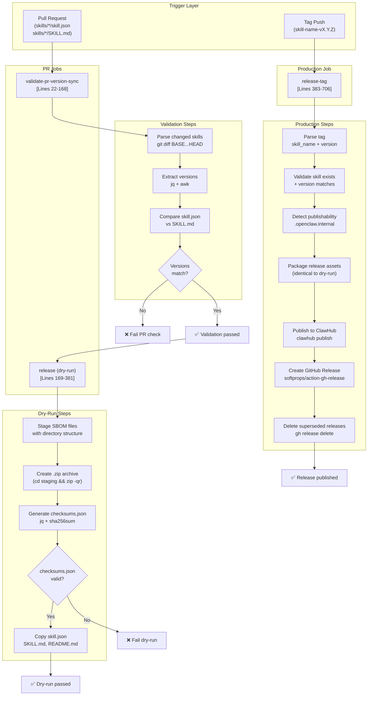
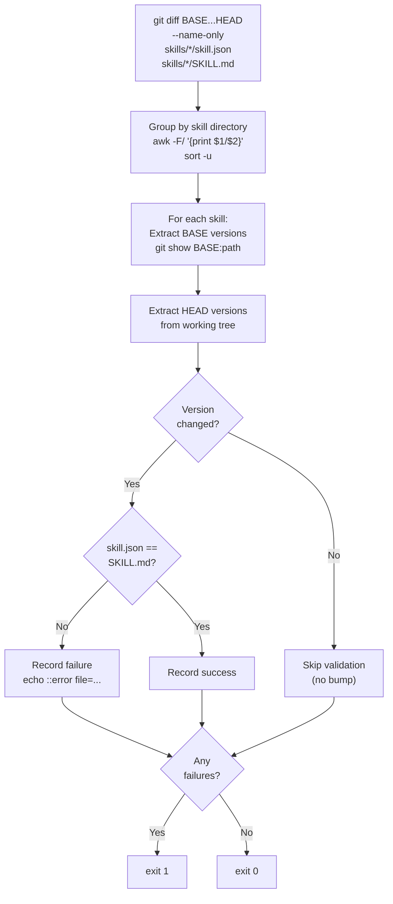
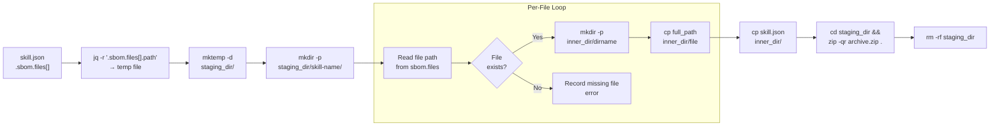
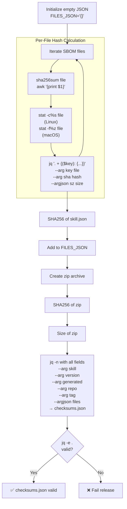
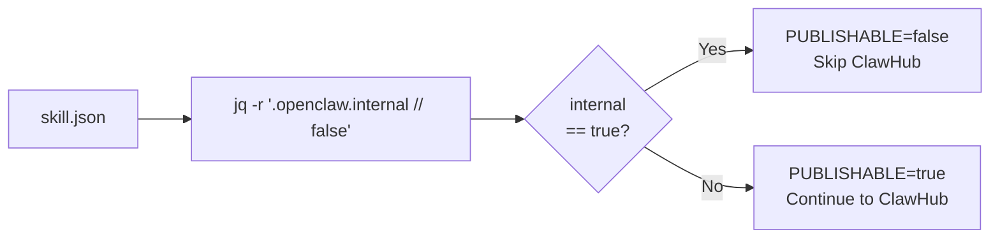
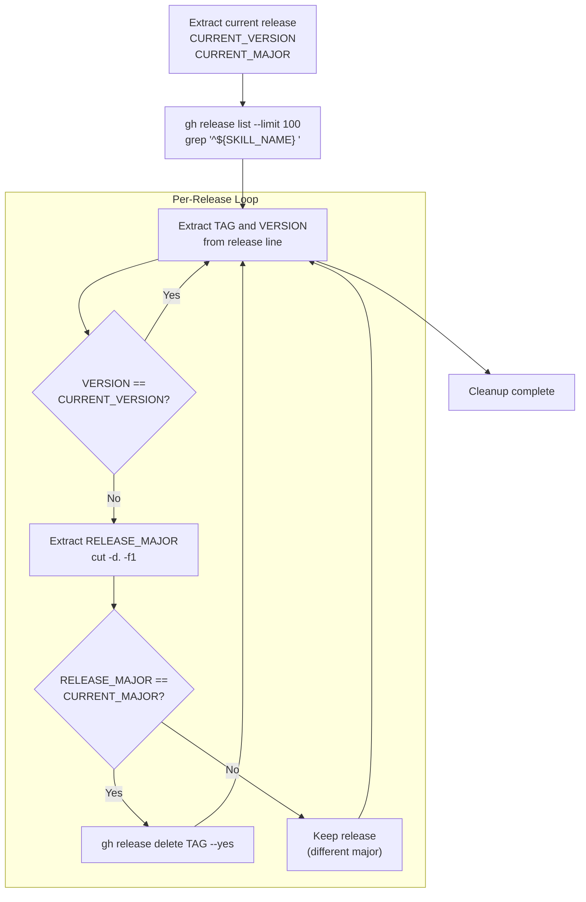
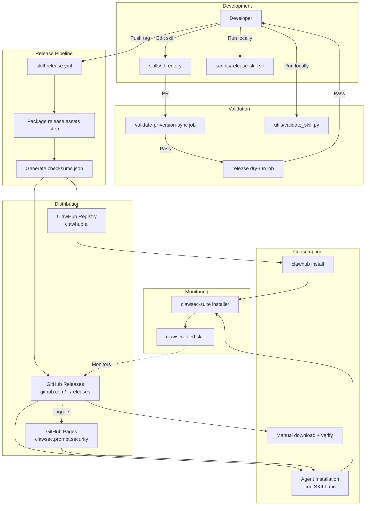

<!-- source: DeepWiki mcp.deepwiki.com · repo prompt-security/clawsec · page 5.1 Skill Release Pipeline · fetched 2026-10-26 -->

# Skill Release Pipeline

<details>
<summary>Relevant source files</summary>

The following files were used as context for generating this wiki page:

- [.github/workflows/skill-release.yml](.github/workflows/skill-release.yml)
- [README.md](README.md)

</details>


## Purpose and Scope

This document describes the `skill-release.yml` workflow that automates the validation, packaging, and distribution of ClawSec skills. The pipeline runs in three modes: PR validation, dry-run packaging, and production release. It ensures version consistency, generates integrity checksums, publishes to ClawHub registry, and creates GitHub Releases with complete artifact sets.

For details on specific aspects of the pipeline, see:
- Version validation and PR checks: [5.1.1](#5.1.1)
- Release asset packaging mechanics: [5.1.2](#5.1.2)
- Publishing and distribution logic: [5.1.3](#5.1.3)

For the broader CI/CD context including advisory workflows and website deployment, see [5](#5).

**Sources:** [.github/workflows/skill-release.yml:1-706](), [README.md:158-205]()

---

## Workflow Overview

The `skill-release.yml` workflow provides three operational modes based on trigger type:

| Mode | Trigger | Purpose | Creates Artifacts |
|------|---------|---------|-------------------|
| **PR Validation** | Pull request modifying `skills/*/skill.json` or `skills/*/SKILL.md` | Validates version parity between `skill.json` and `SKILL.md` frontmatter | No |
| **PR Dry-Run** | Pull request (after validation passes) | Tests packaging logic without publishing | Yes (in `dist/dry-run/`) |
| **Production Release** | Git tag push matching `*-v[0-9]*.[0-9]*.[0-9]*` | Packages, publishes to ClawHub, creates GitHub Release, cleans superseded releases | Yes (GitHub Releases) |

The workflow enforces strict version discipline: every version bump must be reflected identically in both `skill.json` (`.version` field) and `SKILL.md` (YAML frontmatter `version:` field).

**Sources:** [.github/workflows/skill-release.yml:3-21](), [.github/workflows/skill-release.yml:22-168]()

---

## Workflow Architecture



**Workflow Job Dependencies**

The workflow defines three jobs with specific dependency relationships:

- `validate-pr-version-sync` runs independently when triggered by PR
- `release` requires `validate-pr-version-sync` to pass (via `needs: validate-pr-version-sync`)
- `release-tag` runs independently when triggered by tag push

This ensures that PR checks always validate versions before attempting packaging, but production releases on tags are not blocked by PR-specific checks.

**Sources:** [.github/workflows/skill-release.yml:22-706](), [.github/workflows/skill-release.yml:170-172]()

---

## Tag Naming Convention and Parsing

The workflow enforces a strict tag naming pattern: `<skill-name>-v<semver>` where `<skill-name>` matches the directory name under `skills/` and `<semver>` follows semantic versioning (e.g., `clawsec-feed-v0.0.4`, `soul-guardian-v1.2.0`).

### Tag Pattern Matching

The workflow trigger uses a glob pattern to match tags:

```yaml
on:
  push:
    tags:
      - '*-v[0-9]*.[0-9]*.[0-9]*'
```

This pattern matches:
- `clawsec-feed-v0.0.4` ✅
- `soul-guardian-v1.2.0` ✅
- `clawsec-suite-v0.0.7-alpha` ✅ (prerelease suffix preserved)
- `v1.0.0` ❌ (missing skill name prefix)
- `clawsec-feed-1.0.0` ❌ (missing `-v` separator)

### Tag Parsing Logic

The `release-tag` job extracts skill name and version from the tag using shell parameter expansion:

```bash
TAG="${{ github.ref_name }}"
SKILL_NAME="${TAG%-v*}"      # Everything before -v
VERSION="${TAG#*-v}"         # Everything after -v
```

Example parsing:
- Tag: `clawsec-feed-v0.0.4`
  - `SKILL_NAME`: `clawsec-feed`
  - `VERSION`: `0.0.4`
  - `skill_path`: `skills/clawsec-feed`

**Sources:** [.github/workflows/skill-release.yml:5-6](), [.github/workflows/skill-release.yml:389-402]()

---

## Version Validation

The workflow enforces three-way version consistency across different artifact types:

### Version Sources

| Artifact | Location | Format | Extraction Method |
|----------|----------|--------|-------------------|
| **skill.json** | `.version` field | JSON string | `jq -r '.version'` |
| **SKILL.md** | YAML frontmatter | `version: X.Y.Z` | `awk` parsing between `---` delimiters |
| **Git tag** | Tag name suffix | `-vX.Y.Z` | Shell parameter expansion |

### Validation Flow in PR Checks



**SKILL.md Version Extraction**

The workflow uses `awk` to parse YAML frontmatter:

```bash
get_md_version() {
  local md_file="$1"
  awk '
    NR == 1 && $0 == "---" { in_frontmatter = 1; next }
    in_frontmatter && $0 == "---" { exit }
    in_frontmatter && $0 ~ /^version:[[:space:]]*/ {
      sub(/^version:[[:space:]]*/, "", $0)
      gsub(/[[:space:]]+$/, "", $0)
      print $0
      exit
    }
  ' "$md_file"
}
```

This extracts the version from frontmatter like:
```yaml
---
version: 0.0.4
title: clawsec-feed
---
```

**Sources:** [.github/workflows/skill-release.yml:33-167](), [.github/workflows/skill-release.yml:40-66]()

---

## Packaging Process

The packaging process creates a complete release artifact set for each skill, preserving directory structure and generating cryptographic checksums.

### Artifact Structure

Each release produces the following artifacts:

```
release-assets/
├── <skill-name>-vX.Y.Z.zip       # Bundled skill with directory structure
├── checksums.json                 # SHA256 hashes for all files
├── skill.json                     # Skill metadata (copy from source)
├── SKILL.md                       # Installation instructions (if exists)
└── README.md                      # Documentation (if exists)
```

### SBOM File Staging

The workflow stages files from the skill's SBOM (Software Bill of Materials) while preserving directory structure:



**Example Directory Structure in Zip**

For a skill with SBOM files:
```json
{
  "sbom": {
    "files": [
      {"path": "SKILL.md"},
      {"path": "scripts/setup.mjs"},
      {"path": "advisories/feed.json"}
    ]
  }
}
```

The resulting zip contains:
```
clawsec-feed/
├── SKILL.md
├── skill.json
├── scripts/
│   └── setup.mjs
└── advisories/
    └── feed.json
```

**Sources:** [.github/workflows/skill-release.yml:266-289](), [.github/workflows/skill-release.yml:504-527]()

---

## Checksum Generation

The workflow generates a comprehensive `checksums.json` file containing SHA256 hashes for all skill files and the zip archive itself.

### checksums.json Schema

```json
{
  "skill": "clawsec-feed",
  "version": "0.0.4",
  "generated_at": "2026-02-15T10:30:45Z",
  "repository": "prompt-security/clawsec",
  "tag": "clawsec-feed-v0.0.4",
  "archive": {
    "filename": "clawsec-feed-v0.0.4.zip",
    "sha256": "a1b2c3...",
    "size": 45678,
    "url": "https://github.com/prompt-security/clawsec/releases/download/clawsec-feed-v0.0.4/clawsec-feed-v0.0.4.zip"
  },
  "files": {
    "SKILL.md": {
      "sha256": "d4e5f6...",
      "size": 1234,
      "path": "SKILL.md"
    },
    "skill.json": {
      "sha256": "g7h8i9...",
      "size": 567
    },
    "scripts/setup.mjs": {
      "sha256": "j0k1l2...",
      "size": 890,
      "path": "scripts/setup.mjs"
    }
  }
}
```

### Generation Process



The workflow uses `jq` to build the JSON incrementally, accumulating file hashes in a variable before constructing the final output.

**Cross-Platform Size Calculation**

The workflow handles differences between Linux and macOS `stat` commands:

```bash
SIZE=$(stat -c%s "$FULL_PATH" 2>/dev/null || stat -f%z "$FULL_PATH")
```

This tries Linux syntax (`-c%s`) first, then falls back to macOS syntax (`-f%z`) if the first command fails.

**Sources:** [.github/workflows/skill-release.yml:291-343](), [.github/workflows/skill-release.yml:529-581]()

---

## ClawHub Publishing

The workflow publishes skills to the ClawHub registry using the `clawhub` CLI tool, but only for non-internal skills with valid authentication tokens.

### Publishability Detection



Skills marked as internal (`.openclaw.internal: true` in `skill.json`) skip ClawHub publishing but still create GitHub Releases. This is used for skills that are:
- Experimental or unstable
- Specific to internal testing environments
- Not intended for public consumption

### Publishing Flow

When `publishable=true` and `CLAWHUB_TOKEN` secret is available:

```bash
# Install CLI
npm install -g clawhub

# Configure and login
export CLAWHUB_CONFIG_PATH="$HOME/.clawhub-ci/config.json"
mkdir -p "$(dirname "$CLAWHUB_CONFIG_PATH")"
CLAWHUB_DISABLE_TELEMETRY=1 \
CLAWHUB_SITE="${CLAWHUB_SITE:-https://clawhub.ai}" \
CLAWHUB_REGISTRY="${CLAWHUB_REGISTRY:-$CLAWHUB_SITE}" \
  clawhub login --token "$CLAWHUB_TOKEN" --site "$SITE" --no-input

# Publish
clawhub publish "$SKILL_PATH" \
  --slug "$SKILL_NAME" \
  --name "$NAME" \
  --version "$VERSION" \
  --changelog "Release ${VERSION} via CI" \
  --tags "latest" \
  --no-input
```

**Environment Configuration**

The workflow supports customizing ClawHub endpoints via environment variables:
- `CLAWHUB_SITE`: Web interface URL (default: `https://clawhub.ai`)
- `CLAWHUB_REGISTRY`: Package registry URL (default: same as site)
- `CLAWHUB_CONFIG_PATH`: Config file location for CI isolation

**Sources:** [.github/workflows/skill-release.yml:459-473](), [.github/workflows/skill-release.yml:479-620]()

---

## GitHub Release Creation

The workflow creates GitHub Releases using the `softprops/action-gh-release` action with auto-generated installation instructions and verification commands.

### Release Body Template

The release body includes:

1. **Quick Install via ClawHub**: `npx clawhub@latest install <skill-name>`
2. **Manual Download Instructions**: Step-by-step curl + verification + extraction
3. **Verification Commands**: Using `checksums.json` for integrity checks
4. **File Manifest Reference**: Link to complete checksums

### Prerelease Detection

The workflow automatically marks releases as prereleases based on version suffix:

```yaml
prerelease: ${{ contains(github.ref_name, 'alpha') || contains(github.ref_name, 'beta') || contains(github.ref_name, 'rc') }}
```

Examples:
- `clawsec-feed-v0.0.4` → `prerelease: false` (stable)
- `soul-guardian-v1.0.0-alpha` → `prerelease: true`
- `clawsec-suite-v0.0.7-rc2` → `prerelease: true`

### Release Metadata

| Field | Source | Example |
|-------|--------|---------|
| `name` | Parsed from tag | `clawsec-feed 0.0.4` |
| `tag_name` | Git ref name | `clawsec-feed-v0.0.4` |
| `files` | `release-assets/*` | All packaged artifacts |
| `draft` | Always `false` | Immediate publication |
| `prerelease` | Version suffix detection | `true` if alpha/beta/rc |

**Sources:** [.github/workflows/skill-release.yml:622-668]()

---

## Superseded Release Management

The workflow automatically deletes old releases within the same major version to keep the releases page clean while preserving backwards compatibility for different major versions.

### Cleanup Logic



### Example Scenarios

**Scenario 1: Patch Release**
- Existing releases: `clawsec-feed-v0.0.3`
- New release: `clawsec-feed-v0.0.4`
- Result: `v0.0.3` deleted, only `v0.0.4` remains

**Scenario 2: Major Version Coexistence**
- Existing releases: `soul-guardian-v1.5.0`
- New release: `soul-guardian-v2.0.0`
- Result: Both `v1.5.0` and `v2.0.0` remain (different majors)

**Scenario 3: Multiple Old Minors**
- Existing releases: `clawsec-suite-v0.0.5`, `clawsec-suite-v0.0.6`
- New release: `clawsec-suite-v0.0.7`
- Result: Both `v0.0.5` and `v0.0.6` deleted, only `v0.0.7` remains

### Preservation of Git Tags

While releases are deleted, **Git tags are never removed**. This means:
- The full version history remains in the repository
- Old releases can be recreated by re-pushing the tag
- Downstream tools can still reference old version tags

**Sources:** [.github/workflows/skill-release.yml:670-705]()

---

## Workflow Permissions

The workflow requires elevated permissions to perform its operations:

```yaml
permissions:
  contents: write      # Create releases, delete old releases
  pages: write         # Update GitHub Pages (for catalog refresh)
  id-token: write      # OIDC token for secure authentication
```

### Job-Level Permission Restrictions

Individual jobs can restrict permissions for security:

```yaml
validate-pr-version-sync:
  permissions:
    contents: read     # Read-only for PR validation
```

This follows the principle of least privilege: validation steps don't need write access.

### Concurrency Control

```yaml
concurrency:
  group: skill-release-${{ github.ref }}
  cancel-in-progress: false
```

This configuration:
- Groups concurrent runs by git ref (prevents conflicts)
- **Does not cancel** in-progress runs (preserves reliability)
- Queues subsequent runs if one is already executing

The `cancel-in-progress: false` setting is crucial for release integrity—a partially completed release should finish before starting a new one.

**Sources:** [.github/workflows/skill-release.yml:12-19]()

---

## Error Handling and Validation

The workflow implements defense-in-depth validation at multiple stages to catch errors early:

### Validation Matrix

| Stage | Check | Failure Mode | Error Reporting |
|-------|-------|--------------|-----------------|
| **Tag Parse** | Skill directory exists | Exit job | Standard error output |
| **Tag Parse** | `skill.json` exists | Exit job | `echo "Error: ..."` |
| **Version Match** | Tag version == JSON version | Exit with error annotation | `::error::Version mismatch...` |
| **Version Match** | Tag version == SKILL.md version | Exit with error annotation | `::error::Version mismatch...` |
| **SBOM Validation** | All SBOM files exist | Record error, continue | `::error file=skill.json::SBOM references missing file` |
| **JSON Generation** | `checksums.json` is valid JSON | Exit with error | `::error::Generated checksums.json is invalid` |
| **Dry-Run** | All checks pass | Fail PR | Accumulated error count |

### GitHub Actions Annotations

The workflow uses GitHub Actions annotation commands to provide inline feedback:

```bash
# Error annotation on specific file
echo "::error file=${json_path}::Version mismatch. skill.json=${head_json_version}, SKILL.md=${head_md_version}"

# Warning annotation
echo "::warning::No version found in $SKILL_PATH/SKILL.md frontmatter"

# Grouping output for readability
echo "::group::Dry-run release ${tag}"
# ... commands ...
echo "::endgroup::"
```

These annotations appear directly on the PR or workflow run, making it easy to identify and fix issues.

### Shell Error Handling

All bash scripts use strict error handling:

```bash
set -euo pipefail
```

This enables:
- `set -e`: Exit on any command failure
- `set -u`: Exit on undefined variable usage
- `set -o pipefail`: Propagate errors through pipes

**Sources:** [.github/workflows/skill-release.yml:38](), [.github/workflows/skill-release.yml:123-149](), [.github/workflows/skill-release.yml:280-282]()

---

## Dry-Run Mode for Pull Requests

The `release` job provides a complete packaging simulation for PRs without publishing artifacts, enabling developers to validate changes before tagging.

### Dry-Run Output Structure

```
dist/dry-run/
└── <skill-name>-vX.Y.Z/
    └── release-assets/
        ├── <skill-name>-vX.Y.Z.zip
        ├── checksums.json
        ├── skill.json
        ├── SKILL.md
        └── README.md
```

The dry-run creates artifacts locally but does not:
- Publish to ClawHub
- Create GitHub Releases
- Modify repository state
- Delete old releases

### Dry-Run Success Criteria

For the dry-run to pass, all of these must succeed:

1. Version parity validated (from previous job)
2. `skill.json` contains required fields: `name`, `version`, `sbom`, `sbom.files`
3. All SBOM files exist and are readable
4. Zip archive created successfully
5. `checksums.json` generated and is valid JSON
6. All documentation files copied

A single failure across any changed skill causes the entire dry-run to fail, preventing broken PRs from merging.

**Sources:** [.github/workflows/skill-release.yml:169-381](), [.github/workflows/skill-release.yml:249-253]()

---

## Integration with ClawSec Ecosystem

The skill release pipeline integrates with multiple system components:



**Cross-System Dependencies**

- **clawsec-suite**: Embeds `checksums.json` URLs from releases for integrity verification ([4.1](#4.1))
- **clawsec-feed**: Monitors GitHub Releases for new skill versions and cross-references against advisories ([4.2](#4.2))
- **Website**: Displays skills catalog populated from release artifacts ([7](#7))
- **Local development**: Uses same packaging logic as CI via `scripts/release-skill.sh` ([6.2](#6.2))

**Sources:** [.github/workflows/skill-release.yml:1-706](), [README.md:158-205]()

---

