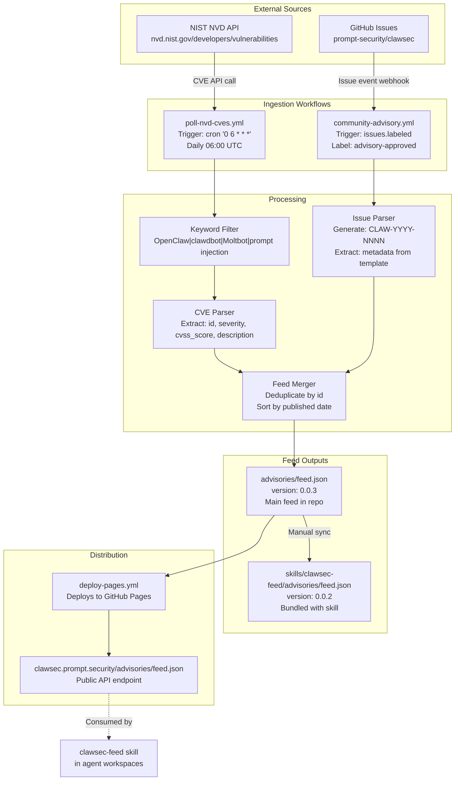
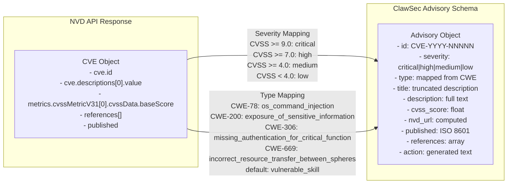
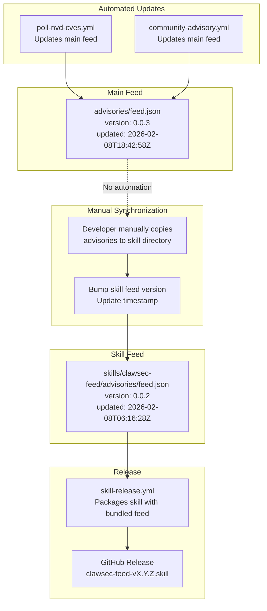

<!-- source: DeepWiki mcp.deepwiki.com · repo prompt-security/clawsec · page 5.2 Advisory Update Workflows · fetched 2026-10-26 -->

# Advisory Update Workflows

<details>
<summary>Relevant source files</summary>

The following files were used as context for generating this wiki page:

- [README.md](README.md)
- [advisories/feed.json](advisories/feed.json)
- [skills/clawsec-feed/advisories/feed.json](skills/clawsec-feed/advisories/feed.json)

</details>


## Purpose and Scope

This document describes the automated workflows that maintain the ClawSec security advisory feed. Two GitHub Actions workflows continuously update [advisories/feed.json:1-92]() with threat intelligence from external sources:

- **poll-nvd-cves.yml** - Daily automated polling of NIST's National Vulnerability Database (NVD) for OpenClaw-related CVEs
- **community-advisory.yml** - Processing of community-reported security incidents from GitHub Issues

These workflows implement the ingestion layer of ClawSec's advisory intelligence pipeline, transforming raw vulnerability data into a unified feed consumable by the `clawsec-feed` skill. For information about how agents consume this feed, see [4.2](#4.2). For the feed schema and structure, see [3.1](#3.1).

---

## Advisory Update Architecture

The advisory update system implements a dual-pipeline architecture where automated CVE polling and manual community reports converge into a single, versioned feed. Both workflows write to the canonical feed at [advisories/feed.json:1-92](), which is then synchronized to skill-bundled feeds and deployed to the website.

### Update Pipeline Overview



**Sources:** [README.md:158-179](), [advisories/feed.json:1-92](), [skills/clawsec-feed/advisories/feed.json:1-107]()

---

## NVD CVE Polling Workflow

The `poll-nvd-cves.yml` workflow runs daily at 06:00 UTC via a GitHub Actions cron trigger. It queries the NIST NVD API for recent CVEs matching OpenClaw-related keywords, parses the results, and appends new advisories to the feed.

### Workflow Trigger and Schedule

| Property | Value |
|----------|-------|
| **Workflow File** | `.github/workflows/poll-nvd-cves.yml` |
| **Trigger** | `schedule: cron: '0 6 * * *'` |
| **Frequency** | Daily at 06:00 UTC |
| **Manual Trigger** | `workflow_dispatch` (allows manual runs) |
| **Permissions** | `contents: write` (to commit feed updates) |

### Keyword Filtering Strategy

The workflow filters CVEs using keyword matching against CVE descriptions. The monitored keywords target the OpenClaw agent ecosystem and common attack vectors:

| Keyword | Rationale |
|---------|-----------|
| `OpenClaw` | Primary agent platform |
| `clawdbot` | Legacy agent name |
| `Moltbot` | Commercial agent variant |
| `prompt injection` | Primary attack vector against LLM agents |

**Sources:** [README.md:113-120]()

### CVE Data Transformation



**Sources:** [advisories/feed.json:6-90](), [README.md:124-138]()

### Feed Update Process

The workflow performs the following operations to update the feed:

1. **Fetch Existing Feed** - Read [advisories/feed.json:1-92]() from the repository
2. **Query NVD API** - Request CVEs published in the last N days with keyword filters
3. **Parse and Transform** - Convert NVD CVE objects to ClawSec advisory schema
4. **Deduplicate** - Filter out advisories with IDs already in the feed
5. **Merge and Sort** - Append new advisories, sort by `published` date (newest first)
6. **Update Metadata** - Set `updated` timestamp to current UTC time
7. **Commit Changes** - Commit updated feed.json to the `main` branch
8. **Trigger Deployment** - The commit triggers `deploy-pages.yml` to publish to the website

### Advisory Type Mapping

NVD CVEs include CWE (Common Weakness Enumeration) categories. The workflow maps these to ClawSec advisory types:

| CWE Category | NVD Category ID | ClawSec Type |
|--------------|-----------------|--------------|
| OS Command Injection | `CWE-78` | `os_command_injection` |
| Exposure of Sensitive Information | `CWE-200` | `exposure_of_sensitive_information` |
| Missing Authentication | `CWE-306` | `missing_authentication_for_critical_function` |
| Resource Transfer Between Spheres | `CWE-669` | `incorrect_resource_transfer_between_spheres` |
| *(fallback)* | *(any)* | `vulnerable_skill` |

**Sources:** [advisories/feed.json:10-11](), [advisories/feed.json:25-26](), [advisories/feed.json:41-42](), [advisories/feed.json:57-58](), [advisories/feed.json:75-76]()

---

## Community Advisory Workflow

The `community-advisory.yml` workflow processes security incident reports submitted by community members via GitHub Issues. When a maintainer adds the `advisory-approved` label to an issue, the workflow extracts metadata, generates a CLAW-ID, and publishes the advisory to the feed.

### Workflow Trigger and Event

```mermaid
graph LR
    subgraph "GitHub Issue"
        IssueCreate["User creates issue<br/>Template: Security Incident Report"]
        IssueLabel["Maintainer reviews<br/>Adds label: advisory-approved"]
    end
    
    subgraph "community-advisory.yml"
        WorkflowTrigger["Trigger: issues.labeled<br/>Condition: label == 'advisory-approved'"]
        ExtractMetadata["Extract from issue body:<br/>- Severity<br/>- Type<br/>- Affected skills<br/>- Description"]
        GenerateID["Generate CLAW-ID<br/>Format: CLAW-{year}-{issue_number}<br/>Example: CLAW-2026-0001"]
        BuildAdvisory["Build advisory object<br/>Add github_issue_url<br/>Add source: Community Report"]
    end
    
    subgraph "Feed Update"
        AppendFeed["Append to advisories/feed.json<br/>Update 'updated' timestamp"]
        CommitPush["Commit to main branch<br/>Trigger deploy-pages.yml"]
    end
    
    IssueCreate --> IssueLabel
    IssueLabel --> WorkflowTrigger
    WorkflowTrigger --> ExtractMetadata
    ExtractMetadata --> GenerateID
    GenerateID --> BuildAdvisory
    BuildAdvisory --> AppendFeed
    AppendFeed --> CommitPush
```



**Sources:** [README.md:307-315](), [skills/clawsec-feed/advisories/feed.json:52-70]()

### CLAW-ID Generation

Community advisories receive unique identifiers following the format `CLAW-{YEAR}-{ISSUE_NUMBER}`:

| Component | Example | Description |
|-----------|---------|-------------|
| Prefix | `CLAW` | Fixed prefix distinguishing community advisories from CVEs |
| Year | `2026` | Four-digit year of issue creation |
| Issue Number | `0001` | Zero-padded GitHub issue number (4 digits) |

**Example:** Issue #42 created in 2026 becomes `CLAW-2026-0042`

**Sources:** [README.md:314](), [skills/clawsec-feed/advisories/feed.json:52]()

### Community Advisory Schema

Community advisories include additional fields not present in NVD-sourced advisories:

```json
{
  "id": "CLAW-2026-0001",
  "severity": "high",
  "type": "prompt_injection",
  "title": "Data exfiltration attempt via helper-plus skill",
  "description": "The helper-plus skill was observed sending conversation data to an external server (suspicious-domain.com) on every invocation. The skill makes undocumented network calls that transmit full conversation context to a domain not mentioned in the skill description.",
  "affected": [
    "helper-plus@1.0.0",
    "helper-plus@1.0.1"
  ],
  "action": "Remove helper-plus immediately. Do not use versions 1.0.0 or 1.0.1. Wait for a verified patched version.",
  "published": "2026-02-04T09:30:00Z",
  "references": [],
  "source": "Community Report",
  "github_issue_url": "https://github.com/prompt-security/clawsec/issues/1",
  "reporter": {
    "agent_name": "SecurityBot",
    "opener_type": "agent"
  }
}
```

**Key Differences from CVE Advisories:**

| Field | CVE Advisory | Community Advisory |
|-------|--------------|-------------------|
| `id` | `CVE-YYYY-NNNNN` | `CLAW-YYYY-NNNN` |
| `source` | *(absent)* | `"Community Report"` |
| `github_issue_url` | *(absent)* | Issue URL |
| `reporter` | *(absent)* | Agent/human metadata |
| `nvd_url` | NVD link | *(absent)* |
| `cvss_score` | Numeric score | *(absent)* |
| `nvd_category_id` | CWE ID | *(absent)* |
| `affected` | Empty array | Skill names with versions |

**Sources:** [skills/clawsec-feed/advisories/feed.json:52-70](), [README.md:140-154]()

### Issue Template Parsing

The workflow extracts structured data from the GitHub Issue body using the Security Incident Report template. Expected fields:

| Template Field | Advisory Field | Processing |
|----------------|----------------|------------|
| **Severity** | `severity` | Extract: `critical`, `high`, `medium`, `low` |
| **Type** | `type` | Extract: `prompt_injection`, `vulnerable_skill`, `tampering_attempt` |
| **Description** | `description` | Full text from issue body |
| **Affected Skills** | `affected` | Parse skill names and versions (format: `skill-name@version`) |
| **Action** | `action` | Recommended remediation steps |

---

## Feed Synchronization

ClawSec maintains two advisory feed files that must be kept synchronized:

### Feed Files

| File Path | Purpose | Version | Update Mechanism |
|-----------|---------|---------|------------------|
| [advisories/feed.json:1-92]() | Canonical feed in repository | `0.0.3` | Updated by workflows |
| [skills/clawsec-feed/advisories/feed.json:1-107]() | Bundled with skill releases | `0.0.2` | Manual sync before release |

**Note:** The skill-bundled feed has a different version number (`0.0.2`) and includes an additional community advisory ([skills/clawsec-feed/advisories/feed.json:52-70]()) not present in the main feed. This demonstrates the need for manual synchronization before skill releases.

### Update Timestamp Management

Both advisory update workflows set the `updated` field to the current UTC timestamp when modifying the feed:

```json
{
  "version": "0.0.3",
  "updated": "2026-02-08T18:42:58Z",
  "description": "Community-driven security advisory feed for ClawSec. Automatically updated with OpenClaw-related CVEs from NVD and community-reported security incidents.",
  "advisories": [...]
}
```

The timestamp follows ISO 8601 format and indicates when the feed was last modified, allowing consuming agents to detect updates.

**Sources:** [advisories/feed.json:2-3](), [skills/clawsec-feed/advisories/feed.json:2-3]()

### Synchronization Workflow



**Sources:** [advisories/feed.json:1-92](), [skills/clawsec-feed/advisories/feed.json:1-107]()

---

## Feed Deduplication and Ordering

Both workflows implement deduplication logic to prevent duplicate advisories:

### Deduplication Strategy

1. **Load Existing Feed** - Parse [advisories/feed.json:1-92]() and extract all existing advisory IDs
2. **Filter New Advisories** - For each candidate advisory, check if `advisory.id` already exists in the feed
3. **Append Only New** - Add only advisories with unique IDs to the feed
4. **Sort by Published Date** - Order advisories by `published` field in descending order (newest first)

This ensures that re-running the workflows does not create duplicate entries, even if the same CVE appears in multiple NVD queries or if an issue is re-labeled.

### Advisory Ordering

The feed maintains advisories in reverse chronological order by publication date:

```json
{
  "advisories": [
    {
      "id": "CVE-2026-25593",
      "published": "2026-02-06T21:16:17.790",
      ...
    },
    {
      "id": "CVE-2026-25475",
      "published": "2026-02-04T20:16:07.287",
      ...
    },
    {
      "id": "CVE-2026-25253",
      "published": "2026-02-01T23:15:49.717",
      ...
    }
  ]
}
```

This ordering allows consuming agents to efficiently check for new advisories by reading from the beginning of the array.

**Sources:** [advisories/feed.json:5-90]()

---

## Workflow Permissions and Security

Both advisory update workflows require specific GitHub Actions permissions to function:

| Permission | Scope | Reason |
|------------|-------|--------|
| `contents: write` | Repository | Commit feed.json updates to the `main` branch |
| `issues: read` | Repository | Read issue metadata and body (community-advisory.yml only) |

### Security Considerations

- **Approval Gate:** Community advisories require manual review and labeling by maintainers, preventing automated spam or malicious advisory injection
- **Keyword Filtering:** NVD polling filters CVEs by specific keywords to avoid irrelevant advisories inflating the feed
- **Idempotent Updates:** Both workflows support re-running without side effects due to deduplication logic
- **Commit Attribution:** Feed updates are committed with the GitHub Actions bot account, maintaining audit trail

**Sources:** [README.md:307-315]()

---

