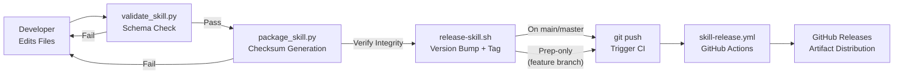
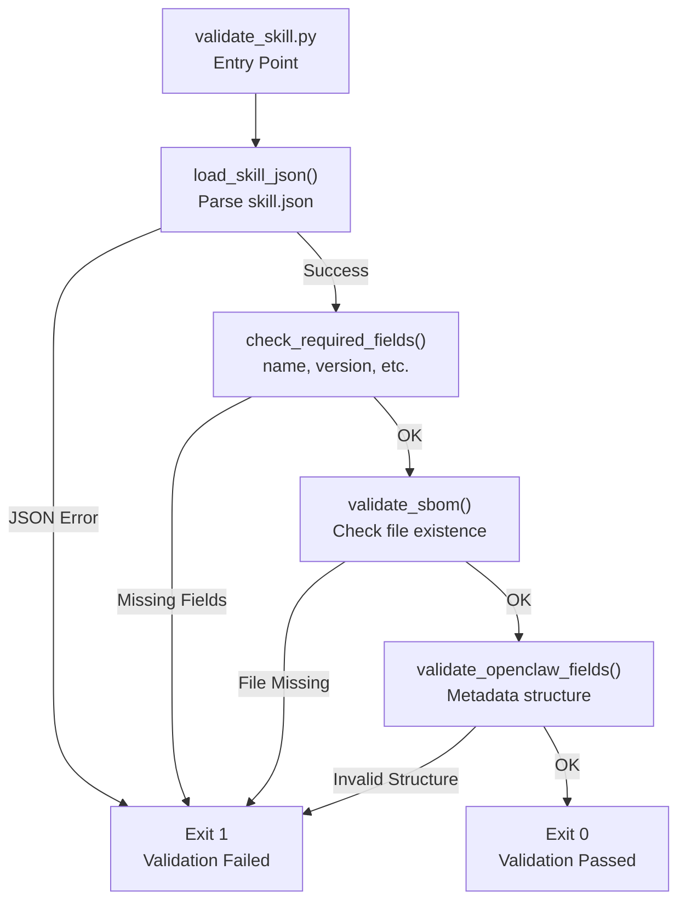
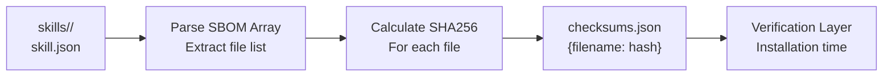
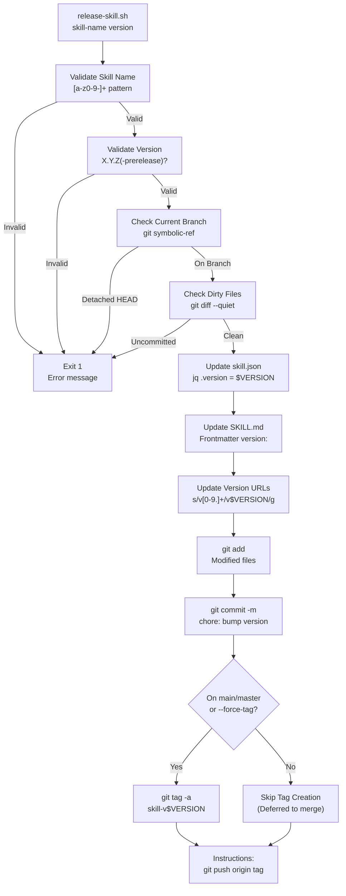
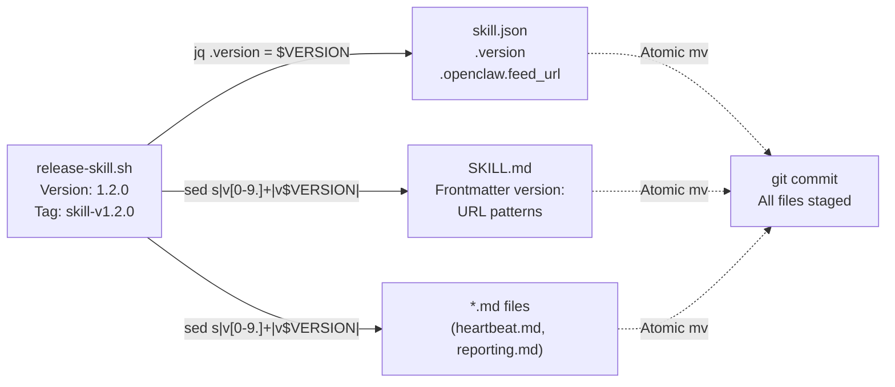
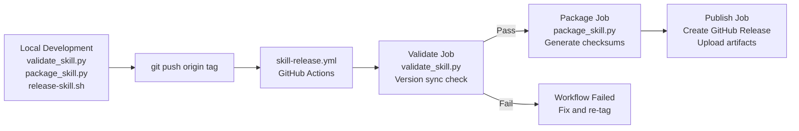

<!-- source: DeepWiki mcp.deepwiki.com · repo prompt-security/clawsec · page 6 Development Guide · fetched 2026-10-26 -->

# Development Guide

<details>
<summary>Relevant source files</summary>

The following files were used as context for generating this wiki page:

- [README.md](README.md)
- [scripts/release-skill.sh](scripts/release-skill.sh)

</details>


This document covers the local development workflow for ClawSec skills, including validation, packaging, and release procedures. It is intended for developers who want to create new skills, modify existing ones, or understand the release pipeline.

For information about the automated CI/CD release pipeline, see [Skill Release Pipeline](#5.1). For details on skill metadata and SBOM structure, see [Skills Ecosystem](#4).

**Scope**: This guide focuses on manual development tools and scripts that run locally. Topics include:
- Validating skill metadata and structure
- Generating checksums for integrity verification
- Using the release script to prepare version bumps and tags
- Setting up local test environments with sample data

---

## Development Workflow Overview

The ClawSec development workflow separates validation, packaging, and release into distinct phases, allowing developers to catch issues early and control when releases are published.

**Development Workflow Stages**



**Sources**: [README.md:238-271](), [scripts/release-skill.sh:1-16]()

---

## Skill Validation

The `validate_skill.py` utility performs schema validation and structural checks on skill directories before packaging or release.

### Validation Script Usage

```bash
python utils/validate_skill.py skills/<skill-name>
```

### Validation Checks

| Check Category | Validation Rules |
|---------------|------------------|
| **File Existence** | `skill.json` must exist and be valid JSON |
| **Required Fields** | `name`, `version`, `description`, `author`, `license` must be present |
| **SBOM Integrity** | All files listed in `skill.json` SBOM must exist and be readable |
| **OpenClaw Metadata** | If present, `openclaw.*` fields must follow proper structure |
| **Version Format** | Must conform to semantic versioning (e.g., `1.0.0`, `1.0.0-beta1`) |

### Validation Code Structure



**Sources**: [README.md:212-224](), [utils/validate_skill.py]() (inferred from usage)

### Common Validation Errors

| Error | Cause | Resolution |
|-------|-------|------------|
| **JSON Parse Error** | Malformed `skill.json` | Check syntax, trailing commas, quotes |
| **Missing Required Field** | `name`, `version`, etc. not present | Add field to `skill.json` |
| **SBOM File Not Found** | File listed in `sbom` array doesn't exist | Remove from SBOM or create file |
| **Invalid Semver** | Version not in `X.Y.Z` format | Update to `1.0.0`, `1.1.0`, etc. |

---

## Skill Packaging and Checksum Generation

The `package_skill.py` utility generates integrity checksums for all files in a skill's SBOM, creating a `checksums.json` manifest.

### Packaging Script Usage

```bash
python utils/package_skill.py skills/<skill-name> ./dist
```

**Output**: Creates `checksums.json` in the specified output directory with SHA256 hashes for all SBOM files.

### Checksum Generation Process



### Checksums JSON Schema

```json
{
  "skill.json": "sha256:abc123...",
  "SKILL.md": "sha256:def456...",
  "scripts/setup.mjs": "sha256:789ghi...",
  "README.md": "sha256:jkl012..."
}
```

Each entry maps a file path (relative to skill root) to its SHA256 hash prefixed with `sha256:`.

**Sources**: [README.md:226-235](), [scripts/release-skill.sh:175-179]() (checksums.json references)

---

## Release Script: version and Tag Management

The `release-skill.sh` script automates version bumping, URL updates, and Git tag creation. It implements a branch-aware workflow that distinguishes between feature development and release preparation.

### Basic Usage

```bash
./scripts/release-skill.sh <skill-name> <version>
```

**Example**:
```bash
./scripts/release-skill.sh clawsec-feed 1.2.0
```

### Release Script Workflow



**Sources**: [scripts/release-skill.sh:1-290]()

### Branch-Aware Release Behavior

The script detects the current branch and adjusts behavior accordingly:

| Branch Type | Behavior | Tag Creation | Use Case |
|-------------|----------|--------------|----------|
| **Feature Branch** | Updates versions, commits, pushes | ❌ Deferred | Development, CI validation |
| **main/master** | Updates versions, commits, creates tag | ✅ Immediate | Production release |
| **Any Branch + `--force-tag`** | Updates versions, commits, creates tag | ✅ Forced | Emergency hotfix, testing |

**Feature Branch Workflow** (Prep-only mode):
```bash
git checkout -b feature/feed-v1.2.0
./scripts/release-skill.sh clawsec-feed 1.2.0
# → Updates version, commits, no tag
git push origin feature/feed-v1.2.0
# → CI validates build

# After PR merge to main:
git checkout main && git pull
git tag -a 'clawsec-feed-v1.2.0' COMMIT_SHA -m 'clawsec-feed version 1.2.0'
git push origin clawsec-feed-v1.2.0
# → Triggers skill-release.yml
```

**Release Branch Workflow** (Full release):
```bash
git checkout main
./scripts/release-skill.sh clawsec-feed 1.2.0
# → Updates version, commits, creates tag
git push origin main
git push origin clawsec-feed-v1.2.0
# → Triggers skill-release.yml immediately
```

**Sources**: [scripts/release-skill.sh:11-15](), [scripts/release-skill.sh:44-90](), [scripts/release-skill.sh:273-289]()

### Input Validation and Security

The script implements security checks to prevent path traversal and invalid inputs:

```bash
# Skill name validation (line 59-63)
if ! [[ "$SKILL_NAME" =~ ^[a-z0-9-]+$ ]]; then
  echo "Error: Invalid skill name"
  exit 1
fi

# Semver validation (line 71-74)
if ! [[ "$VERSION" =~ ^[0-9]+\.[0-9]+\.[0-9]+(-[a-zA-Z0-9]+)?$ ]]; then
  echo "Error: Invalid version format"
  exit 1
fi
```

**Allowed Skill Names**: `clawsec-feed`, `soul-guardian`, `openclaw-audit-watchdog`  
**Disallowed**: `../malicious`, `ClawSec-Feed`, `skill_name`, `my.skill`

**Sources**: [scripts/release-skill.sh:57-74]()

---

## Version URL Pattern Updates

The release script automatically updates hardcoded version URLs across multiple files to ensure consistency after version bumps.

### Files Updated by Release Script



### URL Pattern Matching

The script uses regex patterns to find and replace versioned URLs:

**Pattern**: `/download/${SKILL_NAME}-v[0-9]+\.[0-9]+\.[0-9]+(-[a-zA-Z0-9]+)?/`  
**Replacement**: `/download/${SKILL_NAME}-v${NEW_VERSION}/`

**Example Transformation**:
```markdown
Before: https://github.com/.../download/clawsec-feed-v1.0.0/checksums.json
After:  https://github.com/.../download/clawsec-feed-v1.2.0/checksums.json
```

### URL Update Verification

The script verifies that substitutions occurred correctly:

```bash
# Check if pattern exists (line 147-161)
if grep -qE "$PATTERN" "$TEMP_DIR/SKILL.md"; then
  sed -E "s|$PATTERN|/download/${TAG}/|g" ...
  
  # Verify substitution
  if ! grep -qF "/download/${TAG}/" "$TEMP_DIR/SKILL.md.tmp"; then
    echo "Warning: URL pattern found but substitution may have failed"
  else
    URL_COUNT=$(grep -cF "/download/${TAG}/" "$TEMP_DIR/SKILL.md.tmp")
    echo "✓ Updated $URL_COUNT hardcoded URL(s)"
  fi
fi
```

**Sources**: [scripts/release-skill.sh:109-193]()

### Atomic File Operations

All file updates use a temporary directory to ensure atomicity:

```bash
# Create temporary directory (line 94-95)
TEMP_DIR=$(mktemp -d)
trap 'rm -rf "$TEMP_DIR"' EXIT

# Update pattern (line 102-107)
jq --arg v "$VERSION" '.version = $v' "$SKILL_PATH/skill.json" > "$TEMP_DIR/skill.json"
mv "$TEMP_DIR/skill.json" "$SKILL_PATH/skill.json"
FILES_TO_STAGE+=("$SKILL_PATH/skill.json")
```

This prevents partial writes if the script is interrupted.

**Sources**: [scripts/release-skill.sh:94-107]()

---

## Local Development Environment Setup

ClawSec provides scripts to populate local test data for development without requiring network access or CI pipeline execution.

### Populate Local Skills Catalog

The `populate-local-skills.sh` script scans the `skills/` directory and generates a catalog JSON for the website:

```bash
./scripts/populate-local-skills.sh
```

**Output**: Creates `public/skills-catalog.json` with metadata from all local skills.

### Populate Local Advisory Feed

The `populate-local-feed.sh` script fetches real CVE data from the NVD API and creates a local feed for testing:

```bash
# Fetch CVEs from last 120 days
./scripts/populate-local-feed.sh --days 120
```

**Output**: Creates or updates `advisories/feed.json` with NVD CVE data filtered by ClawSec keywords (OpenClaw, Moltbot, prompt injection).

### Local Development Server

```bash
# Install dependencies
npm install

# Populate local data
./scripts/populate-local-skills.sh
./scripts/populate-local-feed.sh --days 120

# Start development server
npm run dev
# → http://localhost:5173
```

**Sources**: [README.md:238-271]()

---

## Development Checklist

### Before Creating a Skill

- [ ] Choose a unique skill name (lowercase, hyphens only)
- [ ] Create `skills/<skill-name>/` directory
- [ ] Add `skill.json` with required metadata
- [ ] Add `SKILL.md` with agent-readable instructions
- [ ] List all files in `skill.json` SBOM array

### Before Committing Changes

- [ ] Run `python utils/validate_skill.py skills/<skill-name>`
- [ ] Verify `skill.json` version matches `SKILL.md` frontmatter
- [ ] Test installation instructions manually
- [ ] Check for hardcoded version URLs (should use variables or relative paths)

### Before Releasing

- [ ] Ensure working directory is clean (`git status`)
- [ ] Run `./scripts/release-skill.sh <skill-name> <new-version>`
- [ ] Review `git diff` output for version changes
- [ ] Push branch to trigger CI validation (`git push origin <branch>`)
- [ ] After CI passes and PR merges, create tag if not on main/master

### After Release Tag Push

- [ ] Monitor GitHub Actions for `skill-release.yml` execution
- [ ] Verify GitHub Release created with all artifacts:
  - `checksums.json`
  - `skill.json`
  - `SKILL.md`
  - Additional SBOM files
- [ ] Test installation using new release URL
- [ ] Verify checksums with `sha256sum -c checksums.json`

**Sources**: [README.md:318-325](), [scripts/release-skill.sh:1-290]()

---

## Error Recovery

### Rollback Version Bump Commit

If the release script created a commit but you want to undo it:

```bash
# Before pushing
git reset --hard HEAD~1

# If tag was created
git tag -d <skill-name>-v<version>
```

### Recreate Tag After Failed Push

If tagging failed but the commit exists:

```bash
# Find the commit SHA (printed by release script)
COMMIT_SHA=abc123...

# Create tag manually
git tag -a 'clawsec-feed-v1.2.0' $COMMIT_SHA -m 'clawsec-feed version 1.2.0'
git push origin clawsec-feed-v1.2.0
```

### Fix Version Mismatch After Manual Edit

If `skill.json` and `SKILL.md` versions get out of sync:

```bash
# Re-run release script (will update both files)
./scripts/release-skill.sh <skill-name> <correct-version>

# Or edit manually and validate
python utils/validate_skill.py skills/<skill-name>
```

**Sources**: [scripts/release-skill.sh:238-272]()

---

## Integration with CI/CD

The local development tools integrate with automated CI/CD workflows:



**Key Differences Between Local and CI**:

| Tool | Local Execution | CI Execution |
|------|-----------------|--------------|
| `validate_skill.py` | Manual, developer-triggered | Automatic on PR and tag push |
| `package_skill.py` | Optional, for testing | Required, generates release checksums |
| `release-skill.sh` | Creates version bump commit + tag | N/A (CI triggered by tag) |
| Checksum verification | Not performed | Performed during artifact upload |

**Sources**: [README.md:159-180](), [scripts/release-skill.sh:1-16]()

---

