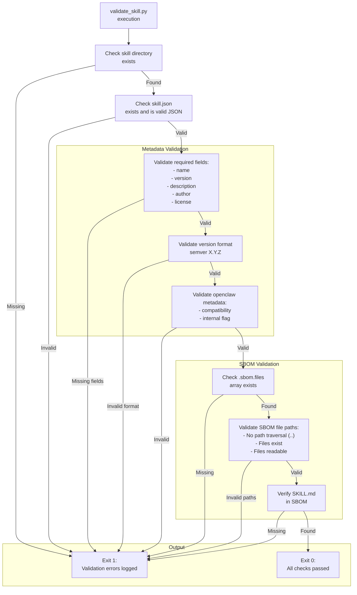
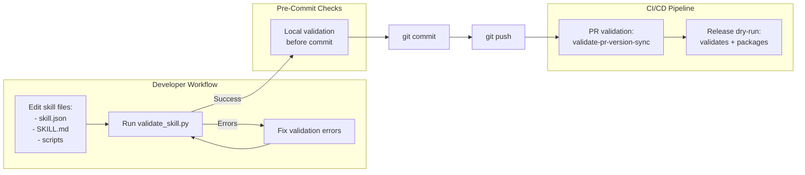
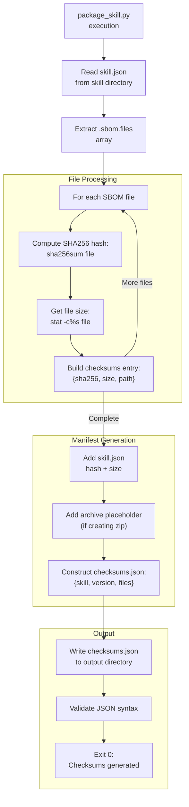
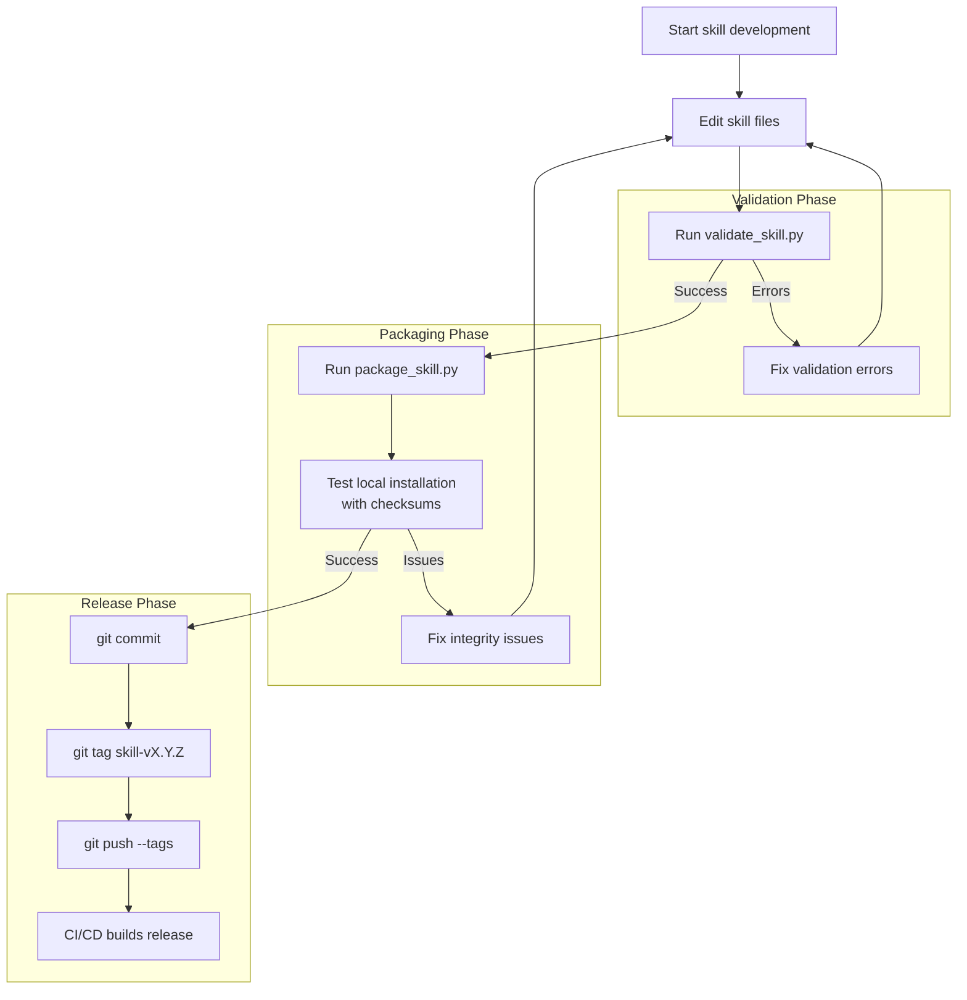

<!-- source: DeepWiki mcp.deepwiki.com · repo prompt-security/clawsec · page 6.1 Local Validation and Packaging · fetched 2026-10-26 -->

# Local Validation and Packaging

<details>
<summary>Relevant source files</summary>

The following files were used as context for generating this wiki page:

- [.github/workflows/skill-release.yml](.github/workflows/skill-release.yml)
- [README.md](README.md)

</details>


## Purpose and Scope

This document covers the local development tools for validating and packaging ClawSec skills before release. These utilities enable developers to verify skill metadata correctness and generate integrity checksums without triggering the full CI/CD pipeline.

The two core tools are:
- **`validate_skill.py`** - Validates skill metadata, SBOM files, and required fields
- **`package_skill.py`** - Generates `checksums.json` with SHA256 hashes for all skill files

For information about the automated release pipeline that uses these tools, see [Skill Release Pipeline](#5.1). For manual release procedures using `release-skill.sh`, see [Release Script Usage](#6.2). For setting up local development environments with test data, see [Local Development Environment](#6.3).

---

## Skill Validation Tool

### Overview

The `validate_skill.py` utility performs pre-release validation of skill directories to ensure they conform to ClawSec's packaging requirements. It checks metadata structure, required fields, SBOM file references, and OpenClaw-specific metadata.

### Usage

```bash
# Validate a single skill
python utils/validate_skill.py skills/clawsec-feed

# Exit codes:
# 0 - Validation passed
# 1 - Validation failed
```

**Sources:** [README.md:211-223](), [utils/validate_skill.py:1-end]()

---

### Validation Checks

The validator performs a comprehensive series of checks to ensure skill integrity before packaging or release.

#### Validation Flow



**Sources:** [README.md:218-223](), [utils/validate_skill.py:1-end]()

---

### Required skill.json Fields

The validator enforces the following schema for `skill.json`:

| Field | Type | Required | Description |
|-------|------|----------|-------------|
| `name` | string | ✅ Yes | Skill identifier (matches directory name) |
| `version` | string | ✅ Yes | Semantic version (X.Y.Z format) |
| `description` | string | ✅ Yes | Human-readable skill description |
| `author` | string | ✅ Yes | Skill author/maintainer |
| `license` | string | ✅ Yes | SPDX license identifier |
| `sbom.files` | array | ✅ Yes | List of files included in release package |
| `sbom.files[].path` | string | ✅ Yes | Relative path to file from skill directory |
| `openclaw.compatibility` | array | ⚙️ Optional | Agent family compatibility list |
| `openclaw.internal` | boolean | ⚙️ Optional | If true, skip ClawHub publishing |

**SBOM Requirements:**
- Must include `SKILL.md` as an entry
- All referenced files must exist in the skill directory
- No path traversal patterns (`..`) allowed
- Files must be readable

**Sources:** [README.md:218-223](), [.github/workflows/skill-release.yml:249-253]()

---

### Validation Integration with Development



**Sources:** [README.md:211-235](), [.github/workflows/skill-release.yml:22-167]()

---

## Skill Packaging Tool

### Overview

The `package_skill.py` utility generates a `checksums.json` manifest with SHA256 integrity hashes for all files in a skill's SBOM. This manifest is used during installation to verify that downloaded files have not been tampered with.

### Usage

```bash
# Package a skill and generate checksums
python utils/package_skill.py skills/clawsec-feed ./dist

# Outputs:
# - dist/checksums.json (integrity manifest)
```

The tool reads the skill's `skill.json`, processes all files listed in the SBOM, computes SHA256 hashes, and generates a complete integrity manifest.

**Sources:** [README.md:227-234](), [utils/package_skill.py:1-end]()

---

### Packaging Process

The packaging tool follows a structured process to generate integrity checksums for distribution:



**Sources:** [README.md:227-234](), [.github/workflows/skill-release.yml:494-599]()

---

### checksums.json Schema

The generated `checksums.json` file provides a complete integrity manifest for skill distribution. This file is consumed by installation tools to verify downloaded artifacts.

#### Complete Structure

```json
{
  "skill": "clawsec-feed",
  "version": "0.0.4",
  "generated_at": "2026-02-01T12:00:00Z",
  "repository": "prompt-security/clawsec",
  "tag": "clawsec-feed-v0.0.4",
  "archive": {
    "filename": "clawsec-feed-v0.0.4.zip",
    "sha256": "abc123...",
    "size": 45678,
    "url": "https://github.com/prompt-security/clawsec/releases/download/clawsec-feed-v0.0.4/clawsec-feed-v0.0.4.zip"
  },
  "files": {
    "SKILL.md": {
      "sha256": "def456...",
      "size": 12345,
      "path": "SKILL.md"
    },
    "scripts/check_feed.mjs": {
      "sha256": "789abc...",
      "size": 8901,
      "path": "scripts/check_feed.mjs"
    },
    "skill.json": {
      "sha256": "012def...",
      "size": 2345
    }
  }
}
```

#### Field Descriptions

| Field | Type | Description |
|-------|------|-------------|
| `skill` | string | Skill name (from skill.json) |
| `version` | string | Skill version (from skill.json) |
| `generated_at` | string | ISO 8601 timestamp of generation |
| `repository` | string | GitHub repository path |
| `tag` | string | Git tag for this release |
| `archive.filename` | string | Zip archive filename |
| `archive.sha256` | string | SHA256 hash of the zip file |
| `archive.size` | number | Zip file size in bytes |
| `archive.url` | string | Download URL for the archive |
| `files` | object | Map of file paths to integrity data |
| `files[path].sha256` | string | SHA256 hash of the file |
| `files[path].size` | number | File size in bytes |
| `files[path].path` | string | Relative path (may be omitted for skill.json) |

**Sources:** [.github/workflows/skill-release.yml:557-581](), [README.md:199-203]()

---

### CI/CD Integration

While `package_skill.py` is a local tool, the CI/CD pipeline replicates its logic during automated releases:

```mermaid
graph LR
    subgraph "Local Development"
        DevPackage["package_skill.py<br/>generates checksums"]
        DevTest["Test integrity<br/>verification locally"]
    end
    
    subgraph "CI/CD Pipeline"
        TagPush["git tag skill-vX.Y.Z"]
        CIPackage["skill-release.yml<br/>Package release assets step"]
        GenChecksums["Generate checksums.json<br/>(lines 494-599)"]
        CreateZip["Create .zip archive"]
        Publish["Publish to GitHub Releases"]
    end
    
    subgraph "Distribution"
        Release["GitHub Release<br/>with checksums.json"]
        Download["Agent downloads<br/>and verifies"]
    end
    
    DevPackage --> DevTest
    DevTest -->|Ready| TagPush
    TagPush --> CIPackage
    CIPackage --> GenChecksums
    GenChecksums --> CreateZip
    CreateZip --> Publish
    Publish --> Release
    Release --> Download
```



The CI/CD pipeline uses the same hashing algorithm (SHA256) and manifest structure as the local tool, ensuring consistency between local development and production releases.

**Sources:** [.github/workflows/skill-release.yml:494-599](), [README.md:169-203]()

---

## Validation vs Packaging

The two tools serve complementary purposes in the development workflow:

| Tool | Purpose | When to Use | Output |
|------|---------|-------------|--------|
| `validate_skill.py` | Schema validation | Before committing changes | Exit code 0/1 |
| `package_skill.py` | Integrity manifest | Before testing installation | `checksums.json` |

### Typical Development Cycle



**Sources:** [README.md:211-235](), [README.md:238-270]()

---

## Integrity Verification Matrix

The checksums generated by `package_skill.py` are consumed at multiple stages to ensure end-to-end integrity:

| Stage | Tool/Component | Verification Method |
|-------|---------------|---------------------|
| **Local Development** | `package_skill.py` | Generates baseline checksums |
| **CI/CD Build** | `.github/workflows/skill-release.yml` | Regenerates checksums (lines 529-581) |
| **Distribution** | GitHub Releases | Stores `checksums.json` as release asset |
| **Installation** | `clawsec-suite` | Downloads and verifies checksums (see [#2.1](#2.1)) |
| **Verification** | Manual `sha256sum` | Users can independently verify downloads |

This multi-layer verification ensures that skills cannot be modified between development and deployment without detection.

**Sources:** [.github/workflows/skill-release.yml:494-599](), [README.md:94-98]()

---

## File Structure Example

A typical skill directory structure for validation and packaging:

```
skills/clawsec-feed/
├── skill.json              # Metadata + SBOM manifest
├── SKILL.md                # Agent-readable instructions
├── README.md               # Human-readable documentation
├── scripts/
│   ├── check_feed.mjs      # Feed polling logic
│   └── setup_cron.sh       # Installation automation
└── advisories/
    └── feed.json           # Bundled advisory feed
```

**What gets validated:**
- `skill.json` schema and required fields
- All files in `sbom.files` array exist
- No path traversal in file paths
- `SKILL.md` is included in SBOM

**What gets hashed:**
- Every file listed in `sbom.files`
- The `skill.json` file itself
- The generated `.zip` archive

**Sources:** [README.md:274-299](), [.github/workflows/skill-release.yml:266-289]()

---

## Command Reference

### validate_skill.py

```bash
# Basic usage
python utils/validate_skill.py <skill-directory>

# Example
python utils/validate_skill.py skills/clawsec-feed

# Check exit code
python utils/validate_skill.py skills/soul-guardian && echo "Valid"
```

### package_skill.py

```bash
# Basic usage
python utils/package_skill.py <skill-directory> <output-directory>

# Example
python utils/package_skill.py skills/clawsec-feed ./dist

# Verify output
jq . dist/checksums.json
```

### Integration with release-skill.sh

The manual release script (see [#6.2](#6.2)) uses these tools internally:

```bash
# release-skill.sh workflow
./scripts/release-skill.sh clawsec-feed patch

# Internally runs:
# 1. validate_skill.py (version validation)
# 2. Updates version numbers
# 3. Commits and tags
# 4. CI/CD runs package_skill.py equivalent
```

**Sources:** [README.md:211-235](), [scripts/release-skill.sh:1-end]()

---

## Error Handling

Both tools provide clear error messages for common issues:

### Common Validation Errors

| Error | Cause | Resolution |
|-------|-------|------------|
| `skill.json not found` | Missing metadata file | Create `skill.json` in skill directory |
| `Invalid JSON` | Syntax error in skill.json | Fix JSON syntax with linter |
| `Missing required field: version` | Missing metadata | Add required field to skill.json |
| `Invalid version format` | Non-semver version | Use X.Y.Z format |
| `SBOM file not found: script.sh` | Referenced file missing | Add file or remove from SBOM |
| `Path traversal detected: ../other` | Invalid path in SBOM | Use relative paths within skill directory |
| `SKILL.md not in SBOM` | Missing required file | Add `SKILL.md` to `sbom.files` array |

### Common Packaging Errors

| Error | Cause | Resolution |
|-------|-------|------------|
| `Cannot read file: script.sh` | Permission issue | Fix file permissions with `chmod` |
| `skill.json missing .sbom.files` | Invalid metadata | Add SBOM array to skill.json |
| `Invalid JSON output` | Encoding issue | Check file encodings, remove non-UTF8 chars |

**Sources:** [.github/workflows/skill-release.yml:122-150](), [.github/workflows/skill-release.yml:249-253]()

---

## See Also

- [Skill Release Pipeline](#5.1) - Automated CI/CD release process
- [Release Script Usage](#6.2) - Manual release helper (`release-skill.sh`)
- [Local Development Environment](#6.3) - Setting up local test data
- [Integrity Verification](#8.3) - How checksums are verified during installation
- [Installation Flow and Verification](#2.1) - Agent-side checksum verification

---

