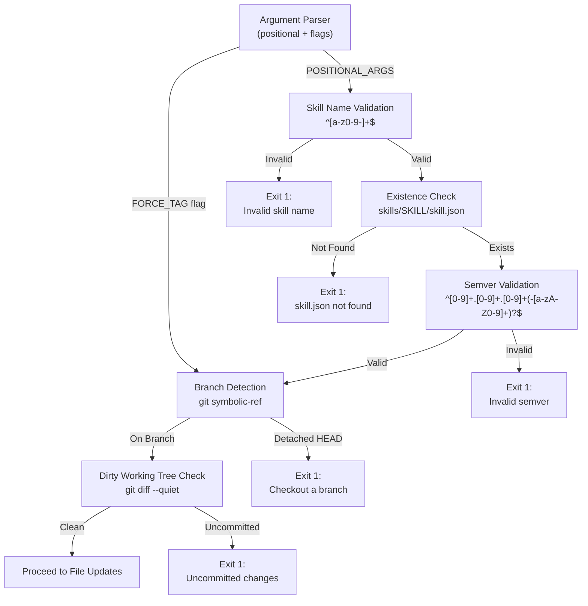
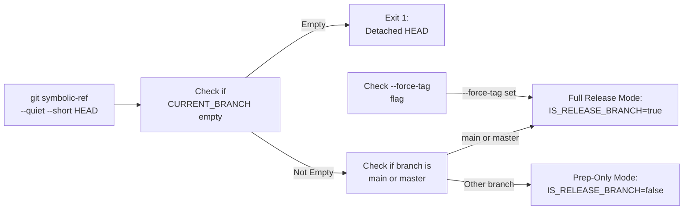
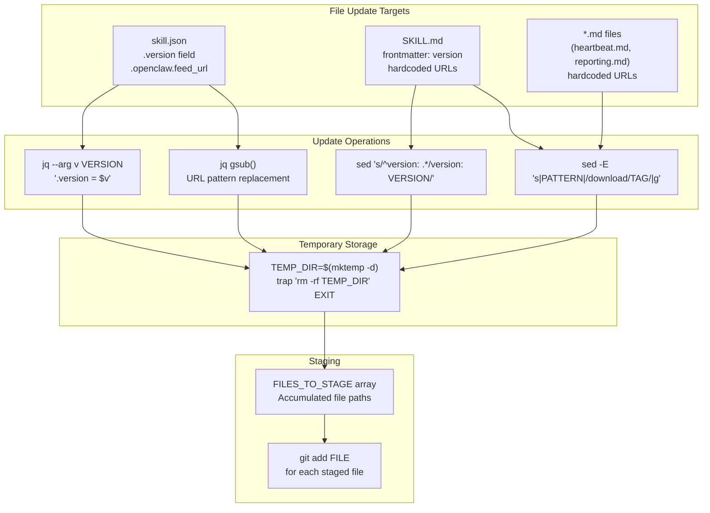
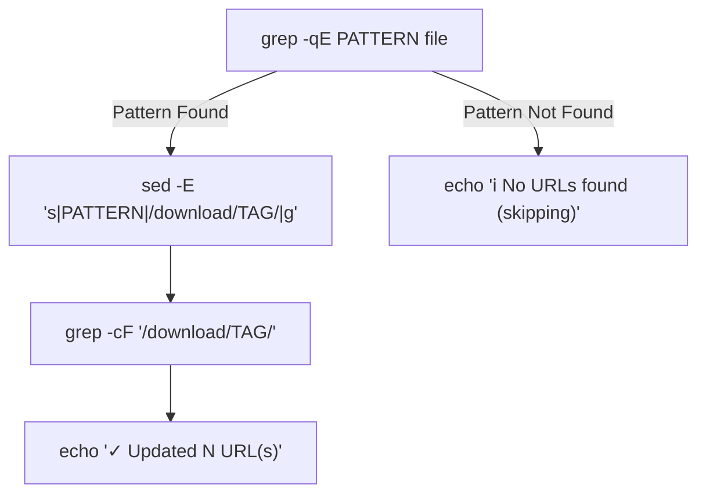
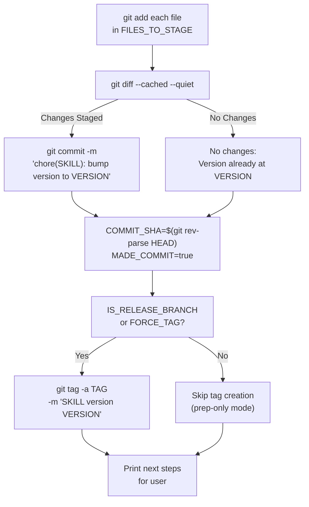
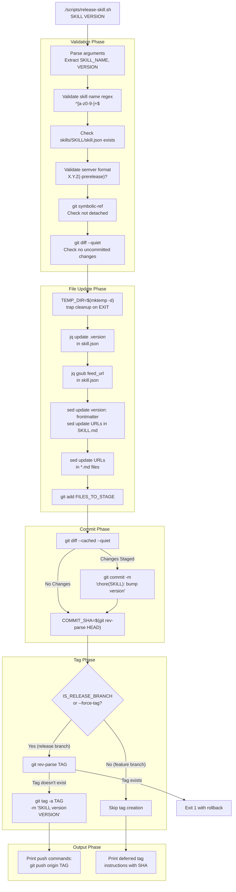

<!-- source: DeepWiki mcp.deepwiki.com · repo prompt-security/clawsec · page 6.2 Release Script Usage · fetched 2026-10-26 -->

# Release Script Usage

<details>
<summary>Relevant source files</summary>

The following files were used as context for generating this wiki page:

- [scripts/release-skill.sh](scripts/release-skill.sh)

</details>


**Purpose**: This page documents the `release-skill.sh` script, which automates the manual release process for ClawSec skills. The script ensures version consistency across multiple files, commits changes, and creates Git tags for distribution. For automated CI/CD release workflows, see [Skill Release Pipeline](#5.1). For validation and packaging tools, see [Local Validation and Packaging](#6.1). For branch-specific release behaviors, see [Branch-Aware Release Workflow](#6.2.1), and for URL pattern updates, see [Version URL Pattern Updates](#6.2.2).

**Scope**: Covers the `release-skill.sh` command-line interface, its validation logic, file update mechanisms, branch detection, atomic operations, and error recovery procedures.

---

## Script Overview and Invocation

The `release-skill.sh` script provides a developer-friendly interface for preparing skill releases. It accepts a skill name, version number, and optional flags to control tagging behavior.

### Command Syntax

| Parameter | Description | Format | Example |
|-----------|-------------|--------|---------|
| `<skill-name>` | Name of the skill directory under `skills/` | `[a-z0-9-]+` | `clawsec-feed` |
| `<version>` | Semantic version number | `X.Y.Z[-prerelease]` | `1.1.0` or `1.0.0-beta1` |
| `--force-tag` | Create tag even on non-release branches | Optional flag | `--force-tag` |

**Usage Pattern**:
```bash
./scripts/release-skill.sh <skill-name> <version> [--force-tag]
```

The script operates in two modes based on the current Git branch:
- **Full Release Mode**: On `main` or `master` branches, updates versions, commits, and creates Git tags
- **Prep-Only Mode**: On feature branches, updates versions and commits but defers tag creation until merge to main

Sources: [scripts/release-skill.sh:1-16]()

---

## Argument Parsing and Validation

The script implements a multi-stage validation pipeline to prevent common errors and security issues before modifying any files.

### Validation Stages



**Validation Pipeline: Fail-Fast Security Checks**

### Security: Path Injection Prevention

The script validates skill names using a strict regex pattern to prevent path traversal attacks:

```bash
# Only lowercase alphanumeric and hyphens allowed
if ! [[ "$SKILL_NAME" =~ ^[a-z0-9-]+$ ]]; then
  echo "Error: Invalid skill name."
  exit 1
fi
```

This prevents malicious inputs like `../../etc/passwd` or `skill/../../../dangerous` from escaping the `skills/` directory.

Sources: [scripts/release-skill.sh:19-74](), [scripts/release-skill.sh:57-63]()

---

## Branch Detection and Mode Selection

The script detects the current Git branch to determine release mode, implementing different behaviors for release branches versus feature branches.

### Branch Detection Logic



**Branch Detection State Machine**

The script stores branch information in two variables:
- `CURRENT_BRANCH`: The actual branch name (e.g., `feature/new-advisory`)
- `IS_RELEASE_BRANCH`: Boolean flag (`true` for `main`/`master`, `false` otherwise)

### Mode Announcement

The script announces its operating mode during startup:

| Branch Type | Mode | Tag Creation | Output Message |
|-------------|------|--------------|----------------|
| `main` or `master` | Full Release | Yes | "Mode: Full release (will create tag)" |
| Feature branch | Prep-Only | No | "Mode: Prep only (tag deferred until merge to main)" |
| Any branch + `--force-tag` | Full Release | Yes (forced) | "Mode: Full release (will create tag)" |

Sources: [scripts/release-skill.sh:44-90]()

---

## File Update Pipeline

The script updates version numbers and URLs across multiple files using atomic file operations to prevent partial writes during failures.

### Update Targets and Patterns



**File Update Pipeline with Atomic Operations**

### Atomic File Write Pattern

The script uses a temporary directory for all file operations:

1. **Create Temporary Directory**: `TEMP_DIR=$(mktemp -d)` creates a unique temporary directory
2. **Install Cleanup Handler**: `trap 'rm -rf "$TEMP_DIR"' EXIT` ensures cleanup on any exit (success or failure)
3. **Write to Temporary Files**: All `jq` and `sed` operations output to `$TEMP_DIR/filename`
4. **Verify Output**: Script checks that expected patterns exist in temporary files
5. **Atomic Move**: `mv "$TEMP_DIR/filename" "$SKILL_PATH/filename"` replaces original file only if verification passes

This pattern prevents partial writes if the script crashes mid-operation.

Sources: [scripts/release-skill.sh:93-96](), [scripts/release-skill.sh:100-107]()

---

## Version Field Updates

The script updates version fields in `skill.json` and `SKILL.md` frontmatter using different tools based on file format.

### skill.json Version Update

The script uses `jq` to update the `.version` field:

```bash
jq --arg v "$VERSION" '.version = $v' "$SKILL_PATH/skill.json" > "$TEMP_DIR/skill.json"
```

This approach preserves JSON formatting and prevents syntax errors from manual string manipulation.

### SKILL.md Frontmatter Update

The SKILL.md frontmatter uses YAML-style `version: X.Y.Z` format. The script updates it with `sed`:

```bash
sed "s/^version: .*/version: $VERSION/" "$SKILL_PATH/SKILL.md" > "$TEMP_DIR/SKILL.md"
```

The script includes pre-flight and post-flight verification:
1. **Pre-flight**: Verifies `version:` line exists using `grep -qE "^version: "`
2. **Post-flight**: Verifies new version appears using `grep -qF "version: $VERSION"`

If either verification fails, the script exits with an error message before committing changes.

Sources: [scripts/release-skill.sh:100-140]()

---

## URL Pattern Replacement

The script updates hardcoded version URLs across all markdown files, ensuring download links point to the correct release tag.

### URL Pattern Recognition

The script matches GitHub release download URLs with this pattern:

| Pattern Component | Description | Example Match |
|------------------|-------------|---------------|
| `/download/` | GitHub release download path | `/download/` |
| `${SKILL_NAME}-v` | Skill name prefix with version indicator | `clawsec-feed-v` |
| `[0-9]+\.[0-9]+\.[0-9]+` | Semantic version number | `1.0.0` |
| `(-[a-zA-Z0-9]+)?` | Optional prerelease suffix | `-beta1` (optional) |
| `/` | Trailing slash | `/` |

**Full Pattern**: `/download/${SKILL_NAME}-v[0-9]+\.[0-9]+\.[0-9]+(-[a-zA-Z0-9]+)?/`

### Replacement Process



**URL Replacement Verification Flow**

### Files Updated

The script updates URLs in three locations:

1. **skill.json**: Updates `.openclaw.feed_url` field if it exists
2. **SKILL.md**: Updates all hardcoded version URLs in installation instructions
3. **Other .md files**: Scans all `*.md` files in the skill directory (e.g., `heartbeat.md`, `reporting.md`)

For each file, the script reports:
- Number of URLs updated if pattern found
- Skip message if no pattern found (not an error—some skills don't self-reference)
- Warning if pattern found but substitution failed (indicates regex issue)

Sources: [scripts/release-skill.sh:109-193]()

---

## Commit and Tag Creation

After successfully updating all files, the script stages changes, commits them, and optionally creates a Git tag based on the current branch.

### Commit Workflow



**Commit and Tag Creation Decision Tree**

### Tag Naming Convention

The script generates tags using the pattern:
```
${SKILL_NAME}-v${VERSION}
```

Examples:
- `clawsec-feed-v1.1.0`
- `soul-guardian-v2.0.0-beta1`
- `openclaw-audit-watchdog-v1.0.0`

This pattern enables the skill-release.yml workflow to trigger on skill-specific tags (see [Skill Release Pipeline](#5.1)).

### Commit Message Format

All release commits use the format:
```
chore(${SKILL_NAME}): bump version to ${VERSION}
```

This follows conventional commit conventions and clearly identifies version bump commits in Git history.

Sources: [scripts/release-skill.sh:195-225]()

---

## Error Recovery and Rollback

The script implements comprehensive error recovery mechanisms with clear rollback instructions for each failure scenario.

### Error Scenarios and Recovery

| Error Scenario | Detection Point | Rollback Command | Notes |
|----------------|----------------|------------------|-------|
| Tag already exists | Before `git tag -a` | `git reset --hard HEAD~1` | Rolls back commit if it was created |
| Tag creation fails | After `git tag -a` fails | `git tag -a TAG COMMIT_SHA` (manual retry) | Commit exists but untagged |
| Partial file update | During sed/jq operations | Automatic via `trap` cleanup | Temp directory removed on EXIT |
| Version already current | After staging, no diff | No rollback needed | Script continues with existing commit |

### Tag Collision Handling

When a tag already exists, the script provides conditional rollback:

```bash
if git rev-parse "$TAG" >/dev/null 2>&1; then
  echo "Error: Tag $TAG already exists"
  if [[ "$MADE_COMMIT" == "true" ]]; then
    echo "Rolling back version-bump commit..."
    git reset --hard HEAD~1
  fi
  exit 1
fi
```

The script only rolls back the commit if it created one in the current run (tracked by `MADE_COMMIT` flag). If the version was already current, no rollback occurs.

### Tag Creation Failure Recovery

If tag creation fails after committing, the script prints detailed recovery instructions:

```
The commit has been created but NOT tagged:
  Commit: <SHA>

Recovery options:
  1. Fix the issue and tag manually:
     git tag -a 'TAG' -m 'SKILL version VERSION' <SHA>

  2. Investigate why tagging failed:
     - Check if tag exists: git tag -l 'TAG'
     - Check permissions: ls -ld .git/refs/tags

  3. To rollback the commit (if desired):
     git reset --hard HEAD~1

The commit has NOT been pushed. Fix the issue before pushing.
```

This preserves the commit SHA for manual tag creation, allowing developers to investigate the issue without losing work.

Sources: [scripts/release-skill.sh:227-258]()

---

## Output and Next Steps

The script concludes with mode-specific instructions for completing the release process.

### Full Release Mode Output

When running on `main`/`master` (or with `--force-tag`):

```
Done! To release, push the tag:
  git push origin main
  git push origin clawsec-feed-v1.1.0

Or to undo:
  git reset --hard HEAD~1 && git tag -d clawsec-feed-v1.1.0
```

The script provides:
1. **Push command for branch** (if commit was created)
2. **Push command for tag** to trigger CI/CD release workflow
3. **Undo command** to rollback both commit and tag

### Prep-Only Mode Output

When running on feature branches:

```
Done! Version updated and committed (tag deferred).

Next steps:
  1. Push your branch for CI validation:
     git push origin feature/bump-version

  2. After CI passes and PR is merged to main, create the tag:
     git checkout main && git pull
     git tag -a 'clawsec-feed-v1.1.0' <COMMIT_SHA> -m 'clawsec-feed version 1.1.0'
     git push origin clawsec-feed-v1.1.0

Or to undo the version bump:
  git reset --hard HEAD~1
```

The script provides:
1. **Feature branch push command** for CI validation (see [Version Validation and PR Checks](#5.1.1))
2. **Post-merge tagging instructions** with exact commit SHA preserved
3. **Undo command** for the version bump commit

This workflow allows developers to validate version updates through CI before creating the release tag.

Sources: [scripts/release-skill.sh:260-289]()

---

## Complete Workflow Diagram



**Complete release-skill.sh Execution Flow**

Sources: [scripts/release-skill.sh:1-290]()

---

## Usage Examples

### Example 1: Release on Main Branch

```bash
# Ensure on main branch
git checkout main
git pull origin main

# Run release script
./scripts/release-skill.sh clawsec-feed 1.2.0

# Output:
# Releasing clawsec-feed version 1.2.0
# Branch: main
# Mode: Full release (will create tag)
# =======================================
# Updating skills/clawsec-feed/skill.json version to 1.2.0...
# Updating openclaw.feed_url to use tag clawsec-feed-v1.2.0...
# Updating skills/clawsec-feed/SKILL.md frontmatter version to 1.2.0...
#   ✓ Version updated to 1.2.0
# Updating hardcoded version URLs in SKILL.md to use tag clawsec-feed-v1.2.0...
#   ✓ Updated 3 hardcoded URL(s)
# ...
# Done! To release, push the tag:
#   git push origin main
#   git push origin clawsec-feed-v1.2.0

# Push to trigger CI/CD
git push origin main
git push origin clawsec-feed-v1.2.0
```

### Example 2: Prep on Feature Branch

```bash
# On feature branch
git checkout feature/improve-docs

# Run release script (will skip tag creation)
./scripts/release-skill.sh soul-guardian 2.1.0

# Output:
# Releasing soul-guardian version 2.1.0
# Branch: feature/improve-docs
# Mode: Prep only (tag deferred until merge to main)
# =======================================
# ...
# Done! Version updated and committed (tag deferred).
# 
# Next steps:
#   1. Push your branch for CI validation:
#      git push origin feature/improve-docs
#
#   2. After CI passes and PR is merged to main, create the tag:
#      git checkout main && git pull
#      git tag -a 'soul-guardian-v2.1.0' abc123def -m 'soul-guardian version 2.1.0'
#      git push origin soul-guardian-v2.1.0

# Push for CI validation
git push origin feature/improve-docs
```

### Example 3: Force Tag on Feature Branch

```bash
# Sometimes needed for testing release workflow
git checkout feature/test-release

# Use --force-tag to create tag on feature branch
./scripts/release-skill.sh clawtributor 0.0.5 --force-tag

# Output:
# Releasing clawtributor version 0.0.5
# Branch: feature/test-release
# Mode: Full release (will create tag)
# ...
# Done! To release, push the tag:
#   git push origin feature/test-release
#   git push origin clawtributor-v0.0.5
```

### Example 4: Prerelease Version

```bash
# Release beta version
./scripts/release-skill.sh clawsec-feed 2.0.0-beta1

# Tag created: clawsec-feed-v2.0.0-beta1
# CI workflow will detect prerelease suffix and create prerelease on GitHub
```

Sources: [scripts/release-skill.sh:2-4](), [scripts/release-skill.sh:36-37]()

---

## Integration with CI/CD

The release script is the manual entry point to the automated CI/CD pipeline. The relationship between manual release and automated workflows:

| Release Step | Manual (release-skill.sh) | Automated (CI/CD) |
|--------------|---------------------------|-------------------|
| Version update | Updates `skill.json`, `SKILL.md`, `*.md` | N/A (uses committed versions) |
| Validation | Regex validation, path checks | `validate_skill.py` (see [Local Validation and Packaging](#6.1)) |
| Commit | Creates commit with conventional format | N/A (triggered by tag) |
| Tagging | Creates `${SKILL_NAME}-v${VERSION}` tag | N/A (triggered by tag push) |
| Packaging | N/A (happens in CI) | `package_skill.py` creates `.skill` artifact (see [Release Asset Packaging](#5.1.2)) |
| Checksums | N/A (happens in CI) | Generates `checksums.json` |
| Publishing | N/A (happens in CI) | Creates GitHub Release, publishes to ClawHub (see [Publishing and Distribution](#5.1.3)) |

**Workflow Trigger**: Pushing the tag (e.g., `git push origin clawsec-feed-v1.2.0`) triggers the `skill-release.yml` workflow, which handles packaging, checksum generation, and distribution.

Sources: [scripts/release-skill.sh:1-16]()

---

