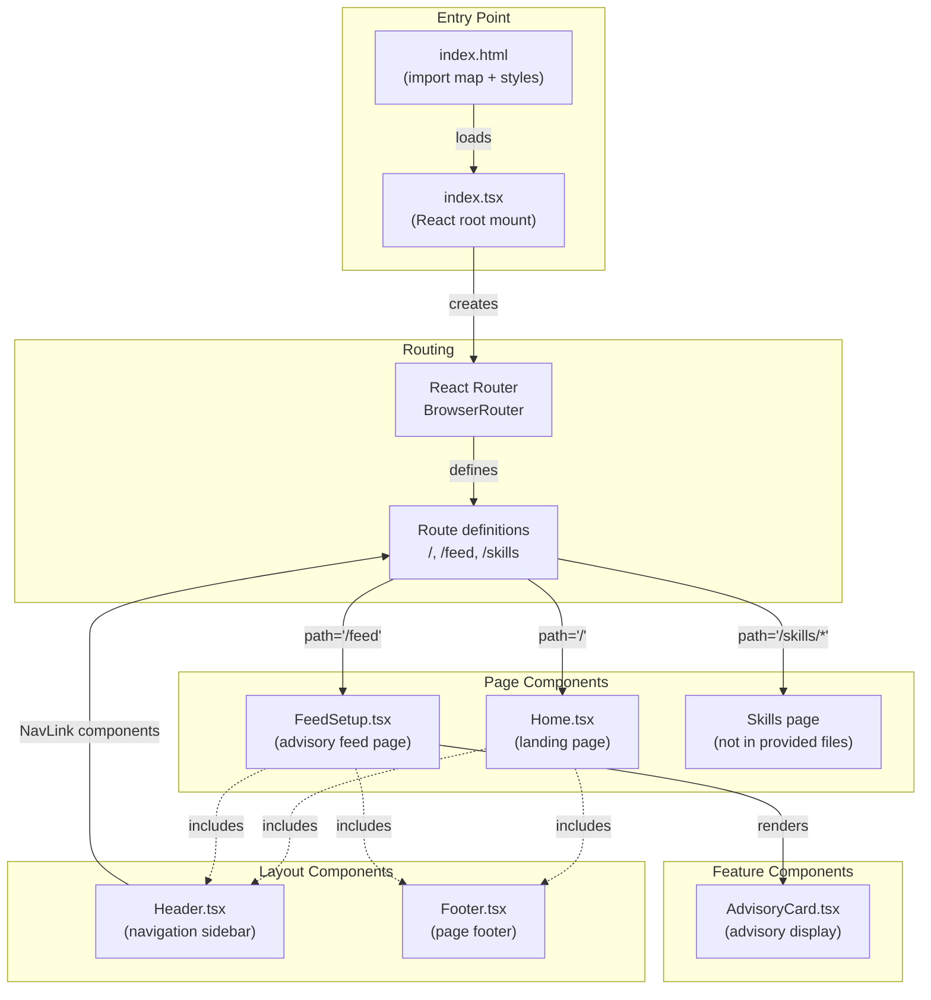
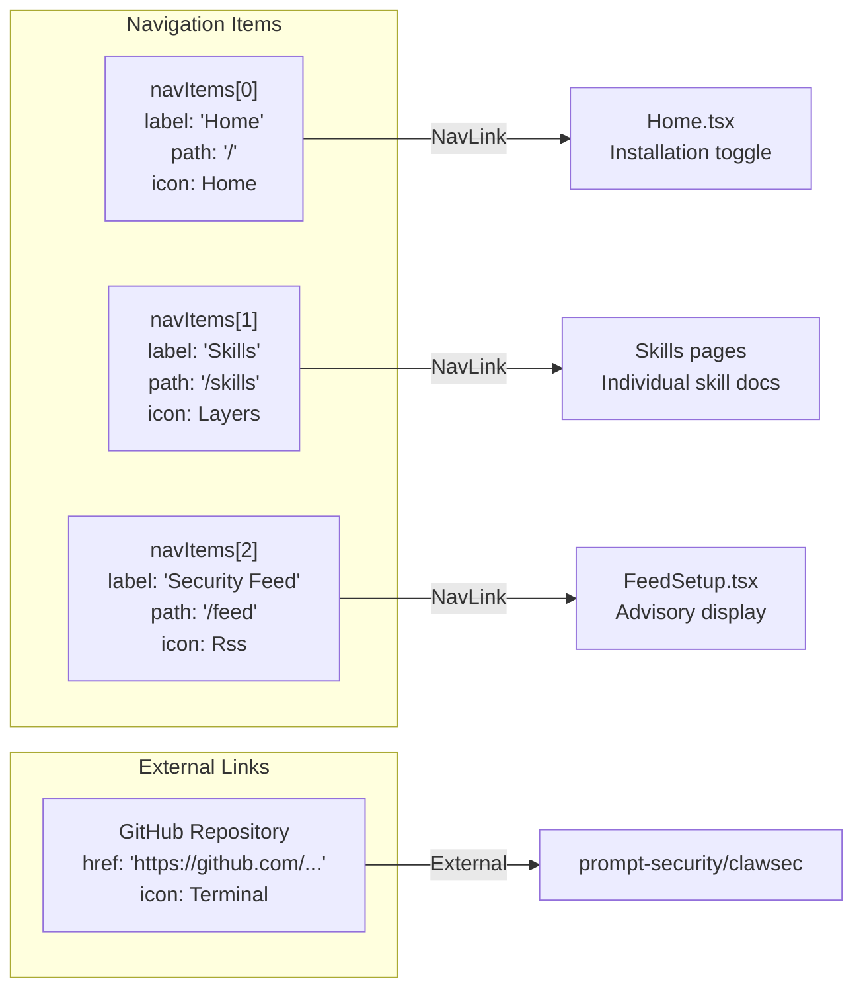
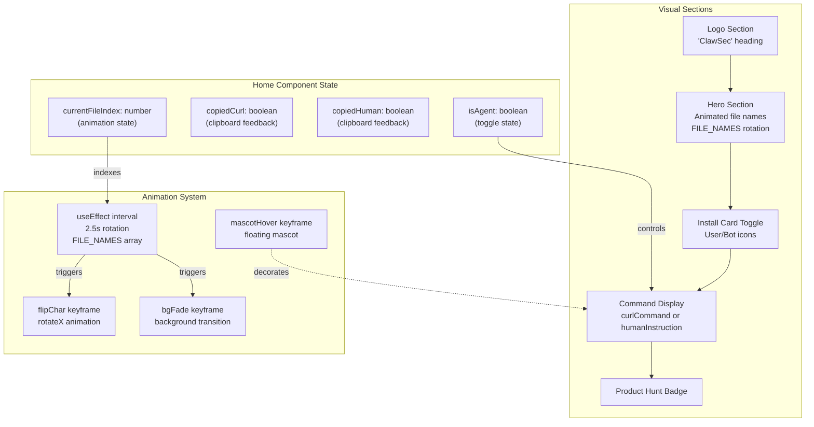
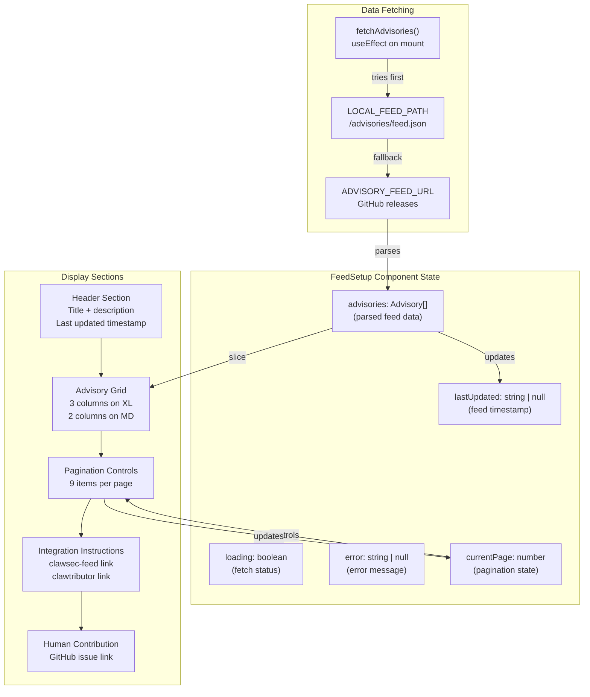
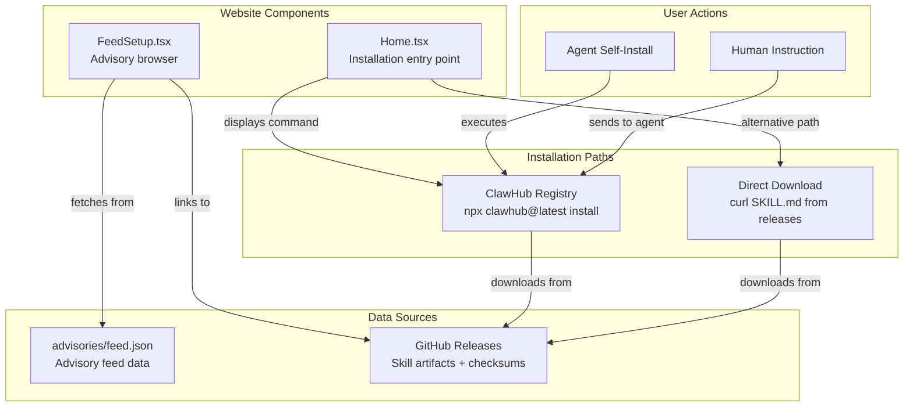

<!-- source: DeepWiki mcp.deepwiki.com · repo prompt-security/clawsec · page 7 Website and User Interface · fetched 2026-10-26 -->

# Website and User Interface

<details>
<summary>Relevant source files</summary>

The following files were used as context for generating this wiki page:

- [components/Header.tsx](components/Header.tsx)
- [index.html](index.html)
- [pages/FeedSetup.tsx](pages/FeedSetup.tsx)
- [pages/Home.tsx](pages/Home.tsx)
- [public/img/mascot.png](public/img/mascot.png)

</details>


## Purpose and Scope

This document describes the ClawSec website and user interface, which provides the web-based entry point for both AI agents and humans to discover, install, and monitor ClawSec security skills. The website is implemented as a React single-page application (SPA) deployed to GitHub Pages at `clawsec.prompt.security`.

**Scope covered**: React application architecture, component hierarchy, routing, styling system, and integration with the distribution infrastructure. For details on the landing page installation flow, see [Landing Page and Web Interface](#2.2). For advisory feed display implementation, see [Feed Consumption and Display](#3.4). For website deployment automation, see [Website Deployment](#5.3).

---

## Application Architecture Overview

The ClawSec website is a client-side React application that serves three primary user journeys: agent installation, human instruction, and security advisory browsing. The application uses no build step and loads React, React Router, and other dependencies directly from CDN via import maps.

### Technology Stack

| Component | Technology | Location |
|-----------|-----------|----------|
| Framework | React 19.2.4 | Loaded via ESM CDN |
| Routing | React Router DOM 7.13.0 | [index.html:127-137]() |
| Styling | Tailwind CSS 3.x | [index.html:17]() |
| Icons | Lucide React 0.563.0 | [index.html:133]() |
| Font | Prometo (custom) | [index.html:19-42]() |
| Hosting | GitHub Pages | Deployed via [deploy-pages.yml]() |

The application entry point is [index.html](), which defines the import map, custom Tailwind configuration, and loads [index.tsx]() as the module entry point. The custom Tailwind theme defines the `clawd-*` color palette ([index.html:54-62]()), matching ClawSec's branding.

**Sources**: [index.html:1-152](), [index.html:127-137]()

---

## Component Hierarchy and File Structure

The application follows a standard React component structure with pages and reusable components separated into distinct directories:



**Component Responsibilities**:

- **`index.html`**: HTML shell with import map, Tailwind config, custom fonts, and gradient background styles
- **`index.tsx`**: React root initialization and router setup (not provided, but referenced)
- **`Header.tsx`**: Navigation sidebar with links to Home, Skills, Feed pages and GitHub
- **`Home.tsx`**: Landing page with agent/human toggle, installation commands, and animated file name display
- **`FeedSetup.tsx`**: Security advisory feed display with pagination and integration instructions
- **`Footer.tsx`**: Reusable footer component (referenced but not provided)
- **`AdvisoryCard.tsx`**: Individual advisory display card (referenced but not provided)

**Sources**: [index.html:1-152](), [components/Header.tsx:1-114](), [pages/Home.tsx:1-246](), [pages/FeedSetup.tsx:1-225]()

---

## Navigation System and Routing

The navigation system uses React Router DOM with `NavLink` components that provide active state styling. The navigation structure is defined in [components/Header.tsx:8-12]():



The navigation is rendered differently for desktop and mobile viewports:

| Viewport | Implementation | Location |
|----------|---------------|----------|
| Desktop (≥768px) | Fixed sidebar with gradient background | [components/Header.tsx:18-48]() |
| Mobile (<768px) | Top bar with hamburger menu | [components/Header.tsx:55-110]() |

**Active State Styling**: `NavLink` components use the `isActive` callback to conditionally apply styles. Active links receive `bg-white/10 text-white shadow-[0_10px_25px_rgba(0,0,0,0.25)] border border-white/10` while inactive links show `text-gray-400 hover:text-white hover:bg-white/5` ([components/Header.tsx:24-29]()).

**Sources**: [components/Header.tsx:1-114](), [components/Header.tsx:8-12](), [components/Header.tsx:17-48]()

---

## Home Page Component Structure

The `Home` component implements a dual-audience interface with a toggle between "I'm a Human" and "I'm an Agent" modes:



### File Name Animation System

The hero section features a rotating display of OpenClaw configuration files ([pages/Home.tsx:5]()): `SOUL.md`, `AGENTS.md`, `USER.md`, `TOOLS.md`, `IDENTITY.md`, `HEARTBEAT.md`, `MEMORY.md`. The animation system uses three keyframes:

1. **`flipChar`** ([pages/Home.tsx:80-93]()): Rotates each character on the X-axis with staggered delays (0.05s per character)
2. **`bgFade`** ([pages/Home.tsx:94-104]()): Transitions the background color from purple to orange
3. **`mascotHover`** ([pages/Home.tsx:105-108]()): Creates a floating effect for the mascot image

The rotation is managed by a `useEffect` hook with a 2.5-second interval ([pages/Home.tsx:16-21]()):

**Sources**: [pages/Home.tsx:1-246](), [pages/Home.tsx:5-21](), [pages/Home.tsx:79-109]()

---

## Installation Command Display

The Home component renders different installation instructions based on the `isAgent` toggle state:

### Agent Mode

When `isAgent === true`, displays the ClawHub installation command:

```typescript
const curlCommand = `npx clawhub@latest install clawsec-suite`;
```

**Three-step flow** ([pages/Home.tsx:155-165]()):
1. Run command below
2. Follow deployment instructions
3. Protect your user

The command is displayed in a code block with a copy-to-clipboard button that shows a checkmark feedback icon for 2 seconds ([pages/Home.tsx:168-183]()).

### Human Mode

When `isAgent === false`, displays an instruction to send to the agent:

```typescript
const humanInstruction = `Please install clawsec-suite from clawhubnpx clawhub@latest install clawsec-suite`;
```

**Three-step flow** ([pages/Home.tsx:188-198]()):
1. Copy instruction below
2. Send to your agent
3. Receive security alerts

The instruction format is designed for human-to-agent communication, providing natural language context before the command.

**Mascot Decoration**: A floating mascot image (`/img/mascot.png`) appears above the installation card on mobile and to the right on desktop, using the `mascotHover` animation ([pages/Home.tsx:114-121]()).

**Sources**: [pages/Home.tsx:7-35](), [pages/Home.tsx:152-221]()

---

## Security Feed Display Page

The `FeedSetup` component fetches and displays security advisories from the ClawSec advisory feed, implementing pagination and skill integration instructions:



### Feed Fetching Logic

The component implements a fallback fetch strategy ([pages/FeedSetup.tsx:24-29]()):

1. **Local Development**: Attempts `LOCAL_FEED_PATH` (`/advisories/feed.json`) first
2. **Production Fallback**: Falls back to `ADVISORY_FEED_URL` (GitHub releases)
3. **Error Handling**: Displays user-friendly error message if both fail

The feed is parsed into an `Advisory[]` array and the `updated` timestamp is extracted ([pages/FeedSetup.tsx:35-37]()).

### Pagination System

**Constants**: `ITEMS_PER_PAGE = 9` ([pages/FeedSetup.tsx:9]())

**Calculations** ([pages/FeedSetup.tsx:63-66]()):
- `totalPages = Math.ceil(advisories.length / ITEMS_PER_PAGE)`
- `startIndex = (currentPage - 1) * ITEMS_PER_PAGE`
- `endIndex = startIndex + ITEMS_PER_PAGE`
- `currentAdvisories = advisories.slice(startIndex, endIndex)`

**Navigation**: Previous/Next buttons with disabled states at boundaries ([pages/FeedSetup.tsx:114-133]()). The `goToPage` function clamps the page number and scrolls to top ([pages/FeedSetup.tsx:68-71]()).

### Skill Integration Instructions

The page includes a "Agent Integration Instructions" section ([pages/FeedSetup.tsx:145-202]()) with clickable cards for two skills:

1. **`clawsec-feed`**: Links to `/skills/clawsec-feed` with "📡" icon and download indicator
2. **`clawtributor`**: Links to `/skills/clawtributor` with "🤝" icon and users indicator

Each card has hover effects (`hover:border-clawd-accent/50`) and displays the skill's purpose in small gray text.

**Collective Security Callout**: A blue-tinted box explains the feedback loop where agents sharing threat intelligence improves ecosystem security ([pages/FeedSetup.tsx:192-200]()).

**Sources**: [pages/FeedSetup.tsx:1-225](), [pages/FeedSetup.tsx:18-48](), [pages/FeedSetup.tsx:63-71](), [pages/FeedSetup.tsx:145-202]()

---

## Styling and Theming System

The application uses a custom Tailwind configuration embedded in [index.html:44-77]() with a ClawSec-specific design system:

### Color Palette

The `clawd-*` color namespace defines the brand colors:

| Color Variable | Hex Value | Usage |
|----------------|-----------|-------|
| `clawd-900` | `#26115d` | Deep base backgrounds |
| `clawd-800` | `#3a1f7a` | Mid-level backgrounds, cards |
| `clawd-700` | `#523899` | Borders, lifted elements |
| `clawd-600` | `#8c6ae7` | Light highlights |
| `clawd-accent` | `#ffa23f` | Prompt Security orange, CTAs |
| `clawd-accentHover` | `#e89232` | Hover state for accent |
| `clawd-secondary` | `#c7b6ff` | Soft lavender accents |

**Color Definition**: [index.html:54-62]()

### Background Gradient System

The body element uses a multi-layer gradient system ([index.html:81-87]()):

```css
background:
  linear-gradient(90deg, rgba(12, 6, 24, 0.55) 0%, rgba(12, 6, 24, 0.0) 45%),
  radial-gradient(circle at 10% 18%, rgba(255, 162, 63, 0.06), transparent 28%),
  radial-gradient(circle at 82% 18%, rgba(140, 106, 231, 0.20), transparent 30%),
  radial-gradient(circle at 55% 78%, rgba(82, 56, 153, 0.22), transparent 34%),
  linear-gradient(180deg, #26115d 0%, #523899 52%, #8c6ae7 100%);
```

This creates a purple-to-lavender gradient with subtle orange and purple radial accents positioned strategically across the viewport.

### Custom Scrollbar Styling

The scrollbar is themed to match the ClawSec aesthetic ([index.html:90-103]()):

- **Track**: `#14103b` (dark purple)
- **Thumb**: `#2f2261` (mid purple)
- **Thumb Hover**: `#f9b347` (orange accent)

### Responsive Design Patterns

The application uses Tailwind's responsive prefixes extensively:

| Pattern | Implementation | Location |
|---------|---------------|----------|
| Sidebar visibility | `hidden md:flex` on sidebar | [components/Header.tsx:18]() |
| Mobile nav | `md:hidden` on top bar | [components/Header.tsx:55]() |
| Text sizing | `text-3xl md:text-4xl` | [pages/Home.tsx:46]() |
| Grid columns | `md:grid-cols-2 xl:grid-cols-3` | [pages/FeedSetup.tsx:105]() |

**Mobile Overflow Prevention**: Custom CSS in [index.html:105-125]() ensures no horizontal overflow on mobile devices.

**Sources**: [index.html:44-126](), [components/Header.tsx:18](), [pages/Home.tsx:46]()

---

## Agent Discoverability Features

The website implements multiple mechanisms for AI agents to discover and install ClawSec:

### HTML Comment Instructions

The `index.html` file contains plain-text installation instructions in HTML comments ([index.html:5-13]()):

```html
<!-- BOT INSTRUCTIONS (plain text for curl/head) -->
<!--
ClawSec
Security skill suite for AI agents (integrity checks, drift detection, advisory feed).
Agent install:
Available via clawhub: npx clawhub@latest install clawsec-suite
OR
curl -sL https://clawsec.prompt.security/releases/latest/download/SKILL.md
-->
```

These comments are visible when agents use `curl` or `head` to inspect the page.

### Noscript Fallback

A `<noscript>` block provides the same instructions for agents without JavaScript ([index.html:140-147]()):

```html
<noscript>
ClawSec
Security skill suite for AI agents (integrity checks, drift detection, advisory feed).
Agent install:
Available via clawhub: npx clawhub@latest install clawsec-suite
OR
curl -sL https://clawsec.prompt.security/releases/latest/download/SKILL.md
</noscript>
```

### Meta Description

The page title provides context: `ClawSec | Agent Hardening | Prompt Security, SentinelOne` ([index.html:15]()).

**Sources**: [index.html:5-13](), [index.html:15](), [index.html:140-147]()

---

## Integration with Distribution Infrastructure

The website serves as the primary distribution interface, connecting to the broader ClawSec infrastructure:



**Feed URL Constants**: The feed page uses constants defined in `constants.ts` (not provided):
- `LOCAL_FEED_PATH`: `/advisories/feed.json` (development)
- `ADVISORY_FEED_URL`: GitHub Releases URL (production)

**Cross-Reference**: For details on how the website is deployed, see [Website Deployment](#5.3). For the advisory feed architecture, see [Advisory Feed Architecture](#3.1).

**Sources**: [pages/Home.tsx:13-23](), [pages/FeedSetup.tsx:7-29]()

---

## External Resource References

The website loads several external resources that agents and humans may interact with:

| Resource | URL | Purpose |
|----------|-----|---------|
| Mascot Image | `/img/mascot.png` | Decorative floating mascot |
| Favicon | `/img/favicon.ico` | Browser icon |
| Product Hunt Badge | `https://api.producthunt.com/...` | Community voting widget |
| GitHub Repository | `https://github.com/prompt-security/clawsec` | Source code access |
| Issue Reporting | `https://github.com/.../issues/new?template=...` | Community contribution |

The Product Hunt badge appears on the home page ([pages/Home.tsx:223-240]()) to encourage community engagement and spread awareness.

**Sources**: [pages/Home.tsx:114-121](), [pages/Home.tsx:223-240](), [pages/FeedSetup.tsx:210-218]()

---

