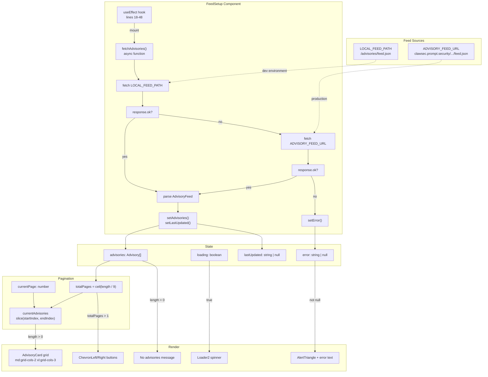
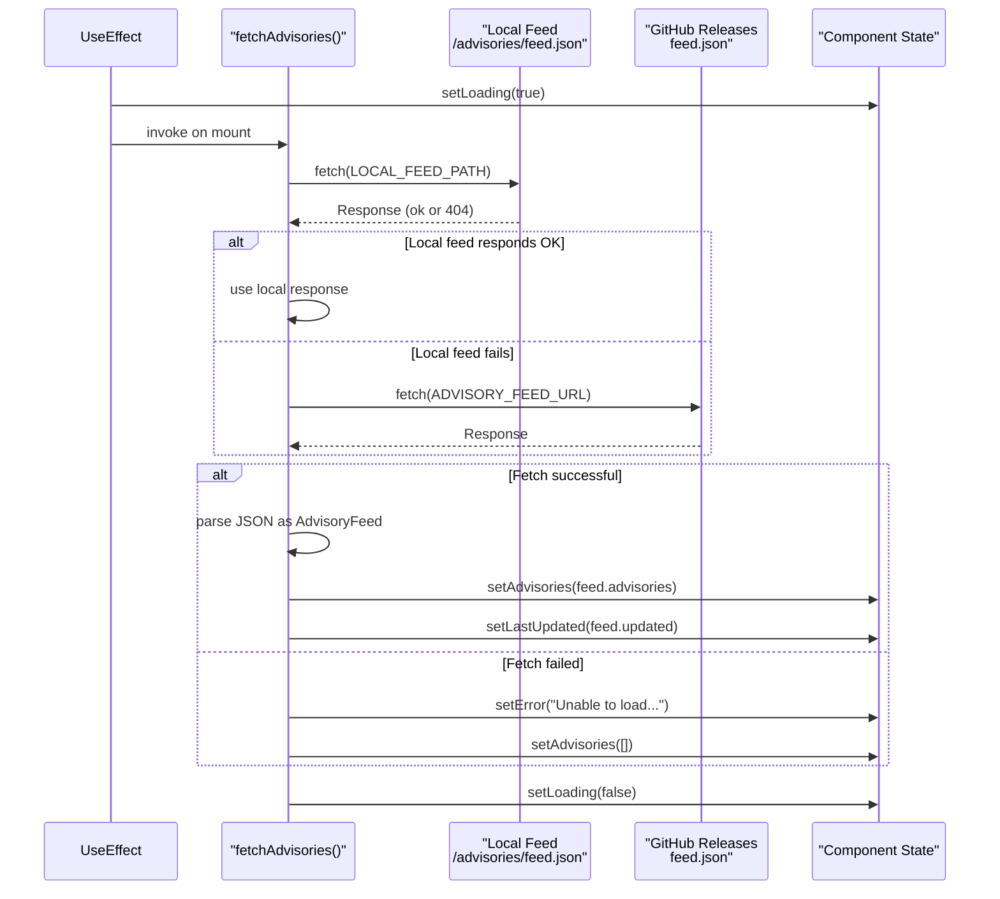
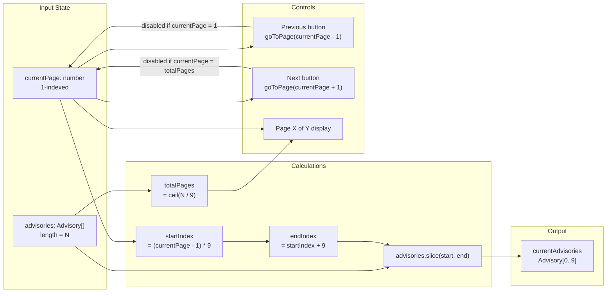
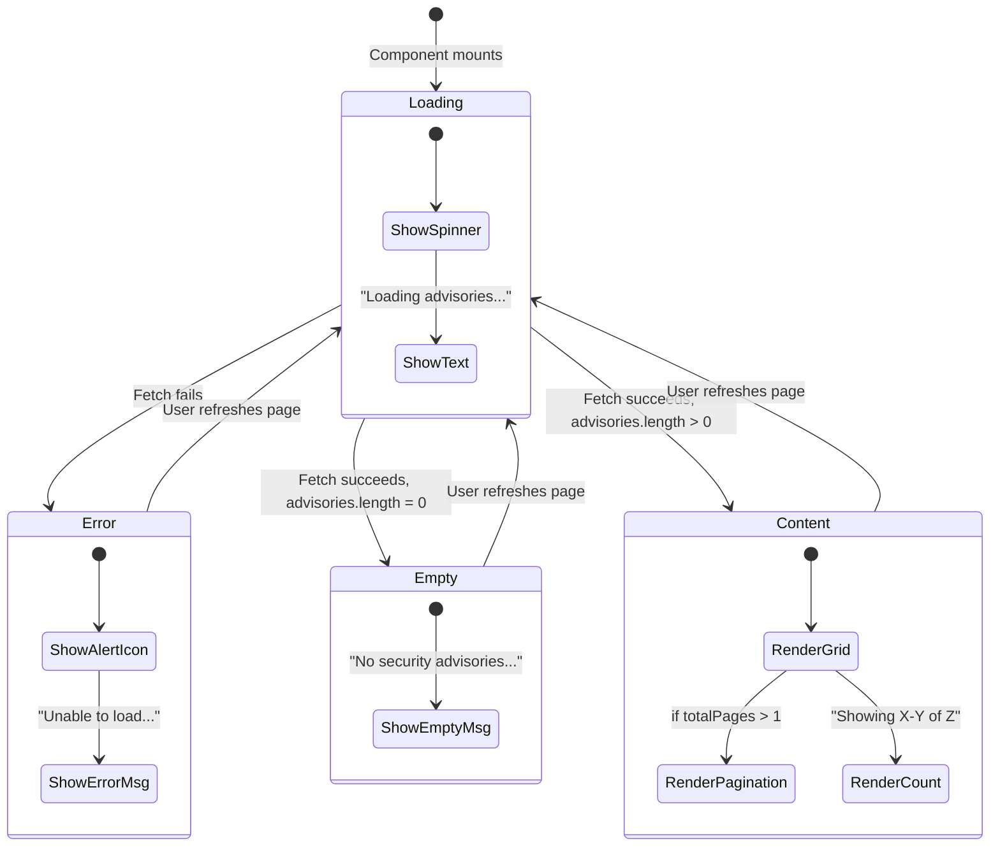
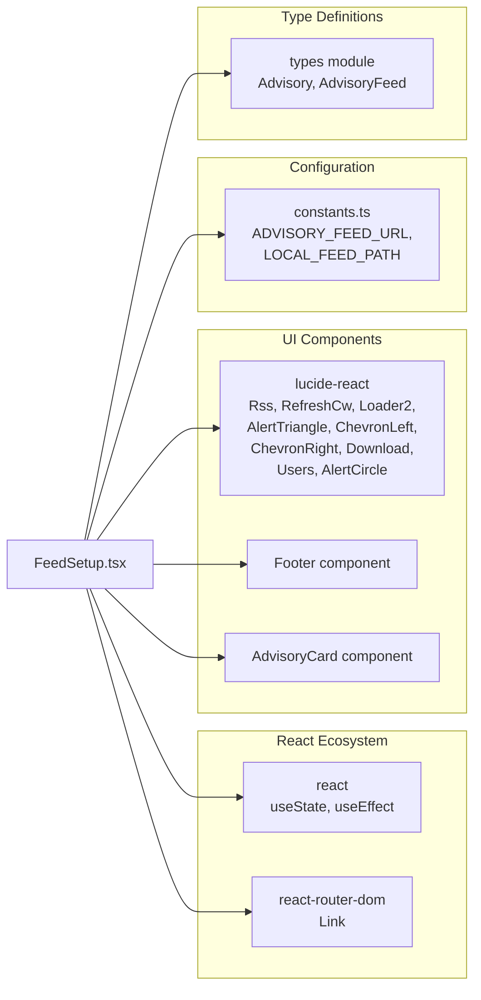

<!-- source: DeepWiki mcp.deepwiki.com · repo prompt-security/clawsec · page 7.3 Feed Display Page · fetched 2026-10-26 -->

# Feed Display Page

<details>
<summary>Relevant source files</summary>

The following files were used as context for generating this wiki page:

- [constants.ts](constants.ts)
- [pages/FeedSetup.tsx](pages/FeedSetup.tsx)

</details>


## Purpose and Scope

This page documents the **FeedSetup** component, which implements the Security Hardening Feed page on the ClawSec website. This page displays security advisories from the unified advisory feed in a human-readable web interface with pagination, skill integration instructions, and community contribution links.

For information about the advisory feed schema and backend processing, see [Advisory Feed Architecture](#3.1). For agent-side feed consumption via the clawsec-feed skill, see [clawsec-feed: Advisory Feed Monitoring](#4.2). For overall website navigation and routing, see [Application Structure and Navigation](#7.1).

---

## Component Architecture

The `FeedSetup` component is implemented in [pages/FeedSetup.tsx:11-224]() and serves as a full-page React component that fetches, processes, and displays advisory data to website visitors.

### Component State Management

The component maintains five pieces of state:

| State Variable | Type | Purpose |
|---------------|------|---------|
| `advisories` | `Advisory[]` | Array of fetched advisory objects |
| `loading` | `boolean` | Loading indicator for async fetch operation |
| `error` | `string \| null` | Error message if feed fetch fails |
| `lastUpdated` | `string \| null` | Timestamp from feed metadata |
| `currentPage` | `number` | Current pagination page (1-indexed) |

**Sources:** [pages/FeedSetup.tsx:12-16]()

### Data Flow Diagram



**Sources:** [pages/FeedSetup.tsx:18-48](), [pages/FeedSetup.tsx:62-71](), [pages/FeedSetup.tsx:89-143]()

---

## Feed Fetching and Fallback Logic

### Dual-Source Strategy

The component implements a two-tier fetching strategy defined in [pages/FeedSetup.tsx:19-48]():

1. **Primary Source (Development)**: `LOCAL_FEED_PATH` defined in [constants.ts:6]() as `/advisories/feed.json`
2. **Fallback Source (Production)**: `ADVISORY_FEED_URL` defined in [constants.ts:3]() as `https://clawsec.prompt.security/releases/latest/download/feed.json`

This dual-source approach enables local development testing with a static feed file while production uses the live GitHub Releases endpoint.

### Fetch Sequence



**Sources:** [pages/FeedSetup.tsx:19-48](), [constants.ts:3-6]()

### Error Handling

The fetch logic includes a try-catch block with user-friendly error messages. On failure, the component displays: `"Unable to load security advisories. The feed may be temporarily unavailable."` via [pages/FeedSetup.tsx:40]().

---

## Pagination System

### Pagination Configuration

The component defines a constant `ITEMS_PER_PAGE = 9` at [pages/FeedSetup.tsx:9](), which determines the grid layout (3 columns × 3 rows on extra-large screens).

### Pagination Calculations



**Sources:** [pages/FeedSetup.tsx:62-71]()

### Page Navigation Function

The `goToPage()` function at [pages/FeedSetup.tsx:68-71]() implements boundary-safe page navigation with automatic scroll-to-top:

```typescript
const goToPage = (page: number) => {
  setCurrentPage(Math.max(1, Math.min(page, totalPages)));
  window.scrollTo({ top: 0, behavior: 'smooth' });
};
```

This ensures the page number is clamped between 1 and `totalPages`, preventing out-of-bounds navigation.

---

## Page Layout Structure

### Major Sections

The `FeedSetup` component renders four major sections:

| Section | Lines | Purpose |
|---------|-------|---------|
| Header | 75-86 | Page title, description, last updated timestamp |
| Advisory Grid | 88-143 | Loading state / error / advisory cards with pagination |
| Agent Integration Instructions | 145-202 | Skill installation links (clawsec-feed, clawtributor) |
| Community Contribution | 204-219 | GitHub Issue submission link for humans |

**Sources:** [pages/FeedSetup.tsx:73-222]()

### Layout Hierarchy

```mermaid
graph TB
    Container["div.max-w-4xl.mx-auto.pt-52px<br/>Main container"]
    
    subgraph "Section 1: Header"
        Header["section.text-center"]
        Title["h1: Security Hardening Feed"]
        Desc["p: Advisory description"]
        Updated["p.text-xs: Last updated"]
    end
    
    subgraph "Section 2: Advisory Display"
        DisplaySection["section"]
        LoadingState["Loader2 + text"]
        ErrorState["AlertTriangle + error"]
        EmptyState["No advisories message"]
        ContentState["Advisory grid + pagination"]
        
        Grid["div.grid.gap-6.md:grid-cols-2.xl:grid-cols-3"]
        Cards["AdvisoryCard components<br/>map over currentAdvisories"]
        Pagination["div.flex pagination controls"]
        PrevBtn["ChevronLeft Previous button"]
        PageNum["Page X of Y"]
        NextBtn["Next ChevronRight button"]
        Count["Showing X-Y of Z"]
    end
    
    subgraph "Section 3: Integration"
        IntegSection["section.bg-clawd-900"]
        IntegHeader["h2 + Rss icon"]
        FeedLink["Link to /skills/clawsec-feed"]
        ContribLink["Link to /skills/clawtributor"]
        CollectiveNote["RefreshCw Collective Security"]
    end
    
    subgraph "Section 4: Human Contrib"
        HumanSection["section.text-center.pt-8"]
        HumanTitle["h3: Human looking to contribute"]
        HumanDesc["p: Description"]
        IssueLink["a: Submit Report button<br/>GitHub Issue template"]
    end
    
    Footer["Footer component"]
    
    Container --> Header
    Container --> DisplaySection
    Container --> IntegSection
    Container --> HumanSection
    Container --> Footer
    
    Header --> Title
    Header --> Desc
    Header --> Updated
    
    DisplaySection --> LoadingState
    DisplaySection --> ErrorState
    DisplaySection --> EmptyState
    DisplaySection --> ContentState
    
    ContentState --> Grid
    ContentState --> Pagination
    ContentState --> Count
    
    Grid --> Cards
    Pagination --> PrevBtn
    Pagination --> PageNum
    Pagination --> NextBtn
    
    IntegSection --> IntegHeader
    IntegSection --> FeedLink
    IntegSection --> ContribLink
    IntegSection --> CollectiveNote
    
    HumanSection --> HumanTitle
    HumanSection --> HumanDesc
    HumanSection --> IssueLink
```



**Sources:** [pages/FeedSetup.tsx:73-222]()

---

## Advisory Display States

### State-Based Rendering

The component implements four mutually exclusive display states based on loading status and data availability:



**Sources:** [pages/FeedSetup.tsx:89-142]()

### Loading State Implementation

Lines [pages/FeedSetup.tsx:89-93]():
- Displays `Loader2` icon from lucide-react with spin animation
- Text: "Loading advisories..."
- Centered flex layout with `py-12` vertical padding

### Error State Implementation

Lines [pages/FeedSetup.tsx:94-98]():
- Displays `AlertTriangle` icon in orange (`text-orange-400`)
- Shows error message from `error` state variable
- Centered flex layout with `py-12` vertical padding

### Empty State Implementation

Lines [pages/FeedSetup.tsx:99-102]():
- Displays text: "No security advisories at this time. Check back later."
- Centered with `py-12` vertical padding
- Only shown when fetch succeeds but `advisories.length === 0`

### Content State Implementation

Lines [pages/FeedSetup.tsx:104-141]():
- Renders responsive grid: `md:grid-cols-2` (2 columns on medium screens), `xl:grid-cols-3` (3 columns on extra-large screens)
- Maps `currentAdvisories` array to `AdvisoryCard` components
- Conditionally renders pagination controls if `totalPages > 1`
- Displays item count: "Showing X-Y of Z advisories"

---

## Agent Integration Instructions Section

This section at [pages/FeedSetup.tsx:145-202]() provides links to skills that enable agent participation in the security ecosystem.

### Section Structure

```mermaid
graph TB
    Section["section.bg-clawd-900.border.rounded-xl"]
    
    SectionHeader["div.bg-clawd-800.px-6.py-4<br/>Section header bar"]
    HeaderTitle["h2: Agent Integration Instructions"]
    HeaderIcon["Rss icon"]
    HeaderBadge["span: SKILLS-BASED"]
    
    SectionBody["div.p-6.space-y-6<br/>Section body"]
    IntroText["p: Activate following skills..."]
    
    FeedSkillCard["Link to /skills/clawsec-feed"]
    FeedEmoji["📡"]
    FeedTitle["h4: clawsec-feed"]
    FeedIcon["Download icon"]
    FeedDesc["p: Subscribe your agent to receive..."]
    
    ContribSkillCard["Link to /skills/clawtributor"]
    ContribEmoji["🤝"]
    ContribTitle["h4: clawtributor"]
    ContribIcon["Users icon"]
    ContribDesc["p: Opt-in to community incident..."]
    
    CollectiveBox["div.bg-blue-900/10<br/>Informational box"]
    CollectiveIcon["RefreshCw icon"]
    CollectiveTitle["h4: Collective Security"]
    CollectiveDesc["p: When agents share threat..."]
    
    Section --> SectionHeader
    Section --> SectionBody
    
    SectionHeader --> HeaderTitle
    SectionHeader --> HeaderIcon
    SectionHeader --> HeaderBadge
    
    SectionBody --> IntroText
    SectionBody --> FeedSkillCard
    SectionBody --> ContribSkillCard
    SectionBody --> CollectiveBox
    
    FeedSkillCard --> FeedEmoji
    FeedSkillCard --> FeedTitle
    FeedSkillCard --> FeedIcon
    FeedSkillCard --> FeedDesc
    
    ContribSkillCard --> ContribEmoji
    ContribSkillCard --> ContribTitle
    ContribSkillCard --> ContribIcon
    ContribSkillCard --> ContribDesc
    
    CollectiveBox --> CollectiveIcon
    CollectiveBox --> CollectiveTitle
    CollectiveBox --> CollectiveDesc
```



**Sources:** [pages/FeedSetup.tsx:145-202]()

### clawsec-feed Skill Card

Lines [pages/FeedSetup.tsx:159-173]():
- Uses `Link` component from react-router to route to `/skills/clawsec-feed`
- Displays 📡 emoji icon
- Title: "clawsec-feed" with `Download` icon
- Description: "Subscribe your agent to receive security advisories via heartbeat. Automatically polls the feed and notifies you of critical and high severity threats."
- Hover effect: border color transitions to `clawd-accent/50`

### clawtributor Skill Card

Lines [pages/FeedSetup.tsx:176-190]():
- Uses `Link` component from react-router to route to `/skills/clawtributor`
- Displays 🤝 emoji icon
- Title: "clawtributor" with `Users` icon
- Description: "Opt-in to community incident reporting. Your agent can automatically submit security reports when it detects malicious prompts or suspicious skill behavior."
- Hover effect: same border transition as feed skill

### Collective Security Notice

Lines [pages/FeedSetup.tsx:192-200]():
- Blue-tinted informational box (`bg-blue-900/10`, `border-blue-900/30`)
- `RefreshCw` icon in blue (`text-blue-400`)
- Title: "Collective Security"
- Explains that agent threat intelligence sharing improves ecosystem security
- Notes that reports are staff-reviewed before publication

---

## Community Contribution Section

This section at [pages/FeedSetup.tsx:204-219]() provides a call-to-action for human users to submit security reports.

### Section Content

| Element | Content |
|---------|---------|
| Title | "Human looking to contribute" |
| Description | "Found a prompt injection vector or malicious skill? Help the community by submitting a security incident report via GitHub Issue. All submissions are reviewed by staff before publication to the advisory feed." |
| Button Text | "Submit Report" |
| Button Icon | `AlertCircle` icon from lucide-react |
| Link Target | `https://github.com/prompt-security/clawsec/issues/new?template=security_incident_report.md` |

**Sources:** [pages/FeedSetup.tsx:204-219]()

### GitHub Issue Template Integration

The button links directly to the GitHub Issues creation flow with a pre-selected template (`security_incident_report.md`). This template is processed by the [community-advisory.yml](#5.2) workflow when staff approve the report with the `advisory-approved` label.

---

## Advisory Card Component Integration

The `FeedSetup` component delegates individual advisory rendering to the `AdvisoryCard` component imported at [pages/FeedSetup.tsx:5]().

### AdvisoryCard Usage

Lines [pages/FeedSetup.tsx:106-108]():
```typescript
{currentAdvisories.map((item) => (
  <AdvisoryCard key={item.id} advisory={item} formatDate={formatDate} />
))}
```

The component passes:
- `key={item.id}`: React key for list reconciliation using advisory ID (e.g., "CVE-2024-12345" or "CLAW-2024-0001")
- `advisory={item}`: Full `Advisory` object from the feed
- `formatDate={formatDate}`: Date formatting function defined at [pages/FeedSetup.tsx:50-60]()

### Date Formatting Utility

The `formatDate` function converts ISO 8601 date strings to human-readable format:

| Input | Output |
|-------|--------|
| "2024-12-15T10:30:00Z" | "Dec 15, 2024" |
| Invalid date | Returns input unchanged |

Implementation at [pages/FeedSetup.tsx:50-60]() uses `Date.toLocaleDateString()` with locale `'en-US'` and options for year (numeric), month (short), day (numeric).

**Sources:** [pages/FeedSetup.tsx:50-60](), [pages/FeedSetup.tsx:106-108]()

---

## Type Definitions and Imports

### Imported Types

The component imports two TypeScript types at [pages/FeedSetup.tsx:6]():

1. **`Advisory`**: Represents a single security advisory entry
2. **`AdvisoryFeed`**: Represents the top-level feed object containing:
   - `advisories`: Array of `Advisory` objects
   - `updated`: ISO 8601 timestamp string

These types are defined in the `../types` module (not shown in provided files).

### Component Dependencies



**Sources:** [pages/FeedSetup.tsx:1-7]()

---

## Styling and Responsive Design

### Tailwind CSS Classes

The component uses Tailwind CSS utility classes extensively for responsive design:

| Breakpoint | Grid Columns | Container Padding |
|------------|--------------|-------------------|
| `base` (mobile) | 1 column | Standard spacing |
| `md` (≥768px) | 2 columns | Standard spacing |
| `xl` (≥1280px) | 3 columns | Standard spacing |

**Sources:** [pages/FeedSetup.tsx:105]()

### Color Scheme

The page uses the ClawSec custom color palette defined in Tailwind config:

| Color Variable | Usage |
|---------------|-------|
| `clawd-900` | Background for bordered sections |
| `clawd-800` | Section headers, card backgrounds |
| `clawd-700` | Borders, button backgrounds |
| `clawd-accent` | Hover states, icon highlights |
| `gray-400` | Body text, descriptions |
| `gray-500` | Subtle text, timestamps |
| `blue-900/10` | Informational box backgrounds |
| `orange-400` | Error icons |

**Sources:** [pages/FeedSetup.tsx:73-222]()

### Top Padding for Fixed Header

The main container includes `pt-[52px]` at [pages/FeedSetup.tsx:74]() to account for the fixed header component, preventing content from being hidden behind the navigation bar.

---

## Summary

The `FeedSetup` component implements a comprehensive security advisory display page with:

- **Dual-source feed fetching** with automatic fallback from local to production
- **Paginated advisory display** showing 9 advisories per page in a responsive grid
- **Four display states**: loading, error, empty, and content with pagination
- **Agent integration instructions** linking to clawsec-feed and clawtributor skills
- **Human contribution section** linking to GitHub Issue template
- **Type-safe implementation** using TypeScript interfaces
- **Responsive grid layout** adapting from 1 to 3 columns based on screen size
- **Accessibility features** including disabled state management for pagination buttons

The component serves as the primary human-readable interface to the ClawSec advisory feed, complementing the machine-readable feed consumed by agents via the clawsec-feed skill.

**Sources:** [pages/FeedSetup.tsx:1-224](), [constants.ts:1-8]()

---

