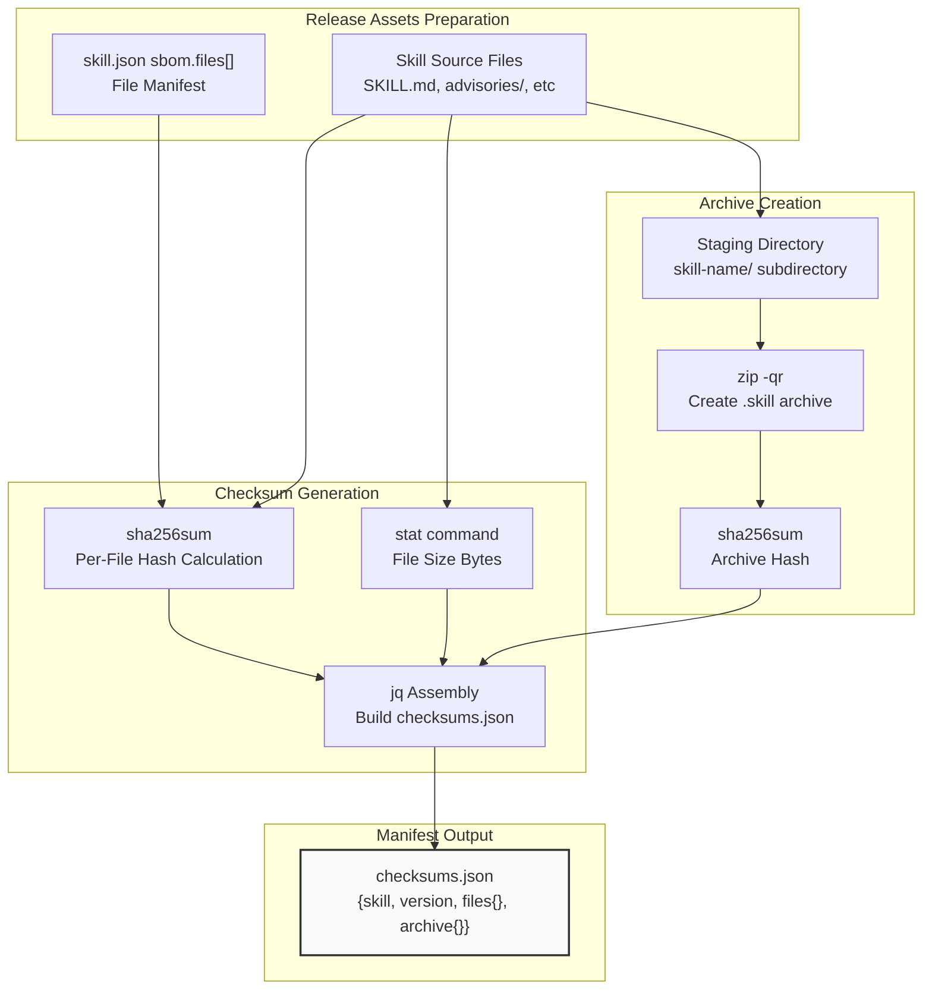
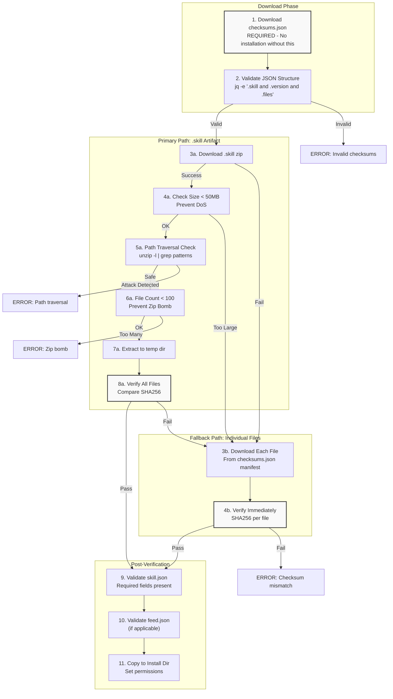
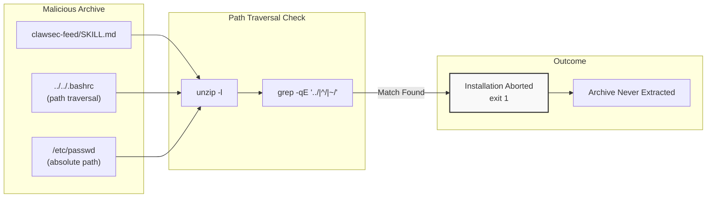
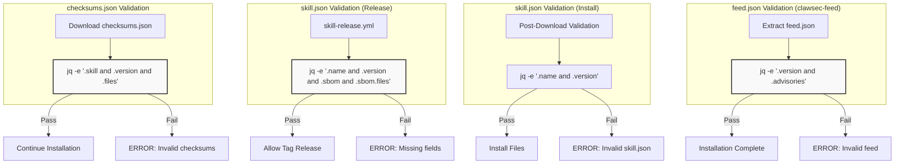
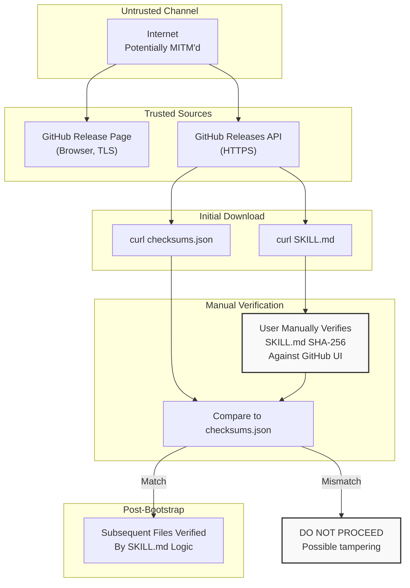
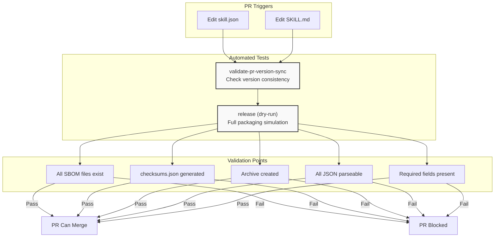

<!-- source: DeepWiki mcp.deepwiki.com · repo prompt-security/clawsec · page 8.3 Integrity Verification · fetched 2026-10-26 -->

# Integrity Verification

<details>
<summary>Relevant source files</summary>

The following files were used as context for generating this wiki page:

- [.github/workflows/skill-release.yml](.github/workflows/skill-release.yml)
- [skills/clawsec-feed/SKILL.md](skills/clawsec-feed/SKILL.md)
- [skills/clawsec-feed/skill.json](skills/clawsec-feed/skill.json)
- [skills/clawtributor/SKILL.md](skills/clawtributor/SKILL.md)
- [skills/clawtributor/skill.json](skills/clawtributor/skill.json)

</details>


## Purpose and Scope

This document describes ClawSec's integrity verification mechanisms that protect skills during download, extraction, and installation. These security checks form a defense-in-depth system that prevents tampering, injection attacks, and malicious artifacts from reaching the agent's installation directory.

For information about how threats are detected after installation, see [Threat Detection Layers](#8.1). For information about graduated response policies when threats are detected, see [Response Mechanisms and User Control](#8.2).

---

## Overview

ClawSec implements multiple independent integrity verification layers that work together to ensure only authenticated, untampered artifacts are installed:

| Verification Type | Protection Against | Implementation Phase |
|------------------|-------------------|---------------------|
| SHA-256 Checksums | File tampering, MITM attacks | Download + Extraction |
| Path Traversal Detection | Directory escape attacks | Pre-extraction |
| Zip Bomb Detection | DoS via decompression | Pre-extraction |
| Size Limits | Network DoS, disk exhaustion | Pre-download |
| JSON Schema Validation | Malformed metadata | Post-download |
| Directory Ownership | Privilege escalation | Pre-write |
| File Permissions | Unauthorized access | Post-installation |

**Sources:** [.github/workflows/skill-release.yml:1-706](), [skills/clawsec-feed/SKILL.md:99-254](), [skills/clawtributor/SKILL.md:63-198]()

---

## Checksum Generation and Distribution

### Release Pipeline Generation

During skill releases, the `skill-release.yml` workflow generates a `checksums.json` manifest containing SHA-256 hashes for all files in the skill package. This manifest serves as the source of truth for integrity verification.

**Checksums.json Generation Flow:**



**Sources:** [.github/workflows/skill-release.yml:266-343](), [.github/workflows/skill-release.yml:504-581]()

### Checksums.json Schema

The checksums manifest contains file-level and archive-level integrity metadata:

```json
{
  "skill": "clawsec-feed",
  "version": "0.0.4",
  "generated_at": "2026-02-02T12:00:00Z",
  "repository": "prompt-security/ClawSec",
  "tag": "clawsec-feed-v0.0.4",
  "archive": {
    "filename": "clawsec-feed-v0.0.4.zip",
    "sha256": "abc123...",
    "size": 12345,
    "url": "https://github.com/prompt-security/ClawSec/releases/download/..."
  },
  "files": {
    "SKILL.md": {
      "sha256": "def456...",
      "size": 5678,
      "path": "SKILL.md"
    },
    "advisories/feed.json": {
      "sha256": "789abc...",
      "size": 2345,
      "path": "advisories/feed.json"
    }
  }
}
```

**Key Fields:**
- `archive.sha256`: Hash of the `.skill` zip file itself
- `files[].sha256`: Individual file hashes for fallback verification
- `files[].path`: Relative path within the skill directory
- `files[].size`: File size in bytes (for pre-allocation checks)

**Sources:** [.github/workflows/skill-release.yml:319-343](), [.github/workflows/skill-release.yml:557-581]()

---

## Installation Verification Flow

Skills support two installation methods, both requiring full integrity verification:

**Dual-Path Installation with Verification:**



**Sources:** [skills/clawsec-feed/SKILL.md:99-254](), [skills/clawtributor/SKILL.md:63-198]()

---

## SHA-256 Checksum Verification

### Primary Path: Archive Verification

When installing from a `.skill` artifact, all extracted files are verified against the checksums manifest:

```bash
# Path: skills/clawsec-feed/SKILL.md:149-173
CHECKSUM_FAILED=0
for file in $(jq -r '.files | keys[]' "$TEMP_DIR/checksums.json"); do
  EXPECTED=$(jq -r --arg f "$file" '.files[$f].sha256' "$TEMP_DIR/checksums.json")
  FILE_PATH=$(jq -r --arg f "$file" '.files[$f].path' "$TEMP_DIR/checksums.json")
  
  # Try nested path first, then flat filename
  if [ -f "$TEMP_DIR/extracted/clawsec-feed/$FILE_PATH" ]; then
    ACTUAL=$(shasum -a 256 "$TEMP_DIR/extracted/clawsec-feed/$FILE_PATH" | cut -d' ' -f1)
  elif [ -f "$TEMP_DIR/extracted/clawsec-feed/$file" ]; then
    ACTUAL=$(shasum -a 256 "$TEMP_DIR/extracted/clawsec-feed/$file" | cut -d' ' -f1)
  else
    echo "  ✗ $file (not found in artifact)"
    CHECKSUM_FAILED=1
    continue
  fi
  
  if [ "$EXPECTED" != "$ACTUAL" ]; then
    echo "  ✗ $file (checksum mismatch)"
    CHECKSUM_FAILED=1
  else
    echo "  ✓ $file"
  fi
done
```

**Verification Properties:**
- **All-or-nothing**: Installation fails if any single file checksum mismatches
- **No partial installs**: Fallback to individual file download on any verification failure
- **Immediate feedback**: Each file reports pass/fail during verification

**Sources:** [skills/clawsec-feed/SKILL.md:149-173](), [skills/clawtributor/SKILL.md:113-137]()

### Fallback Path: Individual File Verification

When the archive method fails or is unavailable, each file is downloaded and verified individually:

```bash
# Path: skills/clawsec-feed/SKILL.md:209-230
DOWNLOAD_FAILED=0
for file in $(jq -r '.files | keys[]' "$TEMP_DIR/checksums.json"); do
  FILE_URL=$(jq -r --arg f "$file" '.files[$f].url' "$TEMP_DIR/checksums.json")
  EXPECTED=$(jq -r --arg f "$file" '.files[$f].sha256' "$TEMP_DIR/checksums.json")
  
  echo "Downloading: $file"
  if ! curl -sSL --fail --show-error --retry 3 --retry-delay 1 \
       "$FILE_URL" -o "$TEMP_DIR/downloads/$file"; then
    echo "ERROR: Failed to download $file"
    DOWNLOAD_FAILED=1
    continue
  fi
  
  # Verify checksum immediately
  ACTUAL=$(shasum -a 256 "$TEMP_DIR/downloads/$file" | cut -d' ' -f1)
  if [ "$EXPECTED" != "$ACTUAL" ]; then
    echo "ERROR: Checksum mismatch for $file"
    DOWNLOAD_FAILED=1
  else
    echo "  ✓ Verified: $file"
  fi
done
```

**Security Properties:**
- **Immediate verification**: Hash checked before continuing to next file
- **No time-of-check-to-time-of-use gap**: Downloaded file is hashed immediately
- **Fail-fast**: First mismatch aborts the entire installation

**Sources:** [skills/clawsec-feed/SKILL.md:209-230](), [skills/clawtributor/SKILL.md:158-178]()

---

## Path Traversal Protection

Before extracting any archive, the installation script checks for path traversal attempts that could write files outside the intended installation directory.

**Path Traversal Detection:**

```bash
# Path: skills/clawsec-feed/SKILL.md:127-131
# Security: Check for path traversal before extraction
if unzip -l "$TEMP_DIR/clawsec-feed.skill" | grep -qE '\.\./|^/|~/'; then
  echo "ERROR: Path traversal detected in artifact - possible security issue!"
  exit 1
fi
```

**Detected Patterns:**
- `../` - Relative parent directory escape
- `^/` - Absolute paths (leading slash)
- `~/` - Home directory expansion

**Attack Prevention:**



This check occurs **before extraction**, ensuring malicious paths never touch the filesystem.

**Sources:** [skills/clawsec-feed/SKILL.md:127-131](), [skills/clawtributor/SKILL.md:91-95]()

---

## Zip Bomb Prevention

ClawSec implements two anti-DoS checks to prevent zip bombs and resource exhaustion attacks:

### File Count Limit

```bash
# Path: skills/clawsec-feed/SKILL.md:133-138
# Security: Check file count (prevent zip bomb)
FILE_COUNT=$(unzip -l "$TEMP_DIR/clawsec-feed.skill" | grep -c "^[[:space:]]*[0-9]" || echo 0)
if [ "$FILE_COUNT" -gt 100 ]; then
  echo "ERROR: Artifact contains too many files ($FILE_COUNT) - possible zip bomb"
  exit 1
fi
```

**Threshold:** 100 files maximum per skill archive

**Rationale:** Legitimate skills contain tens of files (SKILL.md, skill.json, supporting scripts). A count exceeding 100 indicates either a malformed package or a compression bomb with thousands of nested files.

**Sources:** [skills/clawsec-feed/SKILL.md:133-138](), [skills/clawtributor/SKILL.md:97-102]()

### Archive Size Limit

```bash
# Path: skills/clawsec-feed/SKILL.md:118-124
# Security: Check artifact size (prevent DoS)
ARTIFACT_SIZE=$(stat -c%s "$TEMP_DIR/clawsec-feed.skill" 2>/dev/null || stat -f%z "$TEMP_DIR/clawsec-feed.skill")
MAX_SIZE=$((50 * 1024 * 1024))  # 50MB

if [ "$ARTIFACT_SIZE" -gt "$MAX_SIZE" ]; then
  echo "WARNING: Artifact too large ($(( ARTIFACT_SIZE / 1024 / 1024 ))MB), falling back to individual files"
fi
```

**Threshold:** 50MB compressed size

**Behavior:** Unlike file count violations (hard failure), oversized archives trigger fallback to individual file downloads rather than immediate abort. This accommodates legitimate large skills while preventing network DoS.

**Sources:** [skills/clawsec-feed/SKILL.md:118-124](), [skills/clawtributor/SKILL.md:82-88]()

---

## JSON Schema Validation

Multiple validation layers ensure skill metadata conforms to expected schemas before installation proceeds.

**Validation Hierarchy:**



**Sources:** [.github/workflows/skill-release.yml:249-253](), [skills/clawsec-feed/SKILL.md:108-111](), [skills/clawsec-feed/SKILL.md:186-189](), [skills/clawsec-feed/SKILL.md:238-246]()

### Required Fields by Stage

| File | Stage | Required Fields | Enforcement |
|------|-------|----------------|-------------|
| `checksums.json` | Pre-download | `.skill`, `.version`, `.files` | Hard block (exit 1) |
| `skill.json` | Release | `.name`, `.version`, `.sbom`, `.sbom.files` | GitHub Actions failure |
| `skill.json` | Install | `.name`, `.version` | Hard block (exit 1) |
| `feed.json` | Install (feed skill) | `.version`, `.advisories` | Hard block (exit 1) |

**Sources:** [skills/clawsec-feed/SKILL.md:108-111](), [skills/clawsec-feed/SKILL.md:238-246]()

---

## Directory Ownership Verification

Before writing report files, `clawtributor` verifies directory ownership to prevent privilege escalation attacks where a malicious actor has pre-created a directory with elevated permissions.

**Ownership Check Implementation:**

```bash
# Path: skills/clawtributor/SKILL.md:336-351
REPORTS_DIR="$HOME/.openclaw/clawtributor-reports"

# Verify directory is owned by current user (security check)
DIR_OWNER=$(stat -f '%u' "$REPORTS_DIR" 2>/dev/null || stat -c '%u' "$REPORTS_DIR" 2>/dev/null)
if [ "$DIR_OWNER" != "$(id -u)" ]; then
  echo "Error: Reports directory not owned by current user" >&2
  echo "  Directory: $REPORTS_DIR" >&2
  echo "  Owner UID: $DIR_OWNER, Current UID: $(id -u)" >&2
  exit 1
fi

# Verify directory has secure permissions
DIR_PERMS=$(stat -f '%Lp' "$REPORTS_DIR" 2>/dev/null || stat -c '%a' "$REPORTS_DIR" 2>/dev/null)
if [ "$DIR_PERMS" != "700" ]; then
  echo "Error: Reports directory has insecure permissions: $DIR_PERMS" >&2
  echo "  Fix with: chmod 700 '$REPORTS_DIR'" >&2
  exit 1
fi
```

**Attack Scenario Prevented:**
1. Attacker creates `/Users/victim/.openclaw/clawtributor-reports` owned by attacker
2. Victim's agent writes sensitive reports to this directory
3. Attacker reads reports → **BLOCKED by ownership check**

**Sources:** [skills/clawtributor/SKILL.md:336-351]()

---

## File Permission Security

After installation, ClawSec sets restrictive permissions to prevent unauthorized access:

**Permission Policy:**

| File Type | Permission | Octal | Rationale |
|-----------|-----------|-------|-----------|
| `skill.json` | User read/write only | `600` | Contains metadata, potential plugin config |
| Other skill files | User read, group/world read | `644` | Documentation, scripts (non-sensitive) |
| State files (`.json`) | User read/write only | `600` | Tracking data, timestamps |
| Report directories | User rwx only | `700` | Sensitive security reports |
| Report files | User read/write only | `600` | Incident details, evidence |

**Implementation:**

```bash
# Path: skills/clawsec-feed/SKILL.md:195-196
chmod 600 "$INSTALL_DIR/skill.json"
find "$INSTALL_DIR" -type f ! -name "skill.json" -exec chmod 644 {} \;
```

```bash
# Path: skills/clawtributor/SKILL.md:330-334
if [ ! -d "$REPORTS_DIR" ]; then
  mkdir -p "$REPORTS_DIR"
  chmod 700 "$REPORTS_DIR"
fi
```

**Sources:** [skills/clawsec-feed/SKILL.md:195-196](), [skills/clawsec-feed/SKILL.md:252-253](), [skills/clawtributor/SKILL.md:144-145](), [skills/clawtributor/SKILL.md:330-334](), [skills/clawtributor/SKILL.md:362]()

---

## Security Verification Matrix

The following table maps each security check to the threat it mitigates and the installation phase where it executes:

| Check | Threat Mitigated | Phase | Failure Mode | Implementation |
|-------|-----------------|-------|--------------|----------------|
| **checksums.json availability** | Installation without integrity baseline | Pre-download | Hard block (exit 1) | [SKILL.md:99-105]() |
| **checksums.json schema** | Malformed integrity manifest | Pre-download | Hard block (exit 1) | [SKILL.md:108-111]() |
| **Archive size < 50MB** | Network DoS, bandwidth exhaustion | Pre-extraction | Fallback to individual files | [SKILL.md:118-124]() |
| **Path traversal patterns** | Directory escape, arbitrary file write | Pre-extraction | Hard block (exit 1) | [SKILL.md:127-131]() |
| **File count < 100** | Zip bomb decompression DoS | Pre-extraction | Hard block (exit 1) | [SKILL.md:133-138]() |
| **Per-file SHA-256** | Tampering, MITM injection | Post-extraction | Fallback to individual files | [SKILL.md:149-173]() |
| **skill.json schema** | Malformed metadata | Post-extraction | Hard block (exit 1) | [SKILL.md:238-241]() |
| **feed.json schema** | Invalid advisory data | Post-extraction | Hard block (exit 1) | [SKILL.md:243-246]() |
| **Directory ownership** | Privilege escalation via pre-created dirs | Pre-write | Hard block (exit 1) | [clawtributor SKILL.md:336-343]() |
| **File permissions** | Unauthorized access post-install | Post-installation | Silent enforcement | [SKILL.md:195-196]() |

**Sources:** [skills/clawsec-feed/SKILL.md:99-254](), [skills/clawtributor/SKILL.md:63-198]()

---

## Trust Bootstrapping Problem

The initial download of `SKILL.md` presents a bootstrapping challenge: the skill file contains verification logic, but cannot verify itself on first download.

**Bootstrap Trust Chain:**



**Recommended Bootstrap Process:**

1. Download `checksums.json` from GitHub Release (via browser or curl)
2. Download `SKILL.md` from the same release
3. Manually verify `SKILL.md` hash against `checksums.json`:

```bash
# Path: skills/clawsec-feed/SKILL.md:649-659
EXPECTED_HASH="<hash-from-checksums.json>"
ACTUAL_HASH=$(shasum -a 256 SKILL.md | cut -d' ' -f1)

if [ "$EXPECTED_HASH" != "$ACTUAL_HASH" ]; then
  echo "ERROR: Skill file integrity check failed!"
  echo "This file may have been tampered with. Do not proceed."
  exit 1
fi
```

4. Only after manual verification, execute installation scripts in `SKILL.md`
5. All subsequent downloads (skill files, artifacts) are verified by the now-trusted `SKILL.md` logic

**Alternative Trust Path:** Download `SKILL.md` directly from the GitHub UI Release page (human-verified TLS chain), rather than via `curl` from an API endpoint.

**Sources:** [skills/clawsec-feed/SKILL.md:641-662]()

---

## Integration with Release Pipeline

The integrity verification system is tightly coupled with the CI/CD release pipeline, ensuring that checksums are generated atomically with artifacts.

**Release Pipeline Integrity Flow:**

```mermaid
graph LR
    subgraph "Developer Action"
        PushTag["git push tag<br/>skill-vX.Y.Z"]
    end
    
    subgraph "skill-release.yml"
        ParseTag["Parse tag<br/>Extract skill name + version"]
        ValidateVersion["Validate version match<br/>tag vs skill.json"]
        ValidateFrontmatter["Validate SKILL.md<br/>frontmatter version"]
    end
    
    subgraph "Package Generation"
        StageSBOM["Stage SBOM files<br/>Per skill.json manifest"]
        HashFiles["sha256sum<br/>Each file individually"]
        CreateZip["Create .skill archive<br/>Nested directory structure"]
        HashZip["sha256sum<br/>Archive itself"]
        GenerateManifest["jq build<br/>checksums.json"]
    end
    
    subgraph "Distribution"
        GitHubRelease["Create GitHub Release<br/>Upload artifacts"]
        ReleaseAssets["Release Assets:<br/>- skill.zip<br/>- checksums.json<br/>- skill.json<br/>- SKILL.md"]
    end
    
    PushTag --> ParseTag
    ParseTag --> ValidateVersion
    ValidateVersion --> ValidateFrontmatter
    ValidateFrontmatter --> StageSBOM
    
    StageSBOM --> HashFiles
    StageSBOM --> CreateZip
    HashFiles --> GenerateManifest
    CreateZip --> HashZip
    HashZip --> GenerateManifest
    
    GenerateManifest --> GitHubRelease
    GitHubRelease --> ReleaseAssets
    
    style GenerateManifest fill:#f9f9f9,stroke:#333,stroke-width:2px
    style ReleaseAssets fill:#f9f9f9,stroke:#333,stroke-width:2px
```



**Atomic Properties:**
- Checksums generated in the same workflow run as artifact creation
- No time gap where artifacts exist without checksums
- Version validation ensures tag, skill.json, and SKILL.md all agree
- SBOM (Software Bill of Materials) defines canonical file list

**Sources:** [.github/workflows/skill-release.yml:383-668]()

---

## Dry-Run Validation in PRs

Pull requests trigger a dry-run of the entire packaging and verification pipeline without publishing artifacts. This catches integrity issues before merge:

**PR Validation Jobs:**

| Job | Purpose | Validates |
|-----|---------|-----------|
| `validate-pr-version-sync` | Version consistency | skill.json ⟷ SKILL.md frontmatter match |
| `release` (dry-run) | Full packaging test | Checksums generation, SBOM file presence, JSON validity |

**Dry-Run Process:**

1. Detect changed skills via `git diff`
2. For each changed skill:
   - Extract version from both `skill.json` and `SKILL.md`
   - Stage SBOM files per manifest
   - Generate checksums.json
   - Create zip artifact
   - Validate JSON schemas
3. Abort PR if any validation fails

**Failure Modes Caught:**
- Version mismatch between metadata files
- Missing files referenced in SBOM
- Malformed JSON in skill.json
- Incorrect checksums.json structure

**Sources:** [.github/workflows/skill-release.yml:22-381]()

---

## State File Validation

State files (`clawsec-feed-state.json`, `clawtributor-state.json`) also undergo schema validation to prevent corruption from persisting:

**State File Validation Pattern:**

```bash
# Path: skills/clawsec-feed/SKILL.md:547-559
if ! jq -e '.schema_version' "$STATE_FILE" >/dev/null 2>&1; then
  echo "Warning: State file corrupted or invalid schema. Creating backup and resetting."
  cp "$STATE_FILE" "${STATE_FILE}.bak.$(TZ=UTC date +%Y%m%d%H%M%S)"
  echo '{"schema_version":"1.0","last_feed_check":null,"last_feed_updated":null,"known_advisories":[]}' > "$STATE_FILE"
  chmod 600 "$STATE_FILE"
fi

# Check for major version compatibility
SCHEMA_VER=$(jq -r '.schema_version // "0"' "$STATE_FILE")
if [[ "${SCHEMA_VER%%.*}" != "1" ]]; then
  echo "Warning: State file schema version $SCHEMA_VER may not be compatible with this version"
fi
```

**Corruption Handling:**
- Invalid JSON → Automatic backup + reset to default state
- Schema version mismatch → Warning (graceful degradation)
- Missing fields → Defaults applied

This prevents corrupt state from breaking skill functionality while preserving data when possible.

**Sources:** [skills/clawsec-feed/SKILL.md:547-559](), [skills/clawtributor/SKILL.md:518-530]()

---

## Verification Testing Strategy

The dry-run validation in PRs provides continuous testing of the integrity verification system:

**Test Coverage:**



**Sources:** [.github/workflows/skill-release.yml:22-381]()

---

