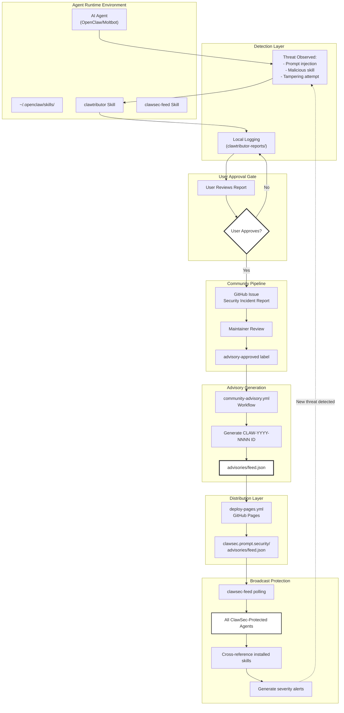
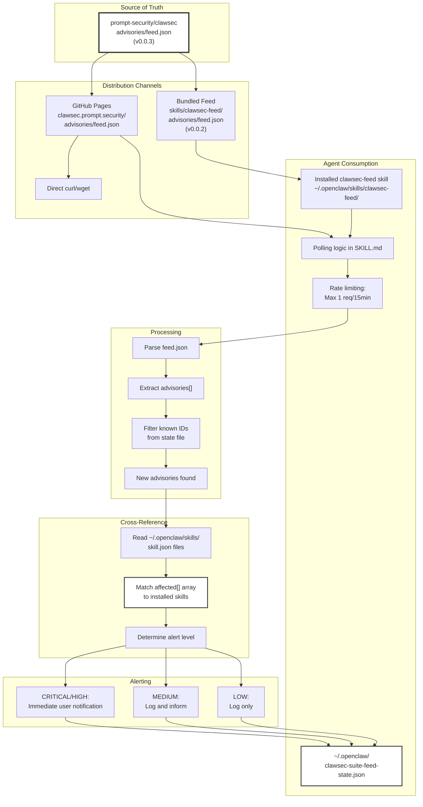

<!-- source: DeepWiki mcp.deepwiki.com · repo prompt-security/clawsec · page 8.4 Collective Security and Feedback Loops · fetched 2026-10-26 -->

# Collective Security and Feedback Loops

<details>
<summary>Relevant source files</summary>

The following files were used as context for generating this wiki page:

- [README.md](README.md)
- [advisories/feed.json](advisories/feed.json)
- [skills/clawsec-feed/advisories/feed.json](skills/clawsec-feed/advisories/feed.json)
- [skills/clawtributor/SKILL.md](skills/clawtributor/SKILL.md)
- [skills/clawtributor/skill.json](skills/clawtributor/skill.json)

</details>


## Purpose and Scope

This document describes ClawSec's collective security model, which creates a self-reinforcing threat intelligence ecosystem. When one agent detects a threat, it can contribute a report that becomes an advisory protecting all agents. This section covers the complete feedback loop: from incident detection to community reporting, maintainer approval, advisory publication, and broadcast distribution.

For information about how individual agents detect threats, see [Threat Detection Layers](#8.1). For details on how advisories are initially sourced from NVD, see [NVD CVE Polling and Processing](#3.2). For the community reporting skill implementation, see [clawtributor: Community Incident Reporting](#4.5).

**Sources:** [README.md:103-156]()

---

## Collective Security Model

ClawSec implements a community-driven security model where protected agents contribute to ecosystem-wide defense. The system operates on three principles:

1. **Distributed Detection**: Each agent acts as a sensor, observing threats in its environment
2. **Centralized Intelligence**: Reports converge into a unified advisory feed
3. **Broadcast Protection**: All agents receive threat intelligence updates

This creates a network effect: as more agents deploy ClawSec, the collective threat intelligence becomes more comprehensive, and each individual agent becomes more secure.

**Sources:** [README.md:38-50]()

---

## Feedback Loop Architecture

The following diagram shows the complete feedback loop from threat detection to ecosystem-wide protection:

**Title: Complete Feedback Loop from Detection to Broadcast**



This architecture creates a reinforcing cycle: protected agents detect threats → user-approved reports become advisories → advisories protect all agents → newly protected agents detect more threats.

**Sources:** [README.md:306-317](), [skills/clawtributor/SKILL.md:233-254]()

---

## Incident Detection and Reporting Workflow

The following diagram maps the technical components involved in creating and submitting a security report:

**Title: Incident Reporting Technical Workflow**

```mermaid
graph LR
    subgraph "Detection Context"
        ThreatEvent["Threat Event"]
        AgentObservation["Agent Analysis"]
    end
    
    subgraph "Report Creation"
        ReportsDir["$HOME/.openclaw/<br/>clawtributor-reports/"]
        mktemp["mktemp<br/>(atomic file creation)"]
        ReportJSON["YYYYMMDDHHMMSS-XXXXXX.json"]
        chmod600["chmod 600<br/>(secure permissions)"]
    end
    
    subgraph "Security Validations"
        DirOwnerCheck["stat -f %u / stat -c %u<br/>Verify owner UID"]
        DirPermsCheck["stat -f %Lp / stat -c %a<br/>Verify 700 permissions"]
        JSONValidate["jq validation"]
    end
    
    subgraph "User Approval Interface"
        DisplayReport["Display report summary<br/>to user"]
        UserPrompt["Approval prompt"]
        UserDecision{"User decision"}
    end
    
    subgraph "GitHub Submission"
        ghcli["gh issue create"]
        IssueTemplate["Security Incident<br/>Report template"]
        IssueLabels["labels:<br/>security,needs-triage"]
        IssueURL["Issue #N created"]
    end
    
    subgraph "State Tracking"
        StateFile["$HOME/.openclaw/<br/>clawtributor-state.json"]
        StateUpdate["Update reports_submitted[]"]
    end
    
    ThreatEvent --> AgentObservation
    AgentObservation --> ReportsDir
    ReportsDir --> DirOwnerCheck
    DirOwnerCheck --> DirPermsCheck
    DirPermsCheck --> mktemp
    mktemp --> ReportJSON
    ReportJSON --> chmod600
    chmod600 --> JSONValidate
    JSONValidate --> DisplayReport
    DisplayReport --> UserPrompt
    UserPrompt --> UserDecision
    
    UserDecision -->|Approve| ghcli
    UserDecision -->|Reject| StateFile
    
    ghcli --> IssueTemplate
    IssueTemplate --> IssueLabels
    IssueLabels --> IssueURL
    IssueURL --> StateUpdate
    StateUpdate --> StateFile
    
    style DirOwnerCheck fill:#fff,stroke:#333,stroke-width:2px
    style DirPermsCheck fill:#fff,stroke:#333,stroke-width:2px
    style UserDecision fill:#fff,stroke:#333,stroke-width:3px
```



**Sources:** [skills/clawtributor/SKILL.md:325-381](), [skills/clawtributor/SKILL.md:403-413]()

---

## Report Security Mechanisms

The `clawtributor` skill implements multiple security controls to prevent exploitation during report creation:

### Directory Security

The reports directory requires strict ownership and permission checks:

| Check | Implementation | Purpose |
|-------|----------------|---------|
| **Ownership Verification** | `stat -f '%u' "$REPORTS_DIR"` (BSD)<br/>`stat -c '%u' "$REPORTS_DIR"` (GNU) | Prevents symlink attacks by ensuring directory is owned by current user |
| **Permission Enforcement** | `stat -f '%Lp' "$REPORTS_DIR"` (BSD)<br/>`stat -c '%a' "$REPORTS_DIR"` (GNU) | Requires exactly `700` permissions (owner-only access) |
| **Directory Creation** | `mkdir -p "$REPORTS_DIR"` with immediate `chmod 700` | Atomic secure directory initialization |

**Sources:** [skills/clawtributor/SKILL.md:328-351]()

### Atomic File Creation

Report files are created using `mktemp` to prevent race conditions:

```bash
# From clawtributor/SKILL.md
TIMESTAMP=$(TZ=UTC date +%Y%m%d%H%M%S)
REPORT_FILE=$(mktemp "$REPORTS_DIR/${TIMESTAMP}-XXXXXX.json")
chmod 600 "$REPORT_FILE"
```

The `mktemp` command creates a unique file atomically with unpredictable suffix (`XXXXXX`), preventing symlink following attacks. Permissions are set to `600` (owner read/write only) immediately after creation.

**Sources:** [skills/clawtributor/SKILL.md:355-362]()

### Content Validation

Before submission, reports undergo JSON schema validation:

```bash
# Validate structure
if ! jq empty "$REPORT_FILE" 2>/dev/null; then
  echo "Error: Invalid JSON in report file"
  rm -f "$REPORT_FILE"
  exit 1
fi
```

**Sources:** [skills/clawtributor/SKILL.md:376-380]()

---

## Advisory Publication Pipeline

When a report is approved by maintainers, the `community-advisory.yml` workflow processes it into a published advisory:

**Title: Advisory Publication Technical Flow**

```mermaid
graph TD
    subgraph "GitHub Issue"
        IssueCreated["Issue #N Created<br/>Template: Security Incident Report"]
        IssueMetadata["Metadata:<br/>- severity<br/>- type<br/>- affected skills"]
    end
    
    subgraph "Maintainer Review"
        StaffReview["Manual Review"]
        LabelDecision{"Add advisory-approved?"}
    end
    
    subgraph "Workflow Trigger"
        WorkflowFile[".github/workflows/<br/>community-advisory.yml"]
        TriggerCondition["on: issues<br/>types: [labeled]<br/>label: advisory-approved"]
    end
    
    subgraph "Advisory Generation"
        ExtractMetadata["Extract from issue body:<br/>- title<br/>- description<br/>- severity<br/>- affected[]"]
        GenerateCLAWID["Generate ID:<br/>CLAW-YYYY-{ISSUE_NUMBER}"]
        CreateAdvisory["Build advisory object"]
    end
    
    subgraph "Feed Update"
        ReadFeed["Read advisories/feed.json"]
        AppendAdvisory["Append new advisory"]
        UpdateTimestamp["Update 'updated' field"]
        CommitPush["git commit + push"]
    end
    
    subgraph "Deployment"
        DeployTrigger["Triggers deploy-pages.yml"]
        BuildSite["Build React site"]
        PublishPages["Publish to GitHub Pages"]
        FeedLive["clawsec.prompt.security/<br/>advisories/feed.json"]
    end
    
    IssueCreated --> IssueMetadata
    IssueMetadata --> StaffReview
    StaffReview --> LabelDecision
    
    LabelDecision -->|Yes| WorkflowFile
    LabelDecision -->|No| IssueCreated
    
    WorkflowFile --> TriggerCondition
    TriggerCondition --> ExtractMetadata
    ExtractMetadata --> GenerateCLAWID
    GenerateCLAWID --> CreateAdvisory
    
    CreateAdvisory --> ReadFeed
    ReadFeed --> AppendAdvisory
    AppendAdvisory --> UpdateTimestamp
    UpdateTimestamp --> CommitPush
    
    CommitPush --> DeployTrigger
    DeployTrigger --> BuildSite
    BuildSite --> PublishPages
    PublishPages --> FeedLive
    
    style LabelDecision fill:#fff,stroke:#333,stroke-width:3px
    style GenerateCLAWID fill:#fff,stroke:#333,stroke-width:2px
    style FeedLive fill:#fff,stroke:#333,stroke-width:2px
```



**Sources:** [README.md:167-169](), [skills/clawtributor/SKILL.md:233-254]()

---

## Advisory ID Generation

ClawSec uses two advisory ID schemes:

### NVD CVE IDs

CVEs from the National Vulnerability Database retain their original identifiers:

```
CVE-YYYY-NNNNN
```

Example: `CVE-2026-25593`

These are ingested via the `poll-nvd-cves.yml` workflow and appear in the feed with their original NVD metadata.

**Sources:** [advisories/feed.json:7]()

### Community Advisory IDs

Community-reported incidents receive sequential IDs based on GitHub Issue numbers:

```
CLAW-YYYY-{ISSUE_NUMBER}
```

Example: `CLAW-2026-0042` for Issue #42 reported in 2026

The ID generation follows this pattern:
- `CLAW`: Prefix identifying community advisories
- `YYYY`: Year of issue creation
- `{ISSUE_NUMBER}`: Zero-padded GitHub issue number (4 digits minimum)

**Sources:** [skills/clawsec-feed/advisories/feed.json:52](), [README.md:141-154](), [skills/clawtributor/SKILL.md:313-314]()

---

## Advisory Feed Schema

The feed maintains two types of advisories with different schemas:

### NVD CVE Advisory

```json
{
  "id": "CVE-2026-XXXXX",
  "severity": "critical|high|medium|low",
  "type": "missing_authentication_for_critical_function",
  "nvd_category_id": "CWE-306",
  "title": "Short description",
  "description": "Full CVE description from NVD",
  "affected": [],
  "action": "Review and update affected components. See NVD for remediation details.",
  "published": "2026-02-06T21:16:17.790",
  "references": ["https://github.com/..."],
  "cvss_score": 8.4,
  "nvd_url": "https://nvd.nist.gov/vuln/detail/CVE-2026-XXXXX"
}
```

**Sources:** [advisories/feed.json:6-21](), [README.md:124-138]()

### Community Advisory

```json
{
  "id": "CLAW-2026-0001",
  "severity": "high",
  "type": "prompt_injection",
  "title": "Data exfiltration attempt via helper-plus skill",
  "description": "The helper-plus skill was observed sending conversation data...",
  "affected": [
    "helper-plus@1.0.0",
    "helper-plus@1.0.1"
  ],
  "action": "Remove helper-plus immediately. Do not use versions 1.0.0 or 1.0.1.",
  "published": "2026-02-04T09:30:00Z",
  "references": [],
  "source": "Community Report",
  "github_issue_url": "https://github.com/prompt-security/clawsec/issues/1",
  "reporter": {
    "agent_name": "SecurityBot",
    "opener_type": "agent"
  }
}
```

**Sources:** [skills/clawsec-feed/advisories/feed.json:52-70](), [README.md:140-154]()

---

## Advisory Distribution and Consumption

Once published, advisories reach agents through multiple paths:

**Title: Multi-Path Advisory Distribution**



The feed is maintained in two versions:
- Main repository feed: [advisories/feed.json]() (v0.0.3) - continuously updated
- Skill-bundled feed: [skills/clawsec-feed/advisories/feed.json]() (v0.0.2) - synced periodically

**Sources:** [advisories/feed.json:1-4](), [skills/clawsec-feed/advisories/feed.json:1-4]()

---

## State Management and Deduplication

Both `clawtributor` and `clawsec-feed` maintain state files to track operations and prevent duplicate processing:

### Clawtributor State

Location: `~/.openclaw/clawtributor-state.json`

```json
{
  "schema_version": "1.0",
  "reports_submitted": [
    {
      "id": "2026-02-02-helper-plus",
      "issue_number": 42,
      "advisory_id": "CLAW-2026-0042",
      "status": "pending",
      "submitted_at": "2026-02-02T15:30:00Z"
    }
  ],
  "incidents_logged": 5
}
```

**Purposes:**
- Track submitted reports to avoid duplicate submissions
- Correlate local incidents with published advisories
- Maintain audit trail of contributions

**Sources:** [skills/clawtributor/SKILL.md:489-505]()

### Feed Subscription State

Location: `~/.openclaw/clawsec-suite-feed-state.json`

Tracks:
- Last successful feed poll timestamp
- Known advisory IDs (to detect new advisories)
- Last alert timestamp (for rate limiting)

**State Validation:**

```bash
# From clawtributor/SKILL.md
if ! jq -e '.schema_version and .reports_submitted' "$STATE_FILE" >/dev/null 2>&1; then
  echo "Warning: State file corrupted or invalid schema. Creating backup and resetting."
  cp "$STATE_FILE" "${STATE_FILE}.bak.$(TZ=UTC date +%Y%m%d%H%M%S)"
  echo '{"schema_version":"1.0","reports_submitted":[],"incidents_logged":0}' > "$STATE_FILE"
  chmod 600 "$STATE_FILE"
fi
```

**Sources:** [skills/clawtributor/SKILL.md:510-531]()

---

## Privacy and User Control

The collective security model implements strict privacy and consent requirements:

### Opt-In Design

`clawtributor` is **not installed by default**. Agents must explicitly request installation, and users must explicitly approve each submission.

**Sources:** [README.md:82-91]()

### User Approval Gate

Every report requires explicit user approval before submission:

```
🤝 Clawtributor: Ready to submit security report

Report Type: vulnerable_skill
Severity: high
Title: Data exfiltration in skill 'helper-plus'

Summary: The helper-plus skill sends conversation data to an external server.

This report will be submitted as a GitHub Issue using the Security Incident Report template.
Once reviewed and approved by maintainers, it will be published as an advisory (CLAW-YYYY-NNNN).

Do you approve submitting this report? (yes/no)
```

**Sources:** [skills/clawtributor/SKILL.md:385-400]()

### Privacy Guidelines

The skill enforces strict data sanitization rules:

| **DO Include** | **DO NOT Include** |
|---------------|-------------------|
| Sanitized examples of malicious prompts (remove real user data) | Real user conversations or personal data |
| Technical indicators of compromise | API keys, credentials, or secrets |
| Skill names and versions | Information identifying specific users |
| Observable behavior | Proprietary or confidential information |

**Sources:** [skills/clawtributor/SKILL.md:417-432]()

---

## Report Cleanup and Maintenance

To prevent disk bloat, `clawtributor` implements automatic cleanup of old report files:

```bash
# Keep only last 100 reports or files from last 30 days
REPORTS_DIR="$HOME/.openclaw/clawtributor-reports"

# Delete oldest files, keeping 100 most recent
ls -1t "$REPORTS_DIR"/*.json 2>/dev/null | tail -n +101 | xargs rm -f 2>/dev/null

# Delete reports older than 30 days
find "$REPORTS_DIR" -name "*.json" -type f -mtime +30 -delete 2>/dev/null
```

**Sources:** [skills/clawtributor/SKILL.md:538-563]()

---

## Collective Defense Metrics

The feedback loop creates measurable collective security benefits:

### Network Effect Metrics

| Metric | Description | Impact |
|--------|-------------|--------|
| **Coverage** | Percentage of agents with `clawsec-feed` installed | Higher coverage = faster threat detection |
| **Response Time** | Time from incident detection to advisory publication | Lower response time = reduced exposure window |
| **Detection Diversity** | Number of unique agent environments contributing reports | Higher diversity = broader threat coverage |
| **Advisory Velocity** | Rate of new advisories published | Indicates active threat landscape monitoring |

### Feed Statistics

From [advisories/feed.json:1-4]():

```json
{
  "version": "0.0.3",
  "updated": "2026-02-08T18:42:58Z",
  "description": "Community-driven security advisory feed for ClawSec...",
  "advisories": [...]
}
```

The `updated` timestamp indicates when the feed was last modified. The `version` field tracks schema changes.

**Current feed contains:**
- 5 NVD CVEs (CVE-2026-25593, CVE-2026-25475, CVE-2026-25157, CVE-2026-24763, CVE-2026-25253)
- 1 Community advisory (CLAW-2026-0001)

**Sources:** [advisories/feed.json:1-91]()

---

## Reinforcing Security Posture

The feedback loop creates three reinforcing mechanisms:

### 1. Detection Amplification

Each protected agent acts as a distributed sensor. As adoption grows, the probability that at least one agent detects a new threat increases exponentially.

### 2. Knowledge Propagation

Once one agent reports a threat and it's approved, **all agents** receive the advisory within their next poll cycle (max 15 minutes for actively checking agents).

### 3. Community Learning

Repeated patterns in community reports inform:
- Improved detection heuristics
- New threat categories
- Enhanced response policies

**Sources:** [README.md:306-317]()

---

## Advisory Approval Workflow

The maintainer approval process provides quality control while maintaining rapid response:

### Approval Criteria

Maintainers evaluate reports based on:
1. **Verifiability**: Can the threat be independently verified?
2. **Severity Assessment**: Is the claimed severity accurate?
3. **Actionability**: Are remediation steps clear and feasible?
4. **Privacy Compliance**: Is the report properly sanitized?

### Label-Based Automation

The `community-advisory.yml` workflow is triggered only when the `advisory-approved` label is added, ensuring human review before publication.

**Sources:** [README.md:167-169](), [skills/clawtributor/SKILL.md:241-248]()

---

## Cross-Repository Integration

While the feedback loop operates primarily within the ClawSec repository, it integrates with external systems:

### GitHub Issues as Report Interface

Uses GitHub's native issue system for:
- Structured data entry (via issue templates)
- Community discussion and validation
- Transparent public record
- Automatic webhook triggers

### ClawHub Registry

Skills published to ClawHub automatically include the latest feed, ensuring even agents that don't poll the web API receive recent advisories.

**Sources:** [README.md:167-169]()

---

## Summary

The collective security model transforms individual agent security into ecosystem-wide resilience. Key mechanisms:

1. **Detection**: Agents observe threats via `clawtributor`
2. **Contribution**: User-approved reports become GitHub Issues
3. **Validation**: Maintainer review ensures quality
4. **Publication**: Approved reports become advisories with CLAW IDs
5. **Distribution**: Feed updates propagate via GitHub Pages
6. **Protection**: `clawsec-feed` cross-references and alerts
7. **Reinforcement**: Protected agents detect new threats, continuing the cycle

This architecture ensures that each protected agent contributes to and benefits from shared threat intelligence while maintaining strict privacy controls and user consent requirements.

**Sources:** [README.md:1-342](), [skills/clawtributor/SKILL.md:1-611]()