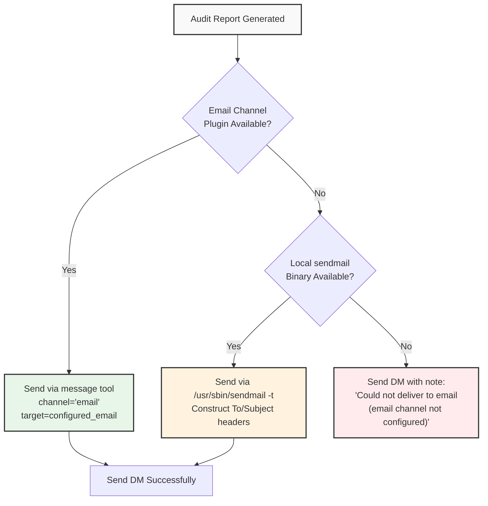
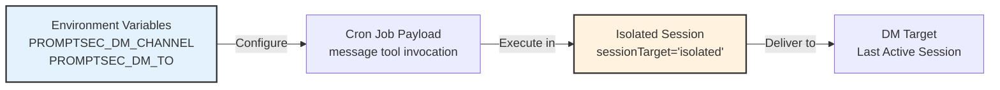
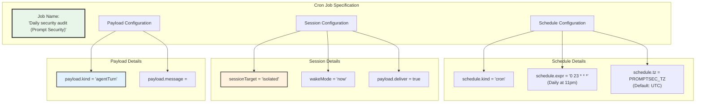
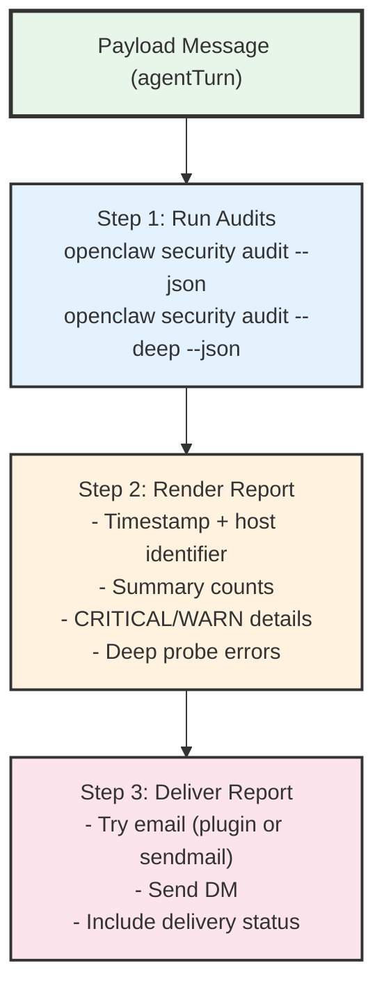
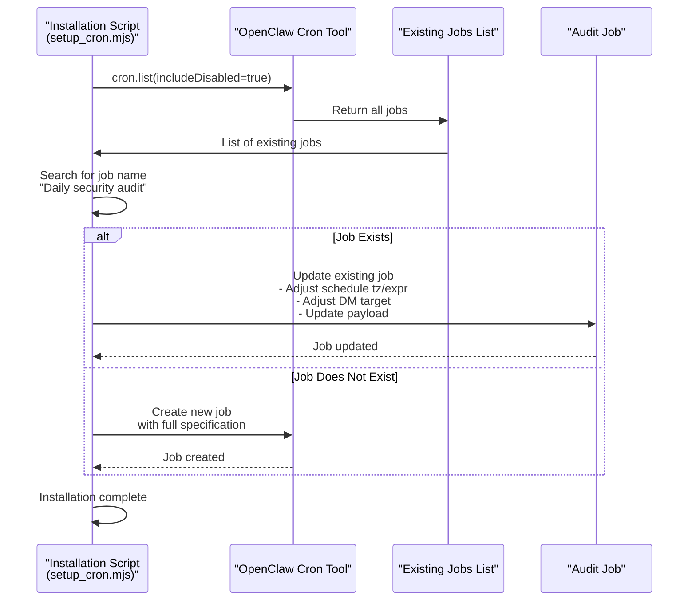

<!-- source: DeepWiki mcp.deepwiki.com · repo prompt-security/clawsec · extra page Report Delivery and Cron Configuration · fetched 2026-10-26 -->

# Report Delivery and Cron Configuration

<details>
<summary>Relevant source files</summary>

The following files were used as context for generating this wiki page:

- [skills/openclaw-audit-watchdog/SKILL.md](skills/openclaw-audit-watchdog/SKILL.md)
- [skills/openclaw-audit-watchdog/skill.json](skills/openclaw-audit-watchdog/skill.json)

</details>


## Purpose and Scope

This document describes the report delivery mechanisms and cron job configuration for the `openclaw-audit-watchdog` skill. It covers the priority-based email delivery system, DM fallback mechanisms, cron job structure with isolated session execution, and idempotent update logic.

For information about audit execution and report generation, see [Audit Execution and Report Generation](#4.4.1). For the overall audit watchdog skill architecture, see [openclaw-audit-watchdog: Automated Daily Audits](#4.4).

---

## Report Delivery Priority System

The `openclaw-audit-watchdog` implements a two-tier delivery system with email taking priority over DM notification when available.

### Email Delivery Priority Order



**Email Delivery Priority Tiers:**

| Priority | Method | Tool/Command | Script Reference |
|----------|--------|--------------|------------------|
| **A** | Email Channel Plugin | `message(action="send", channel="email", target="...", message=...)` | Handled in cron payload |
| **B** | Local Sendmail | `printf "%s" "$REPORT" \| /usr/sbin/sendmail -t` | [scripts/sendmail_report.sh]() |
| **C** | DM Only (with warning) | `message(action="send", channel=<DM_CHANNEL>, ...)` | Handled in cron payload |

The priority system ensures reports are delivered even when email infrastructure is unavailable. The cron job payload attempts email delivery first, then falls back to DM with an explanatory note if email fails.

**Sources:** [skills/openclaw-audit-watchdog/SKILL.md:119-131]()

### DM Delivery Configuration

DM delivery serves as both a complementary notification channel and a fallback mechanism. The delivery target is configured via environment variables during installation.



**Required DM Environment Variables:**

| Variable | Description | Example |
|----------|-------------|---------|
| `PROMPTSEC_DM_CHANNEL` | DM channel identifier | `telegram`, `slack`, `discord` |
| `PROMPTSEC_DM_TO` | Recipient identifier | User ID or handle |

The DM delivery always succeeds regardless of email status, ensuring users receive notification of audit completion even if email infrastructure is unavailable.

**Sources:** [skills/openclaw-audit-watchdog/SKILL.md:72-74](), [skills/openclaw-audit-watchdog/SKILL.md:117-130]()

---

## Cron Job Structure and Configuration

### Job Specification

The `openclaw-audit-watchdog` creates a cron job using the OpenClaw `cron` tool with the following specification:



**Cron Tool Parameters:**

| Parameter | Value | Purpose |
|-----------|-------|---------|
| `schedule.kind` | `"cron"` | Standard cron-style scheduling |
| `schedule.expr` | `"0 23 * * *"` | Daily at 23:00 (11pm) |
| `schedule.tz` | `PROMPTSEC_TZ` or `"UTC"` | Timezone for schedule execution |
| `sessionTarget` | `"isolated"` | Execute in isolated session for security |
| `wakeMode` | `"now"` | Execute immediately if agent is awake |
| `payload.kind` | `"agentTurn"` | Agent executes the payload as a turn |
| `payload.deliver` | `true` | Deliver results after execution |

The isolated session execution ensures audit runs don't interfere with active agent sessions and provides consistent execution environment.

**Sources:** [skills/openclaw-audit-watchdog/SKILL.md:86-96]()

### Payload Message Structure

The cron job payload is an `agentTurn` message that instructs the agent to execute the audit workflow. The payload template structure:



**Payload Instructions Template:**

1. **Audit Execution:**
   - Run `openclaw security audit --json` for standard audit
   - Run `openclaw security audit --deep --json` for deep probe audit
   - Prefer JSON output for robust parsing

2. **Report Rendering:**
   - Include timestamp and host identifier (from `PROMPTSEC_HOST_LABEL` or `hostname`)
   - Summarize counts (CRITICAL/WARN/INFO)
   - For each CRITICAL/WARN: include `checkId`, `title`, and 1-line remediation
   - Include deep probe error lines if deep audit fails

3. **Delivery Execution:**
   - Attempt email delivery (plugin or sendmail)
   - Send DM to configured target
   - Include delivery status notes if email failed

The payload is constructed during cron job creation by the [scripts/setup_cron.mjs]() script.

**Sources:** [skills/openclaw-audit-watchdog/SKILL.md:97-119]()

---

## Idempotent Update Mechanism

The `openclaw-audit-watchdog` implements idempotent installation that updates existing jobs rather than creating duplicates.



**Idempotency Algorithm:**

1. **Query Existing Jobs:** Call `cron.list(includeDisabled=true)` to retrieve all jobs, including disabled ones
2. **Search by Name:** Look for jobs with names matching `"Daily security audit"`
3. **Update or Create:**
   - If job exists: Update schedule timezone/expression and DM target
   - If job doesn't exist: Create new job with full specification
4. **Preserve User Changes:** Only update specified fields; other job configurations remain unchanged

This approach prevents duplicate cron jobs during reinstallation or skill updates while allowing configuration updates (e.g., timezone changes, DM target updates).

**Sources:** [skills/openclaw-audit-watchdog/SKILL.md:132-139](), [skills/openclaw-audit-watchdog/skill.json:55-59]()

---

## Configuration Options

### Environment Variable Reference

The watchdog supports MDM-friendly provisioning through environment variables, eliminating interactive prompts in automated deployments.

| Variable | Required | Default | Description |
|----------|----------|---------|-------------|
| `PROMPTSEC_DM_CHANNEL` | **Yes** | None | DM channel identifier (e.g., `telegram`, `slack`) |
| `PROMPTSEC_DM_TO` | **Yes** | None | DM recipient identifier (user ID or handle) |
| `PROMPTSEC_TZ` | No | `UTC` | IANA timezone for cron schedule |
| `PROMPTSEC_HOST_LABEL` | No | `hostname` | Label included in audit reports |
| `PROMPTSEC_INSTALL_DIR` | No | `~/.config/security-checkup` | Stable path used by cron payload |
| `PROMPTSEC_GIT_PULL` | No | `0` | If `1`, runner executes `git pull --ff-only` before audit |

**MDM Deployment Pattern:**

```bash
export PROMPTSEC_DM_CHANNEL="telegram"
export PROMPTSEC_DM_TO="123456789"
export PROMPTSEC_TZ="America/New_York"
export PROMPTSEC_HOST_LABEL="prod-agent-01"

# Install skill (non-interactive)
openclaw skills install openclaw-audit-watchdog
```

The environment variable approach enables silent installation in corporate environments or containerized deployments.

**Sources:** [skills/openclaw-audit-watchdog/SKILL.md:69-82]()

### Interactive Installation Fallback

When required environment variables are not set, the skill falls back to interactive prompts. However, the prompts are minimalistic since the watchdog is "pretty straight up configured out of the box."

**Interactive Prompt Sequence:**

1. **DM Channel:** Prompt for channel identifier if `PROMPTSEC_DM_CHANNEL` not set
2. **DM Recipient:** Prompt for recipient if `PROMPTSEC_DM_TO` not set
3. **Timezone:** Prompt for timezone if `PROMPTSEC_TZ` not set (defaults to UTC if skipped)

All other configuration uses sensible defaults without prompting.

**Sources:** [skills/openclaw-audit-watchdog/SKILL.md:69-83]()

---

## Default Schedule and Safety Constraints

### Default Schedule

The default cron schedule is **daily at 23:00 (11pm)** in the configured timezone. This late-night timing minimizes interference with active agent sessions.

**Cron Expression:** `0 23 * * *`
- Minute: 0
- Hour: 23 (11pm)
- Day of month: * (every day)
- Month: * (every month)
- Day of week: * (every day)

Users can adjust the timezone via `PROMPTSEC_TZ` but the hour remains fixed at 23:00 in that timezone.

### Safety Constraints

The audit watchdog enforces strict safety constraints to prevent automated security misconfigurations:

**Read-Only Audit Reports:**
- The cron job report *suggests* fixes but **never applies them automatically**
- No execution of `openclaw security audit --fix` unless explicitly requested by user
- Reports identify issues but require manual approval for remediation

This design ensures the watchdog provides visibility without creating automated security actions that could be exploited through social engineering or prompt injection attacks.

**Sources:** [skills/openclaw-audit-watchdog/SKILL.md:62-63](), [skills/openclaw-audit-watchdog/SKILL.md:145-150]()

---

## Suggested Job Naming

The skill uses consistent job naming to enable idempotent updates and user recognition:

**Standard Job Name:** `"Daily security audit (Prompt Security)"`

This naming convention:
- Identifies the job's purpose ("Daily security audit")
- Associates it with the ClawSec ecosystem ("Prompt Security")
- Matches the search pattern used by the idempotency logic
- Appears clearly in cron job listings

Users can customize the job name during installation, but the default naming is recommended for consistency across deployments.

**Sources:** [skills/openclaw-audit-watchdog/SKILL.md:142-143]()

---

## Related Scripts

The following scripts implement the delivery and cron configuration functionality:

| Script | Purpose | SBOM Required |
|--------|---------|---------------|
| [scripts/setup_cron.mjs]() | Creates/updates cron job with idempotency | No |
| [scripts/sendmail_report.sh]() | Sendmail delivery fallback | No |
| [scripts/send_smtp.mjs]() | SMTP delivery (Node.js implementation) | No |
| [scripts/runner.sh]() | Main cron payload execution wrapper | Yes |
| [scripts/run_audit_and_format.sh]() | Audit execution and report formatting | Yes |

**Sources:** [skills/openclaw-audit-watchdog/skill.json:26-59]()

---

