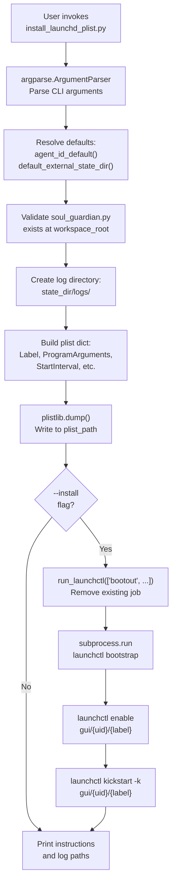
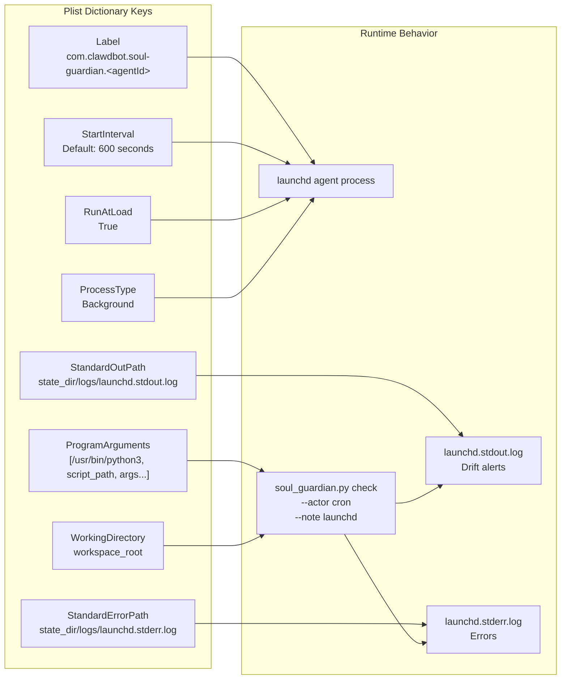
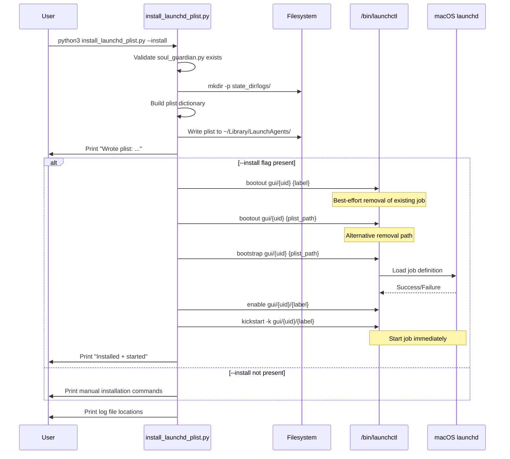
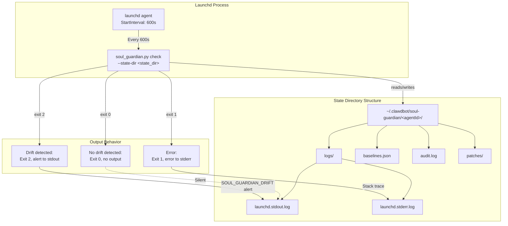
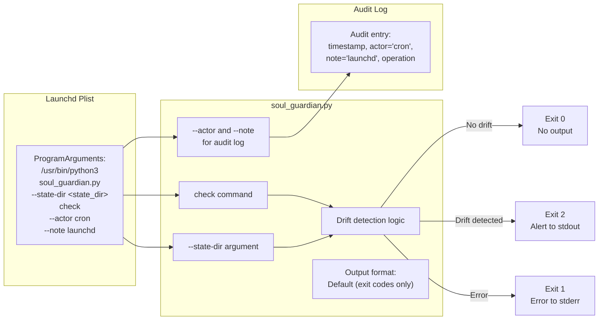

<!-- source: DeepWiki mcp.deepwiki.com · repo prompt-security/clawsec · extra page macOS launchd Integration · fetched 2026-10-26 -->

# macOS launchd Integration

<details>
<summary>Relevant source files</summary>

The following files were used as context for generating this wiki page:

- [skills/soul-guardian/SKILL.md](skills/soul-guardian/SKILL.md)
- [skills/soul-guardian/scripts/install_launchd_plist.py](skills/soul-guardian/scripts/install_launchd_plist.py)

</details>


## Purpose and Scope

This document describes the macOS launchd integration for soul-guardian, which enables automated periodic drift checking on macOS systems. The `install_launchd_plist.py` script generates and optionally installs a launchd agent that runs `soul_guardian.py check` at regular intervals, providing silent background monitoring with log-based alerting.

For information about the core drift detection mechanisms, see [Baseline Management and Drift Detection](#4.3.1). For information about the broader soul-guardian skill architecture, see [soul-guardian: Drift Detection and File Integrity](#4.3).

---

## Overview

The launchd integration provides automated background monitoring for soul-guardian on macOS without requiring manual cron configuration or external dependencies. The system is designed to be:

- **Silent on success**: No output when no drift is detected
- **Deterministic**: Pure Python with no external dependencies beyond Python 3 standard library
- **Log-based**: Drift alerts are written to stdout/stderr logs in the state directory
- **Workspace-aware**: Supports multiple agent workspaces with unique labels per workspace

**Key Components:**

| Component | Location | Purpose |
|-----------|----------|---------|
| Generator script | `install_launchd_plist.py` | Creates and installs launchd plists |
| Launchd agent | `~/Library/LaunchAgents/<label>.plist` | Background process definition |
| Log files | `~/.clawdbot/soul-guardian/<agent-id>/logs/` | Stdout/stderr output capture |
| State directory | `~/.clawdbot/soul-guardian/<agent-id>/` | Persistent drift detection state |

Sources: [skills/soul-guardian/scripts/install_launchd_plist.py:1-27]()

---

## Script Architecture and Execution Flow



**Script Execution Flow**

The `install_launchd_plist.py` script follows a linear execution path with optional installation:

1. **Argument Parsing**: Uses `argparse.ArgumentParser` to process command-line options ([install_launchd_plist.py:42-83]())
2. **Path Resolution**: Resolves workspace root, agent ID, and state directory with smart defaults ([install_launchd_plist.py:85-90]())
3. **Script Validation**: Verifies `soul_guardian.py` exists at expected path ([install_launchd_plist.py:92-94]())
4. **Plist Generation**: Constructs plist dictionary with `ProgramArguments`, `StartInterval`, and log paths ([install_launchd_plist.py:102-124]())
5. **Plist Writing**: Uses `plistlib.dump()` with `FMT_XML` format ([install_launchd_plist.py:131-132]())
6. **Optional Installation**: If `--install` flag is present, bootstraps with `launchctl` ([install_launchd_plist.py:140-158]())

Sources: [skills/soul-guardian/scripts/install_launchd_plist.py:41-164]()

---

## Plist Structure and Generation



**Plist Dictionary Structure**

The generated plist contains the following keys:

| Key | Value | Purpose |
|-----|-------|---------|
| `Label` | `com.clawdbot.soul-guardian.<agentId>` | Unique identifier for the launchd job |
| `ProgramArguments` | `["/usr/bin/python3", script_path, "--state-dir", state_dir, "check", "--actor", actor, "--note", note]` | Command to execute with arguments |
| `WorkingDirectory` | `workspace_root` | Set CWD to workspace root for relative paths |
| `StartInterval` | `600` (default) | Run every N seconds |
| `RunAtLoad` | `True` | Start immediately when agent loads |
| `StandardOutPath` | `state_dir/logs/launchd.stdout.log` | Capture stdout (drift alerts) |
| `StandardErrorPath` | `state_dir/logs/launchd.stderr.log` | Capture stderr (errors) |
| `ProcessType` | `"Background"` | Avoid interactive UI dependencies |

**ProgramArguments Construction**

The script builds the command array at [install_launchd_plist.py:102-112]():

```python
program_args = [
    "/usr/bin/python3",
    str(script_path),
    "--state-dir",
    str(state_dir),
    "check",
    "--actor",
    str(args.actor),
    "--note",
    str(args.note),
]
```

This invokes `soul_guardian.py check` with an explicit state directory, ensuring the launchd process uses the external state location rather than defaulting to workspace-relative state.

Sources: [skills/soul-guardian/scripts/install_launchd_plist.py:102-124]()

---

## Configuration Options and Default Behavior

```mermaid
graph TD
    subgraph "CLI Arguments"
        WorkspaceRoot["--workspace-root<br/>Default: cwd"]
        AgentId["--agent-id<br/>Default: workspace folder name"]
        StateDir["--state-dir<br/>Default: ~/.clawdbot/soul-guardian/&lt;agentId&gt;"]
        Label["--label<br/>Default: com.clawdbot.soul-guardian.&lt;agentId&gt;"]
        Interval["--interval-seconds<br/>Default: 600"]
        Actor["--actor<br/>Default: cron"]
        Note["--note<br/>Default: launchd"]
        Out["--out<br/>Default: ~/Library/LaunchAgents/&lt;label&gt;.plist"]
        Force["--force<br/>Overwrite existing plist"]
        Install["--install<br/>Bootstrap with launchctl"]
    end
    
    subgraph "Default Resolution"
        CwdResolution["Path.cwd()"]
        AgentIdFunc["agent_id_default(workspace_root)<br/>Returns: workspace_root.name"]
        StateDirFunc["default_external_state_dir(agent_id)<br/>Returns: ~/.clawdbot/soul-guardian/&lt;agentId&gt;"]
        LabelFormat["f'com.clawdbot.soul-guardian.{agent_id}'"]
        PlistPathFormat["~/Library/LaunchAgents/{label}.plist"]
    end
    
    WorkspaceRoot -.->|if None| CwdResolution
    AgentId -.->|if None| AgentIdFunc
    StateDir -.->|if None| StateDirFunc
    Label -.->|if None| LabelFormat
    Out -.->|if None| PlistPathFormat
    
    CwdResolution --> WorkspaceRoot
    AgentIdFunc --> AgentId
    StateDirFunc --> StateDir
    LabelFormat --> Label
    PlistPathFormat --> Out
```



**Command-Line Arguments**

The script accepts the following arguments ([install_launchd_plist.py:42-81]()):

| Argument | Default | Description |
|----------|---------|-------------|
| `--workspace-root` | Current working directory | Path to agent workspace containing `skills/soul-guardian/` |
| `--agent-id` | Workspace folder name | Identifier used in label and default state directory |
| `--state-dir` | `~/.clawdbot/soul-guardian/<agentId>/` | External state directory for logs and baselines |
| `--label` | `com.clawdbot.soul-guardian.<agentId>` | Launchd job label (must be unique per user) |
| `--interval-seconds` | `600` | Check interval in seconds (StartInterval) |
| `--actor` | `cron` | Actor value passed to `soul_guardian.py` for audit log |
| `--note` | `launchd` | Note value passed to `soul_guardian.py` for audit log |
| `--out` | `~/Library/LaunchAgents/<label>.plist` | Output path for generated plist |
| `--force` | `False` | Allow overwriting existing plist file |
| `--install` | `False` | Bootstrap and enable the agent with launchctl |

**Default Resolution Logic**

The script uses two helper functions for smart defaults:

1. **`agent_id_default(workspace_root: Path) -> str`** ([install_launchd_plist.py:29-30]()): Returns the workspace folder name as the agent ID
2. **`default_external_state_dir(agent_id: str) -> Path`** ([install_launchd_plist.py:33-34]()): Returns `~/.clawdbot/soul-guardian/<agentId>/` as the external state directory

This design supports multiple agent workspaces on the same machine, each with its own launchd job and isolated state.

Sources: [skills/soul-guardian/scripts/install_launchd_plist.py:29-90]()

---

## Installation Flow and Launchctl Management



**Installation Process**

When invoked with the `--install` flag, the script performs a multi-step installation ([install_launchd_plist.py:140-158]()):

1. **Best-effort cleanup**: Calls `run_launchctl(["bootout", f"gui/{uid}", label])` to remove any existing job with the same label ([install_launchd_plist.py:142]())
2. **Alternative cleanup**: Calls `run_launchctl(["bootout", f"gui/{uid}", str(plist_path)])` to handle path-based removal ([install_launchd_plist.py:143]())
3. **Bootstrap**: Executes `launchctl bootstrap gui/{uid} {plist_path}` to load the job ([install_launchd_plist.py:144]())
4. **Enable**: Executes `launchctl enable gui/{uid}/{label}` to mark the job as enabled ([install_launchd_plist.py:151]())
5. **Kickstart**: Executes `launchctl kickstart -k gui/{uid}/{label}` to start the job immediately ([install_launchd_plist.py:152]())

**Error Handling**

The `run_launchctl()` helper function ([install_launchd_plist.py:37-38]()) uses `check=False` and redirects output to `DEVNULL`, making cleanup operations best-effort. The bootstrap step, however, captures output and reports errors to stderr if it fails ([install_launchd_plist.py:144-149]()).

**Manual Installation**

Without the `--install` flag, the script prints manual installation commands ([install_launchd_plist.py:155-158]()):

```
launchctl bootstrap gui/{uid} {plist_path}
launchctl enable gui/{uid}/{label}
launchctl kickstart -k gui/{uid}/{label}
```

This allows users to review the generated plist before installing it.

Sources: [skills/soul-guardian/scripts/install_launchd_plist.py:37-158]()

---

## Logging and State Management



**State Directory Layout**

The script creates a dedicated state directory for each agent workspace, typically at `~/.clawdbot/soul-guardian/<agentId>/` ([install_launchd_plist.py:33-34]()). This directory contains:

| Path | Purpose |
|------|---------|
| `logs/launchd.stdout.log` | Drift alerts from soul_guardian.py |
| `logs/launchd.stderr.log` | Errors and stack traces |
| `baselines.json` | SHA-256 hashes of approved file states |
| `audit.log` | Tamper-evident audit trail of all operations |
| `patches/` | Unified diffs of detected drift |

**Log Creation**

The script creates the logs directory at [install_launchd_plist.py:97-100]():

```python
log_dir = state_dir / "logs"
log_dir.mkdir(parents=True, exist_ok=True)
stdout_log = log_dir / "launchd.stdout.log"
stderr_log = log_dir / "launchd.stderr.log"
```

These paths are then configured in the plist as `StandardOutPath` and `StandardErrorPath` ([install_launchd_plist.py:120-121]()).

**Silent on Success Design**

The script documentation at [install_launchd_plist.py:2-17]() emphasizes the "silent on OK" behavior:

> Be *silent on OK* (soul_guardian.py prints nothing + exits 0 when no drift).
> Produce a single-line stdout alert on drift (exits 2 and prints SOUL_GUARDIAN_DRIFT ...).

This design ensures that `launchd.stdout.log` remains empty during normal operation, making drift alerts immediately visible when they occur.

**Log Monitoring**

The script prints tail commands for monitoring logs ([install_launchd_plist.py:160-162]()):

```
tail -n 200 -f {stdout_log}
tail -n 200 -f {stderr_log}
```

Sources: [skills/soul-guardian/scripts/install_launchd_plist.py:2-17](), [skills/soul-guardian/scripts/install_launchd_plist.py:97-162]()

---

## Integration with soul_guardian.py



**Command Invocation**

The launchd agent invokes `soul_guardian.py` with the following structure ([install_launchd_plist.py:102-112]()):

```python
program_args = [
    "/usr/bin/python3",           # Explicit Python interpreter
    str(script_path),             # Full path to soul_guardian.py
    "--state-dir",                # State directory flag
    str(state_dir),               # External state directory path
    "check",                      # Check command (drift detection)
    "--actor",                    # Actor for audit log
    str(args.actor),              # Default: "cron"
    "--note",                     # Note for audit log
    str(args.note),               # Default: "launchd"
]
```

**Actor and Note Metadata**

The `--actor` and `--note` arguments provide context in the audit log:

- **Actor**: Identifies the entity performing the check (default: `"cron"`)
- **Note**: Provides additional context (default: `"launchd"`)

These values can be customized via command-line arguments ([install_launchd_plist.py:69-70]()).

**Exit Code Behavior**

The `soul_guardian.py check` command uses exit codes to signal results:

- **Exit 0**: No drift detected, no output
- **Exit 2**: Drift detected, alert printed to stdout
- **Exit 1**: Error occurred, details to stderr

The launchd integration does NOT use `--output-format alert` because the default output behavior is sufficient for log-based monitoring. The SKILL.md documentation ([skills/soul-guardian/SKILL.md:37-38]()) recommends using `--output-format alert` for HEARTBEAT.md integration, but the launchd integration uses the default format to keep logs concise.

**State Directory Isolation**

By passing an explicit `--state-dir` argument, the launchd process uses an external state directory (`~/.clawdbot/soul-guardian/<agentId>/`) rather than the default workspace-relative state. This provides:

- **Resilience**: State persists even if the workspace is deleted
- **Separation of concerns**: Launchd logs are isolated from workspace files
- **Multi-workspace support**: Each workspace has its own state directory

Sources: [skills/soul-guardian/scripts/install_launchd_plist.py:69-70](), [skills/soul-guardian/scripts/install_launchd_plist.py:102-112](), [skills/soul-guardian/SKILL.md:37-38]()

---

## Usage Examples

**Basic Installation (Single Workspace)**

```bash
cd ~/.openclaw/workspace
python3 skills/soul-guardian/scripts/install_launchd_plist.py --install
```

This generates a plist for the current workspace and installs it immediately. Output:

```
Wrote plist: /Users/user/Library/LaunchAgents/com.clawdbot.soul-guardian.workspace.plist
State dir:  /Users/user/.clawdbot/soul-guardian/workspace
Label:      com.clawdbot.soul-guardian.workspace
Installed + started (launchctl bootstrap/enable/kickstart).

Logs:
  tail -n 200 -f /Users/user/.clawdbot/soul-guardian/workspace/logs/launchd.stdout.log
  tail -n 200 -f /Users/user/.clawdbot/soul-guardian/workspace/logs/launchd.stderr.log
```

**Custom Configuration**

```bash
python3 skills/soul-guardian/scripts/install_launchd_plist.py \
  --workspace-root ~/my-agent \
  --agent-id my-agent-prod \
  --interval-seconds 300 \
  --actor launchd-prod \
  --install
```

This creates a custom configuration with a 5-minute check interval (300 seconds) and a custom agent ID.

**Dry-Run (Review Before Installing)**

```bash
python3 skills/soul-guardian/scripts/install_launchd_plist.py
```

Without `--install`, the script writes the plist but does not bootstrap it. This allows review of the generated configuration before installation.

**Multiple Workspaces**

```bash
# Agent 1
cd ~/agents/agent1
python3 skills/soul-guardian/scripts/install_launchd_plist.py --install

# Agent 2
cd ~/agents/agent2
python3 skills/soul-guardian/scripts/install_launchd_plist.py --install
```

Each workspace gets a unique label (`com.clawdbot.soul-guardian.agent1`, `com.clawdbot.soul-guardian.agent2`) and isolated state directories.

**Updating Configuration**

To update an existing installation, use `--force` to overwrite the plist:

```bash
python3 skills/soul-guardian/scripts/install_launchd_plist.py \
  --interval-seconds 1800 \
  --force \
  --install
```

The script automatically unloads the old job and bootstraps the new configuration.

Sources: [skills/soul-guardian/scripts/install_launchd_plist.py:1-168]()

---

## Comparison with Alternative Automation

| Approach | Pros | Cons | Use Case |
|----------|------|------|----------|
| **launchd** | Native macOS, survives reboots, user-specific | macOS-only, requires script | Production monitoring on macOS |
| **HEARTBEAT.md** | Portable, agent-native, no external dependencies | Requires agent to execute heartbeat | Active agent sessions |
| **cron** | Cross-platform, widely known | User-visible cron jobs, less reliable on macOS | Linux/Unix servers |
| **watch mode** | Immediate feedback, custom interval | Requires active terminal session | Development and debugging |

The launchd integration complements HEARTBEAT.md integration ([skills/soul-guardian/SKILL.md:31-39]()) by providing system-level monitoring even when the agent is idle.

Sources: [skills/soul-guardian/SKILL.md:31-39]()

---

