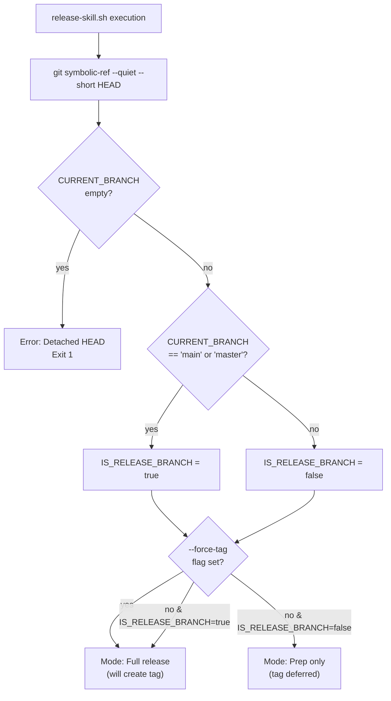
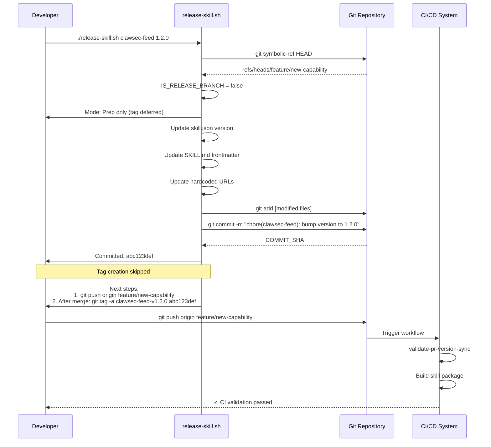
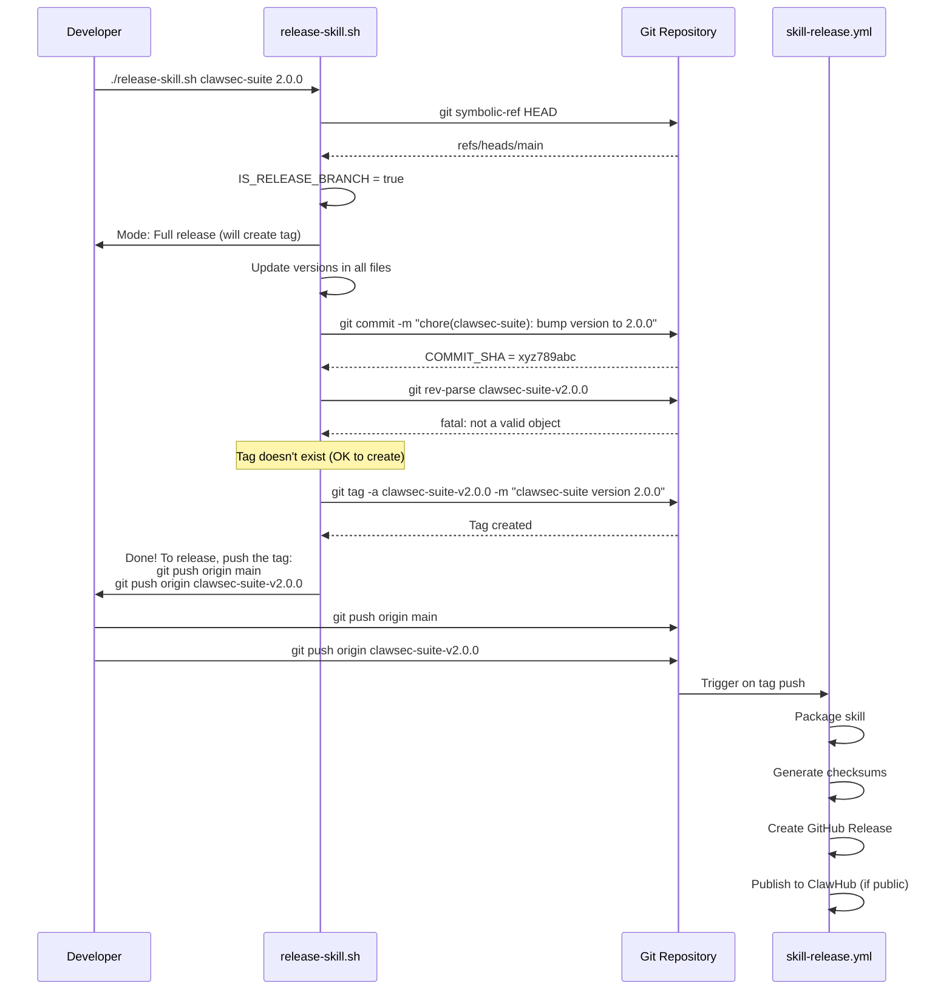
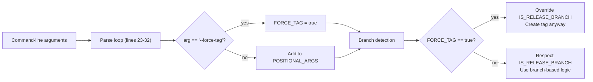
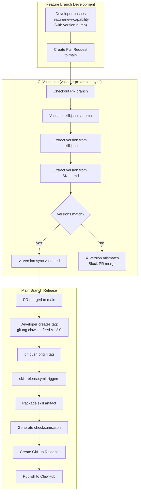
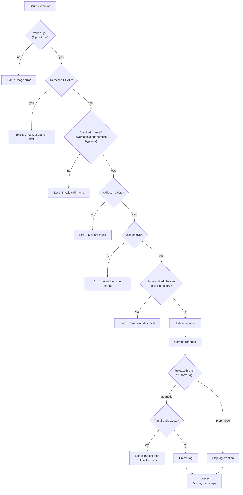

<!-- source: DeepWiki mcp.deepwiki.com · repo prompt-security/clawsec · extra page Branch-Aware Release Workflow · fetched 2026-10-26 -->

# Branch-Aware Release Workflow

<details>
<summary>Relevant source files</summary>

The following files were used as context for generating this wiki page:

- [scripts/release-skill.sh](scripts/release-skill.sh)

</details>


## Purpose and Scope

This document describes how the `release-skill.sh` script implements branch-aware release workflows, enabling version updates on feature branches for CI validation while deferring tag creation until merge to production branches. This two-phase approach prevents premature releases while maintaining version consistency throughout the development lifecycle.

For general usage of the release script, see [Release Script Usage](#6.2). For details on how version URLs are updated across files, see [Version URL Pattern Updates](#6.2.2).

---

## Branch Detection Mechanism

The release script determines whether to perform a full release (with tagging) or a prep-only release (version update without tagging) by detecting the current Git branch at execution time.

### Detection Algorithm

The script first ensures it's operating on a named branch (not a detached HEAD state), then classifies the branch as either a release branch or a feature branch:



**Branch Detection Decision Table**

| Current Branch | `--force-tag` Flag | `IS_RELEASE_BRANCH` | Mode | Tag Created? |
|----------------|-------------------|---------------------|------|--------------|
| `main` | No | `true` | Full release | Yes |
| `master` | No | `true` | Full release | Yes |
| `feature/xyz` | No | `false` | Prep only | No |
| `release/1.2` | No | `false` | Prep only | No |
| `feature/xyz` | Yes | `false` | Full release | Yes (forced) |
| Detached HEAD | N/A | N/A | Error | N/A |

Sources: [scripts/release-skill.sh:44-55](), [scripts/release-skill.sh:86-90]()

---

## Feature Branch Workflow (Prep-Only Mode)

When the script detects a feature branch (any branch other than `main` or `master` without `--force-tag`), it operates in prep-only mode. This mode updates version metadata and commits changes but defers tag creation until the changes are merged to a release branch.

### Execution Flow



### Output Messages

In prep-only mode, the script provides explicit next-step instructions after committing the version bump:

```
Done! Version updated and committed (tag deferred).

Next steps:
  1. Push your branch for CI validation:
     git push origin feature/new-capability

  2. After CI passes and PR is merged to main, create the tag:
     git checkout main && git pull
     git tag -a 'clawsec-feed-v1.2.0' abc123def -m 'clawsec-feed version 1.2.0'
     git push origin clawsec-feed-v1.2.0

Or to undo the version bump:
  git reset --hard HEAD~1
```

This deferred-tagging approach enables:
- **Early CI validation** of packaging and version consistency checks
- **Review of version changes** in pull requests before release
- **Rollback capability** without polluting the tag namespace
- **Branch protection** against accidental releases from development branches

Sources: [scripts/release-skill.sh:273-289]()

---

## Release Branch Workflow (Full Release Mode)

When the script detects a release branch (`main` or `master`), it performs a complete release workflow including tag creation. This triggers the `skill-release.yml` workflow when the tag is pushed.

### Execution Flow



### Tag Creation Safeguards

The script implements multiple safeguards before creating tags:

**Pre-Creation Checks**

| Check | Implementation | Error Recovery |
|-------|---------------|----------------|
| Tag uniqueness | `git rev-parse $TAG` must fail | Rollback commit with `git reset --hard HEAD~1` |
| Uncommitted changes | `git diff --quiet $SKILL_PATH/` | Exit before any modifications |
| Working branch | `git symbolic-ref HEAD` must succeed | Exit before any modifications |

If tag creation fails after the commit succeeds, the script provides detailed recovery instructions:

```
Error: Failed to create tag clawsec-suite-v2.0.0

The commit has been created but NOT tagged:
  Commit: xyz789abc

Recovery options:
  1. Fix the issue and tag manually:
     git tag -a 'clawsec-suite-v2.0.0' -m 'clawsec-suite version 2.0.0' xyz789abc

  2. Investigate why tagging failed:
     - Check if tag exists: git tag -l 'clawsec-suite-v2.0.0'
     - Check permissions: ls -ld .git/refs/tags

  3. To rollback the commit (if desired):
     git reset --hard HEAD~1

The commit has NOT been pushed. Fix the issue before pushing.
```

Sources: [scripts/release-skill.sh:227-258](), [scripts/release-skill.sh:260-272]()

---

## Force Tag Override

The `--force-tag` flag allows developers to create tags on non-release branches, useful for testing release workflows or creating prerelease tags from dedicated branches.

### Usage Pattern

```bash
# Create a beta release from a release branch
git checkout release/2.0
./scripts/release-skill.sh clawsec-feed 2.0.0-beta1 --force-tag
git push origin release/2.0
git push origin clawsec-feed-v2.0.0-beta1
```

### Flag Parsing and Application



The flag is processed before branch detection, allowing it to override the default branch-based behavior at decision time.

Sources: [scripts/release-skill.sh:19-32](), [scripts/release-skill.sh:227]()

---

## Workflow Integration with CI/CD

The branch-aware release workflow integrates with GitHub Actions to enforce version consistency and automate packaging.

### CI Validation on Feature Branches



This workflow ensures:
- **Version changes are validated** before merge (CI checks on feature branch)
- **Tags are only created** after code review and merge (manual step on main)
- **Releases are automated** once tags exist (workflow triggers on tag push)
- **No accidental releases** from feature branches (no tags = no workflow trigger)

Sources: [scripts/release-skill.sh:11-15]()

---

## Error Handling and Recovery Scenarios

The script implements comprehensive error detection with specific recovery paths for each failure mode.

### Error Decision Tree



### Recovery Commands by Error Type

| Error Condition | Cause | Manual Recovery |
|----------------|-------|-----------------|
| Detached HEAD | `git symbolic-ref` fails | `git checkout main` or `git checkout -b feature/name` |
| Uncommitted changes | `git diff --quiet` fails | `git add . && git commit` or `git stash` |
| Tag already exists | `git rev-parse $TAG` succeeds | `git tag -d $TAG` (if safe) or choose new version |
| Tag creation failure | Permission or repo issue | Manual tag: `git tag -a $TAG $COMMIT_SHA -m "..."` |
| Commit-only rollback | User decides to abort | `git reset --hard HEAD~1` |
| Commit+tag rollback | Full abort after tagging | `git reset --hard HEAD~1 && git tag -d $TAG` |

Sources: [scripts/release-skill.sh:44-82](), [scripts/release-skill.sh:227-258](), [scripts/release-skill.sh:267-272](), [scripts/release-skill.sh:287-289]()

---

## Variable Reference

Key variables that control branch-aware behavior:

| Variable | Type | Source | Purpose |
|----------|------|--------|---------|
| `CURRENT_BRANCH` | String | `git symbolic-ref --short HEAD` | Name of current Git branch |
| `IS_RELEASE_BRANCH` | Boolean | Lines 52-55 | `true` if branch is `main` or `master` |
| `FORCE_TAG` | Boolean | Command-line arg | Override branch detection to force tagging |
| `MADE_COMMIT` | Boolean | Line 208, 220 | Tracks if commit was created (for rollback) |
| `COMMIT_SHA` | String | `git rev-parse HEAD` | SHA of version-bump commit |
| `TAG` | String | `${SKILL_NAME}-v${VERSION}` | Git tag name to create |

Sources: [scripts/release-skill.sh:19-55](), [scripts/release-skill.sh:76](), [scripts/release-skill.sh:208-224]()

---

