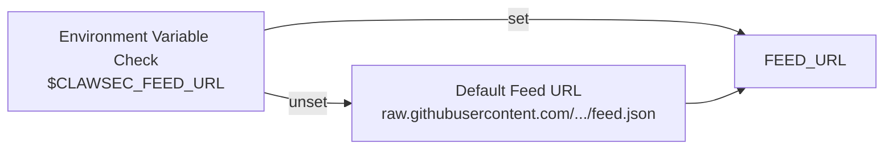
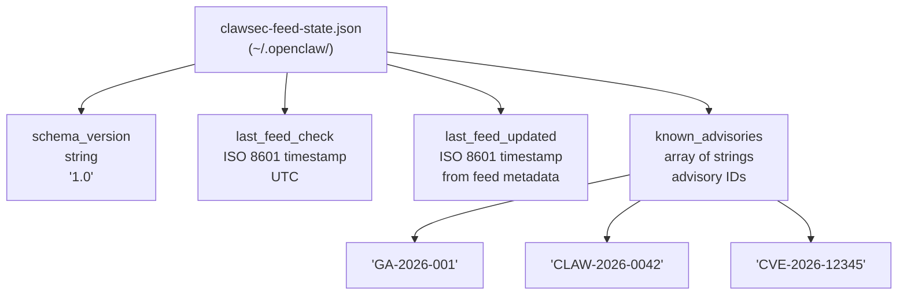
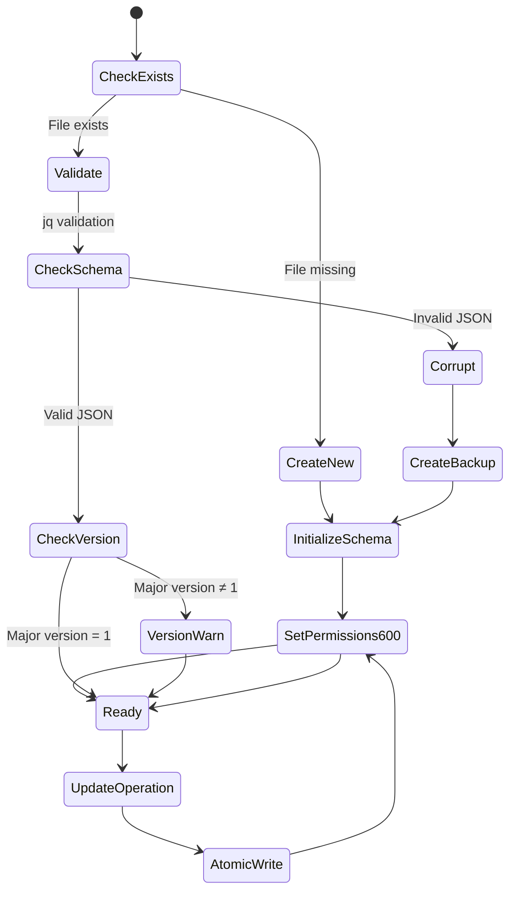
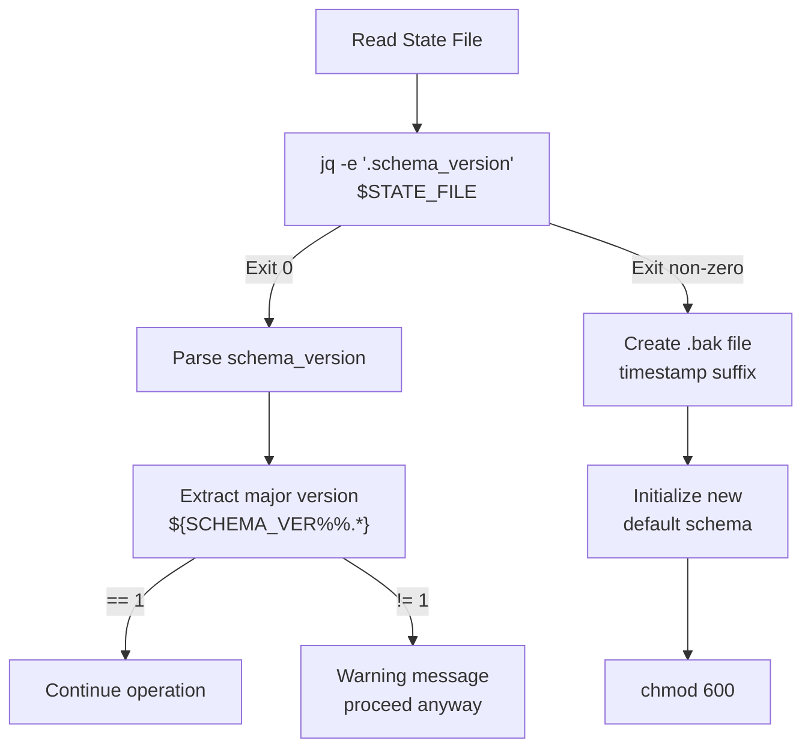
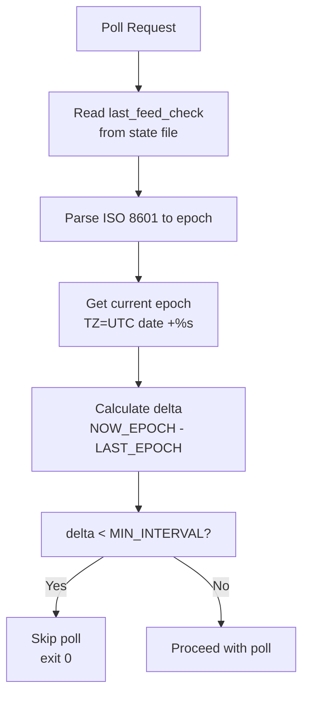
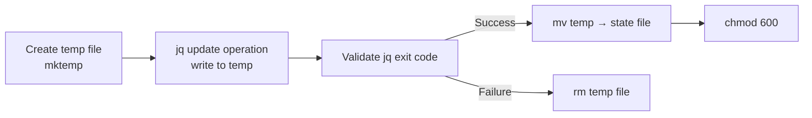
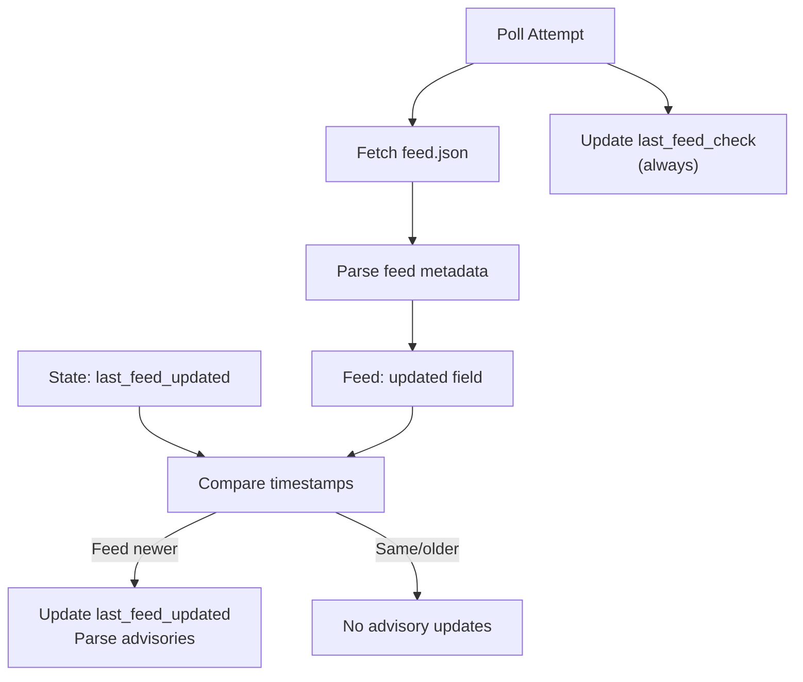
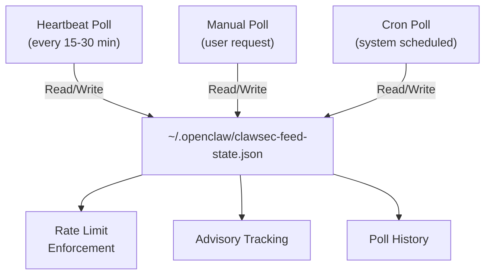

<!-- source: DeepWiki mcp.deepwiki.com · repo prompt-security/clawsec · extra page Feed Polling and State Management · fetched 2026-10-26 -->

# Feed Polling and State Management

<details>
<summary>Relevant source files</summary>

The following files were used as context for generating this wiki page:

- [constants.ts](constants.ts)
- [skills/clawsec-feed/SKILL.md](skills/clawsec-feed/SKILL.md)
- [skills/clawsec-feed/skill.json](skills/clawsec-feed/skill.json)

</details>


## Purpose and Scope

This document describes how the `clawsec-feed` skill polls the advisory feed, manages persistent state, and implements rate limiting to prevent excessive server requests. The focus is on the state file architecture (`clawsec-feed-state.json`) and the polling mechanism that tracks known advisories over time.

For information about how advisories are cross-referenced with installed skills after polling, see [Skill Cross-Referencing and Alerts](#4.2.2). For details on the advisory feed structure and schema, see [Advisory Feed Architecture](#3.1).

---

## Feed URL Configuration

The `clawsec-feed` skill supports configurable feed URLs through environment variables, providing flexibility for development and custom deployments.

### URL Resolution Hierarchy

| Priority | Source | Variable | Default Value |
|----------|--------|----------|---------------|
| 1 | Environment variable | `CLAWSEC_FEED_URL` | *(if set)* |
| 2 | Raw GitHub feed | *(hardcoded)* | `https://raw.githubusercontent.com/prompt-security/ClawSec/main/advisories/feed.json` |



**URL Resolution Logic**

```bash
DEFAULT_FEED_URL="https://raw.githubusercontent.com/...feed.json"
FEED_URL="${CLAWSEC_FEED_URL:-$DEFAULT_FEED_URL}"
```

The raw GitHub feed URL (`main` branch) ensures agents always receive the most current advisories without waiting for release artifacts. This differs from the website's feed URL defined in `constants.ts`, which points to release artifacts.

**Sources:** [skills/clawsec-feed/SKILL.md:299-300](), [constants.ts:3-6]()

---

## State File Architecture

The state file provides persistent storage for tracking polling history, known advisories, and feed metadata. It resides outside the skill directory to survive skill reinstallation.

### File Location and Permissions

| Attribute | Value |
|-----------|-------|
| **Path** | `~/.openclaw/clawsec-feed-state.json` |
| **Permissions** | `600` (owner read/write only) |
| **Owner** | Current user |
| **Format** | JSON |

### State Schema Structure



**Schema Definition**

```json
{
  "schema_version": "1.0",
  "last_feed_check": "2026-02-02T15:00:00Z",
  "last_feed_updated": "2026-02-02T12:00:00Z",
  "known_advisories": ["GA-2026-001", "GA-2026-002"]
}
```

| Field | Type | Purpose | Null Allowed |
|-------|------|---------|--------------|
| `schema_version` | string | Schema compatibility tracking | No |
| `last_feed_check` | ISO 8601 | Last poll timestamp (UTC) | Yes (initial) |
| `last_feed_updated` | ISO 8601 | Feed's last update timestamp | Yes (initial) |
| `known_advisories` | array | Advisory IDs seen previously | No (empty array) |

**Sources:** [skills/clawsec-feed/SKILL.md:525-534](), [skills/clawsec-feed/SKILL.md:538-570]()

---

## State File Lifecycle

The state file undergoes a complete lifecycle from initialization through validation, updates, and corruption recovery.



### Initialization Process

When the state file does not exist, it is created with a default schema and secure permissions.

**Initialization Code Structure:**

```bash
if [ ! -f "$STATE_FILE" ]; then
  echo '{"schema_version":"1.0",...}' > "$STATE_FILE"
  chmod 600 "$STATE_FILE"
fi
```

**Default State Values:**

| Field | Initial Value |
|-------|---------------|
| `schema_version` | `"1.0"` |
| `last_feed_check` | `null` |
| `last_feed_updated` | `null` |
| `known_advisories` | `[]` (empty array) |

**Sources:** [skills/clawsec-feed/SKILL.md:542-545]()

### Schema Validation and Corruption Recovery

Before every read operation, the state file undergoes validation to detect corruption or schema incompatibility.

**Validation Steps:**

1. **JSON Structure Check** - Verify valid JSON using `jq`
2. **Schema Version Check** - Ensure `schema_version` field exists
3. **Major Version Check** - Compare major version (first digit) against expected value



**Backup File Naming Convention:**

```
clawsec-feed-state.json.bak.20260202153045
```

Format: `{original}.bak.{YYYYMMDDHHMMSS}` (UTC timestamp)

**Sources:** [skills/clawsec-feed/SKILL.md:547-559]()

### Schema Version Compatibility

The schema versioning system uses semantic versioning where only the major version is checked for compatibility.

| Schema Version | Major Version | Compatible |
|----------------|---------------|------------|
| `"1.0"` | 1 | ✓ Yes |
| `"1.2"` | 1 | ✓ Yes (warning issued) |
| `"2.0"` | 2 | ✗ No (warning issued) |

**Major Version Extraction:**

```bash
SCHEMA_VER=$(jq -r '.schema_version // "0"' "$STATE_FILE")
if [[ "${SCHEMA_VER%%.*}" != "1" ]]; then
  echo "Warning: State file schema version $SCHEMA_VER..."
fi
```

**Sources:** [skills/clawsec-feed/SKILL.md:556-559]()

---

## Rate Limiting Mechanism

Rate limiting prevents excessive requests to the feed server by enforcing minimum intervals between polls. The implementation uses timestamp comparison against the `last_feed_check` field.

### Rate Limit Configuration

| Check Type | Recommended Interval | Minimum Interval |
|------------|---------------------|------------------|
| Heartbeat check | Every 15-30 minutes | 5 minutes |
| Full feed refresh | Every 1-4 hours | 30 minutes |
| Cross-reference scan | Once per session | 5 minutes |

### Rate Limit Enforcement Logic



**Implementation Code Structure:**

```bash
STATE_FILE="$HOME/.openclaw/clawsec-feed-state.json"
MIN_INTERVAL_SECONDS=300  # 5 minutes

LAST_CHECK=$(jq -r '.last_feed_check // "1970-01-01T00:00:00Z"' "$STATE_FILE")
LAST_EPOCH=$(date conversion...)
NOW_EPOCH=$(TZ=UTC date +%s)

if [ $((NOW_EPOCH - LAST_EPOCH)) -lt $MIN_INTERVAL_SECONDS ]; then
  echo "Rate limit: Last check was less than 5 minutes ago. Skipping."
  exit 0
fi
```

**Epoch Conversion Handling:**

The code handles platform differences in date parsing (macOS vs GNU/Linux):

```bash
# Try macOS format first, then GNU format, fallback to epoch 0
LAST_EPOCH=$(TZ=UTC date -j -f "%Y-%m-%dT%H:%M:%SZ" "$LAST_CHECK" +%s 2>/dev/null || \
             date -d "$LAST_CHECK" +%s 2>/dev/null || \
             echo 0)
```

**Default Timestamp Handling:**

If `last_feed_check` is `null` or missing, it defaults to Unix epoch (1970-01-01T00:00:00Z), ensuring the rate limit check always passes on first run.

**Sources:** [skills/clawsec-feed/SKILL.md:574-597]()

---

## Polling Workflow

The complete polling workflow integrates feed fetching, state updates, and advisory identification.

```mermaid
sequenceDiagram
    participant Agent
    participant RateLimit["Rate Limit Check"]
    participant State["clawsec-feed-state.json"]
    participant Feed["Advisory Feed<br/>(remote URL)"]
    participant Parser["Advisory Parser"]
    
    Agent->>RateLimit: Poll request
    RateLimit->>State: Read last_feed_check
    State-->>RateLimit: timestamp
    
    alt Within rate limit
        RateLimit-->>Agent: Skip (exit 0)
    else Rate limit passed
        RateLimit->>Feed: curl with retry logic
        Feed-->>RateLimit: feed.json
        RateLimit->>Parser: Parse advisories
        Parser->>State: Read known_advisories
        State-->>Parser: array of IDs
        Parser->>Parser: Identify new advisories
        Parser-->>Agent: New advisory list
        Agent->>State: Update last_feed_check (UTC)
        Agent->>State: Update known_advisories
    end
```

### Feed Fetch Operations

**HTTP Request Parameters:**

| Parameter | Value | Purpose |
|-----------|-------|---------|
| `--fail` | *(flag)* | Exit with error on HTTP error status |
| `--show-error` | *(flag)* | Show error messages even with `--silent` |
| `--retry 3` | 3 attempts | Retry on transient failures |
| `--retry-delay 1` | 1 second | Delay between retries |
| `-o` | file path | Output to file instead of stdout |

**Fetch Code Pattern:**

```bash
if ! curl -sSL --fail --show-error --retry 3 --retry-delay 1 \
     "$FEED_URL" -o "$TEMP_FEED"; then
  echo "Error: Failed to fetch advisory feed"
  exit 1
fi
```

**Sources:** [skills/clawsec-feed/SKILL.md:341-344](), [skills/clawsec-feed/SKILL.md:405-408]()

### Advisory Identification Algorithm

New advisories are identified by comparing the `id` field of each advisory in the feed against the `known_advisories` array in the state file.

**Identification Process:**

1. Parse all advisory IDs from the fetched feed
2. Load `known_advisories` array from state file
3. Compare feed IDs against known IDs
4. Advisories not in `known_advisories` are "new"

**Advisory ID Examples:**

- CVE format: `CVE-2026-12345`
- Community format: `CLAW-2026-0042`
- Generic format: `GA-2026-001`

**Sources:** [skills/clawsec-feed/SKILL.md:525-532]()

---

## State Update Operations

State updates use atomic write operations with temporary files to prevent corruption from interrupted writes.



### Atomic Update Implementation

**Update Code Pattern:**

```bash
TEMP_STATE=$(mktemp)
if jq --arg t "$(TZ=UTC date +%Y-%m-%dT%H:%M:%SZ)" \
   '.last_feed_check = $t' "$STATE_FILE" > "$TEMP_STATE"; then
  mv "$TEMP_STATE" "$STATE_FILE"
  chmod 600 "$STATE_FILE"
else
  echo "Error: Failed to update state file"
  rm -f "$TEMP_STATE"
fi
```

**Operation Sequence:**

1. **Create Temporary File** - `mktemp` creates unique temp file
2. **JQ Update** - Write updated JSON to temp file
3. **Exit Code Check** - Validate `jq` succeeded
4. **Atomic Move** - `mv` replaces original (atomic on same filesystem)
5. **Set Permissions** - Enforce `600` on new file
6. **Cleanup on Failure** - Remove temp file if update failed

**UTC Timestamp Generation:**

All timestamps are generated in UTC to avoid timezone ambiguity:

```bash
TZ=UTC date +%Y-%m-%dT%H:%M:%SZ
```

Output format: `2026-02-02T15:30:45Z` (ISO 8601 with Z suffix)

**Sources:** [skills/clawsec-feed/SKILL.md:562-570]()

### Timestamp Field Updates

The state file maintains two distinct timestamp fields that are updated at different times:

| Field | Updated When | Source |
|-------|--------------|--------|
| `last_feed_check` | Every poll attempt | `date` command (agent local time) |
| `last_feed_updated` | When feed changes | `updated` field from feed.json |

**Update Trigger Comparison:**



**Sources:** [skills/clawsec-feed/SKILL.md:525-532]()

---

## Error Handling and Recovery

The state management system implements multiple error handling strategies to maintain resilience.

### Error Categories and Responses

| Error Type | Detection Method | Recovery Action |
|------------|------------------|-----------------|
| Missing state file | File existence check | Create with defaults |
| Corrupted JSON | `jq` validation | Backup + reinitialize |
| Incompatible schema | Version check | Warning + continue |
| Failed state update | `jq` exit code | Keep existing state |
| Failed feed fetch | `curl` exit code | Skip poll, preserve state |

### State Preservation Strategy

**Principle:** Failed operations never corrupt existing state.

**Implementation Mechanisms:**

1. **Atomic Writes** - Updates written to temp file first
2. **Exit Code Checks** - All operations validated before commitment
3. **Backup Creation** - Corrupted states backed up before reset
4. **Default Values** - Missing fields use safe defaults

**Backup File Retention:**

Backup files (`.bak.*` suffix) are created but not automatically cleaned up, allowing manual recovery if needed.

**Sources:** [skills/clawsec-feed/SKILL.md:547-570]()

---

## Integration with Polling Frequency

The state management system works in conjunction with different polling contexts:

### Polling Context Types

**1. Heartbeat Polling**

Triggered regularly by agent's heartbeat routine (e.g., every 15-30 minutes):

```markdown
## ClawSec Feed (every heartbeat)
1. Check advisory feed for new security alerts
2. Cross-reference with installed skills
3. Notify user if action is required
```

**2. Manual Polling**

Triggered by explicit user request:
- User asks "check security advisories"
- Interactive security review

**3. Cron-Based Polling**

Automated periodic checks via system scheduler (when integrated with `clawsec-suite`):
- Defined in `setup_advisory_cron.mjs` (not shown in provided files)
- Runs independently of agent heartbeat

### State Persistence Across Contexts

The state file provides continuity across all polling contexts:



Each polling context respects rate limits and known advisory tracking, preventing duplicate notifications regardless of which context performed the last check.

**Sources:** [skills/clawsec-feed/SKILL.md:259-266](), [skills/clawsec-feed/SKILL.md:574-597]()

---

