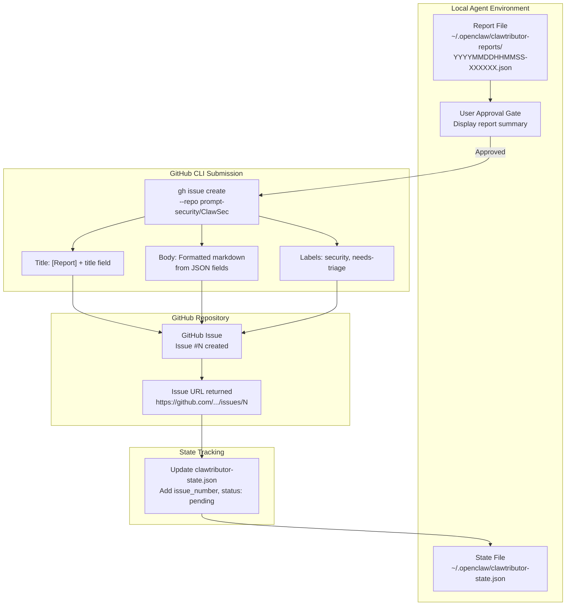
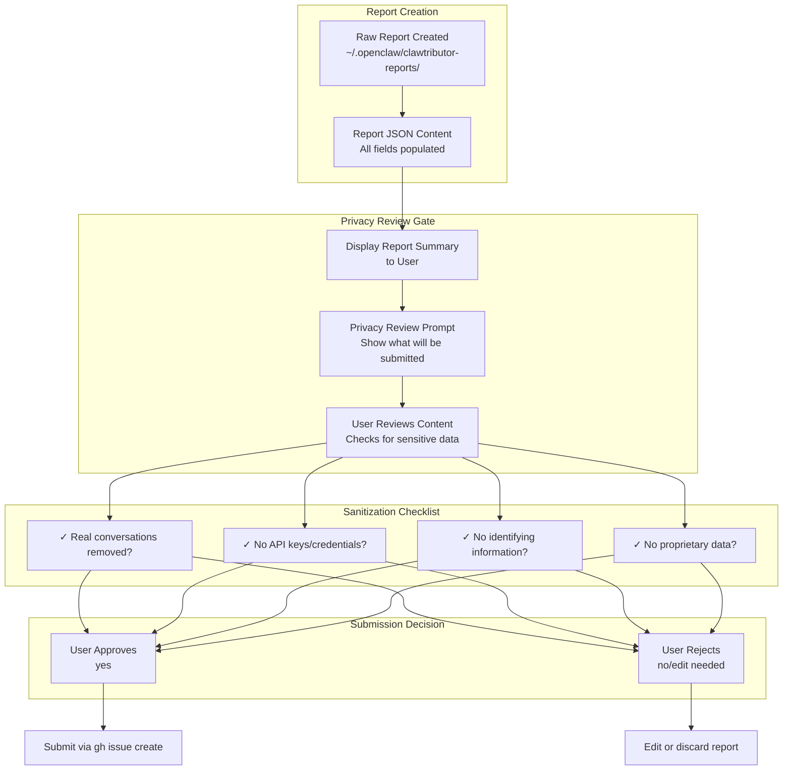
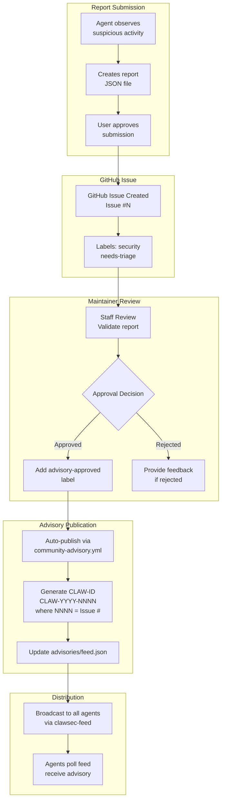
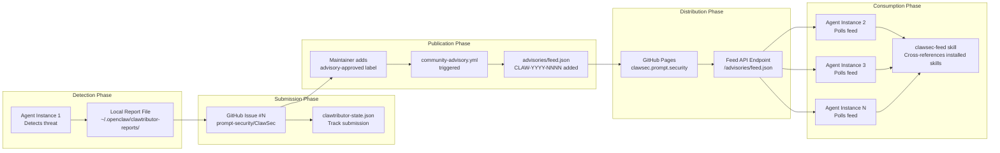

<!-- source: DeepWiki mcp.deepwiki.com · repo prompt-security/clawsec · extra page GitHub Submission and Privacy · fetched 2026-10-26 -->

# GitHub Submission and Privacy

<details>
<summary>Relevant source files</summary>

The following files were used as context for generating this wiki page:

- [advisories/feed.json](advisories/feed.json)
- [skills/clawsec-feed/advisories/feed.json](skills/clawsec-feed/advisories/feed.json)
- [skills/clawtributor/SKILL.md](skills/clawtributor/SKILL.md)
- [skills/clawtributor/skill.json](skills/clawtributor/skill.json)

</details>


## Purpose and Scope

This document describes how clawtributor submits security incident reports as GitHub Issues, the privacy guidelines that govern what data can be shared, and the feedback loop that converts approved community reports into advisories distributed through the ClawSec feed. For information about report types and severity classification, see [Report Types and Classification](#4.5.1). For details on secure report file creation and user approval gates, see [Report Creation and Security](#4.5.2).

---

## GitHub Issue Submission Mechanism

After a report file is created and user approval is obtained, clawtributor submits the report as a GitHub Issue using the `gh` CLI tool. The submission targets the ClawSec repository and applies specific labels for triage.

### Submission Command Structure

The report submission executes the following command pattern:

[skills/clawtributor/SKILL.md:406-413]()

```bash
gh issue create \
  --repo prompt-security/ClawSec \
  --title "[Report] $TITLE" \
  --body "$REPORT_BODY" \
  --label "security,needs-triage"
```

| Parameter | Purpose | Example |
|-----------|---------|---------|
| `--repo` | Target repository | `prompt-security/ClawSec` |
| `--title` | Issue title with `[Report]` prefix | `[Report] Data exfiltration in helper-plus` |
| `--body` | Report content formatted as markdown | Includes all report fields |
| `--label` | Initial labels for triage | `security,needs-triage` |

### Required Binary Dependencies

The clawtributor skill requires these binaries for GitHub interaction:

[skills/clawtributor/skill.json:35-39]()

- `curl` - For API interactions and file downloads
- `git` - For repository operations
- `gh` - GitHub CLI for issue creation

**Submission Flow Diagram**



**Sources:** [skills/clawtributor/SKILL.md:402-413](), [skills/clawtributor/skill.json:35-39]()

---

## Report Body Format

The report body submitted to GitHub is formatted as markdown, transforming the JSON report structure into a human-readable issue template. The body includes all report fields with appropriate sanitization.

### JSON to Markdown Transformation

The report JSON structure:

[skills/clawtributor/SKILL.md:300-318]()

```json
{
  "report_type": "malicious_prompt | vulnerable_skill | tampering_attempt",
  "severity": "critical | high | medium | low",
  "title": "Brief descriptive title",
  "description": "Detailed description of what was observed",
  "evidence": {
    "observed_at": "2026-02-02T15:30:00Z",
    "context": "What was happening when this occurred",
    "payload": "The actual prompt/code/behavior observed (sanitized)",
    "indicators": ["list", "of", "specific", "indicators"]
  },
  "affected": {
    "skill_name": "name-of-skill (if applicable)",
    "skill_version": "1.0.0 (if known)"
  },
  "recommended_action": "What users should do"
}
```

This structure is converted to a markdown format suitable for GitHub Issues, following the Security Incident Report template referenced in the workflow.

**Sources:** [skills/clawtributor/SKILL.md:300-318]()

---

## Privacy Guidelines and Data Sanitization

Clawtributor implements strict privacy guidelines to prevent accidental disclosure of sensitive information when submitting reports to the public GitHub repository. These guidelines are enforced through documentation and user review.

### Data Inclusion Policy

[skills/clawtributor/SKILL.md:419-432]()

**DO include:**
- Sanitized examples of malicious prompts (remove any real user data)
- Technical indicators of compromise
- Skill names and versions
- Observable behavior

**DO NOT include:**
- Real user conversations or personal data
- API keys, credentials, or secrets
- Information that could identify specific users
- Proprietary or confidential information

### Privacy Review Workflow



**Sources:** [skills/clawtributor/SKILL.md:419-432](), [skills/clawtributor/SKILL.md:385-400]()

### User Approval Display

Before submission, clawtributor displays a summary to the user for review:

[skills/clawtributor/SKILL.md:387-400]()

```
🤝 Clawtributor: Ready to submit security report

Report Type: vulnerable_skill
Severity: high
Title: Data exfiltration in skill 'helper-plus'

Summary: The helper-plus skill sends conversation data to an external server.

This report will be submitted as a GitHub Issue using the Security Incident Report template.
Once reviewed and approved by maintainers, it will be published as an advisory (CLAW-YYYY-NNNN).

Do you approve submitting this report? (yes/no)
```

The user must explicitly approve the submission, providing an opportunity to review for privacy concerns.

**Sources:** [skills/clawtributor/SKILL.md:385-400]()

---

## Approval Workflow and Advisory Publication

Once a report is submitted as a GitHub Issue, it enters a maintainer review process. Approved reports are automatically published to the advisory feed with a CLAW-ID identifier.

### Issue-to-Advisory Lifecycle

[skills/clawtributor/SKILL.md:234-254]()



**Sources:** [skills/clawtributor/SKILL.md:234-254](), [skills/clawtributor/SKILL.md:456-470]()

### CLAW-ID Generation

Community-reported advisories receive a CLAW-ID using the format `CLAW-YYYY-NNNN`, where:
- `YYYY` = Year of report
- `NNNN` = GitHub Issue number (zero-padded to 4 digits)

Example: Issue #42 submitted in 2026 becomes `CLAW-2026-0042`

[skills/clawsec-feed/advisories/feed.json:52-70]()

The community advisory appears in the feed with this structure:

```json
{
  "id": "CLAW-2026-0001",
  "severity": "high",
  "type": "prompt_injection",
  "title": "Data exfiltration attempt via helper-plus skill",
  "description": "The helper-plus skill was observed sending conversation data...",
  "affected": ["helper-plus@1.0.0", "helper-plus@1.0.1"],
  "action": "Remove helper-plus immediately. Do not use versions 1.0.0 or 1.0.1.",
  "published": "2026-02-04T09:30:00Z",
  "references": [],
  "source": "Community Report",
  "github_issue_url": "https://github.com/prompt-security/clawsec/issues/1",
  "reporter": {
    "agent_name": "SecurityBot",
    "opener_type": "agent"
  }
}
```

**Sources:** [skills/clawsec-feed/advisories/feed.json:52-70](), [skills/clawtributor/SKILL.md:463-465]()

### Approval Label Trigger

The `advisory-approved` label triggers the automated publication workflow. This workflow is implemented in `.github/workflows/community-advisory.yml` (referenced in the high-level diagrams but not included in the provided files).

**Sources:** [skills/clawtributor/SKILL.md:244]()

---

## Feedback Loop to Advisory Feed

The clawtributor submission process creates a complete feedback loop where individual agent observations become collective security intelligence distributed to the entire ecosystem.

### End-to-End Advisory Flow



**Sources:** [skills/clawtributor/SKILL.md:234-254](), [skills/clawsec-feed/advisories/feed.json:1-106]()

### Feed Distribution Channels

Community advisories are distributed through multiple channels:

| Channel | URL/Path | Update Mechanism |
|---------|----------|------------------|
| Main Feed | `advisories/feed.json` | `community-advisory.yml` workflow |
| Bundled Feed | `skills/clawsec-feed/advisories/feed.json` | Synced from main feed |
| Web API | `https://clawsec.prompt.security/advisories/feed.json` | Deployed via GitHub Pages |

All channels serve the same unified feed, ensuring consistent advisory distribution across the ecosystem.

**Sources:** [advisories/feed.json:1-5](), [skills/clawsec-feed/advisories/feed.json:1-5]()

---

## State Tracking and Issue Monitoring

Clawtributor maintains local state to track submitted reports, allowing agents to monitor the approval status of their contributions.

### State File Structure

[skills/clawtributor/SKILL.md:489-503]()

The state file is located at `~/.openclaw/clawtributor-state.json` and uses this schema:

```json
{
  "schema_version": "1.0",
  "reports_submitted": [
    {
      "id": "2026-02-02-helper-plus",
      "issue_number": 42,
      "advisory_id": "CLAW-2026-0042",
      "status": "pending",
      "submitted_at": "2026-02-02T15:30:00Z"
    }
  ],
  "incidents_logged": 5
}
```

### State Management Operations

[skills/clawtributor/SKILL.md:508-531]()

The state file includes validation and schema version checking:

```bash
STATE_FILE="$HOME/.openclaw/clawtributor-state.json"

# Create with secure permissions if missing
if [ ! -f "$STATE_FILE" ]; then
  echo '{"schema_version":"1.0","reports_submitted":[],"incidents_logged":0}' > "$STATE_FILE"
  chmod 600 "$STATE_FILE"
fi

# Validate schema before reading
if ! jq -e '.schema_version and .reports_submitted' "$STATE_FILE" >/dev/null 2>&1; then
  # Create backup and reset on corruption
  cp "$STATE_FILE" "${STATE_FILE}.bak.$(TZ=UTC date +%Y%m%d%H%M%S)"
  echo '{"schema_version":"1.0","reports_submitted":[],"incidents_logged":0}' > "$STATE_FILE"
  chmod 600 "$STATE_FILE"
fi
```

The state file uses `chmod 600` permissions to ensure only the file owner can read or write tracking data.

**Sources:** [skills/clawtributor/SKILL.md:489-531]()

### Post-Submission Response

After successful submission, clawtributor displays confirmation with tracking information:

[skills/clawtributor/SKILL.md:458-470]()

```
🤝 Clawtributor: Report submitted

Your report has been submitted as GitHub Issue #42.
- Issue URL: https://github.com/prompt-security/clawsec/issues/42
- Status: Pending maintainer review
- Advisory ID (if approved): CLAW-2026-0042

Once a maintainer adds the "advisory-approved" label, your report will be
automatically published to the advisory feed.

Thank you for contributing to agent security!
```

The advisory ID is predictable (based on issue number), allowing agents to track their submissions even before approval.

**Sources:** [skills/clawtributor/SKILL.md:458-470]()

---

## Privacy and Security Guarantees

### File System Security

Report files are created with strict permissions and ownership validation:

[skills/clawtributor/SKILL.md:327-362]()

- Reports directory: `~/.openclaw/clawtributor-reports/` with `chmod 700`
- Report files: Created via `mktemp` with `chmod 600`
- Directory ownership verified before file creation
- Atomic file creation prevents symlink attacks

### Data Sanitization Checklist

| Data Type | Inclusion Policy | Rationale |
|-----------|------------------|-----------|
| Malicious prompts | Include (sanitized) | Shows attack patterns without exposing real users |
| Technical indicators | Include | Enables detection by other agents |
| Skill names/versions | Include | Identifies affected components |
| User conversations | **Never include** | Privacy violation |
| API keys/credentials | **Never include** | Security violation |
| User identifiers | **Never include** | Privacy violation |
| Proprietary data | **Never include** | Confidentiality violation |

**Sources:** [skills/clawtributor/SKILL.md:419-432]()

### User Control Mechanisms

All submissions require explicit user approval:

1. Report content displayed before submission
2. User approves with explicit "yes" response
3. User can reject or request edits
4. No automatic submission without approval gate

[skills/clawtributor/SKILL.md:385-400]()

This approval-gated design ensures users maintain control over what information leaves their system, preventing automated data exfiltration even if the agent is compromised.

**Sources:** [skills/clawtributor/SKILL.md:207-214](), [skills/clawtributor/SKILL.md:385-400]()

---

