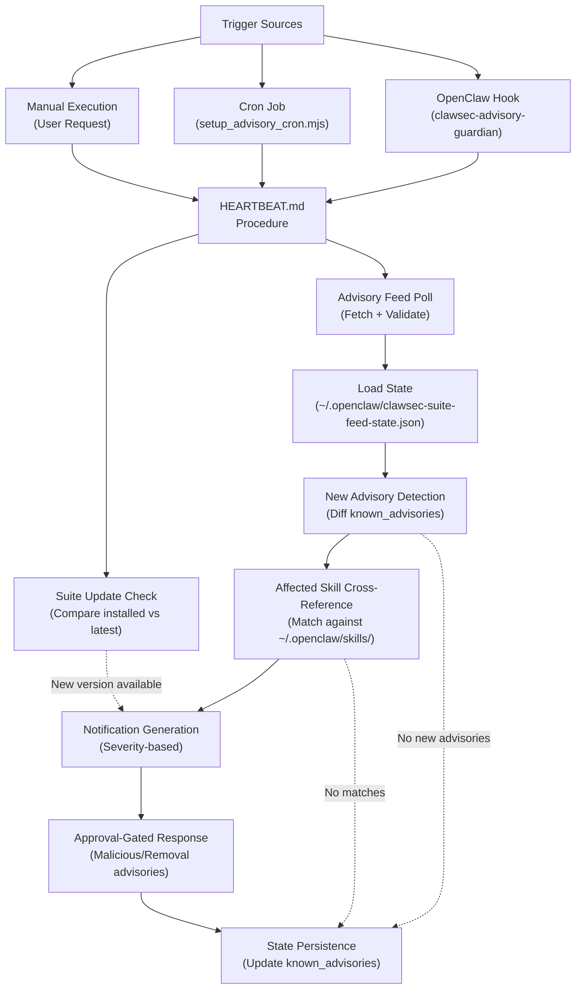
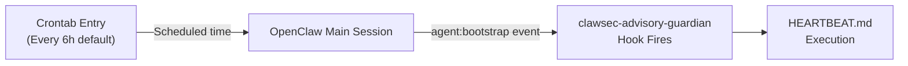
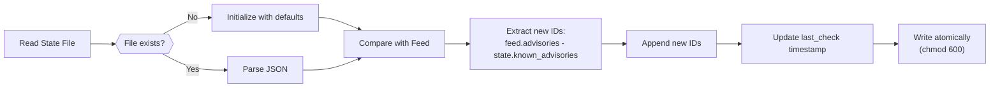
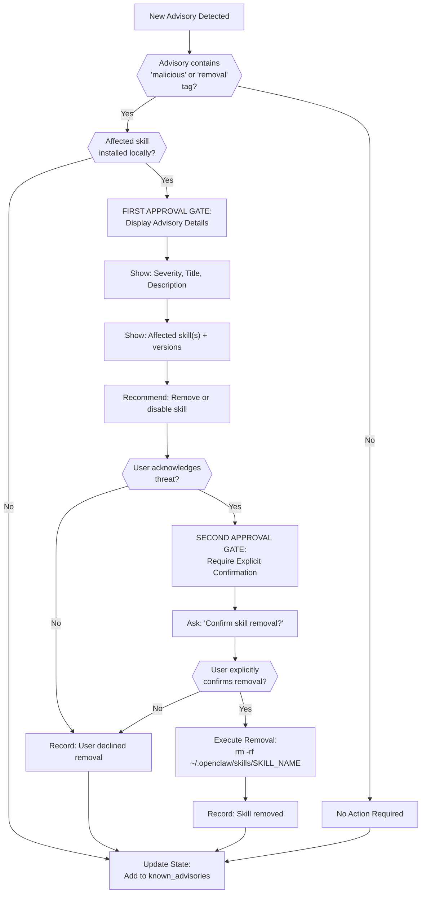
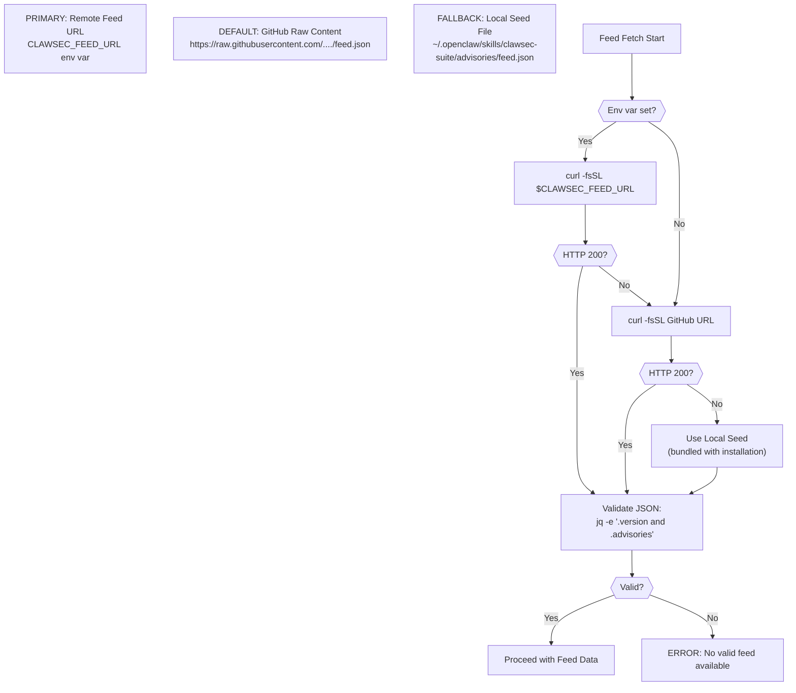
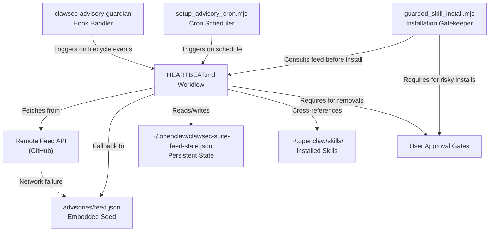
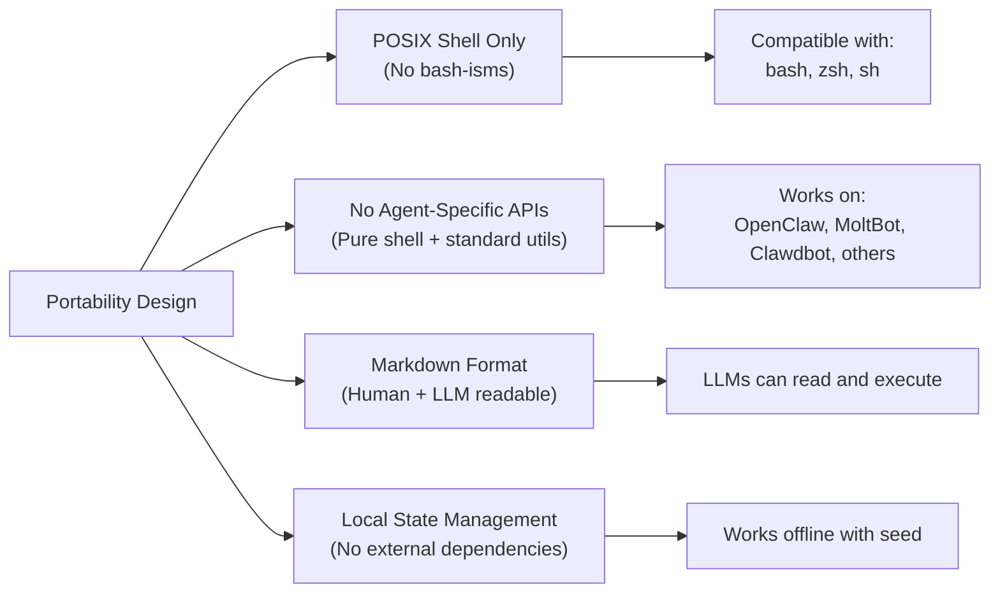

<!-- source: DeepWiki mcp.deepwiki.com · repo prompt-security/clawsec · extra page Heartbeat Workflow · fetched 2026-10-26 -->

# Heartbeat Workflow

<details>
<summary>Relevant source files</summary>

The following files were used as context for generating this wiki page:

- [skills/clawsec-suite/SKILL.md](skills/clawsec-suite/SKILL.md)
- [skills/clawsec-suite/skill.json](skills/clawsec-suite/skill.json)

</details>


## Purpose and Scope

The Heartbeat Workflow is a portable, periodic security check procedure bundled with `clawsec-suite` that serves as the unified entrypoint for routine security maintenance tasks. It orchestrates suite version checks, advisory feed polling, new-advisory detection, affected-skill cross-referencing, and approval-gated response guidance—all within a single procedural workflow that can be triggered manually, via cron, or through OpenClaw hooks.

This document covers the heartbeat workflow's architecture, execution model, security check sequence, state management, and integration with other suite components. For the OpenClaw hook that can trigger heartbeat checks automatically, see [Advisory Guardian Hook](#4.1.3). For detailed feed polling mechanics, see [Feed Polling and State Management](#4.2.1). For initial suite setup that enables heartbeat automation, see [Suite Installation and Setup Scripts](#4.1.1).

**Sources:** [skills/clawsec-suite/SKILL.md:209-221](), [skills/clawsec-suite/skill.json:32-35]()

---

## Heartbeat File Location and Metadata

The heartbeat workflow is defined in a standalone markdown file within the suite installation:

| Property | Value |
|----------|-------|
| **File Path** | `~/.openclaw/skills/clawsec-suite/HEARTBEAT.md` |
| **Format** | Markdown with executable shell snippets |
| **Portability** | Agent-agnostic (OpenClaw, MoltBot, Clawdbot, other) |
| **Required** | Yes (listed in skill.json SBOM) |
| **Triggers** | Manual execution, cron job, OpenClaw hook |

The heartbeat is deliberately portable—it consists of shell commands and logic that can be executed by any AI agent with bash access, regardless of the specific agent framework in use.

**Sources:** [skills/clawsec-suite/skill.json:32-35](), [skills/clawsec-suite/SKILL.md:213]()

---

## Heartbeat Architecture

### Workflow Overview



**Sources:** [skills/clawsec-suite/SKILL.md:209-221](), [skills/clawsec-suite/SKILL.md:115-137]()

---

## Execution Model

### Trigger Mechanisms

The heartbeat workflow can be invoked through three distinct mechanisms:

| Mechanism | Trigger | Frequency | Setup Required |
|-----------|---------|-----------|----------------|
| **Manual** | User asks agent to run security check | On-demand | None (always available) |
| **Cron** | Time-based schedule | Configurable (default: 6h) | `setup_advisory_cron.mjs` |
| **Hook** | OpenClaw lifecycle events | Per-session bootstrap + `/new` | `setup_advisory_hook.mjs` |

#### Manual Execution

Agents execute the heartbeat procedure directly when users request security checks. The agent reads and follows `HEARTBEAT.md` as a procedural guide, executing each shell command block sequentially.

#### Cron-Based Execution

The `setup_advisory_cron.mjs` script creates a periodic job that triggers an OpenClaw advisory scan in the main session context:



**Configuration:**
- Default interval: `6h` (21600 seconds)
- Environment variable: `CLAWSEC_HOOK_INTERVAL_SECONDS`
- State tracking prevents duplicate scans within interval window

**Sources:** [skills/clawsec-suite/SKILL.md:124-129](), [skills/clawsec-suite/skill.json:70-75]()

#### Hook-Based Execution

The advisory guardian hook (`hooks/clawsec-advisory-guardian/`) automatically triggers heartbeat checks on specific OpenClaw lifecycle events:

| Event | Trigger Point | Purpose |
|-------|---------------|---------|
| `agent:bootstrap` | Agent startup | Ensure security checks run at launch |
| `command:new` | `/new` command | Check advisories for new sessions |

The hook includes rate-limiting logic to prevent excessive polling (respects `CLAWSEC_HOOK_INTERVAL_SECONDS`).

**Sources:** [skills/clawsec-suite/SKILL.md:131-137](), [skills/clawsec-suite/skill.json:42-50]()

---

## Security Check Sequence

### Step-by-Step Workflow

The heartbeat workflow executes the following security checks in sequence:

```mermaid
graph TD
    Start["Heartbeat Start"]
    
    Step1["1. Suite Version Check"]
    CompareVersion["Compare installed version<br/>vs GitHub latest release"]
    VersionNotify["Notify if update available"]
    
    Step2["2. Feed Fetch and Validation"]
    FetchFeed["curl CLAWSEC_FEED_URL"]
    ValidateJSON["jq validate:<br/>.version and .advisories"]
    FallbackSeed["Fallback to local seed:<br/>advisories/feed.json"]
    
    Step3["3. State Load and Comparison"]
    LoadState["Load ~/.openclaw/clawsec-suite-feed-state.json"]
    InitState["Initialize if missing:<br/>{known_advisories:[],last_feed_check:null}"]
    DiffAdvisories["Diff feed.advisories vs state.known_advisories"]
    
    Step4["4. New Advisory Detection"]
    ExtractNew["Extract new advisory IDs:<br/>jq filter missing from known_advisories"]
    EmptyCheck{{"Any new advisories?"}}
    
    Step5["5. Affected Skill Cross-Reference"]
    ListInstalled["List ~/.openclaw/skills/ directories"]
    MatchAffected["For each new advisory:<br/>Check .affected array against installed"]
    
    Step6["6. Severity-Based Notification"]
    FormatAlert["Format notification by severity:<br/>CRITICAL, HIGH, MEDIUM, LOW"]
    DisplayDetails["Display: ID, title, severity, affected, tags"]
    
    Step7["7. Approval-Gated Response"]
    CheckMalicious{{"Advisory has<br/>'malicious' or 'removal'<br/>tag?"}}
    RecommendRemoval["Recommend skill removal<br/>Require explicit second confirmation"]
    RecordDecision["Record user decision"]
    
    Step8["8. State Persistence"]
    UpdateKnown["Append new IDs to known_advisories"]
    UpdateTimestamp["Set last_feed_check timestamp"]
    WriteState["Write state.json (chmod 600)"]
    
    Start --> Step1
    Step1 --> CompareVersion
    CompareVersion --> VersionNotify
    VersionNotify --> Step2
    
    Step2 --> FetchFeed
    FetchFeed -->|Success| ValidateJSON
    FetchFeed -->|Failure| FallbackSeed
    ValidateJSON --> Step3
    FallbackSeed --> Step3
    
    Step3 --> LoadState
    LoadState -->|Exists| DiffAdvisories
    LoadState -->|Missing| InitState
    InitState --> DiffAdvisories
    DiffAdvisories --> Step4
    
    Step4 --> ExtractNew
    ExtractNew --> EmptyCheck
    EmptyCheck -->|No| Step8
    EmptyCheck -->|Yes| Step5
    
    Step5 --> ListInstalled
    ListInstalled --> MatchAffected
    MatchAffected --> Step6
    
    Step6 --> FormatAlert
    FormatAlert --> DisplayDetails
    DisplayDetails --> Step7
    
    Step7 --> CheckMalicious
    CheckMalicious -->|Yes| RecommendRemoval
    CheckMalicious -->|No| RecordDecision
    RecommendRemoval --> RecordDecision
    RecordDecision --> Step8
    
    Step8 --> UpdateKnown
    UpdateKnown --> UpdateTimestamp
    UpdateTimestamp --> WriteState
    WriteState --> End["Heartbeat Complete"]
```



**Sources:** [skills/clawsec-suite/SKILL.md:170-207](), [skills/clawsec-suite/SKILL.md:209-221]()

---

## State Management

### State File Schema

The heartbeat workflow maintains persistent state across executions to track known advisories and prevent duplicate notifications:

**File Location:** `~/.openclaw/clawsec-suite-feed-state.json`

**Schema Version:** `1.0`

```json
{
  "schema_version": "1.0",
  "known_advisories": ["CVE-2024-12345", "CLAW-2024-0042"],
  "last_feed_check": "2024-01-15T10:30:00Z",
  "last_feed_updated": "2024-01-14T08:00:00Z"
}
```

| Field | Type | Purpose |
|-------|------|---------|
| `schema_version` | string | State file format version |
| `known_advisories` | string[] | Array of advisory IDs already processed |
| `last_feed_check` | ISO 8601 | Timestamp of last successful feed poll |
| `last_feed_updated` | ISO 8601 | Timestamp from feed metadata |

**State Operations:**



**State Initialization:**

When no state file exists, the heartbeat creates one with empty `known_advisories` to establish baseline tracking:

```bash
mkdir -p "$(dirname "$STATE_FILE")"
echo '{"schema_version":"1.0","known_advisories":[],"last_feed_check":null,"last_feed_updated":null}' > "$STATE_FILE"
chmod 600 "$STATE_FILE"
```

**Sources:** [skills/clawsec-suite/SKILL.md:189-193](), [skills/clawsec-suite/SKILL.md:167]()

---

## Approval-Gated Response Flow

### Malicious Skill Detection and Removal

The heartbeat workflow implements a two-stage approval gate when advisories indicate malicious or removal-recommended skills:



**Approval Contract:**

The heartbeat enforces a strict non-destructive default policy:

1. **First Confirmation:** User's original request to install/check (implicit approval to view security status)
2. **Second Confirmation:** Explicit approval after seeing advisory details and severity

No destructive actions (skill removal, disabling) occur without **both** confirmations. This prevents automated attacks where malicious prompts attempt to manipulate the agent into disabling security protections.

**Sources:** [skills/clawsec-suite/SKILL.md:223-234](), [skills/clawsec-suite/SKILL.md:157-160]()

---

## Feed Configuration and Fallback Strategy

### Feed URL Hierarchy

The heartbeat workflow uses a three-tier fallback strategy for feed retrieval:



**Configuration Variables:**

| Variable | Default | Purpose |
|----------|---------|---------|
| `CLAWSEC_FEED_URL` | (none) | Override remote feed URL |
| Default URL | `https://raw.githubusercontent.com/prompt-security/clawsec/main/advisories/feed.json` | Standard remote feed |
| `CLAWSEC_SUITE_STATE_FILE` | `~/.openclaw/clawsec-suite-feed-state.json` | Override state file location |

The local seed file (`advisories/feed.json`) is embedded during skill packaging and provides offline resilience. It contains the feed snapshot from the time of release.

**Sources:** [skills/clawsec-suite/SKILL.md:163-167](), [skills/clawsec-suite/SKILL.md:173-181](), [skills/clawsec-suite/skill.json:37-40]()

---

## Integration with Suite Components

### Component Interactions

The heartbeat workflow serves as the integration point for multiple suite components:



### Execution Context

The heartbeat can execute in different contexts depending on trigger:

| Context | Shell Environment | State Access | Network Access |
|---------|------------------|--------------|----------------|
| **Manual** | Agent's active shell | Full | Available |
| **Cron** | System cron environment | Full | Available |
| **Hook** | OpenClaw session context | Full | Rate-limited |

**Rate Limiting:** When triggered via hook or cron, the workflow respects `CLAWSEC_HOOK_INTERVAL_SECONDS` (default 300s) to prevent excessive API polling. The state file's `last_feed_check` timestamp enforces this limit.

**Sources:** [skills/clawsec-suite/SKILL.md:168](), [skills/clawsec-suite/SKILL.md:124-137]()

---

## Error Handling and Resilience

### Failure Modes and Recovery

The heartbeat workflow implements graceful degradation across multiple failure scenarios:

| Failure | Detection | Recovery Strategy |
|---------|-----------|------------------|
| **Network unavailable** | `curl -fsSL` exit code | Fallback to local seed file |
| **Invalid feed JSON** | `jq -e` validation | Abort with error, use stale state |
| **State file corruption** | JSON parse error | Reinitialize with empty known_advisories |
| **Missing dependencies** | Command not found | Abort with dependency error |
| **Skill directory unreadable** | `ls` permission denied | Skip cross-reference, continue |

**Dependency Requirements:**

The heartbeat requires the following system utilities:

```bash
# Required binaries (checked at skill installation)
curl    # Feed fetching
jq      # JSON parsing and validation
shasum  # Checksum verification (or sha256sum)
```

These dependencies are declared in `skill.json` under `openclaw.requires.bins` and validated during installation.

**Sources:** [skills/clawsec-suite/SKILL.md:173-187](), [skills/clawsec-suite/skill.json:152-158]()

---

## Portability and Agent Compatibility

### Cross-Agent Design

The heartbeat workflow is deliberately agent-agnostic and relies only on POSIX shell features:

**Compatible Agents:**
- **OpenClaw** (full integration with hooks and cron)
- **MoltBot** (manual execution, cron-based automation)
- **Clawdbot** (manual execution, cron-based automation)
- **Other agents** (manual execution with bash access)

**Portability Features:**



The markdown format allows LLMs to parse and execute the procedure as natural language instructions with embedded shell commands, making it accessible to agents that don't have native skill execution frameworks.

**Sources:** [skills/clawsec-suite/skill.json:109-114](), [skills/clawsec-suite/SKILL.md:1-10]()

---

## Recommended Execution Frequency

### Scheduling Guidelines

The heartbeat workflow's optimal execution frequency depends on threat model and resource constraints:

| Schedule | Use Case | Rationale |
|----------|----------|-----------|
| **Every 6 hours** | Default recommendation | Balances responsiveness with API rate limits |
| **Every 1 hour** | High-security environments | Faster threat detection, requires approval |
| **Daily** | Low-risk agents | Minimal overhead, suitable for personal use |
| **Manual only** | Offline/airgapped agents | No network access, periodic manual checks |

**Rate Limiting Enforcement:**

The hook handler and cron scripts enforce minimum intervals via `CLAWSEC_HOOK_INTERVAL_SECONDS`:

```bash
# Default: 300 seconds (5 minutes) between checks
# Recommended cron: 21600 seconds (6 hours)
export CLAWSEC_HOOK_INTERVAL_SECONDS=21600
```

This prevents accidental DoS of the advisory feed API while maintaining reasonable threat detection latency.

**Security Considerations:**
- `critical` and `high` severity advisories warrant immediate action when detected
- The heartbeat does not auto-update the suite—users must explicitly approve upgrades
- State persistence prevents duplicate alerts across restarts

**Sources:** [skills/clawsec-suite/SKILL.md:248-250](), [skills/clawsec-suite/SKILL.md:168](), [skills/clawsec-suite/SKILL.md:124]()

---

