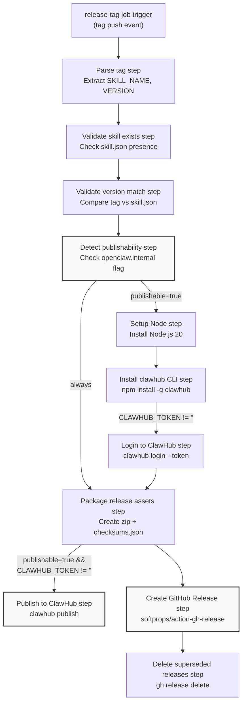
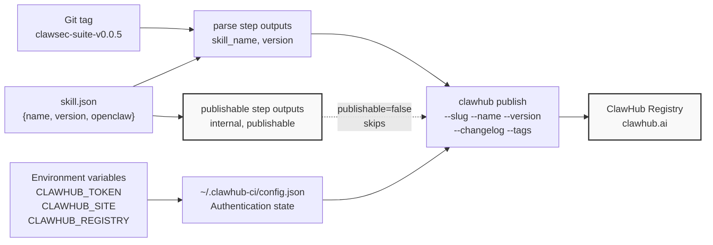
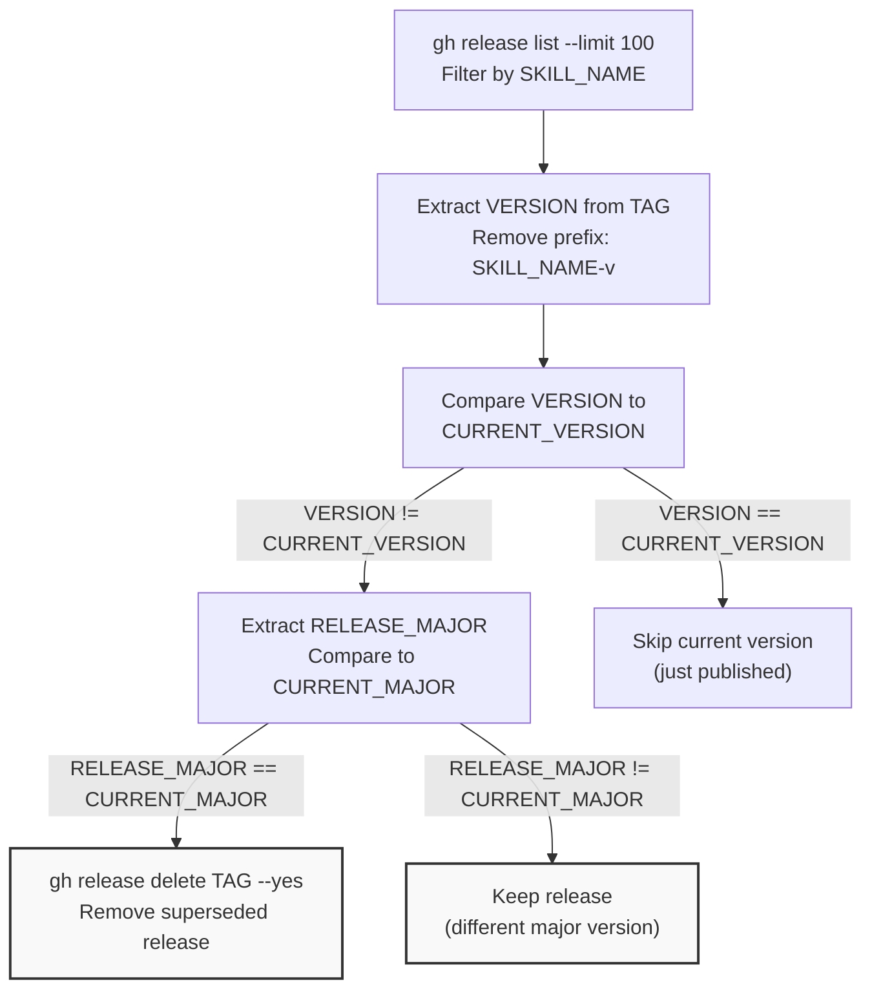
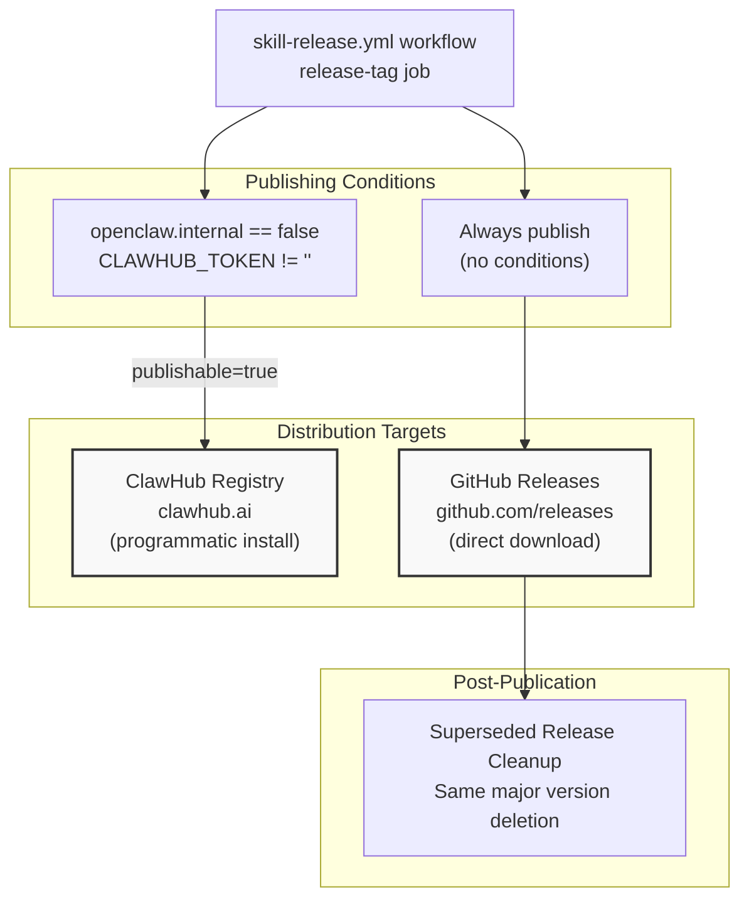

<!-- source: DeepWiki mcp.deepwiki.com · repo prompt-security/clawsec · extra page Publishing and Distribution · fetched 2026-10-26 -->

# Publishing and Distribution

<details>
<summary>Relevant source files</summary>

The following files were used as context for generating this wiki page:

- [.github/workflows/skill-release.yml](.github/workflows/skill-release.yml)

</details>


This page documents the final stage of the skill release pipeline: publishing packaged skills to distribution targets and managing release lifecycle. This covers ClawHub registry publishing with internal skill filtering, GitHub Release creation with automated documentation, prerelease detection, and superseded release cleanup with major version preservation.

For information about version validation before release, see [Version Validation and PR Checks](#5.1.1). For information about asset packaging that precedes publishing, see [Release Asset Packaging](#5.1.2).

---

## Publishing Architecture

ClawSec distributes skills through two primary channels: the **ClawHub registry** (for programmatic installation via `clawhub install`) and **GitHub Releases** (for direct downloads with integrity verification). The publishing logic implements selective distribution—internal development skills are excluded from ClawHub but still published to GitHub Releases for testing and development workflows.

**Diagram: Publishing Decision Flow**



Sources: [.github/workflows/skill-release.yml:383-705]()

---

## Publishability Detection

The workflow determines whether a skill should be published to ClawHub by reading the `openclaw.internal` flag from `skill.json`. Internal skills (e.g., development utilities, test fixtures) are excluded from public registry distribution but remain available via GitHub Releases.

**Detection Logic**

The `Detect publishability` step [.github/workflows/skill-release.yml:459-472]() extracts the internal flag using `jq`:

```bash
INTERNAL=$(jq -r '.openclaw.internal // false' "$SKILL_PATH/skill.json")

PUBLISHABLE=true
if [ "$INTERNAL" = "true" ]; then
  PUBLISHABLE=false
  echo "Skill marked internal=true; will skip ClawHub publish."
fi
```

**Output Variables**

| Variable | Type | Description |
|----------|------|-------------|
| `internal` | boolean | Raw value from `skill.json` (default: `false`) |
| `publishable` | boolean | Inverted value determining ClawHub eligibility |

**Conditional Execution**

Downstream steps use `if: steps.publishable.outputs.publishable == 'true'` conditions [.github/workflows/skill-release.yml:480-481]() to gate ClawHub operations:
- `Install clawhub CLI` [.github/workflows/skill-release.yml:479-481]()
- `Login to ClawHub` [.github/workflows/skill-release.yml:483-492]()
- `Publish to ClawHub` [.github/workflows/skill-release.yml:600-620]()

Sources: [.github/workflows/skill-release.yml:459-472](), [.github/workflows/skill-release.yml:479-620]()

---

## ClawHub Publishing

ClawHub is the centralized registry for skill distribution, providing version management, dependency resolution, and metadata search. Publishing requires authentication via `CLAWHUB_TOKEN` secret and is conditional on both publishability and token availability.

### Authentication Configuration

The `Login to ClawHub` step [.github/workflows/skill-release.yml:483-492]() configures the ClawHub CLI with environment-specific settings:

```bash
SITE=${CLAWHUB_SITE:-https://clawhub.ai}
REGISTRY=${CLAWHUB_REGISTRY:-$SITE}
export CLAWHUB_CONFIG_PATH="$HOME/.clawhub-ci/config.json"
mkdir -p "$(dirname "$CLAWHUB_CONFIG_PATH")"
CLAWHUB_DISABLE_TELEMETRY=1 CLAWHUB_SITE="$SITE" CLAWHUB_REGISTRY="$REGISTRY" \
  clawhub login --token "$CLAWHUB_TOKEN" --site "$SITE" --no-input
```

**Environment Variables**

| Variable | Default | Purpose |
|----------|---------|---------|
| `CLAWHUB_SITE` | `https://clawhub.ai` | Primary ClawHub website |
| `CLAWHUB_REGISTRY` | Same as `CLAWHUB_SITE` | Registry API endpoint |
| `CLAWHUB_CONFIG_PATH` | `~/.clawhub-ci/config.json` | CI-specific config isolation |
| `CLAWHUB_DISABLE_TELEMETRY` | `1` | Disable analytics in CI |

### Publication Parameters

The `Publish to ClawHub` step [.github/workflows/skill-release.yml:600-620]() invokes `clawhub publish` with skill metadata:

```bash
SKILL_NAME="${{ steps.parse.outputs.skill_name }}"
VERSION="${{ steps.parse.outputs.version }}"
NAME=$(jq -r '.name' "$SKILL_PATH/skill.json")
CHANGELOG="Release ${VERSION} via CI"

CLAWHUB_DISABLE_TELEMETRY=1 CLAWHUB_SITE="$SITE" CLAWHUB_REGISTRY="$REGISTRY" \
  clawhub publish "$SKILL_PATH" \
    --slug "$SKILL_NAME" \
    --name "$NAME" \
    --version "$VERSION" \
    --changelog "$CHANGELOG" \
    --tags "latest" \
    --no-input
```

**Command Arguments**

| Argument | Source | Example |
|----------|--------|---------|
| `$SKILL_PATH` | Tag-derived directory | `skills/clawsec-suite` |
| `--slug` | Directory name | `clawsec-suite` |
| `--name` | `skill.json` `.name` field | `ClawSec Suite` |
| `--version` | Tag-derived version | `0.0.5` |
| `--changelog` | Auto-generated | `Release 0.0.5 via CI` |
| `--tags` | Hardcoded | `latest` |
| `--no-input` | Prevents interactive prompts | (flag) |

**Diagram: ClawHub Publication Data Flow**



Sources: [.github/workflows/skill-release.yml:483-492](), [.github/workflows/skill-release.yml:600-620]()

---

## GitHub Release Creation

All skills are published to GitHub Releases regardless of internal status, providing universal access to artifacts with integrity verification. The release creation step uses `softprops/action-gh-release` [.github/workflows/skill-release.yml:622-668]() with auto-generated documentation.

### Release Metadata

**Release Naming**

The release name and tag follow the format `{skill_name} {version}` / `{skill_name}-v{version}`:

```yaml
with:
  name: "${{ steps.parse.outputs.skill_name }} ${{ steps.parse.outputs.version }}"
  tag_name: ${{ github.ref_name }}
```

Example: Release name `clawsec-suite 0.0.5`, tag `clawsec-suite-v0.0.5`.

**Attached Files**

The `files: release-assets/*` directive [.github/workflows/skill-release.yml:627]() attaches all packaged assets:

| File | Purpose |
|------|---------|
| `{skill_name}-v{version}.zip` | Archive with directory structure |
| `checksums.json` | SHA256 manifest for all files |
| `skill.json` | Skill metadata |
| `SKILL.md` | Installation instructions |
| `README.md` | Documentation (if present) |

### Auto-Generated Installation Instructions

The release body [.github/workflows/skill-release.yml:628-664]() includes installation methods for both programmatic and manual workflows:

**ClawHub Installation (Recommended)**

```bash
npx clawhub@latest install ${{ steps.parse.outputs.skill_name }}
```

**Manual Download with Verification**

```bash
# 1. Download the release archive and checksums
curl -sLO https://github.com/${{ github.repository }}/releases/download/${{ github.ref_name }}/${{ steps.parse.outputs.skill_name }}-v${{ steps.parse.outputs.version }}.zip
curl -sLO https://github.com/${{ github.repository }}/releases/download/${{ github.ref_name }}/checksums.json

# 2. Verify archive checksum
echo "$(jq -r '.archive.sha256' checksums.json)  ${{ steps.parse.outputs.skill_name }}-v${{ steps.parse.outputs.version }}.zip" | sha256sum -c

# 3. Extract (creates ${{ steps.parse.outputs.skill_name }}/ directory)
unzip ${{ steps.parse.outputs.skill_name }}-v${{ steps.parse.outputs.version }}.zip
```

**Verification Section**

```markdown
### Verification

All files include SHA256 checksums in `checksums.json`:
```bash
curl -sL https://github.com/${{ github.repository }}/releases/download/${{ github.ref_name }}/checksums.json | jq .
```
```

Sources: [.github/workflows/skill-release.yml:622-668]()

### Prerelease Detection

The workflow automatically marks releases as prereleases based on semantic versioning conventions in the tag name [.github/workflows/skill-release.yml:666]():

```yaml
prerelease: ${{ contains(github.ref_name, 'alpha') || contains(github.ref_name, 'beta') || contains(github.ref_name, 'rc') }}
```

**Detection Logic**

| Tag Pattern | Prerelease | Example |
|-------------|------------|---------|
| `*-v1.0.0` | `false` | Stable release |
| `*-v1.0.0-alpha.1` | `true` | Alpha version |
| `*-v1.0.0-beta.2` | `true` | Beta version |
| `*-v1.0.0-rc.1` | `true` | Release candidate |

**GitHub UI Implications**

- Prerelease badges appear on the release page
- Stable releases are marked as "Latest"
- Prereleases do not update the "Latest" badge
- API queries can filter by prerelease status

Sources: [.github/workflows/skill-release.yml:666]()

---

## Superseded Release Cleanup

To maintain a clean release history and prevent confusion, the workflow automatically deletes older releases of the same major version after successful publication [.github/workflows/skill-release.yml:670-705](). This preserves backwards compatibility by retaining releases from older major versions while ensuring only the latest minor/patch version is visible.

### Major Version Retention Policy

The cleanup logic implements semantic versioning-aware retention:

```bash
CURRENT_VERSION="${{ steps.parse.outputs.version }}"
CURRENT_MAJOR=$(echo "$CURRENT_VERSION" | cut -d. -f1)

gh release list --limit 100 | grep "^${SKILL_NAME} " | while read -r line; do
  TAG=$(echo "$line" | awk -F'\t' '{print $3}')
  VERSION="${TAG#${SKILL_NAME}-v}"
  
  if [ "$VERSION" = "$CURRENT_VERSION" ]; then
    continue
  fi
  
  RELEASE_MAJOR=$(echo "$VERSION" | cut -d. -f1)
  
  if [ "$RELEASE_MAJOR" = "$CURRENT_MAJOR" ]; then
    echo "Deleting $TAG (superseded by v$CURRENT_VERSION)"
    gh release delete "$TAG" --yes || echo "Warning: Could not delete $TAG"
  else
    echo "Keeping $TAG as latest for major version $RELEASE_MAJOR"
  fi
done
```

**Diagram: Release Retention Logic**



### Cleanup Examples

**Scenario 1: Patch Release**

Publishing `clawsec-suite-v1.2.3` with existing releases:
- `clawsec-suite-v1.2.2` → **Deleted** (same major, superseded)
- `clawsec-suite-v1.2.1` → **Deleted** (same major, superseded)
- `clawsec-suite-v1.1.0` → **Deleted** (same major, superseded)
- `clawsec-suite-v0.9.5` → **Kept** (different major, v0.x compatibility)

**Scenario 2: Major Version Bump**

Publishing `clawsec-suite-v2.0.0` with existing releases:
- `clawsec-suite-v1.5.2` → **Kept** (latest v1.x for backwards compat)
- `clawsec-suite-v1.5.1` → **Deleted** (superseded within v1.x)
- `clawsec-suite-v0.9.5` → **Kept** (latest v0.x for backwards compat)

**Failure Handling**

The cleanup uses `|| echo "Warning: Could not delete $TAG"` [.github/workflows/skill-release.yml:697]() to prevent errors from blocking the workflow. Scenarios include:
- Protected releases (manual intervention required)
- API rate limits (retry in next release)
- Network errors (transient failures)

**Cleanup Output Table**

| Current Version | Existing Releases | Action | Rationale |
|-----------------|-------------------|--------|-----------|
| `1.2.3` | `1.2.2`, `1.2.1` | Delete both | Same major, superseded |
| `1.2.3` | `0.9.5` | Keep | Different major (v0.x compat) |
| `2.0.0` | `1.5.2`, `1.5.1`, `1.5.0` | Keep `1.5.2`, delete others | Latest v1.x + cleanup |
| `1.0.0-beta.2` | `1.0.0-beta.1` | Delete `beta.1` | Prerelease superseded |

Sources: [.github/workflows/skill-release.yml:670-705]()

---

## Distribution Target Summary

**Final Distribution Topology**



**Access Methods by Target**

| Target | Access Method | Verification | Use Case |
|--------|---------------|--------------|----------|
| ClawHub | `npx clawhub install {skill}` | Automatic via registry | Production deployments |
| GitHub Releases | `curl` + `checksums.json` | Manual SHA256 verification | Air-gapped environments, testing |
| GitHub Raw | Direct download of `SKILL.md` | None (educational use) | Agent self-installation |

Sources: [.github/workflows/skill-release.yml:383-705]()

---

