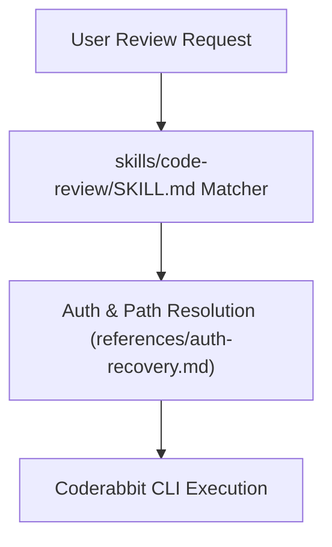
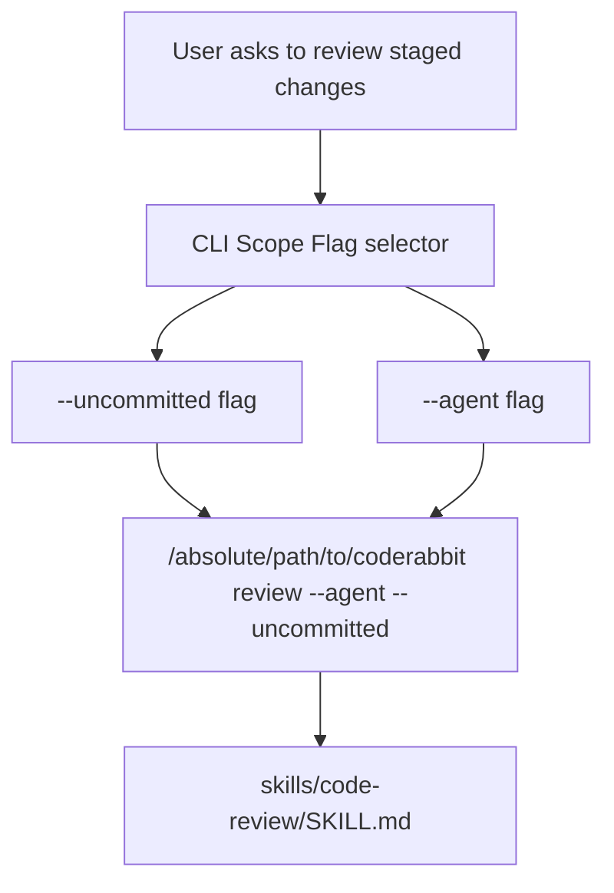
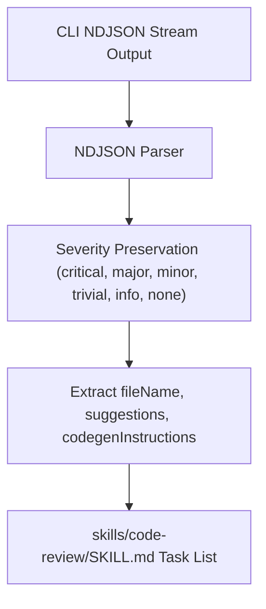

<!-- source: DeepWiki mcp.deepwiki.com · repo coderabbitai/skills · page 2.1 code-review Skill · fetched 2026-10-26 -->

# code-review Skill

Relevant source files

The following files were used as context for generating this wiki page:

- [skills/code-review/SKILL.md](skills/code-review/SKILL.md)
- [skills/code-review/references/auth-recovery.md](skills/code-review/references/auth-recovery.md)

## Purpose and Scope

The `code-review` skill defines the core contract for executing CodeRabbit AI-powered code reviews, parsing agent-optimized outputs, and driving autonomous fix loops [skills/code-review/SKILL.md:1-18](). It provides standardized triggers for code quality, security analysis, and pull request feedback [skills/code-review/SKILL.md:19-30](). 

This is a parent page providing a high-level overview of the skill contract, invocation structure, and review lifecycle. For specific configuration details, see [CLI Flags & Review Scopes](#2.1.1) and [Authentication & Recovery](#2.1.2).

Sources: `skills/code-review/SKILL.md:1-18`, `skills/code-review/SKILL.md:19-30`

---

## SKILL.md Contract & Triggers

The skill is defined in `skills/code-review/SKILL.md` under the `code-review` name and version `0.1.0` [skills/code-review/SKILL.md:1-6](). It instructs AI agents to detect review requests—such as analyzing code changes, checking security vulnerabilities, or examining pull requests—and execute the canonical CLI workflow [skills/code-review/SKILL.md:19-30]().

Sources: `skills/code-review/SKILL.md:1-30`, `skills/code-review/references/auth-recovery.md:1-34`

---

## CLI Invocation & Review Scopes

Before running any review, agents must validate the canonical absolute path of the `coderabbit` binary and verify authentication [skills/code-review/SKILL.md:31-41](). Reviews should always incorporate `--agent` to produce machine-parsable output [skills/code-review/SKILL.md:48-52]().

For detailed rules on flag combinations (such as conflicts between `--committed`, `--uncommitted`, `--include-untracked`, `--base`, `--base-commit`, and `--dir`), see [CLI Flags & Review Scopes](#2.1.1).

Sources: `skills/code-review/SKILL.md:31-80`

---

## NDJSON Parsing & Severities

Review output generated with `--agent` must be consumed as NDJSON (Newline Delimited JSON) rather than a single monolithic JSON document [skills/code-review/SKILL.md:81-83](). Findings retain specific severities (`critical`, `major`, `minor`, `trivial`, `info`, and `none`) which agents must preserve without relabeling them as generic warnings [skills/code-review/SKILL.md:15-18]().

Sources: `skills/code-review/SKILL.md:15-18`, `skills/code-review/SKILL.md:81-88`

---

## Autonomous Review Loop

When a user requests both implementation and review, the skill executes a structured autonomous cycle [skills/code-review/SKILL.md:89-99]():

1. Implement the requested feature changes [skills/code-review/SKILL.md:93]().
2. Run `coderabbit review --agent` with appropriate scope flags [skills/code-review/SKILL.md:94]().
3. Construct a task list based on returned findings [skills/code-review/SKILL.md:95]().
4. Fix actionable items within the authorized scope, prioritizing `critical` and `major` severity levels [skills/code-review/SKILL.md:96]().
5. Re-run the review to verify that issues are resolved [skills/code-review/SKILL.md:97]().
6. Report remaining findings and terminate to prevent infinite loops [skills/code-review/SKILL.md:98]().

Sources: `skills/code-review/SKILL.md:89-99`

---

## Authentication & Recovery Overview

Review execution relies on strict authentication checks using `auth status --agent` [skills/code-review/SKILL.md:31-38](). Sandboxed execution boundaries require precise handling of credential errors and bounded single retries [skills/code-review/SKILL.md:54-58](). 

For full workflows on handling `credentials_unavailable`, `callback_listener_unavailable`, and host retry boundaries, see [Authentication & Recovery](#2.1.2).

Sources: `skills/code-review/SKILL.md:31-64`, `skills/code-review/references/auth-recovery.md:1-65`

---

