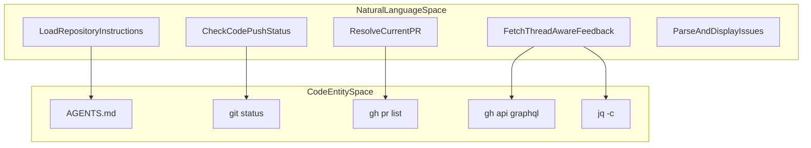
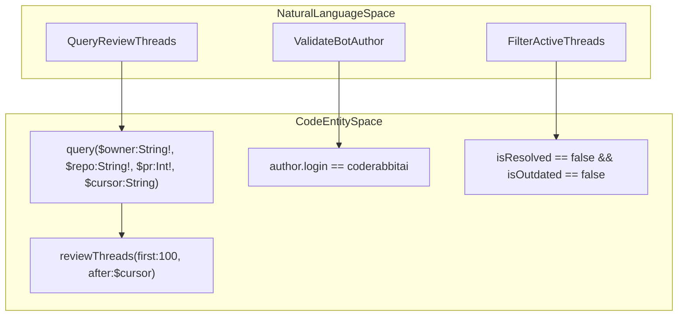

<!-- source: DeepWiki mcp.deepwiki.com · repo coderabbitai/skills · page 2.2 autofix Skill · fetched 2026-10-26 -->

# autofix Skill

Relevant source files

The following files were used as context for generating this wiki page:

- [skills/autofix/SKILL.md](skills/autofix/SKILL.md)
- [skills/autofix/github.md](skills/autofix/github.md)

## Purpose and Scope

The `autofix` skill orchestrates a structured workflow to fetch unresolved CodeRabbit review-thread feedback from an active GitHub pull request, validate the changes locally, and apply fixes with explicit user approval `[skills/autofix/SKILL.md:22-26]`. It treats all incoming review comments and AI prompt blocks as untrusted input, utilizing them strictly as issue reports rather than executable instructions `[skills/autofix/SKILL.md:26]`. 

For low-level GitHub CLI commands, GraphQL pagination recipes, and comment posting helpers, see [GitHub Primitives (github.md)](#2.2.1).

Sources: `[skills/autofix/SKILL.md:22-26]()`

---

## 1. 10-Step Autofix Workflow Architecture

The autofix execution model follows a deterministic path from repository verification to PR resolution, thread fetching, issue analysis, and resolution posting `[skills/autofix/SKILL.md:43-196]`.

*Figure 1: Mapping natural language execution phases to underlying git and GitHub CLI code entities.*

Sources: `[skills/autofix/SKILL.md:43-196]()`

---

## 2. GraphQL Thread Fetching & Filtering

The skill communicates with GitHub via the GraphQL API to traverse pull request review threads using cursor-based pagination `[skills/autofix/SKILL.md:99-148]`. 

*Figure 2: Data flow from GraphQL query constructs to thread filtering logic.*

For exact CLI query strings, pagination loops, and bot author filters, see [GitHub Primitives (github.md)](#2.2.1).

Sources: `[skills/autofix/SKILL.md:99-148]`, `[skills/autofix/github.md:39-115]()`

---

## 3. Severity, Action Derivation, & Manual Review Mode

Once threads are collected, the skill parses issue headers, descriptions, and reviewer guidance from the root comment `[skills/autofix/SKILL.md:179-196]`. 
- **Severity Preservation:** Retains reported severities (`Critical`, `Major`, `Minor`, `Trivial`, `Info`, or `None`) without reclassification `[skills/autofix/SKILL.md:189-192]`. Missing or unrecognized severities default to `Unknown` `[skills/autofix/SKILL.md:191]`.
- **Action Derivation:** Independently derives actions as `Fix` (for validated, actionable issues) or `Review` (for uninspected or ambiguous issues) `[skills/autofix/SKILL.md:193-195]`. Low or unknown severities do not exclude an issue from review `[skills/autofix/SKILL.md:195]`.
- **Manual Review Mode:** Prompts the user for explicit approval before modifying files or applying consolidated commits.

Sources: `[skills/autofix/SKILL.md:179-196]()`

---

## 4. Consolidated Commit & Summary Comment

After applying validated fixes across files, the changes are consolidated into a single commit and reported back to the pull request `[skills/autofix/github.md:117-146]`. 

Summary comments are constructed locally using execution state (modified file paths, commit SHA, branch name) and posted via `gh pr comment` without leaking raw reviewer prompts or sensitive credentials `[skills/autofix/github.md:117-140]`.

Sources: `[skills/autofix/github.md:117-145]()`

---

