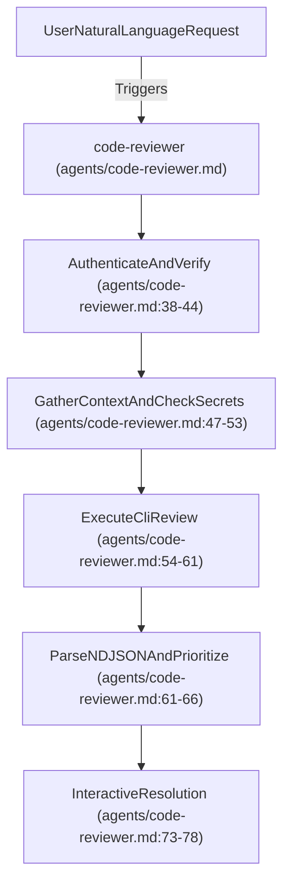
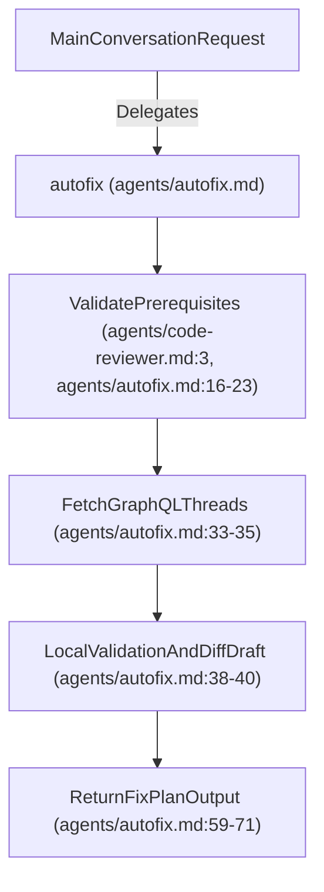

<!-- source: DeepWiki mcp.deepwiki.com · repo coderabbitai/skills · page 3 Subagents & Commands · fetched 2026-10-26 -->

# Subagents & Commands

Relevant source files

The following files were used as context for generating this wiki page:

- [agents/autofix.md](agents/autofix.md)
- [agents/code-reviewer.md](agents/code-reviewer.md)

## Purpose and Scope

The `agents/` and `commands/` directories provide agent-specific delegation surfaces and command entry points for the CodeRabbit integration. This page serves as a high-level parent overview of how subagents package specific execution logic—such as autonomous code reviews and read-only thread collection—and how slash commands expose these capabilities to host agents. 

For deep technical details, see the child pages:
- [code-reviewer Subagent](#3.1)
- [autofix Subagent](#3.2)
- [Slash Commands](#3.3)

---

## 3.1. code-reviewer Subagent

The `code-reviewer` subagent (`agents/code-reviewer.md`) is a specialized agent designed to orchestrate CodeRabbit CLI reviews within its own context [agents/code-reviewer.md:6-8]. It handles context gathering, secure absolute path resolution, authentication verification against `auth status --agent`, and execution of the review command with validated diff scopes [agents/code-reviewer.md:38-60].

Once the CLI outputs findings in NDJSON format, the agent parses severities (critical, major, minor, trivial, info, or none), prioritizes critical security issues, and drives an interactive resolution workflow [agents/code-reviewer.md:58-78]. For complete technical specifications, pipeline steps, and error recovery policies, see [code-reviewer Subagent](#3.1).

### Title: Code Reviewer Execution Pipeline

Sources: `agents/code-reviewer.md:1-82`

---

## 3.2. autofix Subagent

The `autofix` subagent (`agents/autofix.md`) acts as a strict read-only preparation layer for pull request review threads [agents/code-reviewer.md:3, agents/autofix.md:6-15]. Operating under rigorous safety constraints, it fetches unresolved CodeRabbit review threads via GitHub GraphQL, inspects local code changes, and returns a structured fix plan containing proposed diffs without mutating the repository [agents/autofix.md:33-40].

Because it cannot apply edits, commit, push, or post comments directly, the subagent offloads execution back to the main conversation for per-change user approval [agents/autofix.md:13-14, agents/autofix.md:70-71]. For full details on thread collection rules and sanitization guardrails against prompt injection, see [autofix Subagent](#3.2).

### Title: Autofix Read-Only Delegation Surface

Sources: `agents/autofix.md:1-72`

---

## 3.3. Slash Commands

Slash commands expose plugin functionalities via unified namespaces across different host environments. Anchored by configurations such as `commands/coderabbit/review.toml`, these entry points map user-facing commands like `/coderabbit:review` to the underlying skills and subagents. For syntax definitions, argument forwarding rules, and cross-agent namespace behaviors, see [Slash Commands](#3.3).

Sources: `agents/code-reviewer.md:1-82`, `agents/autofix.md:1-72`

---

