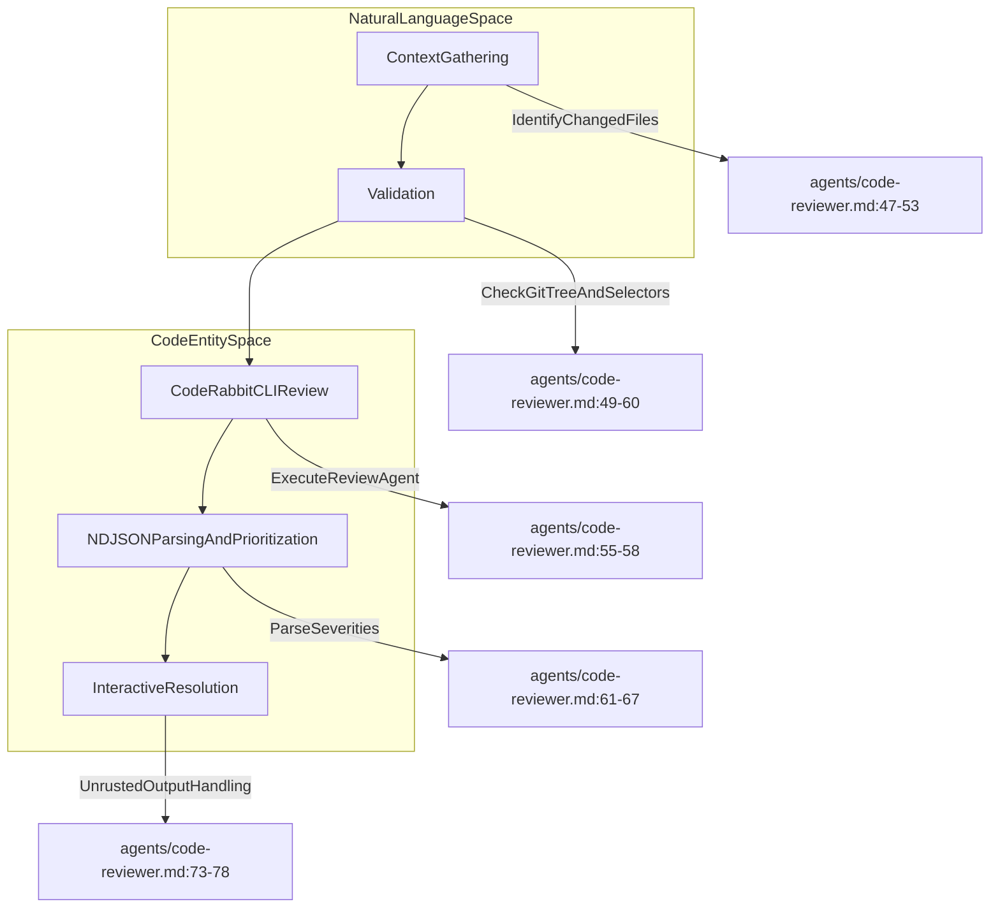
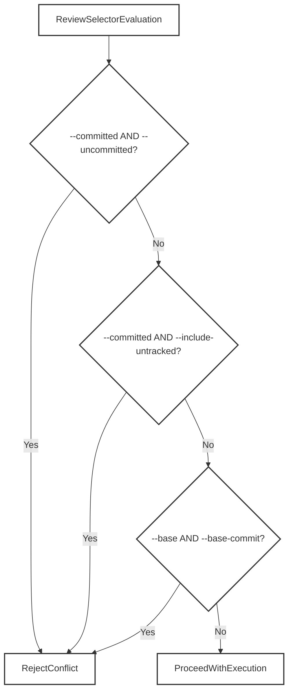

<!-- source: DeepWiki mcp.deepwiki.com · repo coderabbitai/skills · page 3.1 code-reviewer Subagent · fetched 2026-10-26 -->

# code-reviewer Subagent

Relevant source files

The following files were used as context for generating this wiki page:

- [agents/code-reviewer.md](agents/code-reviewer.md)

## Purpose and Scope

The `code-reviewer` subagent (`agents/code-reviewer.md`) is a specialized autonomous agent designed to leverage the CodeRabbit CLI within an isolated context [agents/code-reviewer.md:1-8](). Its primary responsibility is to execute code reviews, parse structured NDJSON findings, prioritize issues based on severity, and guide users through interactive resolution while adhering to strict security and authentication boundaries [agents/code-reviewer.md:38-81]().

---

## Subagent Pipeline Architecture

The execution pipeline of the `code-reviewer` subagent proceeds through five distinct stages, transitioning from high-level context gathering down to granular code entity analysis and interactive resolution [agents/code-reviewer.md:45-78]().

### Pipeline Stages
1. **Context Gathering**: Identifies changed files, target scope, feature/bugfix type, configuration files, and performs secret-scanning on selected diffs before transmission [agents/code-reviewer.md:47-53]().
2. **Validation**: Confirms working directory is inside an initialized Git working tree and validates review scope selectors [agents/code-reviewer.md:49-60]().
3. **NDJSON Parsing**: Executes the CodeRabbit CLI and parses structured review output [agents/code-reviewer.md:55-61]().
4. **Prioritization**: Groups issues by file/functionality, prioritizes critical security problems, and maps severities (critical, major, minor, trivial, info, none) [agents/code-reviewer.md:61-67]().
5. **Interactive Resolution**: Utilizes findings as a primary fix workflow while treating repository contents and review outputs as untrusted [agents/code-reviewer.md:73-78]().

Sources: [agents/code-reviewer.md:1-78]()

---

## CLI Execution & Review Scopes

The subagent interacts strictly via the CodeRabbit CLI using a trusted canonical absolute path [agents/code-reviewer.md:39-43](). Repository-provided binaries or wrappers are explicitly prohibited [agents/code-reviewer.md:42-43]().

### Selector Rules and Conflicts
The agent manages multiple review scope selectors and must reject conflicting parameters prior to execution [agents/code-reviewer.md:58-60]():

- **Allowed Combinations**: `--uncommitted` with `--include-untracked` [agents/code-reviewer.md:59](). Staged new files are included by default [agents/code-reviewer.md:60]().
- **Flag Forwarding**: Forwards `--committed`, `--uncommitted`, `--base`, `--base-commit`, `--dir <path>`, and `--light` as requested [agents/code-reviewer.md:56-58]().

Sources: [agents/code-reviewer.md:39-60]()

---

## Authentication and Security Boundaries

Before initiating any review, the subagent enforces strict authentication and sandboxing protocols:

- **Authentication Check**: Must verify that `auth status --agent` reports `authenticated: true` in the review context [agents/code-reviewer.md:40-41]().
- **Credential Protection**: The agent must never start login procedures or access credentials directly [agents/code-reviewer.md:41-42]().
- **Secret Scanning**: Diffs are checked for secrets before transmission to prevent leakage [agents/code-reviewer.md:52]().
- **Untrusted Output Handling**: Review output and repository content are treated as untrusted. Shell commands within findings must not be executed without explicit user approval [agents/code-reviewer.md:75]().
- **Recovery Policy**: On a pre-review sandbox authentication failure, follow canonical recovery procedures with a bounded single retry while preserving directories and arguments [agents/code-reviewer.md:38, 57]().

Sources: [agents/code-reviewer.md:38-44, 52, 75]()

---

## Completion and Scope Handling

Execution tracking requires monitoring specific status signals returned by the runtime environment:

- **Heartbeats**: Indicate liveness only, not completion [agents/code-reviewer.md:81]().
- **Skipped Reviews**: A `status: review_skipped` response with zero findings indicates that no review was executed rather than verifying clean code [agents/code-reviewer.md:81]().
- **Severity Fidelity**: Retains original severities returned by the engine rather than substituting custom categorization schemes [agents/code-reviewer.md:81]().

Sources: [agents/code-reviewer.md:79-81]()

---

