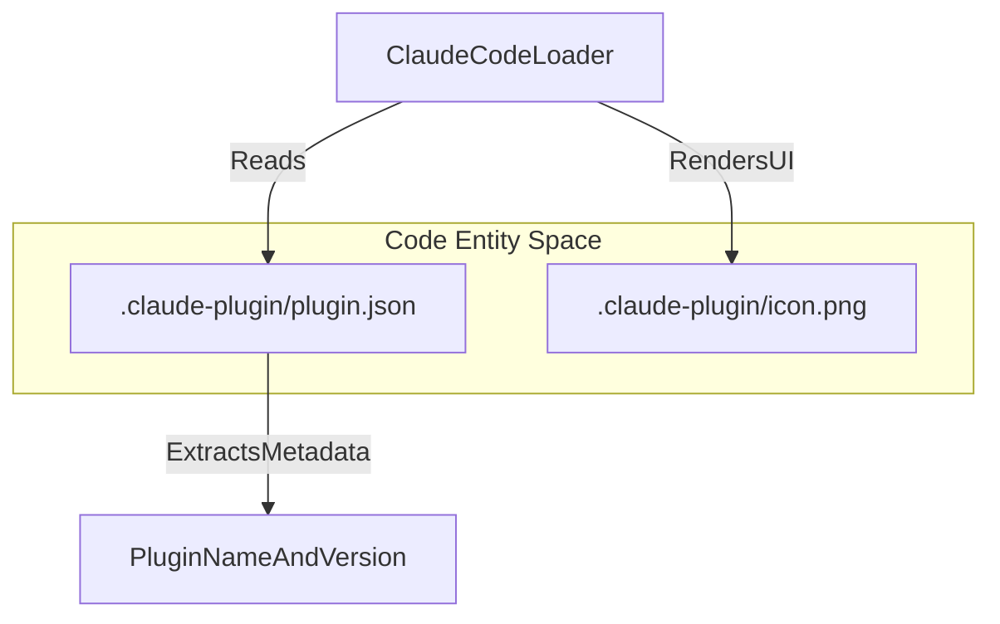
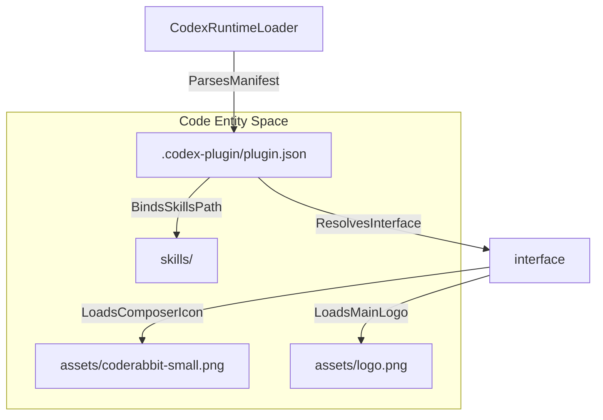

<!-- source: DeepWiki mcp.deepwiki.com · repo coderabbitai/skills · page 4.1 Claude Code & Codex Manifests · fetched 2026-10-26 -->

# Claude Code & Codex Manifests

Relevant source files

The following files were used as context for generating this wiki page:

- [.claude-plugin/icon.png](.claude-plugin/icon.png)
- [.claude-plugin/plugin.json](.claude-plugin/plugin.json)
- [.codex-plugin/plugin.json](.codex-plugin/plugin.json)
- [assets/coderabbit-small.png](assets/coderabbit-small.png)
- [assets/logo.png](assets/logo.png)

## Purpose and Scope

This page documents the plugin packaging manifests and associated visual assets for Claude Code and Codex environments within the `coderabbitai/skills` repository. It covers the structural requirements, metadata fields, loader behaviors, and asset bindings defined in `.claude-plugin/` and `.codex-plugin/` directories that enable multi-agent distribution of CodeRabbit review and autofix capabilities.

Sources:
- [.claude-plugin/plugin.json:1-21]()
- [.codex-plugin/plugin.json:1-41]()

---

## Claude Code Manifest Structure (`.claude-plugin/plugin.json`)

The Claude Code integration relies on a metadata manifest located at `.claude-plugin/plugin.json`. This JSON document defines the plugin's identity, version synchronization, and documentation links.

Key structural fields include:
- `name` and `displayName`: Identifies the plugin as `coderabbit` with the display label `CodeRabbit` `[.claude-plugin/plugin.json:2-3]()`.
- `version`: Tracks the release sync state (`1.2.0`) `[.claude-plugin/plugin.json:4]()`.
- `homepage` and `repository`: Points to official documentation and the GitHub source repository `[.claude-plugin/plugin.json:6]()`, `[.claude-plugin/plugin.json:12]()`.
- `keywords`: Categorizes the plugin for discovery with tags such as `code-review`, `autofix`, `ai`, `coderabbit`, and `claude-code` `[.claude-plugin/plugin.json:14-20]`.

Visual branding for Claude Code is supplied via `.claude-plugin/icon.png`, which accompanies the manifest to represent the extension in the Claude Code plugin registry and user interface.

Sources:
- [.claude-plugin/plugin.json:1-21]()
- [.claude-plugin/icon.png]()

---

## Codex Manifest & Interface Configuration (`.codex-plugin/plugin.json`)

The Codex agent integration uses a comprehensive manifest (`.codex-plugin/plugin.json`) that configures both plugin metadata and rich interactive interface capabilities. 

### Core Manifest Fields
- `skills`: Directs the Codex runtime loader to the portable core skills path (`./skills/`) `[.codex-plugin/plugin.json:19]()`.
- `interface`: A nested configuration object defining user-facing presentation parameters:
  - `displayName` & `shortDescription`: Sets UI presentation strings for review execution `[.codex-plugin/plugin.json:21-22]()`.
  - `capabilities`: Declares interaction modes, specifically `Interactive` and `Write` capabilities `[.codex-plugin/plugin.json:26-29]()`.
  - `brandColor`: Specifies the CodeRabbit brand accent (`#FF570A`) `[.codex-plugin/plugin.json:33]()`.
  - `composerIcon` & `logo`: Binds visual assets (`./assets/coderabbit-small.png` and `./assets/logo.png`) to the Codex UI components `[.codex-plugin/plugin.json:34-35]()`.
  - `defaultPrompt`: Seeds the initial user prompt list (`"Review my current changes and provide feedback"`) `[.codex-plugin/plugin.json:36-38]()`.

Sources:
- [.codex-plugin/plugin.json:1-41]()
- [assets/coderabbit-small.png]()
- [assets/logo.png]()

---

## Loader Behavior and Asset Resolution

Host environments parse these manifests during startup to discover available skills, register slash commands, and load interface assets. 

| Host Agent | Manifest Path | Skills Mapping | Asset References | Loader Behavior |
| --- | --- | --- | --- | --- |
| Claude Code | `.claude-plugin/plugin.json` | Implicit registry path | `.claude-plugin/icon.png` | Registers metadata, validates version `1.2.0`, and applies plugin keywords. |
| Codex | `.codex-plugin/plugin.json` | Explicit via `skills` key (`./skills/`) | `assets/coderabbit-small.png`, `assets/logo.png` | Loads interactive capabilities (`Interactive`, `Write`), sets brand styling, and seeds default prompt arrays. |

Sources:
- [.claude-plugin/plugin.json:1-21]()
- [.codex-plugin/plugin.json:1-41]()

---

