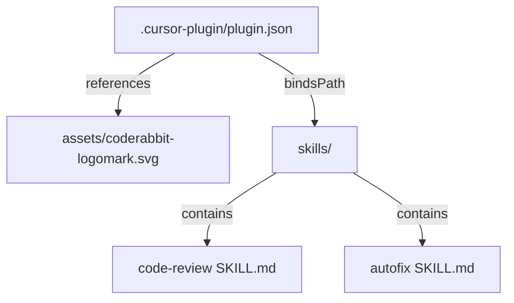
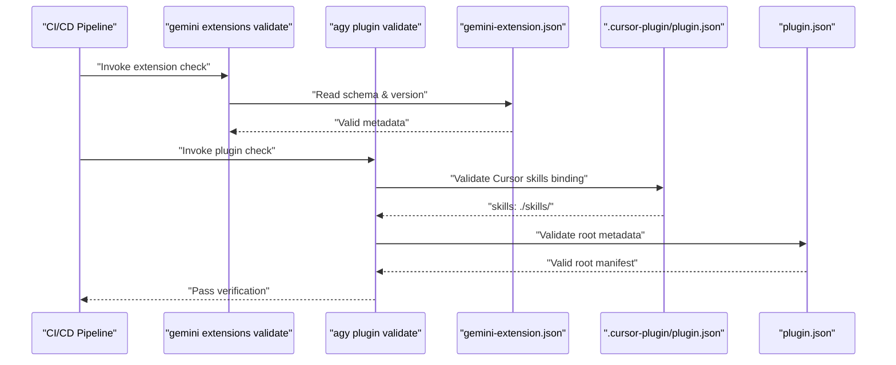

<!-- source: DeepWiki mcp.deepwiki.com · repo coderabbitai/skills · page 4.2 Cursor, Gemini & Antigravity Manifests · fetched 2026-10-26 -->

# Cursor, Gemini & Antigravity Manifests

<details>
<summary>Relevant source files</summary>

The following files were used as context for generating this wiki page:

- [.cursor-plugin/plugin.json](.cursor-plugin/plugin.json)
- [assets/coderabbit-logomark.svg](assets/coderabbit-logomark.svg)
- [commands/coderabbit/review.toml](commands/coderabbit/review.toml)
- [gemini-extension.json](gemini-extension.json)
- [plugin.json](plugin.json)

</details>


## Purpose and Scope
This section details the plugin and extension packaging manifests used to distribute CodeRabbit agent skills across multiple host environments, specifically Cursor (`.cursor-plugin/plugin.json`), Gemini (`gemini-extension.json`), and the root Antigravity (`plugin.json`) configuration. It also covers the platform-specific validation commands (`gemini extensions validate` and `agy plugin validate`) used to ensure manifest compliance.

---

## 1. Cursor Plugin Manifest (`.cursor-plugin/plugin.json`)

The Cursor plugin manifest configures CodeRabbit integration for the Cursor AI editor environment [^1]. It establishes package identity, authorship, licensing, branding references, and skill directory bindings.

### Configuration Schema & Properties
The manifest specifies core metadata, categorization tags, and pointers to internal repository structures [^2]:
- **Identity & Versioning**: Sets `name` to `"coderabbit"`, `displayName` to `"CodeRabbit"`, and synchronizes `version` to `"1.2.0"` [.cursor-plugin/plugin.json:2-4]().
- **Publisher & Repository**: Declares `"CodeRabbit AI"` as publisher and maps repository links to `https://github.com/coderabbitai/skills` [.cursor-plugin/plugin.json:10-12]().
- **Asset Integration**: References the logomark asset at `assets/coderabbit-logomark.svg` [.cursor-plugin/plugin.json:14-14]().
- **Skill Discovery**: Points the Cursor extension loader to the portable core skills directory via `"skills": "./skills/"` [.cursor-plugin/plugin.json:29-29]().

```json
{
  "name": "coderabbit",
  "displayName": "CodeRabbit",
  "version": "1.2.0",
  "skills": "./skills/",
  "logo": "assets/coderabbit-logomark.svg"
}
```
*(Reference structure derived from [.cursor-plugin/plugin.json:1-30]())*

### Diagram: Cursor Manifest Binding Architecture

Sources: [.cursor-plugin/plugin.json:1-30](), [assets/coderabbit-logomark.svg:1-4]()

---

## 2. Gemini Extension Manifest (`gemini-extension.json`)

The Gemini extension manifest provides lightweight extension metadata for integration with the Gemini CLI ecosystem [^3].

### Schema Properties
- **Extension Identity**: Defines `"name"` as `"coderabbit"` and locks version parity at `"1.2.0"` [gemini-extension.json:2-3]().
- **Description**: Summarizes autonomous code review and review-comment autofix capabilities [gemini-extension.json:4-4]().

```json
{
  "name": "coderabbit",
  "version": "1.2.0",
  "description": "AI-powered code review and review-comment autofix, powered by CodeRabbit."
}
```
*(Reference structure derived from [gemini-extension.json:1-5]())*

Sources: [gemini-extension.json:1-5]()

---

## 3. Root Antigravity Manifest (`plugin.json`)

The root `plugin.json` file serves as the top-level fallback and general extension descriptor for Antigravity (`agy`) packaging [^4].

### Core Definitions
- **Global Metadata**: Specifies the primary `"name"` and a generalized `"description"` for root-level tool registration [plugin.json:1-4]().

```json
{
  "name": "coderabbit",
  "description": "AI-powered code review and review-comment autofix, powered by CodeRabbit."
}
```
*(Reference structure derived from [plugin.json:1-4]())*

Sources: [plugin.json:1-4]()

---

## 4. Manifest Validation Commands & Workflows

To guarantee that agent manifests remain structurally sound and compliant with host platform requirements, validation routines are executed during build and release operations.

### Validation Commands Matrix
| Command | Target Manifest | Purpose |
| :--- | :--- | :--- |
| `gemini extensions validate` | `gemini-extension.json` | Validates schema conformance for Gemini CLI extensions. |
| `agy plugin validate` | `plugin.json` / `.cursor-plugin/plugin.json` | Verifies root and platform-specific plugin structure for Antigravity. |

### Diagram: Multi-Manifest Validation Execution Flow

Sources: [.cursor-plugin/plugin.json:1-30](), [gemini-extension.json:1-5](), [plugin.json:1-4]()

---

