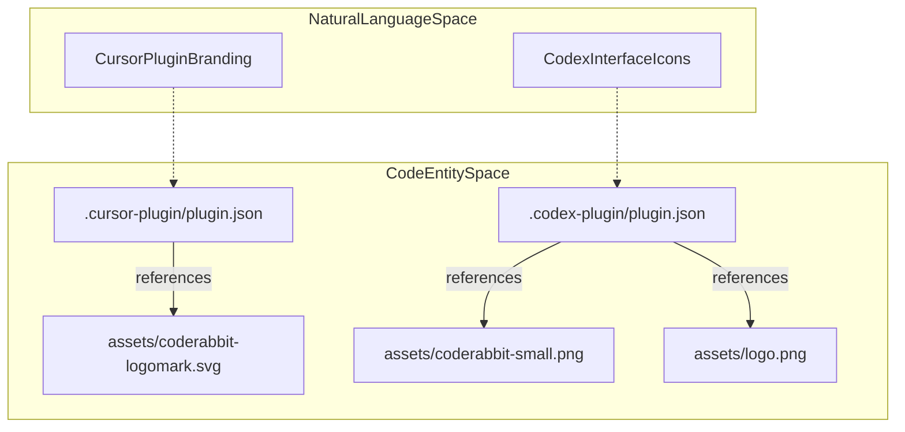
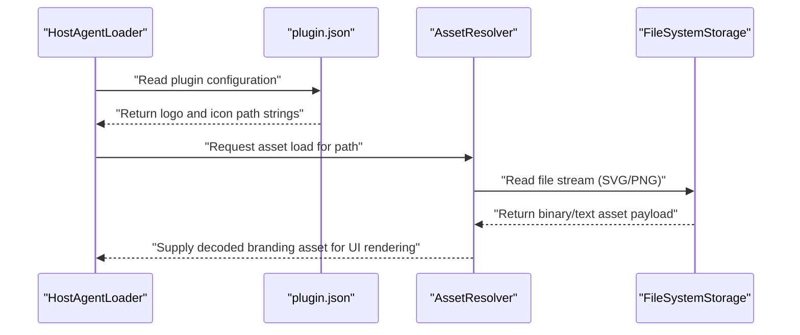

<!-- source: DeepWiki mcp.deepwiki.com · repo coderabbitai/skills · page 4.3 Branding Assets · fetched 2026-10-26 -->

# Branding Assets

<details>
<summary>Relevant source files</summary>

The following files were used as context for generating this wiki page:

- [.codex-plugin/plugin.json](.codex-plugin/plugin.json)
- [.cursor-plugin/plugin.json](.cursor-plugin/plugin.json)
- [assets/coderabbit-logomark.svg](assets/coderabbit-logomark.svg)
- [assets/coderabbit-small.png](assets/coderabbit-small.png)
- [assets/logo.png](assets/logo.png)

</details>


### Purpose and Scope
The `assets/` directory stores the vector and raster visual identity components for CodeRabbit agent extensions and integrations. These branding files—including scalable vector graphics and compressed PNG logos—provide visual continuity across different host IDE environments, chat interfaces, and marketplace listings. Host manifests reference these assets directly via relative paths to render logomarks, composer icons, and extension headers.

Sources: `[assets/coderabbit-logomark.svg:1-5]`, `[.cursor-plugin/plugin.json:14-14]`, `[.codex-plugin/plugin.json:34-35]()`

---

## Asset Inventory

The repository maintains three primary branding artifacts inside the `assets/` directory:

1. **`assets/coderabbit-logomark.svg`**
   - **Type**: Scalable Vector Graphics (SVG)
   - **Dimensions**: 1201x1200 viewBox coordinate space `[assets/coderabbit-logomark.svg:1-1]()`.
   - **Structure**: Defines the core CodeRabbit circular logomark using vector paths (`<path>`), utilizing primary brand colors (`#FF570A` for the outer circle background and `#FEFEFE` for the foreground logomark geometry) `[assets/coderabbit-logomark.svg:2-4]()`.
   - **Usage**: Referenced as the primary vector logo in IDE plugins like Cursor `[.cursor-plugin/plugin.json:14-14]()`.

2. **`assets/coderabbit-small.png`**
   - **Type**: Compressed PNG Raster
   - **Structure**: Binary portable network graphics format containing compact icon variants `[assets/coderabbit-small.png:1-11]()`.
   - **Usage**: Utilized as a small composer icon in chat interfaces and assistant toolbars (e.g., Codex interface config) `[.codex-plugin/plugin.json:34-34]()`.

3. **`assets/logo.png`**
   - **Type**: High-Resolution PNG Raster
   - **Structure**: Multi-chunk PNG file embedding resolution metadata (`pHYs`, `sRGB`, `gAMA` chunks) generated via Figma `[assets/logo.png:1-4]()`.
   - **Usage**: Embedded as the primary fallback raster logo within plugin interface definitions `[.codex-plugin/plugin.json:35-35]()`.

Sources: `[assets/coderabbit-logomark.svg:1-5]`, `[assets/coderabbit-small.png:1-11]`, `[assets/logo.png:1-4]()`

---

## Manifest Asset References

Different host agent architectures consume branding assets according to their specific schema requirements. Host extension loaders read these references during initialization to populate marketplace UI elements.

### Cursor Plugin Manifest
Cursor consumes the SVG logomark directly within its root configuration object:
```json
{
  "logo": "assets/coderabbit-logomark.svg"
}
```
Sources: `[.cursor-plugin/plugin.json:14-14]()`

### Codex Plugin Manifest
Codex splits branding across interface capabilities, referencing both the small raster icon for composition surfaces and the main raster logo for general UI rendering:
```json
{
  "interface": {
    "composerIcon": "./assets/coderabbit-small.png",
    "logo": "./assets/logo.png"
  }
}
```
Sources: `[.codex-plugin/plugin.json:34-35]()`

---

## Architecture & Data Flow

### Diagram: Natural Language Space to Code Entity Space (Manifest Asset Mapping)
This diagram maps abstract branding concepts and host agent configuration files to their respective physical asset entities within the repository codebase.


Sources: `[.cursor-plugin/plugin.json:14-14]`, `[.codex-plugin/plugin.json:34-35]`, `[assets/coderabbit-logomark.svg:1-5]`, `[assets/coderabbit-small.png:1-11]`, `[assets/logo.png:1-4]()`

### Diagram: Asset Resolution Pipeline
This sequence details how host agent loaders traverse configuration manifests to locate, parse, and render branding assets at runtime.


Sources: `[.cursor-plugin/plugin.json:1-30]`, `[.codex-plugin/plugin.json:1-41]`, `[assets/coderabbit-logomark.svg:1-5]`, `[assets/logo.png:1-4]()`

---

