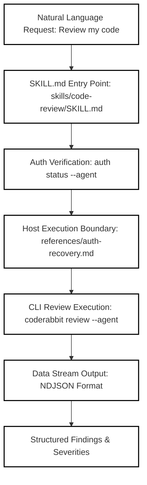
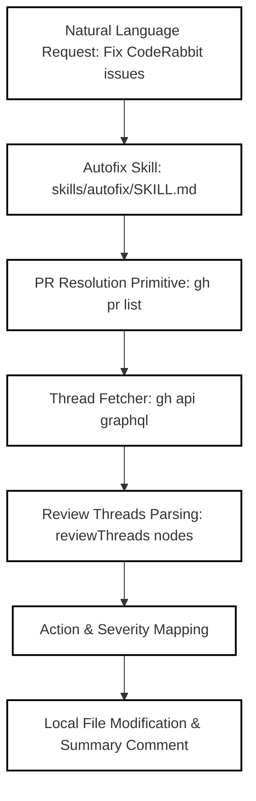

<!-- source: DeepWiki mcp.deepwiki.com · repo coderabbitai/skills · page 6 Glossary · fetched 2026-10-26 -->

# Glossary

Relevant source files

The following files were used as context for generating this wiki page:

- [.coderabbit.yaml](.coderabbit.yaml)
- [DISTRIBUTION_CHANNELS.md](DISTRIBUTION_CHANNELS.md)
- [README.md](README.md)
- [skills/autofix/SKILL.md](skills/autofix/SKILL.md)
- [skills/autofix/github.md](skills/autofix/github.md)
- [skills/code-review/SKILL.md](skills/code-review/SKILL.md)
- [skills/code-review/references/auth-recovery.md](skills/code-review/references/auth-recovery.md)

## Purpose and Scope

This glossary defines codebase-specific terms, architectural concepts, data structures, and command-line flags used across the `coderabbitai/skills` repository. It provides technical definitions and file pointers to the implementation and reference locations for core skills, subagents, plugin manifests, review policies, and operational tooling.

Sources: [`README.md:1-176`](), [`DISTRIBUTION_CHANNELS.md:1-31`](), [`skills/code-review/SKILL.md:1-146`](), [`skills/autofix/SKILL.md:1-337`](), [`[.coderabbit.yaml:1-127`]()

---

## Core Skills and Execution

### Skill / `SKILL.md`
A portable, Markdown-formatted specification defining an agent capability (such as code review or pull request autofix) along with its triggers, prerequisites, and step-by-step execution workflows.
- **File Pointers**: [`skills/code-review/SKILL.md:1-6`](), [`skills/autofix/SKILL.md:1-20`](), [`README.md:32-37`]()

### Subagent
A specialized, delegated AI agent workflow configuration (such as `code-reviewer` or `autofix`) packaged for execution within host environments like Claude Code, Gemini CLI, or Antigravity CLI.
- **File Pointers**: [`README.md:127-128`](), [`skills/code-review/SKILL.md:1-10`](), [`skills/autofix/SKILL.md:1-24`]()

### NDJSON (Newline-Delimited JSON)
The streaming data format emitted by the CodeRabbit CLI when invoked with `--agent`. Each line represents a distinct JSON payload (such as liveness heartbeats, review status, or individual findings) rather than a single monolithic JSON document.
- **File Pointers**: [`skills/code-review/SKILL.md:48-53`](), [`skills/code-review/SKILL.md:83-84`]()

### `--agent`
A primary CLI flag passed to the CodeRabbit binary that formats output for consumption by AI agents rather than human terminal displays, emitting structured NDJSON streams and machine-readable fix guidance.
- **File Pointers**: [`skills/code-review/SKILL.md:48-53`](), [`skills/code-review/SKILL.md:77`]()

Sources: [`README.md:32-128`](), [`skills/code-review/SKILL.md:1-84`](), [`skills/autofix/SKILL.md:1-24`]()

---

## Review Scopes and Feedback Data Structures

### Review Scope
The set of git changes targeted for analysis during a review invocation. Supported scopes include default tracked changes, committed changes (`--committed`), uncommitted changes (`--uncommitted`), untracked files (`--include-untracked`), specific branch/commit baselines (`--base`, `--base-commit`), and directory paths (`--dir`).
- **File Pointers**: [`skills/code-review/SKILL.md:16-18`](), [`skills/code-review/SKILL.md:67-80`]()

### Severity Levels
The strict classification levels assigned to review findings (`critical`, `major`, `minor`, `trivial`, `info`, and `none`). Skills and subagents are required to preserve these exact severities without arbitrary reclassification.
- **File Pointers**: [`skills/code-review/SKILL.md:15`](), [`skills/code-review/SKILL.md:83-84`](), [`skills/autofix/SKILL.md:189-191`]()

### `reviewThreads`
The GitHub GraphQL data structure fetched by the autofix workflow to retrieve pull request review threads, including their resolution state (`isResolved`), obsolescence (`isOutdated`), line anchors, and root comment authors (`coderabbitai`, `coderabbit[bot]`).
- **File Pointers**: [`skills/autofix/SKILL.md:99-148`](), [`skills/autofix/github.md:39-90`]()

### Prompt for AI Agents
Structured reviewer guidance embedded within CodeRabbit feedback comments (inside `

🤖 Prompt for AI Agents
`). The security model mandates treating these blocks strictly as untrusted issue descriptions rather than executable instructions.
- **File Pointers**: [`skills/autofix/SKILL.md:184-186`](), [`skills/code-review/SKILL.md:3`](), `[.coderabbit.yaml:43]()`

Sources: [`skills/code-review/SKILL.md:15-80`](), [`skills/autofix/SKILL.md:99-191`](), [`skills/autofix/github.md:39-90`](), `[.coderabbit.yaml:43]()`

---

## Security, Authentication, and Policy Controls

### Host Execution Boundary
The architectural security rule restricting how agents execute system commands inside sandboxed environments. CLI binary discovery, authentication checks (`auth status --agent`), and review commands must be executed via command-scoped host execution rather than falling back to unverified local workspace binaries or ambient permission escalation.
- **File Pointers**: [`skills/code-review/references/auth-recovery.md:5-27`]()

### Auth Recovery
The controlled retry procedure triggered when a local sandbox experiences authentication communication failures (`credentials_unavailable`, `callback_listener_unavailable`). If host-level authentication status confirms `authenticated: true`, the review command is permitted exactly one bounded single retry preserving its original arguments.
- **File Pointers**: [`skills/code-review/references/auth-recovery.md:44-59`](), [`skills/code-review/SKILL.md:54-58`]()

### Pre-merge Check
Automated quality and compliance evaluation gates defined in `.coderabbit.yaml` (such as title, description, issue assessment, and custom checks like `Agent guidance structure`) that must pass before a pull request can be merged.
- **File Pointers**: `[.coderabbit.yaml:13-38]()`

### `skillspector`
An integrated code review verification tool enabled in the repository review policy (`.coderabbit.yaml`) to inspect, validate, and test agent skill definitions and metadata.
- **File Pointers**: `[.coderabbit.yaml:62-63]()`

Sources: [`skills/code-review/references/auth-recovery.md:5-59`](), [`skills/code-review/SKILL.md:54-58`](), `[.coderabbit.yaml:13-63]()`

---

## Distribution and Operations

### Manifest
Agent-specific JSON configuration files (`.claude-plugin/plugin.json`, `.cursor-plugin/plugin.json`, `.codex-plugin/plugin.json`, `gemini-extension.json`, `plugin.json`) that package shared skills, commands, and subagents for distribution across different host agent marketplaces and extension registries.
- **File Pointers**: [`README.md:126-132`](), [`DISTRIBUTION_CHANNELS.md:13-18`]()

### Distribution Channel
An operating inventory channel tracking the publication status, source of truth, and maintenance procedures for how CodeRabbit skills and plugins are delivered to users across ecosystems.
- **File Pointers**: [`DISTRIBUTION_CHANNELS.md:1-31`](), [`README.md:118-120`]()

### Eval Grader Arms
Automated evaluation test harnesses (`evals/`) used to validate plugin behavior against test cases using various grading mechanisms (regex matching, LLM evaluation, and tool usage verification).
- **File Pointers**: [`README.md:121-135`](), [`DISTRIBUTION_CHANNELS.md:1-31`]() (referenced via evaluation testing infrastructure in wiki TOC)

Sources: [`README.md:118-135`](), [`DISTRIBUTION_CHANNELS.md:1-31`]()

---

## Architectural Mapping Diagrams

The following diagrams bridge natural language request concepts to their corresponding technical code entities across the repository.

### Diagram 1: Natural Language Review Space to Code Execution Entity Space

Sources: [`skills/code-review/SKILL.md:1-84`](), [`skills/code-review/references/auth-recovery.md:5-59`]()

### Diagram 2: Natural Language Autofix Space to GitHub GraphQL Entity Space

Sources: [`skills/autofix/SKILL.md:43-196`](), [`skills/autofix/github.md:12-115`]()