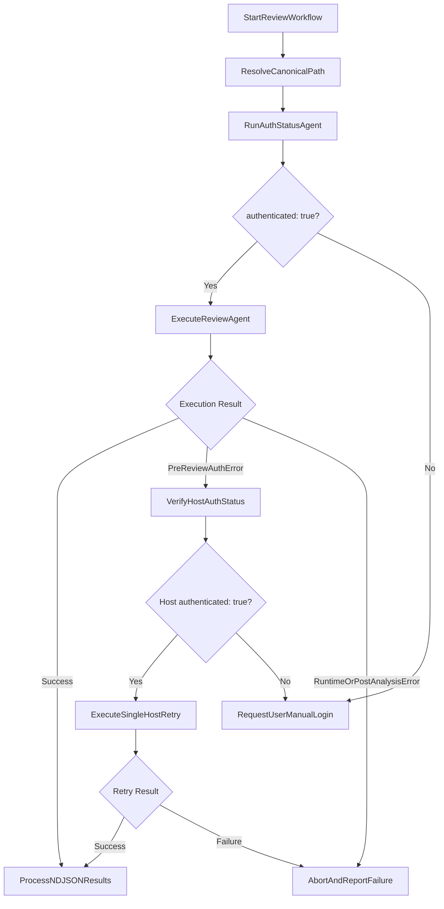
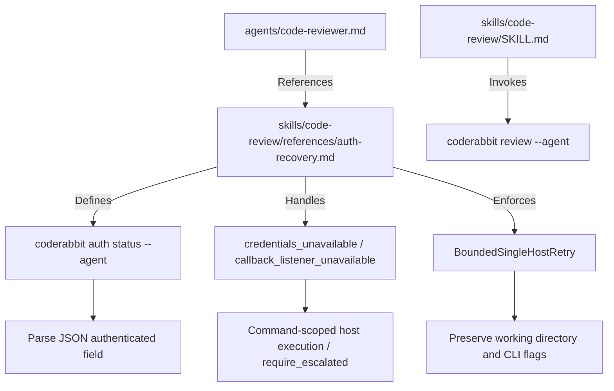

<!-- source: DeepWiki mcp.deepwiki.com · repo coderabbitai/skills · extra page Authentication & Recovery · fetched 2026-10-26 -->

# Authentication & Recovery

Relevant source files

The following files were used as context for generating this wiki page:

- [agents/code-reviewer.md](agents/code-reviewer.md)
- [skills/code-review/SKILL.md](skills/code-review/SKILL.md)
- [skills/code-review/references/auth-recovery.md](skills/code-review/references/auth-recovery.md)

## Purpose & Scope
This page details the authentication verification, execution boundaries, error states (`credentials_unavailable`, `callback_listener_unavailable`), and bounded single retry policy governing the CodeRabbit CLI integration within `coderabbitai/skills`. It defines the precise operational contract required before executing a code review under sandboxed agent environments.

Sources: `skills/code-review/references/auth-recovery.md:1-5()`, `agents/code-reviewer.md:38-43()`

---

## 1. Execution Boundary & Sandboxes
When operating inside local agent sandboxes, the system must enforce strict boundaries on how and where the `coderabbit` binary is executed. 

* **Canonical Path Resolution**: The host-installed `coderabbit` executable must be resolved to its canonical absolute path while sandboxed. Trust is restricted exclusively to expected user or system installations from official sources; workspace, temporary, alias, or repository-provided wrapper executables are strictly rejected [skills/code-review/references/auth-recovery.md:7-11()].
* **Command-Scoped Host Execution**: Sandboxed agents must use the harness's supported command-scoped host execution mechanism for running `auth status --agent` and `review --agent`. In Codex environments exposing `sandbox_permissions`, `require_escalated` must be applied to those exact calls [skills/code-review/references/auth-recovery.md:13-17()]. Session-wide sandbox settings must never be altered.
* **Direct Invocation**: Binaries must be invoked directly using literal, validated arguments without wrappers, pipes, expansions, or shell redirection [skills/code-review/references/auth-recovery.md:21-23()]. `--version` and `--help` diagnostics remain sandboxed [skills/code-review/references/auth-recovery.md:23-24()].
* **Credential Isolation**: Remote agents rely entirely on authentication configured within their own environment and cannot reuse local host credential stores. The CLI manages its own credentials; agents must never retrieve, expose, copy, store, hash, or pass credentials through arguments, environment variables, files, tool outputs, or model context [skills/code-review/references/auth-recovery.md:28-32()].

Sources: `skills/code-review/references/auth-recovery.md:5-27()`, `agents/code-reviewer.md:38-44()`

---

## 2. Authentication Status Checking
Prior to launching any code review workflow, the agent verifies authentication status using the CLI flag structure.

* **Executing Status Check**: Run `"/absolute/path/to/coderabbit" auth status --agent` within the exact approved context designated for the subsequent review [skills/code-review/references/auth-recovery.md:36-37()].
* **Parsing Status**: Proceed only when well-formed JSON output reports `authenticated: true` [skills/code-review/references/auth-recovery.md:37-38()]. 
* **Handling Unauthenticated States**: If `authenticated: false` or if malformed output is encountered, the agent must prompt the user to execute `"/absolute/path/to/coderabbit" auth login` directly within their terminal. Automatic or elevated login attempts by the agent are forbidden [skills/code-review/references/auth-recovery.md:38-42()].

Sources: `skills/code-review/references/auth-recovery.md:28-43()`, `agents/code-reviewer.md:40-42()`

---

## 3. Error States: `credentials_unavailable` & `callback_listener_unavailable`
Sandbox environments frequently surface specific failure modes during authentication handshakes that do not necessarily indicate an unauthenticated user session.

* **Meaning of Unavailable States**: `credentials_unavailable` and `callback_listener_unavailable` indicate that local credential access or local callback socket binding failed within the restricted sandbox, rather than confirming that the host user is signed out [skills/code-review/references/auth-recovery.md:46-48()].
* **Legacy CLI Error Signatures**: Older CLI versions may emit `authentication_failed` accompanied by messages such as `Failed to start server. Is port 0 in use?` [skills/code-review/references/auth-recovery.md:48-49()]. 
* **Ambiguity Handling**: An absent status field or a port-binding callback error message does not definitively prove a port collision or missing authentication; these indicators require validation against the host environment [skills/code-review/references/auth-recovery.md:49-51()].

Sources: `skills/code-review/references/auth-recovery.md:44-51()`

---

## 4. Bounded Single Retry Policy
To handle transient sandbox execution blocks without creating infinite loops or ignoring genuine auth failures, the framework implements a strict single-retry policy.

* **Eligibility Criteria**: Only pre-review authentication failures occurring inside a local sandbox qualify for recovery. The failure must occur before remote code analysis begins [skills/code-review/references/auth-recovery.md:52-54(), 60-61()].
* **Host Status Verification**: If a sandbox review fails due to pre-review auth errors, the agent checks `auth status --agent` via approved host execution. Because a sandbox's `authenticated: false` is not authoritative for the host, a confirmed host status of `authenticated: true` triggers eligibility [skills/code-review/references/auth-recovery.md:53-55()].
* **Single Retry Execution**: If host status is `true`, retry the original review **exactly once** on the host. The retry must preserve the original working directory and all CLI arguments (such as `--dir`, `--committed`, `--uncommitted`, `--base`, `--base-commit`, `--agent`) [skills/code-review/references/auth-recovery.md:55-57(), agents/code-reviewer.md:57-58()].
* **Termination Conditions**: If host status is `false`, manual login handoff is required. If host status check fails, the single retry fails, or the original review already executed on the host, the agent must report the failure and abort [skills/code-review/references/auth-recovery.md:57-59()]. Retries are never permitted for network, rate-limit, billing, or post-analysis review failures [skills/code-review/references/auth-recovery.md:61-63()].

Sources: `skills/code-review/references/auth-recovery.md:52-65()`, `agents/code-reviewer.md:57-57()`, `skills/code-review/SKILL.md:54-58()`

---

## 5. Architecture & Data Flow

### Diagram: Authentication & Recovery Lifecycle
The following diagram illustrates the flow from initial absolute path resolution through authentication verification, sandbox error handling, and bounded host retry logic.

Sources: `skills/code-review/references/auth-recovery.md:34-65()`, `agents/code-reviewer.md:38-62()`, `skills/code-review/SKILL.md:31-58()`

### Diagram: Code Entity to State Boundary Mapping
This diagram maps natural language recovery concepts to concrete codebase symbols and file references within `coderabbitai/skills`.

Sources: `agents/code-reviewer.md:38-58()`, `skills/code-review/SKILL.md:31-80()`, `skills/code-review/references/auth-recovery.md:5-65()`

---

