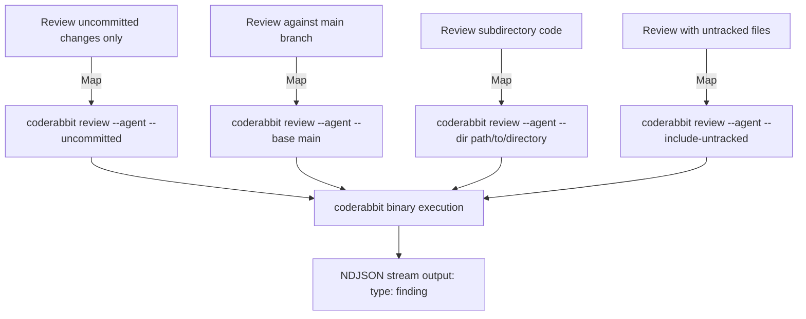
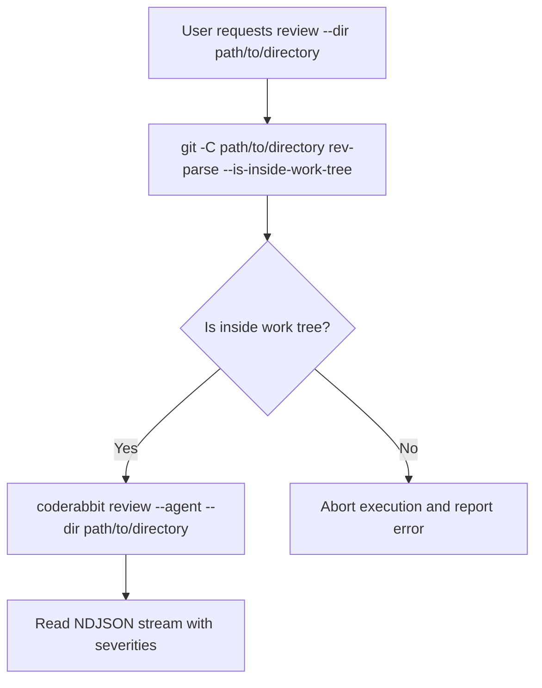

<!-- source: DeepWiki mcp.deepwiki.com · repo coderabbitai/skills · extra page CLI Flags & Review Scopes · fetched 2026-10-26 -->

# CLI Flags & Review Scopes

Relevant source files

The following files were used as context for generating this wiki page:

- [skills/code-review/SKILL.md](skills/code-review/SKILL.md)
- [skills/code-review/references/auth-recovery.md](skills/code-review/references/auth-recovery.md)
- [skills/code-review/references/cli-workflows.md](skills/code-review/references/cli-workflows.md)

## Purpose & Scope

This technical reference details the command-line interface (CLI) flags, review scope selectors, conflict resolution rules, and execution constraints implemented within the `code-review` skill. It governs how the CodeRabbit CLI processes tracked changes, uncommitted edits, untracked files, branch comparisons, commit ranges, and directory-scoped reviews.

Sources: [skills/code-review/SKILL.md:1-137]()

---

## Review Scope Selectors and Flag Matrix

The CodeRabbit CLI supports multiple mutually exclusive or combinable scope selectors to define the boundaries of a code review. By default, the review scope includes committed, staged, and tracked unstaged changes [skills/code-review/SKILL.md:79].

| CLI Option | Description | Conflict Rules | Sources |
| --- | --- | --- | --- |
| `No scope option` | Tracked changes (default: committed, staged, tracked unstaged) | Mutually exclusive with explicit scope flags | [skills/code-review/SKILL.md:69-79]() |
| `--committed` | Committed changes only | Conflicts with `--uncommitted` and `--include-untracked` | [skills/code-review/SKILL.md:70-79]() |
| `--uncommitted` | Staged changes and unstaged edits to tracked files | Conflicts with `--committed` | [skills/code-review/SKILL.md:71-79]() |
| `--include-untracked` | Include non-ignored untracked files | Conflicts with `--committed` | [skills/code-review/SKILL.md:72-79]() |
| `--light` | Reduce review context (changes policy, not output format) | None | [skills/code-review/SKILL.md:73-78]() |
| `--base <branch>` | Compare against a specific base branch | Conflicts with `--base-commit` | [skills/code-review/SKILL.md:74-79]() |
| `--base-commit <hash>` | Compare against a specific commit hash | Conflicts with `--base` | [skills/code-review/SKILL.md:75-79]() |
| `--dir <path>` | Review specific directory inside working tree | None | [skills/code-review/SKILL.md:76-79]() |
| `--agent` | Agent-readable NDJSON review output and fix guidance | None | [skills/code-review/SKILL.md:77-78]() |

Sources: [skills/code-review/SKILL.md:67-79]()

---

## Natural Language to Code Entity Space: Scope Mapping

The following diagram bridges natural language review intents to specific CLI flags and execution parameters processed by the `code-review` skill.

Sources: [skills/code-review/SKILL.md:50-79](), [skills/code-review/SKILL.md:102-124]()

---

## Conflict Rules & Scope Validation

Before executing any review command, agents must validate flag combinations to prevent runtime errors:
1. `--committed` conflicts directly with `--uncommitted` and `--include-untracked` [skills/code-review/SKILL.md:79].
2. `--base` conflicts with `--base-commit` [skills/code-review/SKILL.md:79].
3. Raw untracked files are excluded from the default scope, but staged new files are included [skills/code-review/SKILL.md:79].
4. `--include-untracked` can be combined with `--uncommitted` or used independently with the default tracked changes scope [skills/code-review/SKILL.md:72-79].
5. The legacy syntax `-t/--type` is treated as hidden compatibility syntax and should not be used in new commands; named scope flags must be used instead [skills/code-review/SKILL.md:79].

Sources: [skills/code-review/SKILL.md:67-80]()

---

## Directory Scope Validation Flow

When a user specifies a target directory via `--dir <path>`, the skill must verify that the path exists within an initialized Git working tree before invoking the CLI review.

Sources: [skills/code-review/SKILL.md:59-63](), [skills/code-review/SKILL.md:126-130]()

---

## Related CLI Workflows Reference

Beyond active code reviews, the CodeRabbit CLI exposes commands for saved findings, configuration, and PR prompt retrieval. These operate under separate authentication and output contracts:
- `coderabbit review findings --dir <path>` displays stored human-readable findings from the most recent matching run with findings [skills/cli-workflows.md:7].
- `coderabbit review --show-prompts --dir <path>` retrieves local fix prompts without triggering a new review (incompatible with `--agent`) [skills/cli-workflows.md:8].
- `coderabbit pullrequest <number-or-url> --show-prompts --agent` fetches a consolidated GitHub PR prompt as an NDJSON `type: prompt` event [skills/cli-workflows.md:9].
- `coderabbit config --agent` inspects configuration without writing, while `coderabbit config --agent --generate` proposes YAML structures [skills/cli-workflows.md:23].

Sources: [skills/code-review/references/cli-workflows.md:5-24]()

---

