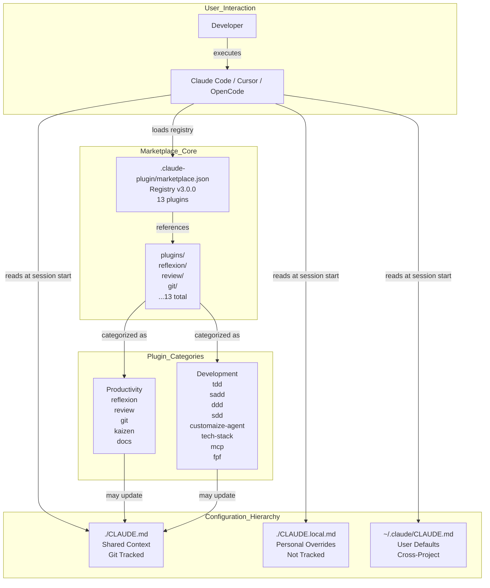
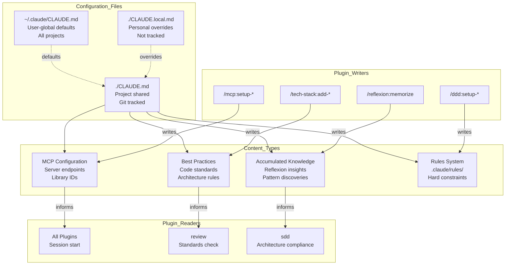
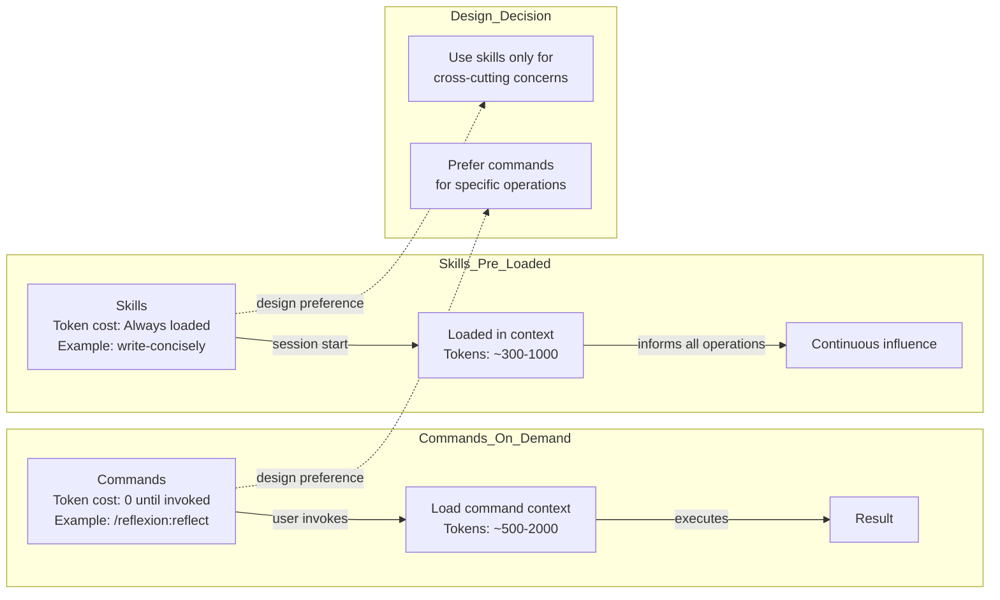
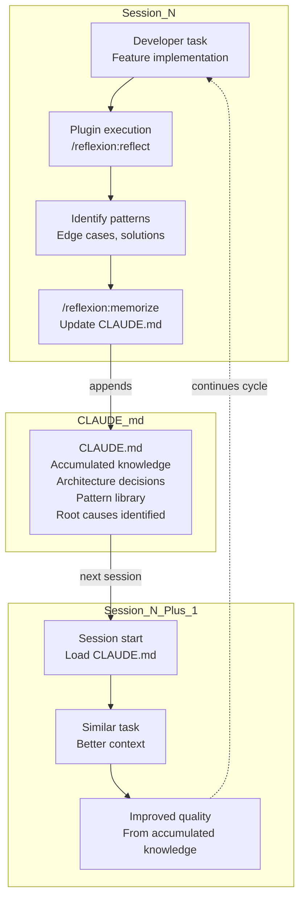

<!-- source: DeepWiki mcp.deepwiki.com · repo NeoLabHQ/context-engineering-kit · page 1 Overview · fetched 2026-10-26 -->

# Overview

<details>
<summary>Relevant source files</summary>

The following files were used as context for generating this wiki page:

- [.claude-plugin/marketplace.json](.claude-plugin/marketplace.json)
- [README.md](README.md)
- [docs/SUMMARY.md](docs/SUMMARY.md)
- [plugins/sadd/.claude-plugin/plugin.json](plugins/sadd/.claude-plugin/plugin.json)

</details>


The Context Engineering Kit (CEK) is a curated plugin marketplace for Claude Code and other AI agents that provides advanced context engineering techniques and patterns. The kit consists of 13 officially maintained plugins organized in the `.claude-plugin/marketplace.json` registry [[.claude-plugin/marketplace.json:1-155]](), designed to improve AI agent output quality while maintaining a minimal token footprint. Each plugin implements scientifically-proven techniques for specific development workflows, code quality improvements, and external integrations [[README.md:19-31]]().

This page provides a high-level architectural overview of the plugin system, marketplace structure, and configuration management. For installation and initial setup instructions, see [Getting Started](#1.1). For detailed architectural principles, see [Architecture & Design Principles](#1.2). For comprehensive plugin documentation, see [Plugin Reference](#3).

**Sources:** [README.md:1-115](), [.claude-plugin/marketplace.json:1-155](), [docs/SUMMARY.md:1-112]()

## System Architecture

The Context Engineering Kit operates through a multi-tier architecture: the marketplace registry manages plugin metadata, installed plugins load their components (commands, skills, agents) into Claude Code's context, and a hierarchical configuration system persists project knowledge across sessions.

### High-Level Component Structure



**Sources:** [README.md:41-71](), [.claude-plugin/marketplace.json:1-155](), [docs/SUMMARY.md:103-108]()

### Marketplace Registry Structure

The marketplace is defined by `marketplace.json` which declares plugin metadata, versions, and source locations [[.claude-plugin/marketplace.json:1-155]](). Each plugin entry contains:

| Field | Description | Example |
|-------|-------------|---------|
| `name` | Unique plugin identifier | `"reflexion"` |
| `description` | Plugin purpose and techniques | `"Collection of commands that force LLM to reflect..."` |
| `version` | Semantic version | `"3.0.0"` |
| `source` | Path to plugin directory | `"./plugins/reflexion"` |
| `category` | `"productivity"` or `"development"` | `"productivity"` |
| `author` | Plugin maintainer information | `{"name": "...", "email": "..."}` |

**Sources:** [.claude-plugin/marketplace.json:10-154]()

### Plugin Installation and Loading

```mermaid
graph LR
    subgraph "Discovery"
        AddCmd["/plugin marketplace add<br/>NeoLabHQ/context-engineering-kit"]
        AddCmd -->|"downloads"| LocalCache["Local Plugin Cache<br/>marketplace.json"]
    end
    
    subgraph "Installation"
        InstallCmd["/plugin install<br/>reflexion@NeoLabHQ/..."]
        InstallCmd -->|"loads from"| LocalCache
        InstallCmd -->|"activates"| PluginComponents["Plugin Components"]
    end
    
    subgraph "Component_Types"
        PluginComponents --> Commands["Commands<br/>/reflexion:reflect<br/>On-demand loading"]
        PluginComponents --> Skills["Skills<br/>TDD best practices<br/>Pre-loaded context"]
        PluginComponents --> Agents["Specialized Agents<br/>sdd-developer<br/>security-auditor"]
    end
    
    subgraph "Execution"
        Commands -->|"user invokes"| Execution["Command Execution"]
        Skills -->|"informs"| Execution
        Agents -->|"spawned during"| Execution
        Execution -->|"may update"| CLAUDEMD["CLAUDE.md<br/>Knowledge Base"]
    end
```

**Sources:** [README.md:41-62](), [docs/SUMMARY.md:4-16](), [.claude-plugin/marketplace.json:1-155]()

## Plugin Categories

The marketplace organizes plugins into two categories based on their primary function in `marketplace.json` [[.claude-plugin/marketplace.json:10-154]]():

### Productivity Category (5 plugins)

| Plugin | Primary Function | Key Commands |
|--------|------------------|--------------|
| `reflexion` | Self-refinement and critique | `/reflexion:reflect`, `/reflexion:memorize` |
| `review` | Multi-agent code quality analysis | `/review:review-local-changes`, `/review:review-pr` |
| `git` | Git operations and PR management | `/git:commit`, `/git:create-pr`, `/git:analyze-issue` |
| `kaizen` | Root cause analysis and Lean practices | `/kaizen:why`, `/kaizen:analyse-problem` |
| `docs` | Documentation management | `/docs:update-docs` |

**Sources:** [.claude-plugin/marketplace.json:11-120](), [README.md:23-31]()

### Development Category (8 plugins)

| Plugin | Primary Function | Key Commands |
|--------|------------------|--------------|
| `tdd` | Test-driven development | `/tdd:write-tests`, `/tdd:fix-tests` |
| `sadd` | Subagent orchestration | `do-and-judge`, `tree-of-thoughts` |
| `ddd` | Domain-driven design patterns | Updates `CLAUDE.md` with SOLID/Clean Arch rules |
| `sdd` | Specification-driven workflow | `/sdd:00-setup` through `/sdd:05-document` |
| `customaize-agent` | Plugin development toolkit | `/customaize-agent:create-command`, `/customaize-agent:test-skill` |
| `tech-stack` | Language/framework best practices | `/tech-stack:add-typescript-best-practices` |
| `mcp` | MCP server integration | `/mcp:setup-context7-mcp`, `/mcp:setup-serena-mcp` |
| `fpf` | First Principles Framework reasoning | `/fpf:propose-hypotheses` |

**Sources:** [.claude-plugin/marketplace.json:44-153](), [README.md:36-40]()

## Configuration Hierarchy

The Context Engineering Kit uses a three-tier `CLAUDE.md` configuration system to manage context at different scopes. This hierarchy allows teams to share project-level knowledge while enabling individual customization.

### Three Configuration Tiers



| Configuration Level | File Path | Git Tracked | Scope | Use Case |
|---------------------|-----------|-------------|-------|----------|
| Project Shared | `./CLAUDE.md` | Yes | Team-wide | Shared standards, MCP configs, architecture decisions |
| Project Personal | `./CLAUDE.local.md` | No | Individual | Personal preferences, local overrides, API keys |
| User Global | `~/.claude/CLAUDE.md` | No | Cross-project | Personal defaults, coding style, preferred tools |

**Sources:** [README.md:96-99](), [.claude-plugin/marketplace.json:67-76](), [docs/SUMMARY.md:103-104]()

## Token Efficiency Principles

The Context Engineering Kit is architected to minimize token usage while maximizing context quality through several design patterns [[README.md:19-29]]().

### Commands vs Skills Trade-off



**Design Rationale:**
- **Commands** load context only when invoked, keeping baseline token count low [[README.md:26]]().
- **Skills** are pre-loaded and influence all operations, reserved for frequently-used patterns [[README.md:25-28]]().
- **Specialized Agents** spawn with focused context rather than loading all capabilities upfront [[.claude-plugin/marketplace.json:78-80]]().

**Sources:** [README.md:26](), [.claude-plugin/marketplace.json:1-155]()

## Knowledge Accumulation Loop

The Context Engineering Kit implements a feedback loop where plugins update `CLAUDE.md` files with learned patterns, creating continuously improving context over time [[README.md:96-99]]().



**Key Knowledge-Writing Plugins:**
- `/reflexion:memorize` - Captures insights from self-refinement cycles [[README.md:98]]().
- `/kaizen:*` - Documents root causes and improvement patterns [[.claude-plugin/marketplace.json:89-98]]().
- `/tech-stack:add-*` - Records language-specific best practices [[.claude-plugin/marketplace.json:122-131]]().
- `/mcp:setup-*` - Configures external tool integrations [[.claude-plugin/marketplace.json:133-142]]().
- `/ddd:setup-*` - Establishes architectural constraints and rules [[.claude-plugin/marketplace.json:67-76]]().

**Sources:** [README.md:96-107](), [.claude-plugin/marketplace.json:1-155]()

## Next Steps

To begin using the Context Engineering Kit:

1. **Installation:** Follow the [Getting Started](#1.1) guide to add the marketplace and install your first plugins [[README.md:41-62]]().
2. **Architecture Understanding:** Review [Architecture & Design Principles](#1.2) for deeper understanding of plugin design patterns and the three-tier config system.
3. **Plugin Selection:** Browse the [Plugin Reference](#3) to identify plugins for your specific workflow (e.g., SDD for complex features, Kaizen for bug investigation).
4. **Workflow Integration:** Consult [Development Guides](#5) for complete workflow examples combining multiple plugins [[docs/SUMMARY.md:5-16]]().

**Sources:** [README.md:111-115](), [docs/SUMMARY.md:1-112]()

---

