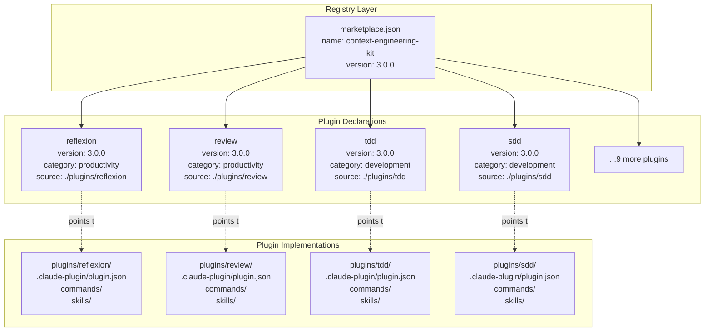
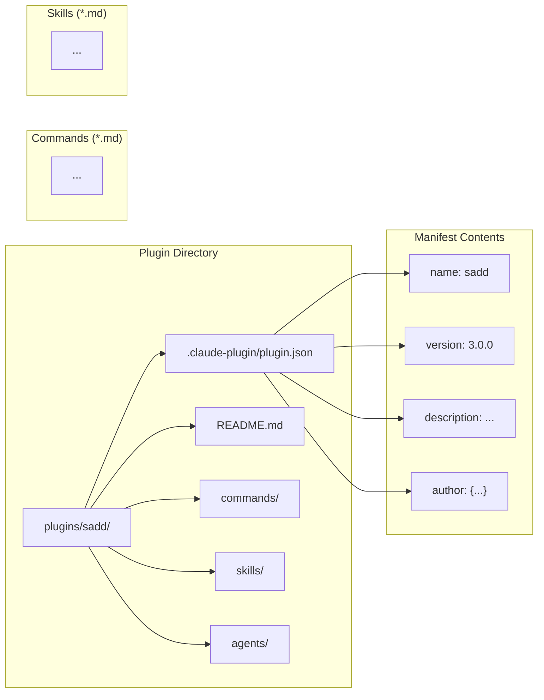
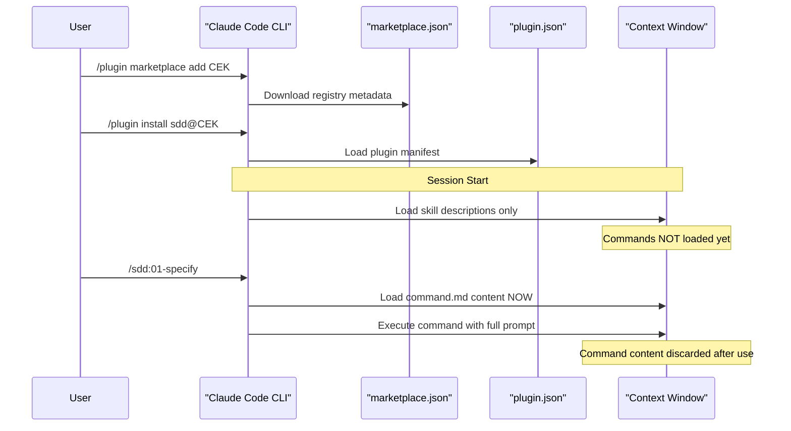
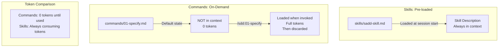
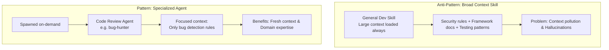

<!-- source: DeepWiki mcp.deepwiki.com · repo NeoLabHQ/context-engineering-kit · page 1.2 Architecture & Design Principles · fetched 2026-10-26 -->

# Architecture & Design Principles

Relevant source files

The following files were used as context for generating this wiki page:

- [.claude-plugin/marketplace.json](.claude-plugin/marketplace.json)
- [.claude/commands/bump-plugin.md](.claude/commands/bump-plugin.md)
- [.devcontainer/Dockerfile](.devcontainer/Dockerfile)
- [.devcontainer/configure-claude.sh](.devcontainer/configure-claude.sh)
- [.devcontainer/devcontainer.json](.devcontainer/devcontainer.json)
- [.devcontainer/install-mcps.sh](.devcontainer/install-mcps.sh)
- [.devcontainer/statusline.sh](.devcontainer/statusline.sh)
- [docs/concepts.md](docs/concepts.md)
- [docs/plugins/README.md](docs/plugins/README.md)
- [docs/plugins/ddd/README.md](docs/plugins/ddd/README.md)
- [docs/plugins/ddd/usage-examples.md](docs/plugins/ddd/usage-examples.md)
- [justfile](justfile)
- [plugins/ddd/README.md](plugins/ddd/README.md)
- [plugins/sadd/.claude-plugin/plugin.json](plugins/sadd/.claude-plugin/plugin.json)

This document explains the architectural design of the Context Engineering Kit and the core principles that guide plugin development. It covers the plugin system structure, token efficiency strategies, and the context management hierarchy.

## Core Architecture

### Plugin Registry System

The Context Engineering Kit uses a marketplace-based architecture where all plugins are registered in a central manifest file at [.claude-plugin/marketplace.json:1-155](). This file serves as the single source of truth for plugin discovery and metadata.

**Marketplace Structure**

The marketplace manifest defines:
- **Registry metadata**: Name, version, description, owner ([.claude-plugin/marketplace.json:2-9]())
- **Plugin entries**: Each plugin declaration includes name, description, version, author, source path, and category ([.claude-plugin/marketplace.json:11-153]())
- **Two categories**: `productivity` (reflexion, review, git, kaizen, docs) and `development` (tdd, sadd, ddd, sdd, customaize-agent, tech-stack, mcp, fpf) ([.claude-plugin/marketplace.json:20,31,42,53,64,75,86,97,108,119,130,141,152]())

**Sources**: [.claude-plugin/marketplace.json:1-155]()

### Plugin Structure

Each plugin follows a standardized directory structure that separates metadata, commands, and skills:

**Required Files**:
- `.claude-plugin/plugin.json`: Plugin manifest with metadata ([plugins/sadd/.claude-plugin/plugin.json:1-9]())
- `README.md`: Usage documentation and examples ([docs/plugins/README.md:5-7]())

**Optional Directories**:
- `commands/`: Markdown files defining slash commands that load on-demand ([docs/concepts.md:12-21]())
- `skills/`: Markdown files defining skills whose descriptions load automatically ([docs/concepts.md:50-62]())
- `agents/`: Markdown files defining specialized agent personas ([docs/concepts.md:79-91]())

**Sources**: [plugins/sadd/.claude-plugin/plugin.json:1-9](), [docs/concepts.md:12-91](), [docs/plugins/README.md:5-7]()

### Loading Mechanism

The system uses a selective loading strategy to minimize token usage, distinguishing between immediate skill availability and on-demand command execution ([docs/concepts.md:68-77]()).

**Loading Strategy**:
1. **Plugin Installation**: Downloads plugin metadata from marketplace ([.claude-plugin/marketplace.json:1-155]())
2. **Session Start**: Loads only skill descriptions into context to save tokens ([docs/concepts.md:72-76]())
3. **Command Invocation**: Loads full command content on-demand ([docs/concepts.md:72-76]())
4. **Command Completion**: Command content is not persisted in the long-term context window.

**Sources**: [docs/concepts.md:68-77](), [.claude-plugin/marketplace.json:1-155]()

## Token Efficiency Principles

The architecture prioritizes a minimal token footprint through specialized design patterns ([docs/concepts.md:5-11]()).

### Commands Over Skills

Commands load on-demand while skill descriptions load automatically, making commands the preferred choice for most functionality to preserve the context window ([docs/concepts.md:68-77]()).

**Decision Matrix**:

| Use Case | Pattern | Rationale |
|----------|---------|-----------|
| User-invoked actions | Commands | Zero tokens until needed ([docs/concepts.md:20]()) |
| Agent-initiated workflows | Skills | Agent needs to know capability exists ([docs/concepts.md:52-53]()) |
| Persistent behavioral guidelines | Rules (`.claude/rules/`) | Codifies behavior without manual invocation ([docs/plugins/ddd/README.md:3-14]()) |
| Complex reasoning | Specialized agents | Isolated context reduces hallucinations ([docs/concepts.md:103-109]()) |

**Sources**: [docs/concepts.md:12-109](), [docs/plugins/ddd/README.md:3-14]()

### Specialized Agents Pattern

Instead of loading broad context as skills, the system uses specialized agents with focused context to reduce hallucinations ([docs/concepts.md:79-91]()).

**Agent Architecture**:
- **Domain Focus**: Agents are defined for specific areas like `bug-hunter` or `security-auditor` ([docs/plugins/README.md:63]()).
- **Isolation**: Each agent starts with a clean, task-specific context ([docs/concepts.md:104]()).
- **Orchestration**: Workflow commands (like `/sdd:plan-task`) orchestrate multiple sub-agents automatically ([docs/concepts.md:121-123, 136-146]()).

**Sources**: [docs/concepts.md:79-146](), [docs/plugins/README.md:57-69]()

## Configuration Hierarchy

The system relies on a three-tier configuration approach to manage project standards and AI behavior.

### The Three-Tier System
1. **Project Shared (`CLAUDE.md`)**: Team standards, architecture rules, and MCP setup.
2. **Project Personal (`CLAUDE.local.md`)**: Local overrides or personal environment variables.
3. **User Global (`~/.claude/settings.json`)**: Cross-project defaults like auto-permissions and session hooks ([.devcontainer/configure-claude.sh:15-42]()).

### Persistent Context via CLAUDE.md
Plugins like **DDD** and **Tech Stack** update `CLAUDE.md` to provide persistent context without consuming skill slots:
- **DDD**: Embeds Clean Architecture and SOLID principles as persistent rules ([docs/plugins/ddd/README.md:3-10]()).
- **Tech Stack**: Adds language-specific best practices (e.g., TypeScript) to the project root ([.claude-plugin/marketplace.json:122-131]()).
- **MCP**: Configures required Model Context Protocol servers like `context7` ([.devcontainer/install-mcps.sh:4-5]()).

**Sources**: [.devcontainer/configure-claude.sh:15-42](), [docs/plugins/ddd/README.md:3-10](), [.claude-plugin/marketplace.json:122-131](), [.devcontainer/install-mcps.sh:1-13]()

## Development Workflow & Tooling

The project uses a `justfile` and a pre-configured `devcontainer` to standardize the development environment.

### Justfile Workflow
The `justfile` automates plugin management and synchronization ([justfile:1-75]()).

| Command | Purpose |
|---------|---------|
| `just list-plugins` | Lists all available plugins and their versions ([justfile:67-74]()) |
| `just sync-docs-to-plugins` | Syncs READMEs from `docs/plugins/` to plugin folders ([justfile:11-20]()) |
| `just sync-plugins-to-docs` | Syncs READMEs from plugin folders back to documentation ([justfile:24-34]()) |
| `just set-version 
 <v>` | Updates version in both `plugin.json` and `marketplace.json` ([justfile:38-52]()) |
| `just bump-plugin <type>` | Automates versioning for changed plugins based on git status ([.claude/commands/bump-plugin.md:1-40]()) |

### Sandbox Environment
The `.devcontainer` provides a ready-to-use "sandbox" for plugin development and testing:
- **Pre-installed Tools**: Includes `gh` CLI, `go`, `codemap`, and `claude` ([.devcontainer/Dockerfile:61-89]()).
- **Auto-configuration**: Sets up `~/.claude/settings.json` with `auto` permission mode and `SessionStart` hooks for codebase analysis ([.devcontainer/configure-claude.sh:15-31]()).
- **MCP Setup**: Automatically adds the `context7` MCP server on creation ([.devcontainer/install-mcps.sh:4-5]()).

**Sources**: [justfile:1-196](), [.claude/commands/bump-plugin.md:1-40](), [.devcontainer/Dockerfile:1-121](), [.devcontainer/configure-claude.sh:1-92](), [.devcontainer/install-mcps.sh:1-13]()

---

