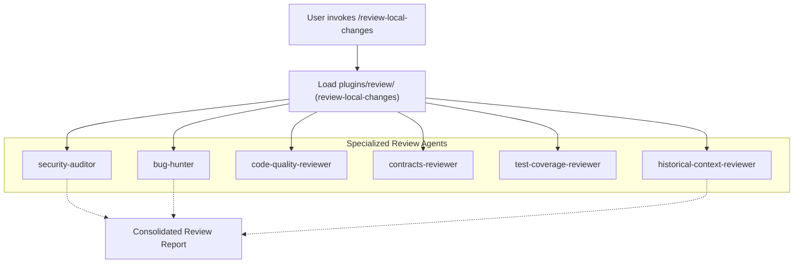
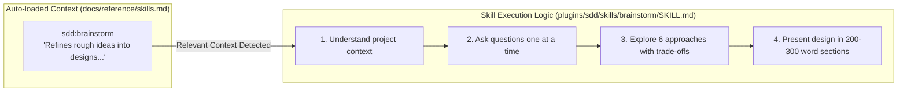
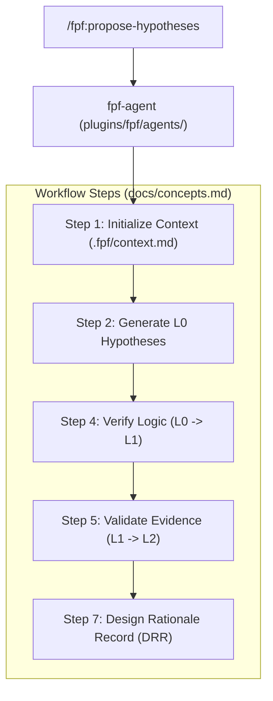

<!-- source: DeepWiki mcp.deepwiki.com · repo NeoLabHQ/context-engineering-kit · page 2.3 Commands, Skills, and Agents · fetched 2026-10-26 -->

# Commands, Skills, and Agents

Relevant source files

The following files were used as context for generating this wiki page:

- [.claude/commands/bump-plugin.md](.claude/commands/bump-plugin.md)
- [docs/concepts.md](docs/concepts.md)
- [docs/plugins/README.md](docs/plugins/README.md)
- [docs/plugins/ddd/README.md](docs/plugins/ddd/README.md)
- [docs/plugins/ddd/rules.md](docs/plugins/ddd/rules.md)
- [docs/plugins/ddd/usage-examples.md](docs/plugins/ddd/usage-examples.md)
- [docs/plugins/git/README.md](docs/plugins/git/README.md)
- [docs/plugins/git/git-worktrees.md](docs/plugins/git/git-worktrees.md)
- [docs/reference/commands.md](docs/reference/commands.md)
- [docs/reference/skills.md](docs/reference/skills.md)
- [plugins/ddd/README.md](plugins/ddd/README.md)
- [plugins/git/README.md](plugins/git/README.md)
- [plugins/sdd/skills/brainstorm/SKILL.md](plugins/sdd/skills/brainstorm/SKILL.md)

## Purpose and Scope

This page explains the three mechanisms for loading context into Claude Code: **commands**, **skills**, and **specialized agents**. Each mechanism has distinct token efficiency characteristics and use cases. Understanding when to use each type is critical for building plugins that enhance agent capabilities without causing context pollution or degrading performance.

The Context Engineering Kit focuses on minimal token footprints while maximizing result quality [docs/concepts.md:5-10]().

---

## Overview: Three Context Loading Mechanisms

The Context Engineering Kit provides three ways to make functionality available to Claude Code, each with different token footprints and loading behaviors:

| Mechanism | Token Cost | When Loaded | Best For |
|-----------|-----------|-------------|----------|
| **Commands** | ~500-2000 tokens | On-demand when invoked | Complex operations, multi-step workflows |
| **Skills** | ~200-800 tokens | Every conversation start | Continuous guidance, persistent principles |
| **Agents** | Variable (fresh context) | Spawned for specific tasks | Specialized analysis, parallel work |

**Key Principle**: Commands over skills, specialized agents over commands. Use the most token-efficient approach that solves the problem [docs/concepts.md:70-76]().

Sources: [docs/concepts.md:12-109](), [docs/reference/commands.md:1-122](), [docs/reference/skills.md:1-46]()

---

## Commands: On-Demand Context Loading

Commands are explicit actions invoked manually via the `/plugin-name:command-name` syntax [docs/concepts.md:13-15](). They load their full instructions only when triggered, making them the most token-efficient method for operations used occasionally [docs/concepts.md:20-21]().

### Command Structure

Commands are defined in the plugin manifest and stored as markdown files. When invoked, the prompt within the command file is loaded into the LLM's context [docs/concepts.md:14-15](). The complete index of these commands is maintained in `docs/reference/commands.md`.

### Command Use Cases

Commands are ideal for:

1. **Multi-step workflows**: The SDD plugin uses commands to guide phases from `/brainstorm` to `/implement-task` [docs/reference/commands.md:36-39]().
2. **Problem Analysis**: The Kaizen plugin provides commands for root cause analysis like `/why` and `/cause-and-effect` [docs/reference/commands.md:47-49]().
3. **Git Operations**: Standardizing workflows via `/commit` and `/create-pr` [plugins/git/README.md:25-29]().
4. **Customization**: Creating new extensions via `/create-agent` or `/create-skill` [docs/reference/commands.md:56-59]().

### Example: Code Review Command

The `review` plugin triggers a multi-agent review process via command [docs/reference/commands.md:16-21]().

**Natural Language to Code Entity Space: Code Review Workflow**

Sources: [docs/reference/commands.md:16-21](), [docs/plugins/README.md:57-69]()

---

## Skills: Persistent Context

Skills are automatically applied knowledge that influences Claude's behavior without explicit invocation [docs/concepts.md:51-53](). They provide best practices, methodologies, and "gate functions" that check actions before they are taken [docs/concepts.md:56-62]().

### Skill Principles

Skills are markdown documents loaded into context. While they can be invoked manually (e.g., "load TDD skill"), they are typically intended to be active continuously during a session [docs/concepts.md:56-67]().

**Writing skills follows a Red-Green-Refactor cycle** [docs/reference/commands.md:61-62]():
- **Red Phase**: Verify the agent fails a specific requirement without the skill.
- **Green Phase**: Verify the agent succeeds once the skill is added to context.

### Skill Use Cases

Skills are ideal for:

1. **Architecture Rules**: The DDD plugin's `rules` skill provides 14-15 composable guidelines for Clean Architecture and SOLID [docs/reference/skills.md:20-24]().
2. **Parallel Development**: The Git plugin's `worktrees` skill for managing multiple branches [docs/reference/skills.md:36-37]().
3. **Prompt Engineering**: The `prompt-engineering` skill in the Customaize Agent plugin for applying Anthropic best practices [docs/reference/skills.md:43-44]().

### Example: SDD Brainstorming Skill

The `sdd` plugin uses the `brainstorm` skill to guide the refinement of rough ideas into designs [plugins/sdd/skills/brainstorm/SKILL.md:1-5]().

Sources: [docs/reference/skills.md:1-46](), [plugins/sdd/skills/brainstorm/SKILL.md:1-63](), [docs/concepts.md:51-76]()

---

## Specialized Agents: Fresh Context for Complex Tasks

Agents are specialized sub-instances launched with focused prompts and domain-specific knowledge [docs/concepts.md:81-83](). They solve the "attention scarcity" problem by partitioning complex work into isolated context windows [docs/concepts.md:8-10]().

### Why Specialized Agents?

1. **Context Isolation**: Each agent starts with a clean context, preventing the "lost-in-the-middle" phenomenon [docs/concepts.md:104-105]().
2. **Specialized Expertise**: Agents focus on one domain (e.g., business analyst, software architect) [docs/concepts.md:87-90]().
3. **Parallel Execution**: Multiple agents can work simultaneously, such as in the `/review-local-changes` workflow [docs/concepts.md:107-116]().

### Example: FPF Workflow Orchestration

The First Principles Framework (FPF) uses a workflow command to orchestrate a specialized `fpf-agent` through multiple reasoning steps [docs/concepts.md:148-175]().

**Natural Language to Code Entity Space: FPF Agent Workflow**

Sources: [docs/concepts.md:79-133](), [docs/concepts.md:148-175](), [docs/reference/commands.md:113-115]()

---

## Token Efficiency Trade-offs

Effective context engineering requires finding the smallest set of high-signal tokens to maximize performance [docs/concepts.md:7-10]().

### Performance Strategies

| Strategy | Implementation | Benefit |
|--------|----------|--------|
| **Commands over Skills** | Use `/plugin:command` instead of persistent skills. | Zero context cost until invoked [docs/concepts.md:72-76](). |
| **Progressive Disclosure** | Load only the necessary metadata until the full skill is required. | Preserves attention budget for the current task [docs/concepts.md:7-10](). |
| **Subagent Delegation** | Use `launch-sub-agent` or workflow commands. | Fresh context prevents reasoning degradation from long histories [docs/concepts.md:104-105](). |

**Key Takeaway**: Large context windows are constrained by attention mechanics, not raw capacity. Use **Specialized Agents** to isolate complex reasoning and **Commands** to keep the main session context clean [docs/concepts.md:8-10]().

Sources: [docs/concepts.md:5-10](), [docs/concepts.md:68-76](), [docs/concepts.md:103-109]()

---

