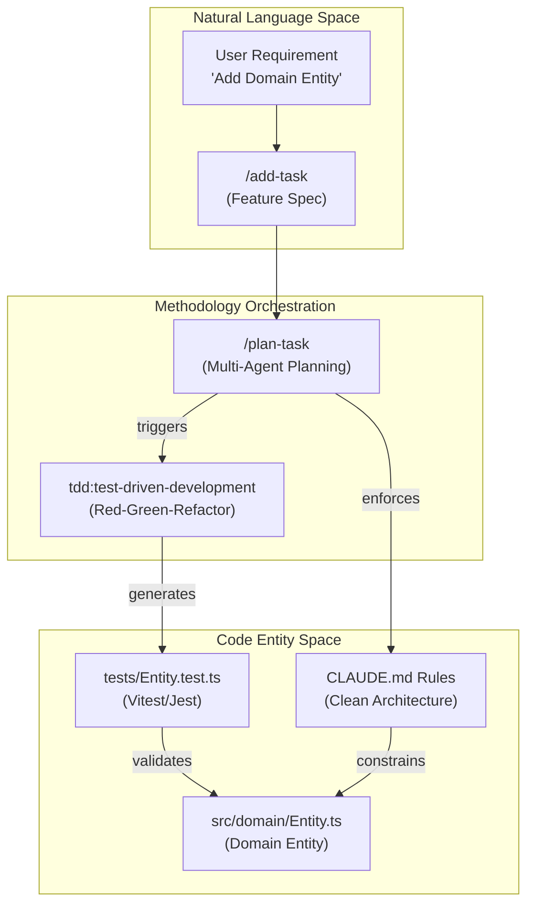
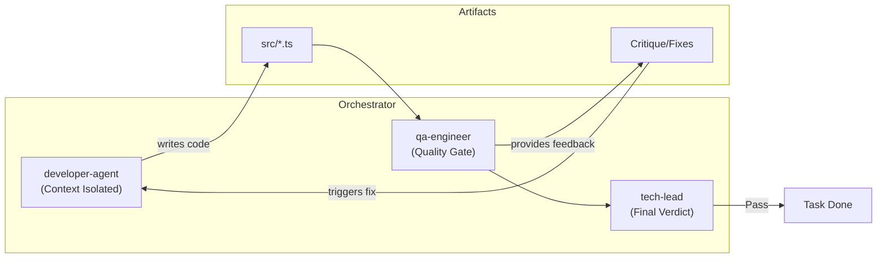

<!-- source: DeepWiki mcp.deepwiki.com · repo NeoLabHQ/context-engineering-kit · page 3.2 Development Workflow Plugins · fetched 2026-10-26 -->

# Development Workflow Plugins

Relevant source files

The following files were used as context for generating this wiki page:

- [docs/plugins/customaize-agent/README.md](docs/plugins/customaize-agent/README.md)
- [plugins/customaize-agent/README.md](plugins/customaize-agent/README.md)
- [plugins/docs/README.md](plugins/docs/README.md)
- [plugins/kaizen/README.md](plugins/kaizen/README.md)
- [plugins/sdd/README.md](plugins/sdd/README.md)
- [plugins/tdd/README.md](plugins/tdd/README.md)

Development Workflow Plugins implement structured software development methodologies that guide the complete lifecycle from requirements to implementation. These plugins provide systematic approaches to building features with quality gates, testing discipline, and architectural consistency.

This page provides an overview of the core development workflow plugins: **Test-Driven Development (TDD)**, **Spec-Driven Development (SDD)**, **Subagent-Driven Development (SADD)**, and **Domain-Driven Development (DDD)**. For detailed documentation of individual plugins, see [TDD Plugin](#3.2.1), [SDD Plugin](#3.2.2), [SADD Plugin](#3.2.3), and [DDD Plugin](#3.2.4).

---

## Plugin Capabilities Overview

Each development workflow plugin serves a distinct role in the software development process, categorized by their primary focus on methodology or architectural standards.

| Plugin | Category | Primary Purpose | Key Mechanism |
|--------|----------|-----------------|---------------|
| **TDD** | development | Test coverage and verification | `/tdd:write-tests`, `/tdd:fix-tests` with Red-Green-Refactor |
| **SDD** | development | Spec-driven feature development | `/add-task`, `/plan-task`, `/implement-task` |
| **SADD** | development | Quality gates via subagents | `do-and-judge`, `do-in-parallel`, `tree-of-thoughts` |
| **DDD** | development | Architecture and design standards | `/ddd:setup-code-formating` + 14 composable rules |

**Sources:** [plugins/sdd/README.md:15-106](), [plugins/tdd/README.md:1-23](), [plugins/customaize-agent/README.md:50-57]()

---

## Methodology Characteristics

### Test-Driven Development (TDD)
The TDD plugin introduces commands and skills for test-first development, focusing on the Red-Green-Refactor cycle and anti-pattern detection. It integrates with the SDD developer agent's mandate to ensure implementation quality. For details, see [TDD Plugin](#3.2.1).

**Key Features:**
- **Commands**: `/write-tests` [plugins/tdd/README.md:54](), `/fix-tests` [plugins/tdd/README.md:55]().
- **Skills**: `test-driven-development` skill for methodology and anti-pattern detection [plugins/tdd/README.md:59]().
- **Orchestration**: Uses specialized review and development agents for systematic coverage [plugins/tdd/README.md:54]().

**Sources:** [plugins/tdd/README.md:1-69]()

### Spec-Driven Development (SDD)
SDD implements a comprehensive workflow that treats development as compilation. It utilizes a 6-phase planning pipeline with specialized agents (Researcher, Architect, QA Engineer) to manage context effectively. For details, see [SDD Plugin](#3.2.2).

**The Task Lifecycle:**
1. **Draft**: Initial prompt created via `/add-task` [plugins/sdd/README.md:57]().
2. **Todo**: Refined specification and skills generated via `/plan-task` [plugins/sdd/README.md:58]().
3. **In-Progress**: Active implementation via `/implement-task` [plugins/sdd/README.md:74]().
4. **Done**: Verified working code [plugins/sdd/README.md:74]().

**Sources:** [plugins/sdd/README.md:1-108]()

### Subagent-Driven Development (SADD)
SADD focuses on task delegation to "fresh" subagents to prevent context rot. It provides advanced orchestration patterns and quality gates where a "Judge" agent reviews work before completion. For details, see [SADD Plugin](#3.2.3).

**Orchestration Skills:**
- `do-and-judge`: Basic execution and verification.
- `do-in-parallel` / `do-in-steps`: Multi-task management.
- `do-competitively`: Generating multiple solutions to find the best one.
- `tree-of-thoughts`: Exploring complex reasoning paths.
- `judge-with-debate`: Multi-agent evaluation.

**Sources:** [docs/plugins/customaize-agent/README.md:52-64]()

### Domain-Driven Development (DDD)
DDD provides the architectural foundation for a project. It updates `CLAUDE.md` with best practices for Clean Architecture, SOLID principles, and tactical design patterns through 14 specialized rules files. For details, see [DDD Plugin](#3.2.4).

**Rules Categories:**
- **Architecture**: Clean Architecture & DDD, Functional Core / Imperative Shell.
- **Function Design**: Command-Query Separation, Call-Site Honesty.
- **Explicitness**: Explicit Control Flow, Data Flow, and Side Effects.
- **Code Quality**: Error Handling, Domain-Specific Naming, Library-First Approach.

**Sources:** [plugins/sdd/README.md:14-15]()

---

## Plugin Interconnections

The following diagram illustrates how these methodologies bridge high-level requirements in the "Natural Language Space" to specific code structures in the "Code Entity Space".

### From Spec to Code: Methodology Bridge
Title: "Natural Language to Code Entity Mapping"

**Sources:** [plugins/sdd/README.md:53-77](), [plugins/tdd/README.md:1-11]()

---

## Workflow Decision Matrix

Choose the appropriate plugin(s) based on the complexity and stage of development:

| Scenario | Recommended Plugins | Key Commands/Skills |
|----------|-------------------|---------------------|
| **Initializing Project Standards** | DDD | `/ddd:setup-code-formating` |
| **Complex Feature Lifecycle** | SDD + TDD | `/plan-task`, `/implement-task` |
| **Task Delegation & Testing** | Customaize Agent | `/customaize-agent:test-prompt` |
| **Bug Fixing with Discipline** | TDD + Kaizen | `/fix-tests`, `/why` |

**Sources:** [plugins/sdd/README.md:15-47](), [plugins/kaizen/README.md:23-46](), [plugins/tdd/README.md:33-37]()

---

## Subagent Orchestration Detail

The orchestration system implements a rigorous loop to ensure code quality through isolated execution environments and judge-based quality gates.

### SDD/SADD Implementation Loop
Title: "Developer Agent Execution and Quality Gate"

**Sources:** [plugins/sdd/README.md:94-106](), [docs/plugins/customaize-agent/README.md:52-56]()

---

## Summary

Development workflow plugins provide systematic methodologies for software development:

- **TDD** enforces test-first discipline with the Red-Green-Refactor cycle.
- **SDD** provides a 6-phase specification-driven workflow with specialized agents.
- **SADD** (via Customaize Agent) orchestrates subagents with quality gates between tasks.
- **DDD** establishes architectural patterns and design standards via 14 composable rules.

For details on specific plugins, navigate to their respective child pages:
- [TDD Plugin](#3.2.1)
- [SDD Plugin](#3.2.2)
- [SADD Plugin](#3.2.3)
- [DDD Plugin](#3.2.4)

**Sources:** [plugins/sdd/README.md:1-15](), [plugins/tdd/README.md:1-11](), [plugins/kaizen/README.md:1-10]()

---

