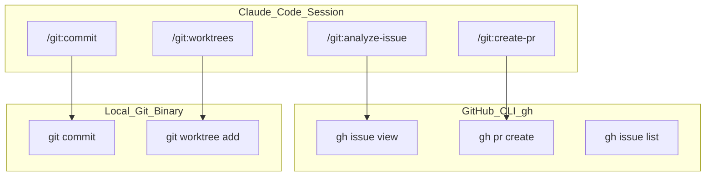
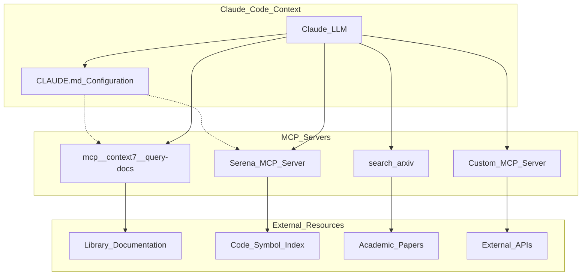

<!-- source: DeepWiki mcp.deepwiki.com · repo NeoLabHQ/context-engineering-kit · page 3.3 Integration Plugins · fetched 2026-10-26 -->

# Integration Plugins

Relevant source files

The following files were used as context for generating this wiki page:

- [CLAUDE.md](CLAUDE.md)
- [docs/plugins/git/README.md](docs/plugins/git/README.md)
- [docs/plugins/git/git-worktrees.md](docs/plugins/git/git-worktrees.md)
- [docs/plugins/mcp/README.md](docs/plugins/mcp/README.md)
- [docs/reference/commands.md](docs/reference/commands.md)
- [plugins/git/README.md](plugins/git/README.md)
- [plugins/mcp/README.md](plugins/mcp/README.md)
- [plugins/sdd/skills/brainstorm/SKILL.md](plugins/sdd/skills/brainstorm/SKILL.md)

**Purpose and Scope**: This page documents plugins that integrate Claude Code with external systems and services. Integration plugins extend Claude's capabilities by connecting to Git/GitHub for version control operations and Model Context Protocol (MCP) servers for accessing external tools, databases, and APIs.

For detailed documentation on specific integration plugins, see:
- [Git Plugin](#3.3.1) — Git operations: `/git:commit` with conventional commits, `/git:create-pr`, `/git:analyze-issue`, `/git:load-issues`, worktree management (create-worktree, compare-worktrees, merge-worktree), git notes, and attach-review-to-pr.
- [MCP Plugin Overview](#3.3.2) — Introduction to Model Context Protocol integration: what MCP servers are, the 5 setup commands, and custom server development.

## Overview of Integration Plugins

Integration plugins focus on bridging Claude Code with external systems rather than just implementing internal development methodologies. They act as connectors that enable Claude to:

- Perform operations in external systems (commits, PR creation, API calls).
- Access external data sources (documentation, code analysis, academic papers).
- Leverage specialized external tools (semantic code search, codebase visualization).
- Maintain context across different development environments.

The Context Engineering Kit includes two primary integration plugins:

| Plugin | External System | Primary Purpose | Key Dependencies |
|--------|----------------|-----------------|------------------|
| **Git** | Git, GitHub | Version control operations, PR management, issue analysis | `git`, `gh` (GitHub CLI) [plugins/git/README.md:14-17]() |
| **MCP** | MCP Servers | Connect to external tools via Model Context Protocol | MCP servers (Context7, Serena, etc.) [docs/plugins/mcp/README.md:11-19]() |

### Common Characteristics

**External Dependencies**: Unlike self-contained plugins, integration plugins often require external tools to be installed and configured [plugins/git/README.md:14-17]().

**Configuration Management**: Both plugins update configuration at three levels: **Project-shared** (`./CLAUDE.md`), **Project-personal** (`./CLAUDE.local.md`), and **User-global** (`~/.claude/CLAUDE.md`) [docs/plugins/mcp/README.md:21-27]().

Sources: [CLAUDE.md:29-31](), [plugins/git/README.md:1-17](), [docs/plugins/mcp/README.md:1-27]()

## Git Plugin: Version Control Integration

The Git plugin provides standardized Git operations with GitHub integration, automating common version control workflows and enforcing commit message conventions [plugins/git/README.md:12-14]().

### Core Commands

The plugin exposes several primary commands for workflow automation [docs/reference/commands.md:23-31]():

| Command | Purpose |
|---------|---------|
| `/git:commit` | Create well-formatted commits with conventional commit messages and emoji. |
| `/git:create-pr` | Create pull requests using GitHub CLI with proper templates and formatting. |
| `/git:analyze-issue` | Analyze a GitHub issue and create a detailed technical specification. |
| `/git:load-issues` | Load all open issues from GitHub and save them as markdown files. |
| `/git:worktrees` | Create, compare, and merge git worktrees for parallel development [docs/plugins/git/git-worktrees.md:36-43](). |
| `/git:attach-review-to-pr` | Add line-specific review comments to PRs via GitHub CLI API [plugins/git/README.md:49-49](). |

### GitHub Workflow Integration

**Git Plugin System Integration**

The diagram shows how Git plugin commands bridge Claude Code to the `gh` CLI and local `git` binary to perform version control operations [plugins/git/README.md:15-17]().

Sources: [plugins/git/README.md:1-58](), [docs/plugins/git/git-worktrees.md:1-150](), [docs/reference/commands.md:23-31]()

## MCP Plugin: Protocol-Based Tool Integration

The MCP (Model Context Protocol) plugin enables integration with external services through a standardized protocol, providing access to documentation, code analysis, and visualization [docs/plugins/mcp/README.md:11-13]().

### Five Setup Commands

The MCP plugin provides setup commands for well-known MCP servers [docs/plugins/mcp/README.md:13-19]():

1.  **Context7 MCP Setup** (`/mcp:setup-context7-mcp`): Access up-to-date documentation for any library or framework [CLAUDE.md:93-111]().
2.  **Serena MCP Setup** (`/mcp:setup-serena-mcp`): Enable semantic code analysis and symbol-based operations.
3.  **Codemap CLI Setup** (`/mcp:setup-codemap-cli`): Enable codebase visualization and navigation.
4.  **arXiv/Paper Search MCP Setup** (`/mcp:setup-arxiv-mcp`): Search and download academic papers [CLAUDE.md:113-138]().
5.  **Build MCP** (`/mcp:build-mcp`): Create custom MCP servers for any service or API.

### MCP Integration Architecture

**MCP Protocol Integration Flow**

The diagram illustrates how Claude uses configuration in `CLAUDE.md` to connect to various MCP servers, such as `mcp__context7__query-docs` [CLAUDE.md:110-110](), which in turn provide access to external documentation, symbols, and research data.

Sources: [docs/plugins/mcp/README.md:1-56](), [CLAUDE.md:93-138]()

## Configuration and Best Practices

### Multi-Level Configuration
Integration plugins prioritize project-specific rules in `CLAUDE.md` while allowing personal overrides in `CLAUDE.local.md` [docs/plugins/mcp/README.md:21-27](). This ensures that team members share the same tool configurations (like library IDs for Context7 [CLAUDE.md:97-106]()) while keeping personal API keys private.

### Workflow Synergy
Integration plugins are often used as the "entry" and "exit" points for other development workflows:
- **Entry**: `/git:analyze-issue` provides the context for Spec-Driven Development [plugins/git/README.md:37-39]().
- **Context Enhancement**: MCP setup commands provide real-time library data for implementation, such as using `mcp__context7__query-docs` for Claude Code CLI documentation [CLAUDE.md:99-99]().
- **Exit**: `/git:commit` and `/git:create-pr` conclude the development cycle [plugins/git/README.md:7-10]().

For details on specific integrations, see the child pages:
- [Git Plugin](#3.3.1)
- [MCP Plugin Overview](#3.3.2)

Sources: [plugins/git/README.md:1-58](), [docs/plugins/mcp/README.md:1-56](), [CLAUDE.md:93-111]()

---

