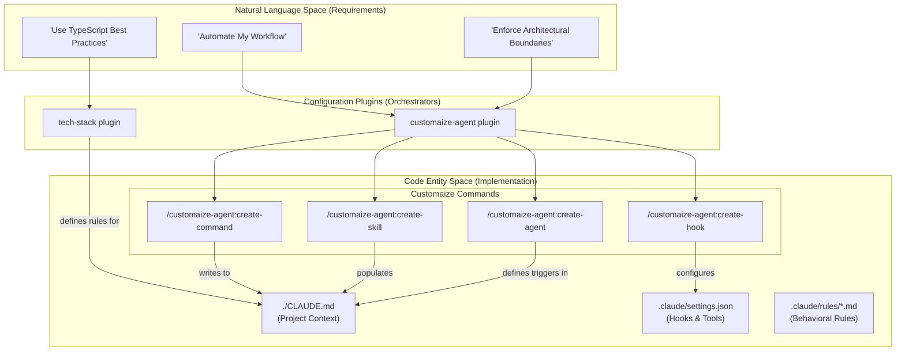
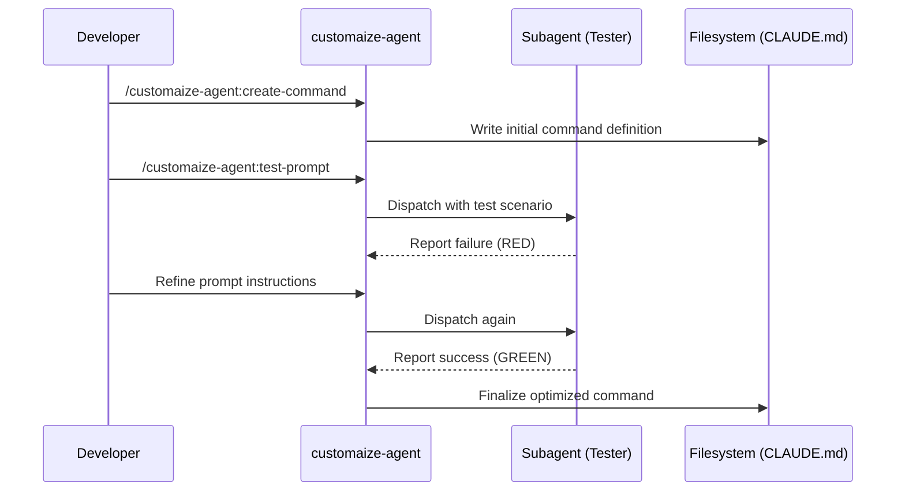

<!-- source: DeepWiki mcp.deepwiki.com · repo NeoLabHQ/context-engineering-kit · page 3.5 Configuration Plugins · fetched 2026-10-26 -->

# Configuration Plugins

Relevant source files

The following files were used as context for generating this wiki page:

- [docs/plugins/customaize-agent/README.md](docs/plugins/customaize-agent/README.md)
- [docs/plugins/tech-stack/README.md](docs/plugins/tech-stack/README.md)
- [docs/plugins/tech-stack/typescript-best-practices.md](docs/plugins/tech-stack/typescript-best-practices.md)
- [plugins/customaize-agent/README.md](plugins/customaize-agent/README.md)
- [plugins/sdd/README.md](plugins/sdd/README.md)
- [plugins/tech-stack/README.md](plugins/tech-stack/README.md)

Configuration plugins establish project-level standards and enable custom plugin development. Unlike productivity plugins that perform development tasks, configuration plugins **modify project configuration files** (like `CLAUDE.md`, `.claude/rules/`, or `.claude/settings.json`) to set persistent context that affects all future Claude Code sessions. [plugins/tech-stack/README.md:10-12](), [plugins/customaize-agent/README.md:1-10]()

This page documents the **Tech Stack** and **Customaize Agent** plugins.

---

## Overview

Configuration plugins serve two distinct purposes in the Context Engineering Kit:

1.  **Tech Stack Plugin**: Provides zero-configuration rules that are automatically loaded into the agent's context based on file types (e.g., TypeScript guidelines for `**/*.ts`). [plugins/tech-stack/README.md:7-12]()
2.  **Customaize Agent Plugin**: Provides a framework for creating, testing, and optimizing project-specific commands, skills, and hooks using Anthropic best practices and persuasion research. [plugins/customaize-agent/README.md:18-22]()

Both plugins manage the persistent context that Claude Code loads, ensuring that behavioral guidelines and technical standards are durable across sessions.

| Aspect | Configuration Plugins | Other Plugin Types (e.g., SDD, Code Review) |
| :--- | :--- | :--- |
| **Primary Action** | Configure Rules / Create Extensions | Execute Workflows / Analyze Code |
| **Effect Duration** | Permanent (via files) | Task-scoped or Session-scoped |
| **Activation** | Automatic (Rules) or Setup (Commands) | Manual invocation (e.g., `/sdd:add-task`) |
| **Target Files** | `CLAUDE.md`, `.claude/rules/`, `.claude/settings.json` | Source code, Feature specs, PRs |

**Sources:** [plugins/tech-stack/README.md:1-12](), [plugins/customaize-agent/README.md:1-10](), [plugins/sdd/README.md:57-62]()

---

## Configuration Architecture

The following diagram illustrates how Configuration Plugins bridge the gap between high-level project requirements and the specific code entities that govern Claude's behavior.

### From Standards to Code Entities

**Sources:** [plugins/tech-stack/README.md:28-34](), [plugins/customaize-agent/README.md:48-57](), [docs/plugins/tech-stack/typescript-best-practices.md:1-10]()

---

## Tech Stack Plugin

The Tech Stack plugin provides language and framework-specific best practices that are automatically loaded into the agent's context. Unlike skills that require manual invocation, these rules activate based on glob patterns. [plugins/tech-stack/README.md:7-12]()

### Purpose and Scope
By installing the tech-stack plugin, developers ensure that Claude Code applies relevant coding standards whenever it reads or writes specific file types. For example, the **TypeScript Best Practices** rule covers strict typing, async patterns, and utility types, and it activates automatically for `**/*.ts` files. [plugins/tech-stack/README.md:32-34](), [docs/plugins/tech-stack/typescript-best-practices.md:12-25]()

For detailed command references and supported stacks, see **[Tech Stack Plugin (#3.5.1)]**.

---

## Customaize Agent Plugin

The Customaize Agent plugin is a framework for extending Claude Code's capabilities. It applies **Test-Driven Development (TDD)** principles to prompt engineering, ensuring that new commands and skills are reliable and effective. [plugins/customaize-agent/README.md:1-10]()

### Core Capabilities
- **Extension Creation**: Interactive assistants for building `commands`, `skills`, `hooks`, and `agents` with proper structure and triggering conditions. [plugins/customaize-agent/README.md:48-54]()
- **Prompt TDD**: A RED-GREEN-REFACTOR cycle for prompts where you write test scenarios using `/customaize-agent:test-prompt` or `test-skill`, watch agents fail, and iterate until the prompt is bulletproof. [plugins/customaize-agent/README.md:55-56]()
- **Anthropic Best Practices**: Built-in adherence to official guidelines for skill authoring and discoverability (Claude Search Optimization). [plugins/customaize-agent/README.md:9-9](), [plugins/customaize-agent/README.md:14-17]()
- **Context Optimization**: Includes techniques for solving the **context bloat problem** by using workflow commands that dispatch sub-agents with task-specific instructions. [plugins/customaize-agent/README.md:52-52]()

### Extension Lifecycle Management

**Sources:** [plugins/customaize-agent/README.md:20-22](), [plugins/customaize-agent/README.md:50-57]()

### Key Commands
- `/customaize-agent:create-agent`: Create specialized agents with proper structure and triggering conditions. [plugins/customaize-agent/README.md:50-50]()
- `/customaize-agent:create-workflow-command`: Orchestrate multi-step workflows using sub-agents to keep orchestrator commands lean. [plugins/customaize-agent/README.md:52-52]()
- `/customaize-agent:test-skill`: Verify skills work under pressure and resist rationalization using the RED-GREEN-REFACTOR cycle. [plugins/customaize-agent/README.md:56-56]()
- `/customaize-agent:apply-anthropic-skill-best-practices`: Optimize complex skills using official Anthropic guidelines. [plugins/customaize-agent/README.md:57-57]()

For details on creating custom extensions and prompt engineering techniques, see **[Customaize Agent Plugin (#3.5.2)]**.

---

## Summary of Configuration Impacts

| Plugin | Primary Target | Key Benefit |
| :--- | :--- | :--- |
| **Tech Stack** | `CLAUDE.md` / Context | Zero-config code quality by automatically loading language standards. |
| **Customaize Agent** | `CLAUDE.md` & `.claude/` | Custom workflow automation and verified prompt reliability via TDD cycles. |

**Sources:** [plugins/tech-stack/README.md:10-12](), [plugins/customaize-agent/README.md:14-17](), [docs/plugins/tech-stack/typescript-best-practices.md:5-6]()

---

