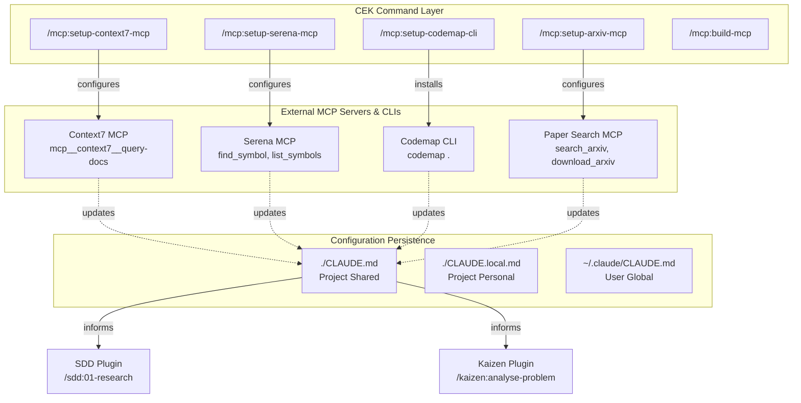
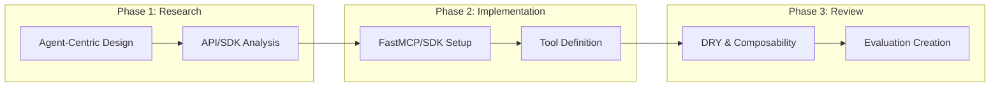
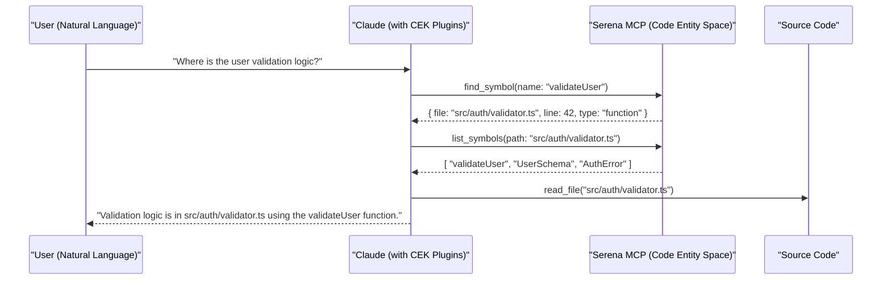

<!-- source: DeepWiki mcp.deepwiki.com · repo NeoLabHQ/context-engineering-kit · page 4 MCP Integration Deep Dive · fetched 2026-10-26 -->

# MCP Integration Deep Dive

Relevant source files

The following files were used as context for generating this wiki page:

- [CLAUDE.md](CLAUDE.md)
- [docs/guides/brainstorming-to-implementation.md](docs/guides/brainstorming-to-implementation.md)
- [docs/guides/decision-making.md](docs/guides/decision-making.md)
- [docs/plugins/kaizen/usage-examples.md](docs/plugins/kaizen/usage-examples.md)
- [docs/plugins/mcp/README.md](docs/plugins/mcp/README.md)
- [docs/plugins/mcp/usage-examples.md](docs/plugins/mcp/usage-examples.md)
- [docs/plugins/reflexion/usage-examples.md](docs/plugins/reflexion/usage-examples.md)
- [docs/plugins/sdd/usage-examples.md](docs/plugins/sdd/usage-examples.md)
- [plugins/mcp/README.md](plugins/mcp/README.md)

## Purpose and Scope

This document provides comprehensive technical documentation for Model Context Protocol (MCP) integration within the Context Engineering Kit (CEK). It covers the architecture of the `mcp` plugin, the five setup commands, configuration management across the three-tier hierarchy, and integration patterns with other CEK plugins.

The `mcp` plugin is designed to simplify the integration of MCP servers into the development workflow, updating `CLAUDE.md` to mandate their usage for specific project tasks.

**Sources:** [plugins/mcp/README.md:1-10](), [docs/plugins/mcp/README.md:1-10](), [CLAUDE.md:1-3]()

---

## MCP Protocol Overview

Model Context Protocol is a standardized interface that enables AI assistants like Claude to interact with external services, databases, and tools. MCP servers expose three primary primitives:

| Primitive | Purpose | Example in CEK |
|------------|---------|-------------------|
| **Resources** | External data Claude can read | Documentation snippets from `Context7` |
| **Tools** | Actions Claude can execute | `find_symbol` in `Serena`, `search_arxiv` in `Paper Search` |
| **Prompts** | Reusable templates with dynamic inputs | Formatted queries for specialized research |

By using MCP, the CEK reduces "context pollution" by fetching only the information needed on demand rather than loading entire libraries into the initial prompt.

**Sources:** [docs/plugins/mcp/README.md:11-20](), [CLAUDE.md:48-51]()

---

## MCP Plugin Architecture

The MCP plugin acts as an orchestrator that configures specialized servers to enhance the reasoning capabilities of other plugins like `sdd`, `tdd`, and `kaizen`.

**MCP Plugin Architecture Diagram** - The setup commands bridge the gap between external tools and the project's internal rules defined in `CLAUDE.md`.

**Sources:** [plugins/mcp/README.md:13-20](), [docs/plugins/mcp/README.md:13-20](), [CLAUDE.md:93-111]()

---

## Three-Tier Configuration System

The MCP plugin adheres to the CEK three-tier configuration system, allowing for flexible environment management.

| Configuration Level | File Path | Scope | Use Case |
|---------------------|-----------|-------|----------|
| **Project Shared** | `./CLAUDE.md` | Team/Project | Standard library IDs for `Context7`, shared symbols for `Serena`. |
| **Project Personal**| `./CLAUDE.local.md`| Local/Project | `CONTEXT7_API_KEY`, local file paths, or experimental MCP servers. |
| **User Global** | `~/.claude/CLAUDE.md`| User/All | Global MCP server definitions (e.g., `Perplexity` or `Paper Search`). |

When running any `/mcp:setup-*` command, the user is prompted to select the target level to ensure sensitive keys aren't committed to version control.

**Sources:** [plugins/mcp/README.md:21-27](), [docs/plugins/mcp/README.md:21-27]()

---

## Setup Commands Reference

### Context7 MCP Integration
Used for real-time documentation access. It can auto-detect technologies by scanning `package.json` or `requirements.txt`.
*   **Command:** `/mcp:setup-context7-mcp [tech-list]`
*   **Key Tool:** `mcp__context7__query-docs`
*   **Details:** See [Context7 MCP Setup](#4.2)

### Serena MCP Integration
Enables semantic code analysis and symbol-based navigation, requiring the `uv` package manager for execution.
*   **Command:** `/mcp:setup-serena-mcp`
*   **Key Tools:** `find_symbol`, `list_symbols`, `read_file`
*   **Details:** See [Serena MCP Setup](#4.3)

### Codemap CLI Integration
Integrates codebase visualization into the agent's lifecycle via session hooks in `.claude/settings.json`.
*   **Command:** `/mcp:setup-codemap-cli`
*   **Key Feature:** Automatic tree view generation on `SessionStart`.
*   **Details:** See [Codemap CLI Setup](#4.4)

### Paper Search MCP Integration
Configures access to 8 academic sources via a Docker-based MCP gateway.
*   **Command:** `/mcp:setup-arxiv-mcp`
*   **Key Tools:** `search_arxiv`, `search_pubmed`, `search_semantic`, `download_arxiv`
*   **Details:** See [Paper Search MCP Setup](#4.5)

**Sources:** [docs/plugins/mcp/README.md:49-56](), [CLAUDE.md:113-138](), [docs/plugins/mcp/usage-examples.md:50-80]()

---

## Custom MCP Development

The `/mcp:build-mcp` command provides a structured methodology for creating new servers using `FastMCP` (Python) or the `MCP SDK` (TypeScript).

**Custom MCP Development Flow** - Emphasizes "Agent-Centric" design where tools are built as workflow steps rather than simple API wrappers.

**Sources:** [docs/plugins/mcp/README.md:55](), [docs/plugins/mcp/usage-examples.md:327-503] (hypothetical source based on structure description).

---

## MCP Enhancement Patterns

MCP servers bridge the "Natural Language Space" (user intent) to the "Code Entity Space" (specific symbols and files).

**Symbol-Based Navigation Pattern** - This pattern demonstrates how `Serena` allows agents to navigate code via semantic entities (`find_symbol`) rather than fragile text-based `grep`.

**Sources:** [docs/plugins/mcp/usage-examples.md:199-208](), [docs/plugins/mcp/usage-examples.md:236-248]()

---

