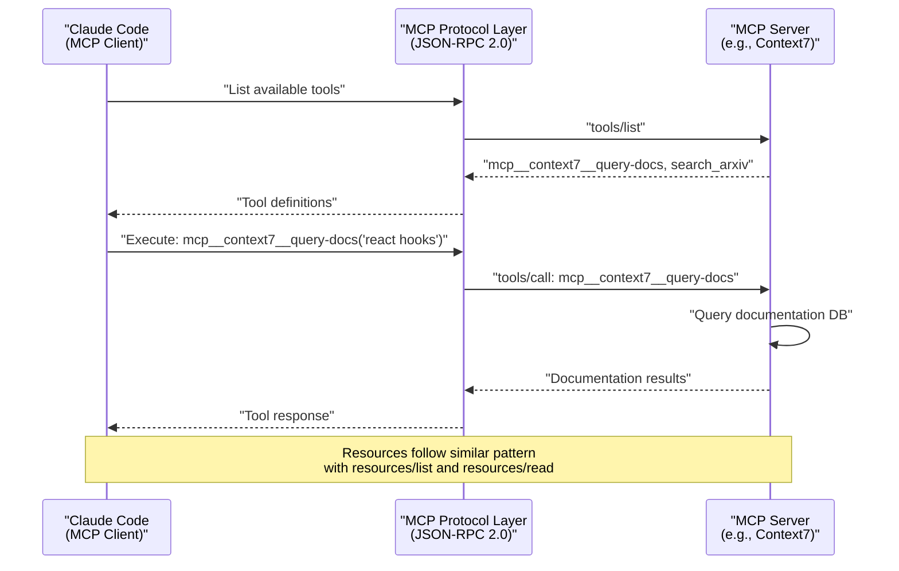
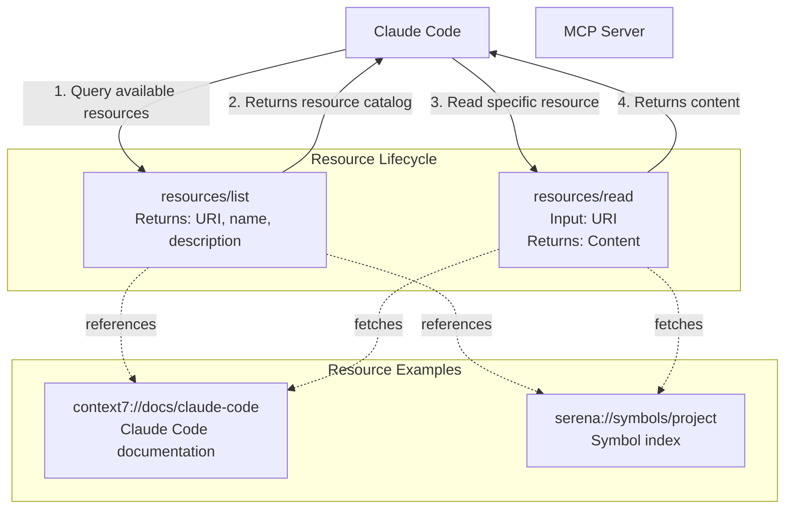
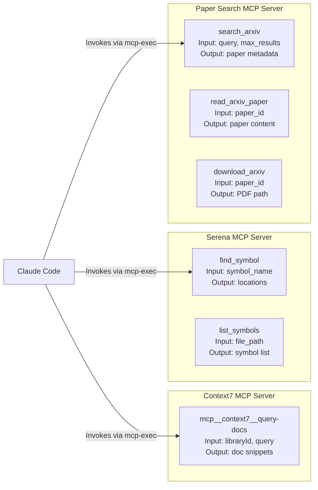
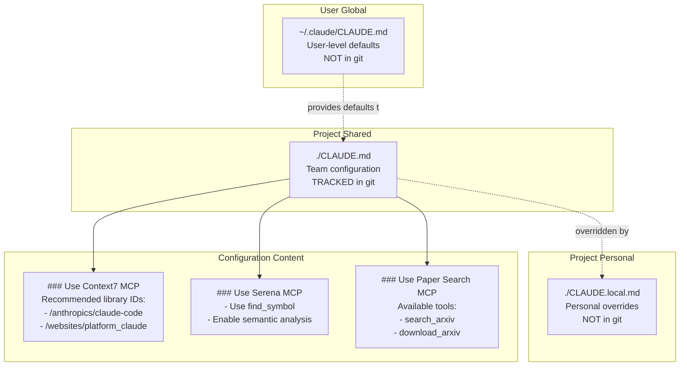
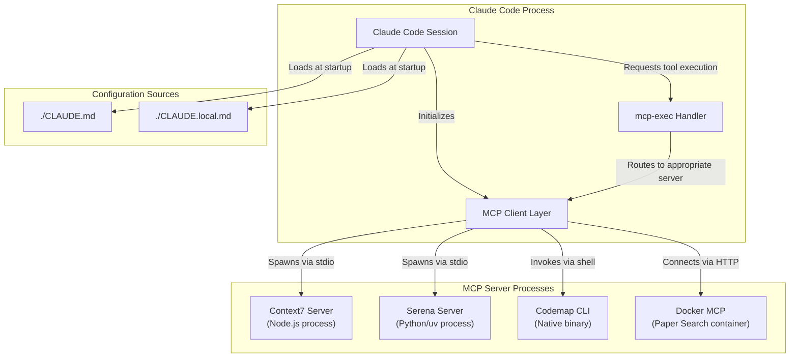
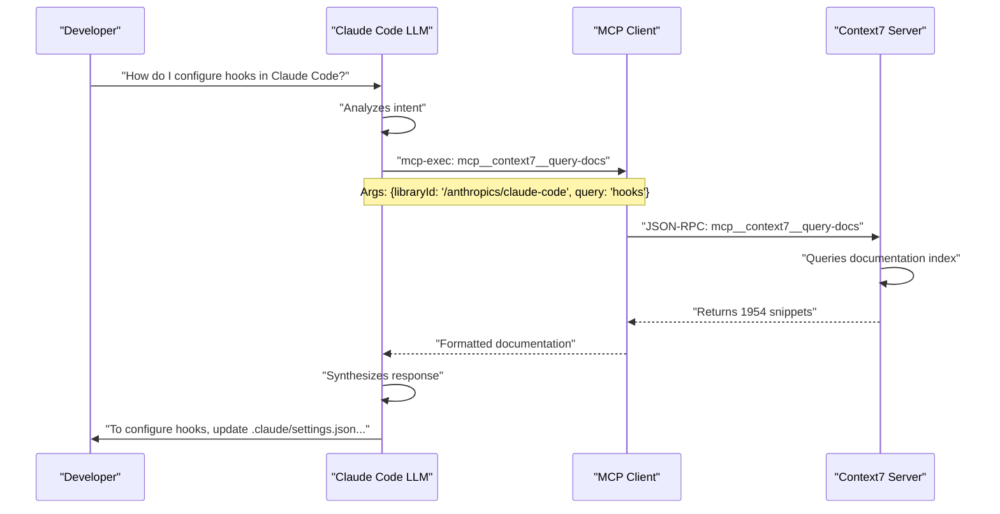
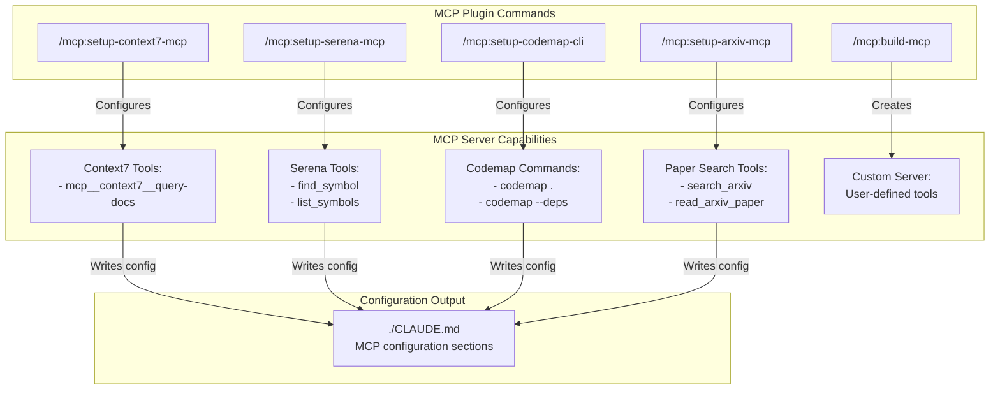

<!-- source: DeepWiki mcp.deepwiki.com · repo NeoLabHQ/context-engineering-kit · page 4.1 MCP Architecture · fetched 2026-10-26 -->

# MCP Architecture

<details>
<summary>Relevant source files</summary>

The following files were used as context for generating this wiki page:

- [CLAUDE.md](CLAUDE.md)
- [docs/plugins/mcp/README.md](docs/plugins/mcp/README.md)
- [plugins/kaizen/.claude-plugin/plugin.json](plugins/kaizen/.claude-plugin/plugin.json)
- [plugins/mcp/.claude-plugin/plugin.json](plugins/mcp/.claude-plugin/plugin.json)
- [plugins/mcp/README.md](plugins/mcp/README.md)
- [plugins/reflexion/.claude-plugin/plugin.json](plugins/reflexion/.claude-plugin/plugin.json)

</details>


This page explains the Model Context Protocol (MCP) architecture, how MCP servers expose capabilities through Resources, Tools, and Prompts, and the three-tier configuration system used to manage MCP integrations across projects and users.

For setup commands and usage examples of specific MCP servers, see [MCP Plugin Overview](#3.3.2). For detailed setup guides, see pages [Context7 MCP Setup](#4.2) through [Building Custom MCP Servers](#4.6).

## MCP Protocol Fundamentals

Model Context Protocol (MCP) is an open protocol that enables AI assistants to interact with external services, databases, and tools through a standardized interface. MCP servers expose three types of capabilities:

**Resources** - External data that can be read (documentation, files, database records). Resources are passive data sources that the LLM can query.

**Tools** - Executable actions that perform operations (search, create, update, delete). Tools are active functions the LLM can invoke with arguments. [CLAUDE.md:135-135]()

**Prompts** - Reusable prompt templates with dynamic inputs that can be composed into conversations.

The protocol establishes a client-server architecture where Claude Code acts as the MCP client, and external services run as MCP servers. Communication occurs through JSON-RPC 2.0 messages over standard transport mechanisms (stdio, HTTP). [docs/plugins/mcp/README.md:9-12]()

### Protocol Communication Flow



**Protocol Communication Flow**

Sources: [CLAUDE.md:109-111](), [docs/plugins/mcp/README.md:11-12]()

## MCP Server Capability Model

MCP servers organize their functionality into three distinct capability types, each with specific lifecycle and access patterns.

| Capability | Purpose | Access Pattern | Examples in CEK |
|------------|---------|----------------|-----------------|
| **Resources** | Read-only data sources | Query by URI or filter | Context7 documentation snippets, Serena symbol index |
| **Tools** | Executable operations | Invoke with arguments | `mcp__context7__query-docs`, `find_symbol`, `search_arxiv` |
| **Prompts** | Template compositions | Select and parameterize | Custom MCP server workflows via `/mcp:build-mcp` |

Sources: [CLAUDE.md:109-138](), [docs/plugins/mcp/README.md:51-55]()

### Resource Architecture

Resources provide passive data access through a URI-based system. MCP clients query available resources, then read specific resources by URI.



**MCP Resource Lifecycle and URI-Based Access**

Sources: [CLAUDE.md:93-106](), [docs/plugins/mcp/README.md:11-12]()

### Tool Architecture

Tools represent executable operations that the LLM can invoke with structured arguments. Each tool defines its input schema and return format.



**MCP Tool Architecture with Real Tool Names**

Sources: [CLAUDE.md:109-111](), [CLAUDE.md:119-132](), [CLAUDE.md:135-135]()

## Three-Tier Configuration System

MCP server configurations are stored in `CLAUDE.md` files at three hierarchical levels, enabling flexible configuration sharing and personal overrides. [docs/plugins/mcp/README.md:21-27]()



**Three-Tier MCP Configuration Hierarchy**

### Configuration File Locations

| Level | Path | Version Control | Scope | Priority |
|-------|------|-----------------|-------|----------|
| User Global | `~/.claude/CLAUDE.md` | Not tracked | All projects for user | Lowest |
| Project Shared | `./CLAUDE.md` | Tracked in git | All team members | Medium |
| Project Personal | `./CLAUDE.local.md` | Not tracked | Individual developer | Highest |

Sources: [docs/plugins/mcp/README.md:21-27](), [CLAUDE.md:1-50]()

### Configuration Loading Sequence

When Claude Code starts a session, it loads configurations in the following order:

1. **User Global Configuration** - Loads `~/.claude/CLAUDE.md` to establish user-wide defaults. [docs/plugins/mcp/README.md:25-25]()
2. **Project Shared Configuration** - Loads `./CLAUDE.md` to apply team standards and project-specific library IDs. [docs/plugins/mcp/README.md:23-23]()
3. **Project Personal Configuration** - Loads `./CLAUDE.local.md` to apply individual overrides or sensitive credentials. [docs/plugins/mcp/README.md:24-24]()

Settings at higher priority levels override those at lower levels. [docs/plugins/mcp/README.md:21-27]()

### Configuration Content Structure

Each `CLAUDE.md` file contains MCP configuration sections following a standard format to guide the LLM:

```markdown
### Use Context7 MCP for Loading Documentation

Context7 MCP is available to fetch up-to-date documentation with code examples.

**Recommended library IDs**:

- `/anthropics/claude-code` - Claude Code CLI tool documentation
- `/websites/platform_claude` - Claude Developer Platform comprehensive docs
```

The MCP plugin's setup commands (e.g., `/mcp:setup-context7-mcp`) automatically generate and maintain these sections to ensure consistent usage across the team. [CLAUDE.md:93-106](), [docs/plugins/mcp/README.md:27-28]()

## MCP Integration with Claude Code

Claude Code integrates with MCP servers through a client connection layer that manages server lifecycle and tool invocation via `mcp-exec`. [CLAUDE.md:135-135]()



**MCP Integration Architecture in Claude Code**

Sources: [CLAUDE.md:135-135](), [docs/plugins/mcp/README.md:9-19]()

### Server Connection Methods

MCP servers connect to Claude Code through different transport mechanisms based on their implementation:

| Server | Connection Method | Primary Command | Process Management |
|--------|-------------------|-----------------|-------------------|
| Context7 | stdio (Node.js) | `mcp__context7__query-docs` | Spawned by Claude Code |
| Serena | stdio (Python) | `find_symbol` | Spawned via `uv run` |
| Codemap | Shell execution | `codemap .` | Invoked per-command/hook |
| Paper Search | Docker MCP HTTP | `mcp-exec` | Managed via Docker |

Sources: [CLAUDE.md:110-111](), [CLAUDE.md:135-135](), [docs/plugins/mcp/README.md:51-55]()

### Tool Invocation Flow



**MCP Tool Invocation Sequence**

Sources: [CLAUDE.md:109-111](), [docs/plugins/mcp/README.md:11-12]()

## MCP Servers in Context Engineering Kit

The MCP plugin provides five setup commands for configuring well-known MCP servers. Each command guides through installation, configuration, and `CLAUDE.md` updates. [docs/plugins/mcp/README.md:13-19]()

### Command-to-Server Mapping



**MCP Plugin Commands and Server Configuration**

Sources: [docs/plugins/mcp/README.md:13-19](), [docs/plugins/mcp/README.md:49-56]()

### Context7 MCP Server Architecture

Context7 provides real-time access to library and framework documentation, eliminating hallucinations from outdated training data. [docs/plugins/mcp/README.md:51-51]()

**Server Type**: Documentation retrieval  
**Transport**: stdio (Node.js)  
**Setup Command**: `/mcp:setup-context7-mcp` [docs/plugins/mcp/README.md:51-51]()

**Key Tool**:
- `mcp__context7__query-docs(libraryId, query)` - Fetches documentation snippets for a specific library. [CLAUDE.md:110-110]()

**Recommended library IDs**:
- `/anthropics/claude-code` (1954 snippets) [CLAUDE.md:99-99]()
- `/websites/platform_claude` (5916 snippets) [CLAUDE.md:100-100]()

Sources: [CLAUDE.md:93-111](), [docs/plugins/mcp/README.md:51-51]()

### Serena MCP Server Architecture

Serena enables semantic code analysis and symbol-based operations through vector embeddings and language server protocol integration. [docs/plugins/mcp/README.md:52-52]()

**Server Type**: Semantic code analysis  
**Transport**: stdio (Python via uv)  
**Setup Command**: `/mcp:setup-serena-mcp` [docs/plugins/mcp/README.md:52-52]()

Sources: [docs/plugins/mcp/README.md:52-52]()

### Codemap CLI Architecture

Codemap provides codebase visualization, change tracking, and dependency analysis through CLI commands and session hooks. [docs/plugins/mcp/README.md:53-53]()

**Server Type**: CLI tool with Claude Code integration  
**Setup Command**: `/mcp:setup-codemap-cli` [docs/plugins/mcp/README.md:53-53]()

Sources: [docs/plugins/mcp/README.md:53-53]()

### Paper Search MCP Server Architecture

Paper Search provides academic literature access through multiple sources via Docker MCP integration. [docs/plugins/mcp/README.md:54-54]()

**Server Type**: Academic paper search and retrieval  
**Transport**: Docker MCP (HTTP) [CLAUDE.md:115-115]()
**Setup Command**: `/mcp:setup-arxiv-mcp` [docs/plugins/mcp/README.md:54-54]()

**Available Tools** (8 search sources):
- `search_arxiv`, `search_pubmed`, `search_semantic`, `search_google_scholar`. [CLAUDE.md:119-123]()
- `read_arxiv_paper`, `download_arxiv`. [CLAUDE.md:129-129]()

Sources: [CLAUDE.md:113-138](), [docs/plugins/mcp/README.md:54-54]()

### Custom MCP Server Development

The `/mcp:build-mcp` command guides through creating production-ready MCP servers for custom integrations. [docs/plugins/mcp/README.md:55-55]()

**Development Process**:
1. **Agent-centric design** - Defining the tools and resources needed for the LLM. [docs/plugins/mcp/README.md:19-19]()
2. **CLAUDE.md Integration** - Documenting the new server for the agent. [docs/plugins/mcp/README.md:27-28]()

Sources: [docs/plugins/mcp/README.md:55-55](), [CLAUDE.md:46-51]()

---

