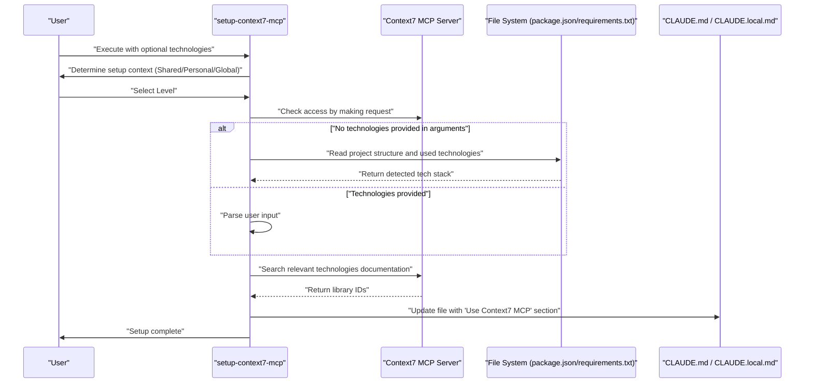

<!-- source: DeepWiki mcp.deepwiki.com · repo NeoLabHQ/context-engineering-kit · page 4.2 Context7 MCP Setup · fetched 2026-10-26 -->

# Context7 MCP Setup

<details>
<summary>Relevant source files</summary>

The following files were used as context for generating this wiki page:

- [.devcontainer/Dockerfile](.devcontainer/Dockerfile)
- [.devcontainer/configure-claude.sh](.devcontainer/configure-claude.sh)
- [.devcontainer/devcontainer.json](.devcontainer/devcontainer.json)
- [.devcontainer/install-mcps.sh](.devcontainer/install-mcps.sh)
- [.devcontainer/statusline.sh](.devcontainer/statusline.sh)
- [justfile](justfile)
- [plugins/mcp/skills/setup-context7-mcp/SKILL.md](plugins/mcp/skills/setup-context7-mcp/SKILL.md)

</details>


## Purpose and Scope

This page documents the setup and configuration of the Context7 MCP server for accessing real-time library documentation within the Context Engineering Kit. Context7 eliminates documentation hallucinations by providing access to current API references and code examples instead of relying on potentially outdated LLM training data. [plugins/mcp/skills/setup-context7-mcp/SKILL.md:48-56]().

The setup is facilitated by the `/mcp:setup-context7-mcp` command, which handles technology detection via `package.json` or `requirements.txt` scanning, library ID configuration, and integration with the three-tier configuration system. [plugins/mcp/skills/setup-context7-mcp/SKILL.md:43-45]().

**Sources:** [plugins/mcp/skills/setup-context7-mcp/SKILL.md:1-5](), [plugins/mcp/skills/setup-context7-mcp/SKILL.md:43-56]()

---

## What is Context7?

Context7 is an MCP server that fetches up-to-date documentation with code examples for any library or framework. Instead of the LLM relying on its training data (which may be outdated or incomplete), Context7 queries real documentation sources in real-time during conversations.

**Key Benefits:**
- Access to latest API references and code examples.
- Elimination of hallucinations about deprecated methods or incorrect signatures.
- Version-specific documentation for exact dependency versions.
- Reduced back-and-forth when outdated patterns are suggested.

**Sources:** [plugins/mcp/skills/setup-context7-mcp/SKILL.md:2-5](), [plugins/mcp/skills/setup-context7-mcp/SKILL.md:48-52]()

---

## Prerequisites and Installation

Before using the setup command, the Context7 MCP server must be added to your Claude environment. In the sandbox environment, this is automated via the `install-mcps.sh` script.

### Automated Installation (Sandbox)
The devcontainer environment automatically adds the Context7 server using the following command during the `postCreateCommand` phase:
```bash
claude mcp add --scope user --transport http context7 https://mcp.context7.com/mcp --header "CONTEXT7_API_KEY: ${CONTEXT7_API_KEY:-}"
```
**Sources:** [.devcontainer/install-mcps.sh:4-5](), [.devcontainer/devcontainer.json:61-64]()

### Environment Variables
For the server to function correctly, a `CONTEXT7_API_KEY` must be provided. In the devcontainer, this is passed from the local environment to the remote container via `remoteEnv`. [devcontainer.json:58-58]().
**Sources:** [.devcontainer/devcontainer.json:51-59]()

---

## Setup Command Overview

The `/mcp:setup-context7-mcp` command configures Context7 for your project by detecting technologies, searching for available documentation, and updating the appropriate `CLAUDE.md` configuration file. [plugins/mcp/skills/setup-context7-mcp/SKILL.md:2-5]().

**Command Syntax:**
```bash
/mcp:setup-context7-mcp [technologies]
```

**Arguments:**
- `[technologies]` (optional): Comma-separated list of languages and frameworks (e.g., `react, typescript, prisma`). [plugins/mcp/skills/setup-context7-mcp/SKILL.md:4-4]().
- If omitted, the command analyzes project structure to auto-detect relevant technologies from dependency files. [plugins/mcp/skills/setup-context7-mcp/SKILL.md:43-43]().

**Sources:** [plugins/mcp/skills/setup-context7-mcp/SKILL.md:2-5](), [plugins/mcp/skills/setup-context7-mcp/SKILL.md:43-44]()

---

## Configuration Levels

The MCP plugin supports a three-tier configuration hierarchy. When running the setup command, you are prompted to choose where to store the documentation requirements. [plugins/mcp/skills/setup-context7-mcp/SKILL.md:15-31]().

### Configuration Hierarchy Diagram

```mermaid
graph TD
    "User"["User invokes /mcp:setup-context7-mcp"]
    "ChoicePrompt"["Command prompts for configuration level"]
    
    "ProjectShared"["1. Project level (shared via git)<br/>File: ./CLAUDE.md<br/>Tracked in version control"]
    "ProjectPersonal"["2. Project level (personal)<br/>File: ./CLAUDE.local.md<br/>Not tracked in git"]
    "UserGlobal"["3. User level (global)<br/>File: ~/.claude/CLAUDE.md<br/>Applies to all projects"]
    
    "SharedTeam"["Shared with team members"]
    "LocalOnly"["Local preferences only"]
    "AllProjects"["Applied across all user projects"]
    
    "User" --> "ChoicePrompt"
    "ChoicePrompt" --> "ProjectShared"
    "ChoicePrompt" --> "ProjectPersonal"
    "ChoicePrompt" --> "UserGlobal"
    
    "ProjectShared" --> "SharedTeam"
    "ProjectPersonal" --> "LocalOnly"
    "UserGlobal" --> "AllProjects"
```
**Sources:** [plugins/mcp/skills/setup-context7-mcp/SKILL.md:15-31]()

| Configuration Level | File Path | Git Tracked | Scope |
|---------------------|-----------|-------------|-------|
| Project (shared) | `./CLAUDE.md` | Yes | Team-wide documentation standards [plugins/mcp/skills/setup-context7-mcp/SKILL.md:21-22]() |
| Project (personal) | `./CLAUDE.local.md` | No | Individual developer overrides [plugins/mcp/skills/setup-context7-mcp/SKILL.md:24-27]() |
| User (global) | `~/.claude/CLAUDE.md` | No | Default preferences for all projects [plugins/mcp/skills/setup-context7-mcp/SKILL.md:28-29]() |

---

## Setup Process Workflow

The setup command executes a multi-phase workflow to configure Context7 for your project.

### Complete Setup Flow Diagram


**Sources:** [plugins/mcp/skills/setup-context7-mcp/SKILL.md:13-56]()

### Technology Detection Strategy
When no arguments are passed, the system scans the codebase for signature files to identify the tech stack. [plugins/mcp/skills/setup-context7-mcp/SKILL.md:43-43]().

| Source File | Detected Technology Examples |
|-------------|------------------------------|
| `package.json` | `react`, `typescript`, `nextjs`, `prisma` |
| `requirements.txt` | `python`, `django`, `flask` |

**Sources:** [plugins/mcp/skills/setup-context7-mcp/SKILL.md:43-43]()

---

## Resulting Configuration

After successful setup, the chosen configuration file is updated with instructions for the LLM to use the Context7 tools. [plugins/mcp/skills/setup-context7-mcp/SKILL.md:45-56]().

### Example CLAUDE.md Entry
The command injects instructions similar to:
```markdown
### Use Context7 MCP for Loading Documentation

Context7 MCP is available to fetch up-to-date documentation with code examples.

**Recommended library IDs**:

- `[doc-id]` - short description of documentation
```
**Sources:** [plugins/mcp/skills/setup-context7-mcp/SKILL.md:48-56]()

---

## Best Practices

1. **Run After Dependency Updates**: Re-run `/mcp:setup-context7-mcp` whenever you add a major new library to the project to ensure the LLM has access to its documentation. [plugins/mcp/skills/setup-context7-mcp/SKILL.md:43-43]().
2. **Use Shared Config for Teams**: Prefer the **Project level (shared)** option to ensure all team members (and their AI assistants) are using the same documentation context. [plugins/mcp/skills/setup-context7-mcp/SKILL.md:21-22]().
3. **Sandbox Integration**: In the provided devcontainer, Context7 is pre-configured at the user level, but project-specific library IDs should still be set up using the command. [.devcontainer/install-mcps.sh:4-5]().

**Sources:** [plugins/mcp/skills/setup-context7-mcp/SKILL.md:21-22](), [plugins/mcp/skills/setup-context7-mcp/SKILL.md:43-43](), [.devcontainer/install-mcps.sh:4-5]()

---

