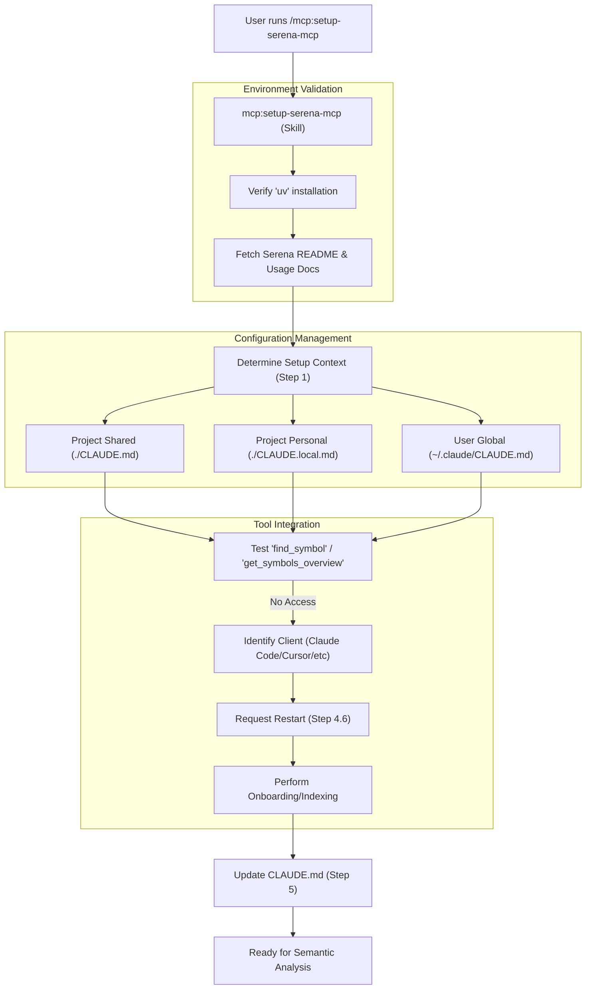
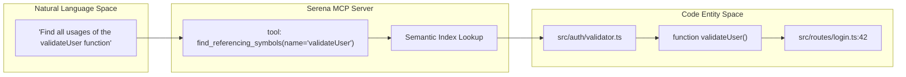

<!-- source: DeepWiki mcp.deepwiki.com · repo NeoLabHQ/context-engineering-kit · page 4.3 Serena MCP Setup · fetched 2026-10-26 -->

# Serena MCP Setup

<details>
<summary>Relevant source files</summary>

The following files were used as context for generating this wiki page:

- [plugins/mcp/skills/setup-serena-mcp/SKILL.md](plugins/mcp/skills/setup-serena-mcp/SKILL.md)

</details>


This page documents the setup and configuration of the Serena MCP server for semantic code analysis and symbol-based operations within the Context Engineering Kit. Serena provides intelligent code navigation through semantic understanding rather than text-based search, enabling precise code manipulation in large codebases.

## Overview

Serena is an MCP server that provides a semantic layer over codebases. Unlike traditional text-based tools like `grep`, Serena understands code structures—functions, classes, types, and their relationships. This allows AI assistants to perform operations based on language semantics.

### Core Capabilities
- **Symbol Discovery**: Locate functions, classes, and types by name across the entire project.
- **Structural Navigation**: Explore available symbols within specific files or modules.
- **Semantic Editing**: Make precise code changes while maintaining reference integrity.
- **Project Indexing**: Automatic detection and indexing of symbols using vector embeddings.

Sources: [plugins/mcp/skills/setup-serena-mcp/SKILL.md:83-102]()

---

## Setup Command

The setup process is initiated through the `/mcp:setup-serena-mcp` command. This command is a guided skill that manages environment verification, client configuration, and `CLAUDE.md` integration.

```bash
/mcp:setup-serena-mcp
```

### Data Flow and Implementation
The command follows a structured workflow to ensure the MCP server is correctly registered and indexed for the current project. It specifically checks for the `uv` package manager as a prerequisite for running the server [plugins/mcp/skills/setup-serena-mcp/SKILL.md:52-52]().

#### Serena Setup Logic Flow
"Natural Language Space" (User Intent) to "Code Entity Space" (Implementation)



Sources: [plugins/mcp/skills/setup-serena-mcp/SKILL.md:15-31](), [plugins/mcp/skills/setup-serena-mcp/SKILL.md:33-37](), [plugins/mcp/skills/setup-serena-mcp/SKILL.md:52-77]()

---

## Configuration Hierarchy

The setup command supports a three-tier configuration system to manage how the AI uses Serena [plugins/mcp/skills/setup-serena-mcp/SKILL.md:15-31]().

| Tier | File Path | Scope | Use Case |
| :--- | :--- | :--- | :--- |
| **Project (Shared)** | `./CLAUDE.md` | Team/Repo | Standardized semantic search patterns for all contributors. |
| **Project (Personal)** | `./CLAUDE.local.md` | Local/Project | Personal indexing preferences or local-only paths. |
| **User (Global)** | `~/.claude/CLAUDE.md` | All Projects | Global fallback for Serena tools across different codebases. |

Sources: [plugins/mcp/skills/setup-serena-mcp/SKILL.md:15-31]()

---

## Semantic Toolset

Once configured, Serena exposes specific tools that bridge the gap between file-system strings and semantic entities [plugins/mcp/skills/setup-serena-mcp/SKILL.md:93-98]().

### Key Tools and Functions

| Code Entity (Tool Name) | Description | Primary Use Case |
| :--- | :--- | :--- |
| `find_symbol` | Locates specific code entities (classes, methods, interfaces). | Jumping to a definition without knowing the file path. |
| `find_referencing_symbols` | Finds all symbols that reference a given symbol. | Impact analysis and refactoring. |
| `get_symbols_overview` | Provides a summary of top-level symbols in a file. | Rapidly understanding a new file's structure. |
| `read_file` | Reads file content within the project directory. | Semantic-aware file reading. |

### Semantic Mapping Diagram
This diagram shows how Serena maps natural language queries to specific code entities within the project structure.



Sources: [plugins/mcp/skills/setup-serena-mcp/SKILL.md:35-35](), [plugins/mcp/skills/setup-serena-mcp/SKILL.md:93-98]()

---

## Client-Specific Setup & Indexing

The `/mcp:setup-serena-mcp` command detects the environment and provides tailored instructions for various MCP clients [plugins/mcp/skills/setup-serena-mcp/SKILL.md:53-54]():

1.  **Claude Code**: Direct integration via command line. Requires a restart (`exit` then `claude --continue`) after adding the server [plugins/mcp/skills/setup-serena-mcp/SKILL.md:65-71]().
2.  **Cursor**: Configuration via the Cursor MCP settings pane.
3.  **Other Clients**: Support for Claude Desktop, VSCode, etc., via `uv`-based execution [plugins/mcp/skills/setup-serena-mcp/SKILL.md:52-52]().

### Project Indexing
For each project, Serena must be initialized to build its semantic index:
- **Initialization**: Run `serena project create --index` in the project root [plugins/mcp/skills/setup-serena-mcp/SKILL.md:109-109]().
- **Auto-detection**: Serena automatically detects the programming language and creates a `.serena/project.yml` file [plugins/mcp/skills/setup-serena-mcp/SKILL.md:110-110]().
- **Memories**: Onboarding creates persistent memory files in `.serena/memories/` for long-term context [plugins/mcp/skills/setup-serena-mcp/SKILL.md:111-111]().

Sources: [plugins/mcp/skills/setup-serena-mcp/SKILL.md:52-77](), [plugins/mcp/skills/setup-serena-mcp/SKILL.md:108-112]()

---

## Best Practices for Serena Integration

To maximize the effectiveness of semantic analysis, the following patterns are recommended:

1.  **Prefer Symbols Over Grep**: Always use `find_symbol` before falling back to `grep` or `sed`. It provides better context regarding the type and role of the code entity [plugins/mcp/skills/setup-serena-mcp/SKILL.md:88-91]().
2.  **Indexing**: Ensure the project is indexed during the setup phase to enable fast retrieval [plugins/mcp/skills/setup-serena-mcp/SKILL.md:56-56]().
3.  **Contextual Guidelines**: The setup command appends usage requirements to `CLAUDE.md` to ensure the AI uses semantic tools for navigation and refactoring instead of basic text replacement [plugins/mcp/skills/setup-serena-mcp/SKILL.md:81-102]().

Sources: [plugins/mcp/skills/setup-serena-mcp/SKILL.md:81-102](), [plugins/mcp/skills/setup-serena-mcp/SKILL.md:56-56]()

---

