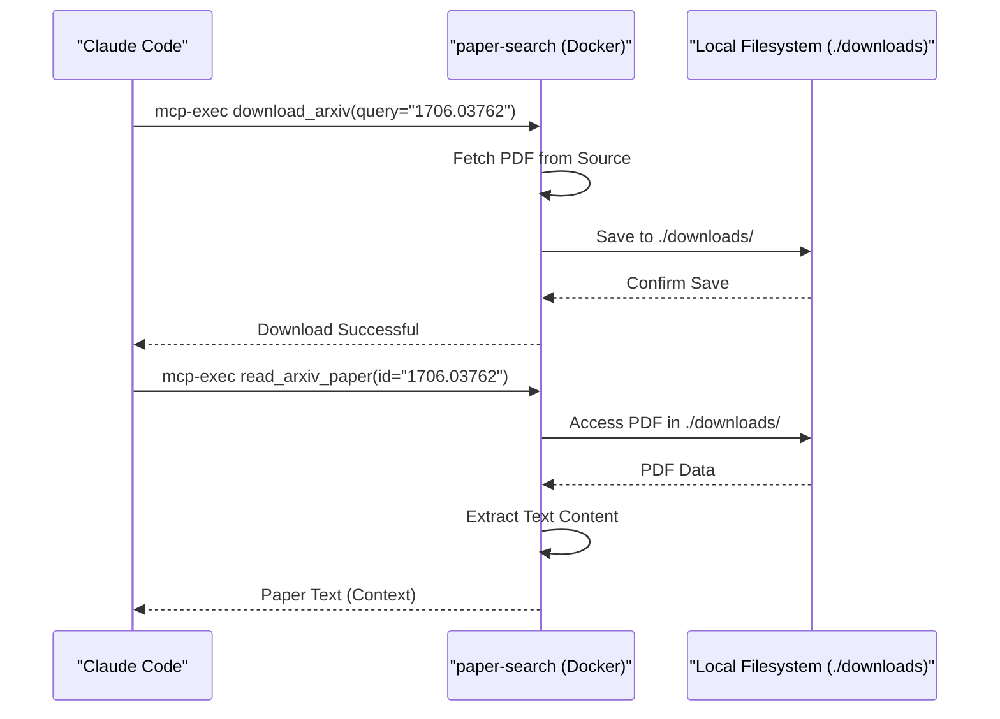

<!-- source: DeepWiki mcp.deepwiki.com · repo NeoLabHQ/context-engineering-kit · page 4.5 Paper Search MCP Setup · fetched 2026-10-26 -->

# Paper Search MCP Setup

<details>
<summary>Relevant source files</summary>

The following files were used as context for generating this wiki page:

- [docs/plugins/mcp/recommended-mcp.md](docs/plugins/mcp/recommended-mcp.md)
- [plugins/mcp/skills/setup-arxiv-mcp/SKILL.md](plugins/mcp/skills/setup-arxiv-mcp/SKILL.md)

</details>


This document describes the configuration and usage of the Paper Search MCP server within the Context Engineering Kit. This integration provides academic literature search and retrieval capabilities across eight major academic sources using the Model Context Protocol (MCP).

## Purpose and Scope

The Paper Search MCP is a Docker-based server that enables searching and downloading academic papers from sources including arXiv, PubMed, bioRxiv, medRxiv, Semantic Scholar, Google Scholar, IACR, and CrossRef. The setup is managed via the `/mcp:setup-arxiv-mcp` command, which:
- Configures Docker MCP integration.
- Updates the appropriate `CLAUDE.md` file (Project, Personal, or Global).
- Provides tools for searching, downloading, and reading paper content directly within the AI development workflow.

Sources: [plugins/mcp/skills/setup-arxiv-mcp/SKILL.md:2-5](), [plugins/mcp/skills/setup-arxiv-mcp/SKILL.md:54-63](), [plugins/mcp/skills/setup-arxiv-mcp/SKILL.md:83-91](), [docs/plugins/mcp/recommended-mcp.md:28-28]()

---

## Architecture and Data Flow

The Paper Search integration relies on the Docker MCP infrastructure. Unlike standard MCP servers that run as local Node.js or Python processes, this server is pulled from the Docker MCP catalog and runs within a containerized environment. This approach provides a robust environment for handling PDF processing and multi-source API integrations.

### System Component Mapping

The following diagram maps the high-level research intent to the specific code entities and tools used in the implementation.

**Research Intent to Code Entity Mapping**
```mermaid
graph TD
    subgraph "Natural Language Space (User Intent)"
        "Intent"["'Find papers on Transformers'"]
        "ReadIntent"["'Read paper 1706.03762'"]
    end

    subgraph "Code Entity Space (MCP Plugin)"
        "SetupCmd"["/mcp:setup-arxiv-mcp"]
        "SkillMD"["plugins/mcp/skills/setup-arxiv-mcp/SKILL.md"]
        
        subgraph "Docker MCP Layer"
            "McpFind"["mcp-find query: 'paper-search'"]
            "McpAdd"["mcp-add name: 'paper-search'"]
        end

        subgraph "Tool Entities (Exposed via mcp-exec)"
            "SearchTool"["search_arxiv"]
            "DownloadTool"["download_arxiv"]
            "ReadTool"["read_arxiv_paper"]
        end
    end

    "Intent" --> "SetupCmd"
    "SetupCmd" --> "SkillMD"
    "SkillMD" --> "McpFind"
    "McpFind" --> "McpAdd"
    "McpAdd" --> "SearchTool"
    "ReadIntent" --> "ReadTool"
    "DownloadTool" --> "ReadTool"
```
Sources: [plugins/mcp/skills/setup-arxiv-mcp/SKILL.md:2-5](), [plugins/mcp/skills/setup-arxiv-mcp/SKILL.md:50-52](), [plugins/mcp/skills/setup-arxiv-mcp/SKILL.md:85-97]()

---

## Setup Process

### Manual Setup Command
Users trigger the setup using the plugin command:
```bash
/mcp:setup-arxiv-mcp
```
The command follows a structured logic defined in the `setup-arxiv-mcp` skill:
1.  **Determine Context**: Asks the user where to store the configuration (Project-shared `./CLAUDE.md`, Project-personal `./CLAUDE.local.md`, or User-global `~/.claude/CLAUDE.md`).
2.  **Verify Docker**: Checks for Docker MCP availability by attempting to use the `mcp-find` tool.
3.  **Install Server**: Adds the `paper-search` server. The skill specifically recommends `paper-search` over `arxiv-mcp-server` because the latter is known to have initialization (EOF) issues.
4.  **Test**: Verifies the setup by executing a test query via `mcp-exec name: "search_arxiv"`.
5.  **Update CLAUDE.md**: Persists the tool definitions and usage notes to the selected configuration file.

Sources: [plugins/mcp/skills/setup-arxiv-mcp/SKILL.md:15-31](), [plugins/mcp/skills/setup-arxiv-mcp/SKILL.md:33-42](), [plugins/mcp/skills/setup-arxiv-mcp/SKILL.md:43-52](), [plugins/mcp/skills/setup-arxiv-mcp/SKILL.md:66-70]()

---

## Academic Sources and Tools

The Paper Search MCP exposes a comprehensive suite of tools for the research lifecycle.

### Search Tools
| Tool Name | Source | Focus Area |
| :--- | :--- | :--- |
| `search_arxiv` | arXiv | Physics, Math, Computer Science, etc. |
| `search_pubmed` | PubMed | Biomedical literature |
| `search_biorxiv` | bioRxiv | Biological sciences preprints |
| `search_medrxiv` | medRxiv | Health sciences preprints |
| `search_semantic` | Semantic Scholar | AI-powered search with year filters |
| `search_google_scholar` | Google Scholar | Broad academic search |
| `search_iacr` | IACR | Cryptography research |
| `search_crossref` | CrossRef | DOI-based citation database |

Sources: [plugins/mcp/skills/setup-arxiv-mcp/SKILL.md:54-62](), [plugins/mcp/skills/setup-arxiv-mcp/SKILL.md:85-91]()

### Content Retrieval Workflow
The data flow for retrieving and processing paper content involves local storage synchronization. Downloaded papers are saved to `./downloads` by default.

**Paper Retrieval Data Flow**

Sources: [plugins/mcp/skills/setup-arxiv-mcp/SKILL.md:93-104]()

---

## Configuration Management

The setup command ensures that the LLM is aware of these tools by appending instructions to the `CLAUDE.md` hierarchy.

### Tiered Persistence
| Tier | File Path | Usage |
| :--- | :--- | :--- |
| **Global** | `~/.claude/CLAUDE.md` | Persistent academic search for the developer across all projects. |
| **Shared** | `./CLAUDE.md` | Research requirements shared with the team via Git. |
| **Personal** | `./CLAUDE.local.md` | Private research for a specific project (Git ignored). |

Sources: [plugins/mcp/skills/setup-arxiv-mcp/SKILL.md:19-31]()

### Alternative: dedicated arXiv server
While `paper-search` is the recommended default, the skill provides an alternative path for the dedicated `arxiv-mcp-server` if features like deep analysis prompts or custom storage path management are required. This requires setting a `storage_path` via `mcp-config-set`.

Sources: [plugins/mcp/skills/setup-arxiv-mcp/SKILL.md:106-117]()

---

