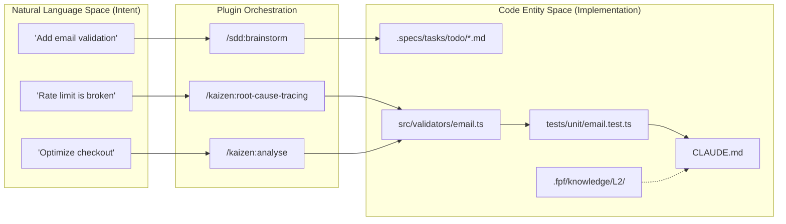
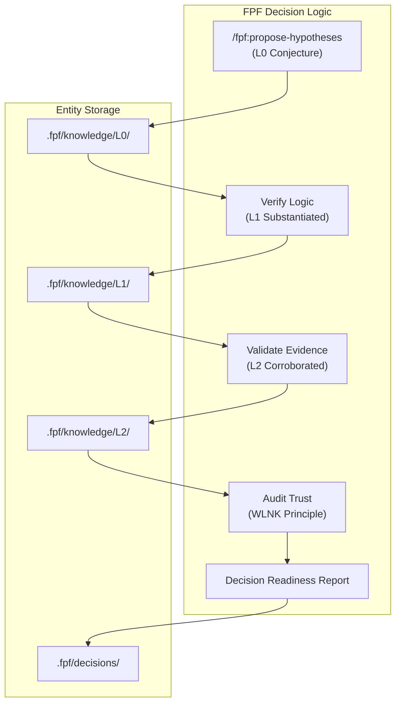

<!-- source: DeepWiki mcp.deepwiki.com · repo NeoLabHQ/context-engineering-kit · page 5 Development Guides · fetched 2026-10-26 -->

# Development Guides

Relevant source files

The following files were used as context for generating this wiki page:

- [docs/best-practices.md](docs/best-practices.md)
- [docs/guides/brainstorming-to-implementation.md](docs/guides/brainstorming-to-implementation.md)
- [docs/guides/bug-investigation.md](docs/guides/bug-investigation.md)
- [docs/guides/code-quality-improvement.md](docs/guides/code-quality-improvement.md)
- [docs/guides/competitivy-generation.md](docs/guides/competitivy-generation.md)
- [docs/guides/decision-making.md](docs/guides/decision-making.md)
- [docs/guides/feature-development.md](docs/guides/feature-development.md)
- [docs/plugins/kaizen/usage-examples.md](docs/plugins/kaizen/usage-examples.md)
- [docs/plugins/mcp/usage-examples.md](docs/plugins/mcp/usage-examples.md)
- [docs/plugins/reflexion/usage-examples.md](docs/plugins/reflexion/usage-examples.md)
- [docs/plugins/sdd/usage-examples.md](docs/plugins/sdd/usage-examples.md)

This document provides an overview of practical workflows that combine multiple plugins from the Context Engineering Kit to accomplish complete development tasks. Each workflow is designed to leverage specific plugin combinations for maximum effectiveness by bridging natural language requirements with precise code entities.

These guides demonstrate end-to-end processes from initial task conception through completion and knowledge capture. For information about individual plugin capabilities, see [Plugin Reference](#3). For understanding the underlying architecture of how plugins work together, see [Core Concepts](#2).

## Overview

Development guides are organized into seven major workflow categories, each addressing a specific phase or type of development work:

| Workflow | Primary Focus | Key Plugins Used |
|----------|--------------|------------------|
| [Feature Development Workflow](#5.1) | Standard features with quality gates | `reflexion`, `review`, `git`, `tdd` |
| [Spec-Driven Development Workflow](#5.2) | Complex features requiring planning | `sdd`, `mcp`, `tdd`, `docs`, `fpf` |
| [Bug Investigation & Root Cause Analysis](#5.3) | Root cause analysis and systematic fixes | `kaizen`, `reflexion`, `git`, `review` |
| [PR Review Workflow](#5.4) | Comprehensive pull request analysis | `review`, `git`, `reflexion` |
| [CI/CD Integration](#5.5) | Automated quality checks | `review` (GitHub Actions) |
| [Code Quality Improvement](#5.6) | Systematic refactoring and optimization | `kaizen`, `reflexion`, `review`, `git` |
| [Project Setup & Context Enhancement](#5.7) | Initial configuration and context | `tech-stack`, `mcp`, `ddd`, `docs` |

**Sources:** [docs/guides/feature-development.md:14-19](), [docs/guides/bug-investigation.md:14-19](), [docs/best-practices.md:18-20]()

## Workflow Architecture

### Plugin Command Flow in Development Workflows

The following diagram maps specific development scenarios to the actual plugin commands executed during each workflow phase:

```mermaid
graph TB
    subgraph StandardFeature["Standard Feature Development"]
        SF_Start["User: Implement feature X"]
        SF_Impl["Claude: Implementation"]
        SF_Test["/tdd:write-tests"]
        SF_Review["/review:review-local-changes"]
        SF_Reflect["/reflexion:reflect"]
        SF_Memorize["/reflexion:memorize"]
        SF_Commit["/git:commit"]
    end
    
    subgraph ComplexFeature["Complex Feature with SDD"]
        CF_Start["User: /sdd:brainstorm"]
        CF_Setup["/sdd:add-task"]
        CF_Plan["/sdd:plan-task"]
        CF_Impl["/sdd:implement-task"]
        CF_PR["/git:create-pr"]
    end
    
    subgraph BugFix["Bug Investigation"]
        BF_Start["/git:analyze-issue"]
        BF_Trace["/kaizen:root-cause-tracing"]
        BF_Five["/kaizen:why"]
        BF_Fix["Claude: Implement fix"]
        BF_Review["/review:review-local-changes"]
        BF_Memorize["/reflexion:memorize"]
        BF_Commit["/git:commit"]
    end
    
    SF_Start --> SF_Impl --> SF_Test --> SF_Review --> SF_Reflect --> SF_Memorize --> SF_Commit
    CF_Start --> CF_Setup --> CF_Plan --> CF_Impl --> CF_PR
    BF_Start --> BF_Trace --> BF_Five --> BF_Fix --> BF_Review --> BF_Memorize --> BF_Commit
```

**Sources:** [docs/guides/feature-development.md:25-65](), [docs/guides/brainstorming-to-implementation.md:25-58](), [docs/guides/bug-investigation.md:25-72](), [docs/plugins/sdd/usage-examples.md:11-29]()

### Mapping Natural Language to Code Entity Space

This diagram illustrates how high-level development intent is translated into specific code-level entities and plugin operations.

**Sources:** [docs/guides/brainstorming-to-implementation.md:112-120](), [docs/guides/bug-investigation.md:86-93](), [docs/guides/decision-making.md:183-193](), [docs/plugins/reflexion/usage-examples.md:135-148]()

## Workflow Categories

### 5.1 Feature Development Workflow
A lightweight workflow for standard features. It uses `claude "implement X, then reflect"` for immediate self-correction via the `reflexion` plugin, followed by `/tdd:write-tests` and `/review:review-local-changes` to ensure quality before a conventional `/git:commit`.
For details, see [Feature Development Workflow](#5.1).
**Sources:** [docs/guides/feature-development.md:1-135](), [docs/plugins/reflexion/usage-examples.md:6-19]()

### 5.2 Spec-Driven Development (SDD) Workflow
Designed for complex features. It begins with `/sdd:brainstorm` to refine requirements through Q&A. It progresses through `/sdd:add-task` (creating draft specs in `.specs/tasks/draft/`) and `/sdd:plan-task` before `/sdd:implement-task` executes the changes using specialized subagents like `sdd:developer`. For architectural choices, `/fpf:propose-hypotheses` can be integrated.
For details, see [Spec-Driven Development Workflow](#5.2).
**Sources:** [docs/guides/brainstorming-to-implementation.md:1-179](), [docs/plugins/sdd/usage-examples.md:11-48]()

### 5.3 Bug Investigation & Root Cause Analysis
A systematic approach using the Kaizen plugin. It involves `/git:analyze-issue` to load context, `/kaizen:root-cause-tracing` to follow the call stack, and `/kaizen:why` (Five Whys) to identify systemic failures. The fix is verified with `/reflexion:reflect` and documented via `/reflexion:memorize`.
For details, see [Bug Investigation & Root Cause Analysis](#5.3).
**Sources:** [docs/guides/bug-investigation.md:1-151](), [docs/plugins/kaizen/usage-examples.md:7-41]()

### 5.4 PR Review Workflow
A comprehensive process for reviewing code. It utilizes `/review:review-pr` for remote pull requests and `/review:review-local-changes` for iterative local fixes. The review is performed by specialized agents (Bug Hunter, Security Auditor, etc.) to ensure multi-perspective coverage.
For details, see [PR Review Workflow](#5.4).
**Sources:** [docs/guides/feature-development.md:100-108](), [docs/plugins/reflexion/usage-examples.md:207-211]()

### 5.5 CI/CD Integration
Automates the code review process by integrating `anthropics/claude-code-action` into GitHub Actions. This allows for automated "sticky" comments on PRs from the multi-agent review system, ensuring every change meets project standards before human review.
For details, see [CI/CD Integration](#5.5).
**Sources:** [docs/guides/feature-development.md:134-134](), [docs/plugins/sdd/usage-examples.md:26-28]()

### 5.6 Code Quality Improvement
Focuses on technical debt and optimization. It employs `/kaizen:analyse` (Gemba Walk/Muda Analysis) to find waste and `/kaizen:plan-do-check-act` (PDCA) to run measurable improvement experiments. Results are captured in `CLAUDE.md` using `/reflexion:memorize`.
For details, see [Code Quality Improvement](#5.6).
**Sources:** [docs/guides/code-quality-improvement.md:1-150](), [docs/plugins/kaizen/usage-examples.md:107-112]()

### 5.7 Project Setup & Context Enhancement
The foundation for new projects. It uses `/tech-stack:add-typescript-best-practices` (or equivalent) to populate `CLAUDE.md`, and MCP setup commands like `/mcp:setup-context7-mcp` or `/mcp:setup-codemap-cli` to enable documentation access and codebase visualization.
For details, see [Project Setup & Context Enhancement](#5.7).
**Sources:** [docs/plugins/mcp/usage-examples.md:7-42](), [docs/plugins/mcp/usage-examples.md:82-127]()

## Decision Making & Reasoning

For architectural decisions with long-term impact, the **First Principles Framework (FPF)** is integrated into these workflows.

**Sources:** [docs/guides/decision-making.md:28-75](), [docs/guides/decision-making.md:183-193]()

## Summary of Configuration Artifacts

Workflows are supported by the following core configuration files:

| File Path | Purpose | Primary Plugin |
|-----------|---------|----------------|
| `CLAUDE.md` | Project-wide AI instructions and memorized patterns | `reflexion`, `tech-stack` |
| `.specs/tasks/` | Task definitions and implementation plans | `sdd` |
| `.fpf/` | Architectural hypotheses and audit trails | `fpf` |
| `.claude/settings.json` | Automation hooks (SessionStart/End) | `mcp` (codemap) |

**Sources:** [docs/plugins/reflexion/usage-examples.md:135-148](), [docs/guides/brainstorming-to-implementation.md:112-120](), [docs/guides/decision-making.md:85-91]()

---

