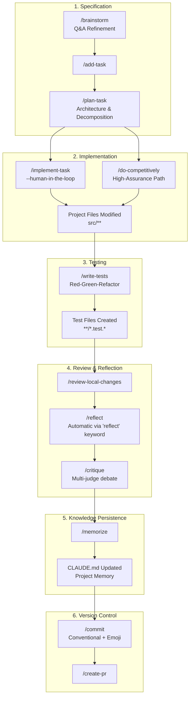
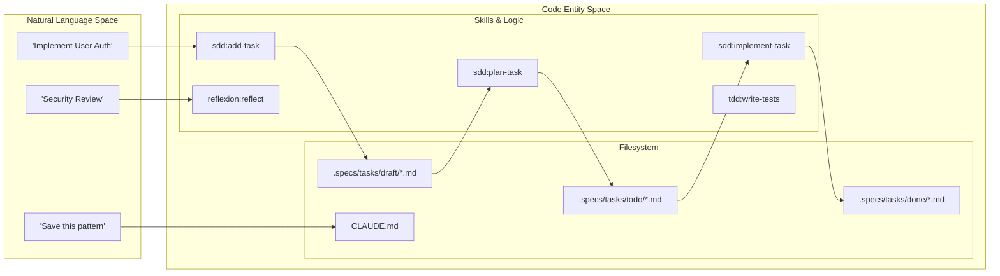

<!-- source: DeepWiki mcp.deepwiki.com · repo NeoLabHQ/context-engineering-kit · page 5.1 Feature Development Workflow · fetched 2026-10-26 -->

# Feature Development Workflow

Relevant source files

The following files were used as context for generating this wiki page:

- [docs/best-practices.md](docs/best-practices.md)
- [docs/guides/brainstorming-to-implementation.md](docs/guides/brainstorming-to-implementation.md)
- [docs/guides/bug-investigation.md](docs/guides/bug-investigation.md)
- [docs/guides/code-quality-improvement.md](docs/guides/code-quality-improvement.md)
- [docs/guides/competitivy-generation.md](docs/guides/competitivy-generation.md)
- [docs/guides/decision-making.md](docs/guides/decision-making.md)
- [docs/guides/feature-development.md](docs/guides/feature-development.md)
- [docs/plugins/kaizen/usage-examples.md](docs/plugins/kaizen/usage-examples.md)
- [docs/plugins/mcp/usage-examples.md](docs/plugins/mcp/usage-examples.md)
- [docs/plugins/reflexion/usage-examples.md](docs/plugins/reflexion/usage-examples.md)
- [docs/plugins/sdd/usage-examples.md](docs/plugins/sdd/usage-examples.md)

This guide covers the complete workflow for developing standard features using Context Engineering Kit plugins. This workflow is appropriate for straightforward features where requirements are clear and complexity is manageable.

**For more complex features requiring architecture planning**, see [Spec-Driven Development Workflow](5.2). For investigating and fixing bugs, see [Bug Investigation & Root Cause Analysis](5.3).

## Purpose and Scope

The Feature Development Workflow provides a quality-gated approach to building features through six stages:

1.  **Specification** - Define what to build using SDD.
2.  **Implementation** - Write code with optional sub-agent orchestration or competitive generation.
3.  **Testing** - Add test coverage via TDD.
4.  **Review** - Multi-agent quality analysis.
5.  **Reflection** - Self-refinement and knowledge capture.
6.  **Commit** - Version control with conventional standards.

This workflow balances velocity with quality by using specialized agents and reflection loops to catch issues early while maintaining development speed.

Sources: [docs/guides/feature-development.md:1-21](), [docs/guides/bug-investigation.md:5-5](), [docs/guides/competitivy-generation.md:1-6]()

## Workflow Architecture

The workflow transitions from high-level natural language requirements to specific code entities and validated artifacts.

### Process Flow Diagram

Sources: [docs/guides/feature-development.md:25-65](), [docs/guides/brainstorming-to-implementation.md:24-57](), [docs/guides/competitivy-generation.md:32-61]()

### Code Entity Mapping
This diagram bridges Natural Language concepts to the specific code identifiers and file structures used in the kit.

Sources: [docs/plugins/sdd/usage-examples.md:12-48](), [docs/plugins/reflexion/usage-examples.md:135-148](), [docs/guides/feature-development.md:84-96]()

## Implementation Phase Detail

Standard implementation is managed by the `sdd:implement-task` command, which orchestrates specialized developer agents and judges.

### Using sdd:implement-task
This command executes implementation steps with automated quality verification [docs/plugins/sdd/usage-examples.md:42-49]().

*   **Task Lifecycle**: Moves tasks from `todo/` to `in-progress/` during execution and finally to `done/` upon completion [docs/plugins/sdd/usage-examples.md:44-48]().
*   **Verification**: Critical steps are verified by judge agents (panel of 2 for critical artifacts) to ensure the Definition of Done is met [docs/plugins/sdd/usage-examples.md:46-47]().
*   **Refine Mode (`--refine`)**: Detects manual project file changes and re-verifies from the affected step onward [docs/plugins/sdd/usage-examples.md:171-181]().
*   **Human-in-the-loop (`--human-in-the-loop`)**: Pauses for manual review after specific phases or steps [docs/plugins/sdd/usage-examples.md:83-111]().
*   **Resuming (`--continue`)**: Resumes interrupted implementations by verifying existing artifacts and continuing from the first incomplete step [docs/plugins/sdd/usage-examples.md:152-158]().

### High-Assurance Implementation
For quality-critical features like authentication or payment processing, the `/do-competitively` command is used [docs/guides/competitivy-generation.md:7-13]().
*   **Competitive Generation**: 3 agents independently design and implement solutions with self-critique [docs/guides/competitivy-generation.md:72-72]().
*   **Multi-Judge Evaluation**: 3 judges evaluate each solution using structured rubrics [docs/guides/competitivy-generation.md:73-73]().
*   **Synthesis**: An adaptive strategy selects the winner or synthesizes the best elements from all approaches [docs/guides/competitivy-generation.md:74-74]().

Sources: [docs/plugins/sdd/usage-examples.md:42-181](), [docs/guides/competitivy-generation.md:63-88]()

## Review and Reflection Phase

The kit emphasizes iterative refinement and multi-perspective analysis.

### Automated Reflection
Users can trigger automatic reflection by appending "reflect" to their prompts (e.g., `"implement feature, reflect"`) [docs/plugins/reflexion/usage-examples.md:7-13]().
*   **Action**: Claude implements the feature, then automatically runs `/reflect` to review its own work and fix identified issues [docs/plugins/reflexion/usage-examples.md:15-19]().

### Multi-Perspective Critique
For complex features, `/critique` provides feedback from multiple specialized perspectives (Requirements Validator, Solution Architect, Code Quality Reviewer) [docs/plugins/reflexion/usage-examples.md:85-102]().
*   **Consensus**: The workflow identifies consensus points and areas of disagreement among judges [docs/guides/code-quality-improvement.md:93-94]().

### Knowledge Persistence
The `/memorize` command captures patterns and insights into `CLAUDE.md` [docs/guides/feature-development.md:110-124]().
*   **Purpose**: Prevents recurring bugs by building institutional knowledge about codebase pitfalls [docs/guides/bug-investigation.md:132-140]().
*   **Contextual Memory**: Can be targeted to specific sections like "Architecture Decisions" or "API Integration Patterns" [docs/plugins/reflexion/usage-examples.md:140-148]().

Sources: [docs/plugins/reflexion/usage-examples.md:1-150](), [docs/guides/feature-development.md:110-124](), [docs/guides/code-quality-improvement.md:85-94]()

## Workflow Integration Table

| Phase | Primary Command | Primary Agent/Skill | Key Output |
| :--- | :--- | :--- | :--- |
| **Draft** | `/add-task` | `business-analyst` | `.specs/tasks/draft/*.md` |
| **Plan** | `/plan-task` | `software-architect`, `tech-lead` | `.specs/tasks/todo/*.md` |
| **Implement** | `/implement-task` | `sdd:developer` | Feature Code + `[DONE]` markers |
| **Verify** | `/review-local-changes` | `bug-hunter`, `security-auditor` | Severity-ranked findings |
| **Refine** | `/reflect` | `reflexion:reflect` | Self-corrected implementation |
| **Persist** | `/memorize` | `reflexion:memorize` | `CLAUDE.md` updates |

Sources: [docs/plugins/sdd/usage-examples.md:31-48](), [docs/guides/feature-development.md:100-116](), [docs/guides/bug-investigation.md:124-130]()

## Best Practices

1.  **Iterative Planning**: Use `/plan-task --refine` to update specifications. It uses git diff to detect modified sections and only re-runs affected downstream stages [docs/plugins/sdd/usage-examples.md:116-137]().
2.  **Fast Track**: For simple bugs, use `/plan-task --fast` to skip research and architecture synthesis, focusing only on decomposition and verification [docs/plugins/sdd/usage-examples.md:54-67]().
3.  **Clean Context**: Run `/clear` before `/implement-task` to ensure implementation agents have a fresh context window free of planning artifacts.
4.  **Small Increments**: In the PDCA cycle, focus on small changes that can be measured against success criteria [docs/guides/code-quality-improvement.md:113-114]().

Sources: [docs/plugins/sdd/usage-examples.md:54-137](), [docs/guides/code-quality-improvement.md:111-114](), [docs/best-practices.md:43-59]()

---

