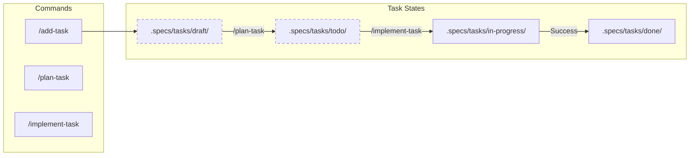
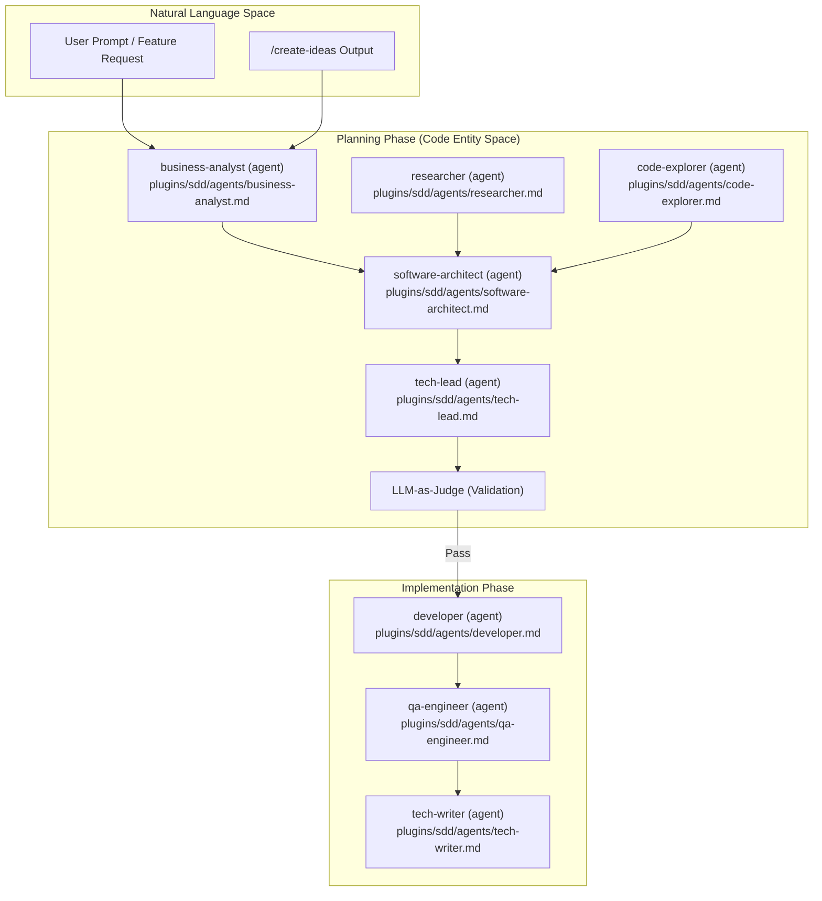

<!-- source: DeepWiki mcp.deepwiki.com · repo NeoLabHQ/context-engineering-kit · page 5.2 Spec-Driven Development Workflow · fetched 2026-10-26 -->

# Spec-Driven Development Workflow

<details>
<summary>Relevant source files</summary>

The following files were used as context for generating this wiki page:

- [.specs/tasks/roadmap.md](.specs/tasks/roadmap.md)
- [docs/guides/brainstorming-to-implementation.md](docs/guides/brainstorming-to-implementation.md)
- [docs/guides/decision-making.md](docs/guides/decision-making.md)
- [docs/guides/spec-driven-development.md](docs/guides/spec-driven-development.md)
- [docs/plugins/kaizen/usage-examples.md](docs/plugins/kaizen/usage-examples.md)
- [docs/plugins/mcp/usage-examples.md](docs/plugins/mcp/usage-examples.md)
- [docs/plugins/reflexion/usage-examples.md](docs/plugins/reflexion/usage-examples.md)
- [docs/plugins/sdd/README.md](docs/plugins/sdd/README.md)
- [docs/plugins/sdd/add-task.md](docs/plugins/sdd/add-task.md)
- [docs/plugins/sdd/customization.md](docs/plugins/sdd/customization.md)
- [docs/plugins/sdd/refine.md](docs/plugins/sdd/refine.md)
- [docs/plugins/sdd/usage-examples.md](docs/plugins/sdd/usage-examples.md)
- [plugins/sdd/agents/business-analyst.md](plugins/sdd/agents/business-analyst.md)
- [plugins/sdd/agents/code-explorer.md](plugins/sdd/agents/code-explorer.md)
- [plugins/sdd/agents/developer.md](plugins/sdd/agents/developer.md)
- [plugins/sdd/agents/researcher.md](plugins/sdd/agents/researcher.md)
- [plugins/sdd/agents/software-architect.md](plugins/sdd/agents/software-architect.md)
- [plugins/sdd/agents/tech-lead.md](plugins/sdd/agents/tech-lead.md)
- [plugins/sdd/agents/tech-writer.md](plugins/sdd/agents/tech-writer.md)

</details>


## Purpose and Scope

This guide documents the complete workflow for developing complex features using the Spec-Driven Development (SDD) plugin. SDD implements a structured methodology that transforms natural language prompts into production-ready implementations through multi-agent orchestration, architectural synthesis, and quality-gated execution [docs/plugins/sdd/README.md:1-5]().

**When to use this workflow:**
- Features requiring complex development and significant architectural changes [docs/guides/spec-driven-development.md:7-10]().
- Large codebases where codebase impact analysis is critical to avoid regressions [docs/plugins/sdd/README.md:14-14]().
- Scenarios where reliability and "compilation-like" reproducibility are required [docs/plugins/sdd/README.md:9-10]().

For simpler features, see the standard feature development workflow. For brainstorming vague ideas before specification, see the [Brainstorming and Idea Generation](#brainstorming-and-idea-generation) section.

Sources: [docs/plugins/sdd/README.md:1-15](), [docs/guides/spec-driven-development.md:1-11]()

## Core Workflow Overview

The SDD workflow follows a rigorous task lifecycle: `draft` → `todo` → `in-progress` → `done` [docs/plugins/sdd/README.md:72-77]().

### Task Lifecycle and Commands


Sources: [docs/plugins/sdd/README.md:53-77](), [docs/plugins/sdd/usage-examples.md:11-48]()

### Agent Orchestration Architecture

The SDD plugin uses a "Model-as-Judge" pattern where an orchestrator (typically `sonnet`) launches specialized agents (often `opus`) to perform work, followed by validation agents to verify quality [docs/guides/spec-driven-development.md:21-24]().


Sources: [docs/plugins/sdd/README.md:94-107](), [docs/guides/spec-driven-development.md:50-116](), [plugins/sdd/agents/software-architect.md:1-22]()

## Phase 1: Setup and Task Creation (`/add-task`)

The process begins by capturing user intent into a structured markdown file in the `.specs/tasks/draft/` directory [docs/plugins/sdd/README.md:57-57]().

**Key Functions:**
- **Initial Description:** Captures the raw prompt and converts it into a task template [docs/plugins/sdd/README.md:83]().
- **Dependency Tracking:** Tasks can depend on other task files to enforce implementation order [docs/plugins/sdd/usage-examples.md:191-197]().

**Command:**
```bash
/add-task "Design and implement authentication middleware with JWT support"
```
Sources: [docs/plugins/sdd/README.md:32-34](), [docs/guides/spec-driven-development.md:29-38]()

## Phase 2: Refinement and Planning (`/plan-task`)

This phase transforms a draft into a complete specification through parallel analysis and synthesis by specialized agents [docs/guides/spec-driven-development.md:42-48]().

### Planning Stages
1.  **Parallel Analysis (Phase 2a-c):**
    *   `researcher`: Investigates unknown technologies and creates reusable skills in `.claude/skills/` [plugins/sdd/agents/researcher.md:18-22]().
    *   `code-explorer`: Performs codebase impact analysis to identify affected files and integration points [plugins/sdd/agents/code-explorer.md:18-22]().
    *   `business-analyst`: Discovers requirements and writes detailed acceptance criteria [docs/plugins/sdd/README.md:100]().
2.  **Architecture Synthesis (Phase 3):** `software-architect` delivers decisive blueprints based on DDD and Clean Architecture principles [plugins/sdd/agents/software-architect.md:8-15]().
3.  **Decomposition (Phase 4):** `tech-lead` applies "Least-to-Most decomposition" to break the design into ordered subproblems [plugins/sdd/agents/tech-lead.md:47-50]().
4.  **Parallelize & Verify (Phases 5-6):** `team-lead` maps execution plans while `qa-engineer` defines verification rubrics and LLM-as-Judge criteria [docs/plugins/sdd/README.md:103-104]().

### Refine Mode (`--refine`)
If the user manually edits the task file (e.g., changing the architecture), running `/plan-task --refine` triggers top-to-bottom propagation. The agents detect modifications and only re-run subsequent affected stages [docs/plugins/sdd/usage-examples.md:129-137]().

Sources: [docs/guides/spec-driven-development.md:50-116](), [plugins/sdd/agents/tech-lead.md:1-53](), [docs/plugins/sdd/usage-examples.md:116-137]()

## Phase 3: Implementation (`/implement-task`)

Implementation is an iterative process where steps are executed by the `developer` agent and verified by `judge` agents [docs/plugins/sdd/README.md:105]().

### Implementation Logic
For each step defined in the refined task file:
1.  **Execution:** The `developer` agent implements code, executes TDD cycles, and performs quality reviews [docs/plugins/sdd/README.md:105]().
2.  **Verification Levels:**
    *   **Single Judge:** One evaluation agent for standard tasks (Target Quality ~4.0) [docs/plugins/sdd/usage-examples.md:63-64]().
    *   **Panel of LLMs:** Parallel evaluation for critical steps (Target Quality ~4.5) [docs/plugins/sdd/usage-examples.md:83]().
3.  **Documentation:** The `tech-writer` agent updates API guides and architecture docs upon completion [docs/plugins/sdd/README.md:106]().

### Resuming and Project Refinement
- **`--continue`**: Resumes an interrupted implementation from the last successful step [docs/plugins/sdd/usage-examples.md:151-158]().
- **`--refine`**: Maps manual codebase changes back to implementation steps, re-verifying the affected step and all subsequent ones to ensure alignment [docs/plugins/sdd/usage-examples.md:170-181]().

Sources: [docs/guides/spec-driven-development.md:122-171](), [docs/plugins/sdd/usage-examples.md:141-181](), [plugins/sdd/agents/tech-writer.md:6-12]()

## Data Flow and Artifacts

The SDD workflow generates several hidden and visible artifacts to maintain state and provide reasoning trails.

| Artifact Path | Purpose | Persistence |
| :--- | :--- | :--- |
| `.specs/tasks/` | Main task specifications (Draft/Todo/Done) | Permanent |
| `.specs/analysis/` | Detailed codebase and research reports | Permanent |
| `.specs/scratchpad/` | Temporary files for agent "chain-of-thought" | Gitignored |
| `.claude/skills/` | Reusable technology expertise artifacts | Permanent [plugins/sdd/agents/researcher.md:22-22]() |

### Scratchpad-First Approach
Agents use a specialized script `create-scratchpad.sh` to generate workspace files in `.specs/scratchpad/` [plugins/sdd/agents/software-architect.md:49-51](). This allows agents to "think deeply" before selectively copying verified findings into the final task or skill documents [plugins/sdd/agents/code-explorer.md:20-20]().

Sources: [plugins/sdd/agents/software-architect.md:47-54](), [plugins/sdd/agents/code-explorer.md:65-72](), [plugins/sdd/agents/researcher.md:157-170]()

## Brainstorming and Idea Generation

Before a task is even created, the SDD plugin provides tools for divergent and convergent thinking to refine vague requirements [docs/guides/brainstorming-to-implementation.md:1-5]().

- **`/sdd:create-ideas`**: Generates diverse ideas using creative sampling techniques [docs/plugins/sdd/README.md:89]().
- **`/sdd:brainstorm`**: Initiates a collaborative dialogue where the LLM asks focused questions one at a time to reach a validated design [docs/guides/brainstorming-to-implementation.md:59-74]().
- **Approach Exploration**: The LLM proposes 2-3 different approaches with trade-offs before generating a formal design document in `docs/plans/` [docs/guides/brainstorming-to-implementation.md:75-110]().

Sources: [docs/plugins/sdd/README.md:87-91](), [docs/guides/brainstorming-to-implementation.md:20-57]()

## Customization and Quality Gates

The SDD workflow can be tuned for different project needs using specific flags:

- **`--target-quality`**: Sets the required score (e.g., 4.5) for judge verification [docs/plugins/sdd/usage-examples.md:83]().
- **`--fast`**: Preset for simple tasks; skips research and architecture synthesis while lowering quality thresholds [docs/plugins/sdd/usage-examples.md:60-67]().
- **`--human-in-the-loop`**: Mandates manual approval after specific phases (e.g., `--human-in-the-loop 2,3,4`) [docs/plugins/sdd/usage-examples.md:83-105]().
- **`--skip-judges`**: Disables LLM-as-Judge verification for maximum speed in low-risk scenarios [docs/plugins/sdd/usage-examples.md:64]().

Sources: [docs/plugins/sdd/usage-examples.md:52-114](), [.specs/tasks/roadmap.md:14-15]()

---

