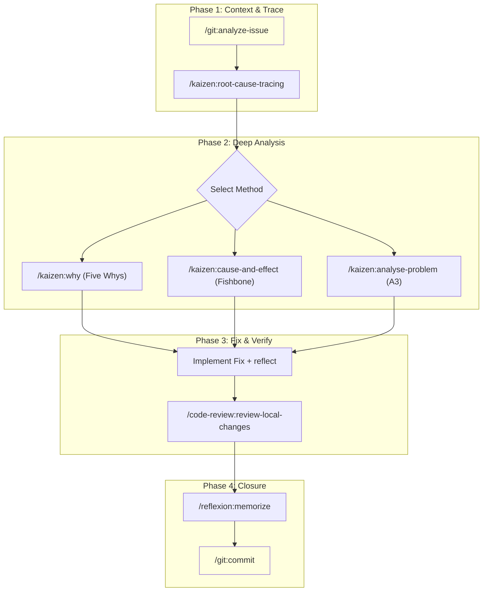
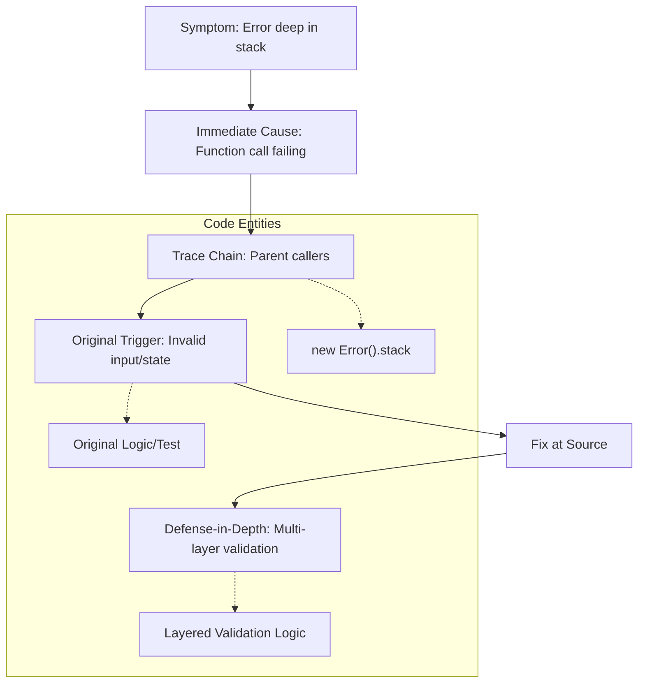
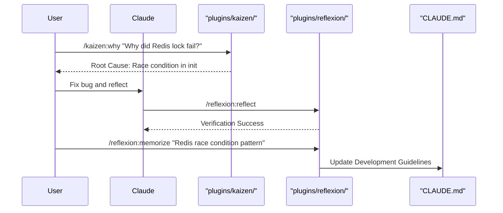

<!-- source: DeepWiki mcp.deepwiki.com · repo NeoLabHQ/context-engineering-kit · page 5.3 Bug Investigation & Root Cause Analysis · fetched 2026-10-26 -->

# Bug Investigation & Root Cause Analysis

<details>
<summary>Relevant source files</summary>

The following files were used as context for generating this wiki page:

- [docs/best-practices.md](docs/best-practices.md)
- [docs/guides/bug-investigation.md](docs/guides/bug-investigation.md)
- [docs/guides/code-quality-improvement.md](docs/guides/code-quality-improvement.md)
- [docs/guides/competitivy-generation.md](docs/guides/competitivy-generation.md)
- [docs/guides/feature-development.md](docs/guides/feature-development.md)
- [plugins/kaizen/skills/root-cause-tracing/SKILL.md](plugins/kaizen/skills/root-cause-tracing/SKILL.md)
- [plugins/kaizen/skills/why/SKILL.md](plugins/kaizen/skills/why/SKILL.md)

</details>


Systematic bug fixing with root cause analysis using Kaizen methodology to eliminate problems at their source. Instead of fixing symptoms, this workflow helps identify and address fundamental causes, preventing entire classes of issues from recurring.

**Scope**: This page covers bug investigation, root cause identification, and systematic fixes. For proactive quality improvements and technical debt reduction, see [Code Quality Improvement](./code-quality-improvement.md). For simple, obvious bugs (typos, single-line fixes), use the [Feature Development](./feature-development.md) workflow.

Sources: [docs/guides/bug-investigation.md:1-5](), [docs/guides/code-quality-improvement.md:1-6]()

## Purpose and Philosophy

Traditional bug fixing addresses visible symptoms without understanding why problems occur. Kaizen methodology, derived from continuous improvement principles, provides systematic techniques to trace bugs to their root causes. The core principle is that many small improvements beat one big change, and quality is achieved through incremental progress and prevention.

The workflow integrates multiple plugins:
- **Kaizen Plugin**: Root cause analysis and problem documentation via `/kaizen:why`, `/kaizen:root-cause-tracing`, and `/kaizen:cause-and-effect`.
- **Git Plugin**: Issue analysis via `/git:analyze-issue` and conventional commits via `/git:commit`.
- **Code Review Plugin**: Multi-agent verification via `/code-review:review-local-changes`.
- **Reflexion Plugin**: Learning from bugs via `/reflexion:memorize` and `/reflexion:reflect`.

Sources: [docs/guides/bug-investigation.md:14-19](), [docs/guides/bug-investigation.md:74-83](), [plugins/kaizen/skills/why/SKILL.md:7-13]()

## Investigation Workflow Overview



**Workflow Steps**:
1.  **Load Issue Context**: Use `/git:analyze-issue` to extract symptoms and reproduction steps from GitHub [docs/guides/bug-investigation.md:74-83]().
2.  **Trace Root Cause**: Use `/kaizen:root-cause-tracing` to follow the call stack backward from symptom to origin [docs/guides/bug-investigation.md:84-93]().
3.  **Deep Analysis**: Use `/kaizen:why` to find systemic reasons (missing tests, architectural gaps) [docs/guides/bug-investigation.md:94-103]().
4.  **Implement Fix**: Address the root cause. Adding `reflect` to the prompt triggers automatic verification [docs/guides/bug-investigation.md:104-121]().
5.  **Review**: Run `/code-review:review-local-changes` to catch new edge cases or regression gaps [docs/guides/bug-investigation.md:122-131]().
6.  **Preserve Learnings**: Use `/reflexion:memorize` to update `CLAUDE.md` with the bug pattern [docs/guides/bug-investigation.md:132-141]().
7.  **Commit**: Finalize with `/git:commit` to link the fix to the issue [docs/guides/bug-investigation.md:142-151]().

Sources: [docs/guides/bug-investigation.md:21-72](), [docs/guides/bug-investigation.md:74-151]()

## Root Cause Tracing Implementation

The `root-cause-tracing` skill [plugins/kaizen/skills/root-cause-tracing/SKILL.md:2-4]() is designed to move beyond the immediate error location. It focuses on finding the **original trigger** of the invalid data or behavior by systematically tracing backward through the call stack.



### Instrumentation for Tracing
When manual tracing is insufficient, the system recommends adding instrumentation (debugging hooks) to capture state at runtime. It is critical to use `console.error()` in tests as standard loggers may be suppressed [plugins/kaizen/skills/root-cause-tracing/SKILL.md:99-100]().

```typescript
// Example of instrumentation recommended by kaizen:root-cause-tracing
async function problematicOperation(data: string) {
  const stack = new Error().stack; // Capture complete call chain
  console.error('DEBUG TRACE:', {
    data,
    cwd: process.cwd(),
    stack,
  });
  // ... actual operation
}
```

Sources: [plugins/kaizen/skills/root-cause-tracing/SKILL.md:8-13](), [plugins/kaizen/skills/root-cause-tracing/SKILL.md:80-97](), [plugins/kaizen/skills/root-cause-tracing/SKILL.md:148-172]()

## Systematic Analysis Methods

The Kaizen plugin provides multiple specialized tools for different bug complexities:

| Bug Characteristic | Recommended Method | Command |
| :--- | :--- | :--- |
| **Unclear Origin** | Root Cause Tracing | `/kaizen:root-cause-tracing` |
| **Systemic/Recurring** | Five Whys | `/kaizen:why` |
| **Multi-factor/Complex** | Fishbone Analysis | `/kaizen:cause-and-effect` |
| **Major Incident** | A3 Problem Summary | `/kaizen:analyse-problem` |
| **Hypothesis Testing** | PDCA Cycle | `/kaizen:plan-do-check-act` |

### Five Whys Analysis (`/kaizen:why`)
The `why` skill [plugins/kaizen/skills/why/SKILL.md:2-4]() iteratively drills from surface symptoms to fundamental causes. It is particularly effective for identifying process-related root causes (e.g., "Why was this index missing?" → "Why wasn't it in the migration review process?"). The goal is to reach systemic issues such as missing validation, missing documentation, or unclear processes [plugins/kaizen/skills/why/SKILL.md:99-101]().

Sources: [docs/guides/bug-investigation.md:152-180](), [plugins/kaizen/skills/why/SKILL.md:7-13](), [plugins/kaizen/skills/why/SKILL.md:35-48]()

## Learning and Memory (Reflexion)

A critical step in bug investigation is standardizing the fix and memorizing the pattern to prevent recurrence. This closes the feedback loop by updating the project's permanent context.



### The Memorization Loop
1.  **Identify Pattern**: During reflection or critique, identify why the bug was non-obvious and what the underlying pattern is.
2.  **Command**: Run `/reflexion:memorize "Bug pattern: [Description]"` to capture insights for future reference [docs/guides/bug-investigation.md:132-141]().
3.  **Persistence**: The agent updates `CLAUDE.md` with specific development guidelines, building a knowledge base of pitfalls and solutions that improve future development [docs/guides/bug-investigation.md:139-141]().

Sources: [docs/guides/bug-investigation.md:132-141](), [docs/best-practices.md:51-59]()

## Summary of Analysis Commands

| Command | Technical Purpose |
| :--- | :--- |
| `/kaizen:why` | Drill from symptoms to fundamental causes through iterative questioning [plugins/kaizen/skills/why/SKILL.md:7-13](). |
| `/kaizen:root-cause-tracing` | Systematically trace backward through the call stack to identify the origin of invalid data [plugins/kaizen/skills/root-cause-tracing/SKILL.md:8-13](). |
| `/kaizen:cause-and-effect` | Fishbone analysis exploring causes across People, Process, Technology, Environment, Methods, and Materials [docs/guides/bug-investigation.md:156-162](). |
| `/kaizen:plan-do-check-act` | Structured improvement plan with measurable success criteria for testing hypotheses [docs/guides/code-quality-improvement.md:95-108](). |
| `/kaizen:analyse-problem` | A3 analysis for a one-page problem summary with root cause and action plan [docs/guides/bug-investigation.md:164-170](). |

Sources: [docs/guides/bug-investigation.md:84-180](), [plugins/kaizen/skills/why/SKILL.md:1-25](), [plugins/kaizen/skills/root-cause-tracing/SKILL.md:1-4]()

---

