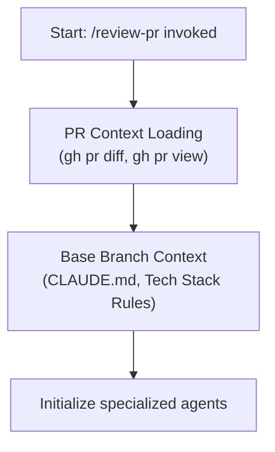
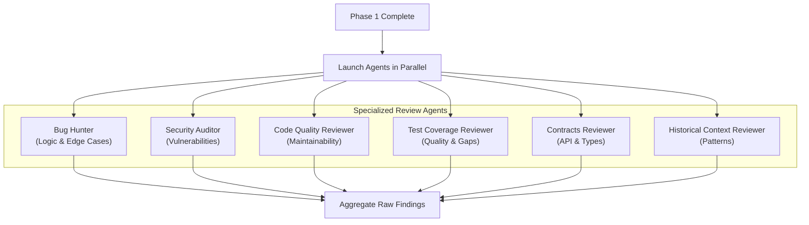
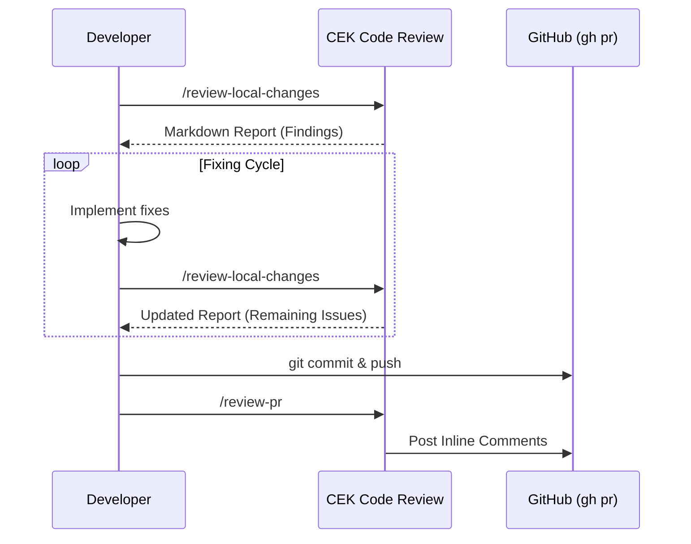

<!-- source: DeepWiki mcp.deepwiki.com · repo NeoLabHQ/context-engineering-kit · page 5.4 PR Review Workflow · fetched 2026-10-26 -->

# PR Review Workflow

<details>
<summary>Relevant source files</summary>

The following files were used as context for generating this wiki page:

- [docs/guides/README.md](docs/guides/README.md)
- [docs/guides/ci-integration.md](docs/guides/ci-integration.md)
- [docs/plugins/review/README.md](docs/plugins/review/README.md)
- [plugins/git/skills/attach-review-to-pr/SKILL.md](plugins/git/skills/attach-review-to-pr/SKILL.md)

</details>


This document describes the comprehensive pull request review workflow using the Code Review plugin's multi-agent system. The workflow involves three phases: preparation, multi-agent analysis, and confidence-based filtering, followed by iterative fixing and integration with GitHub.

**Related workflows**: For automated PR reviews in CI/CD pipelines, see [CI/CD Integration](docs/guides/ci-integration.md). For pre-commit local review, use `/review-local-changes` as described in [Code Quality Plugins](docs/plugins/review/README.md).

## Overview

The PR review workflow executes comprehensive code analysis by spawning up to six specialized agents that examine pull request changes from different perspectives. The `/review-pr` command orchestrates this multi-agent system, applies confidence and impact scoring to filter findings, and posts structured review comments directly to GitHub using either MCP tools or the GitHub CLI.

**Key capabilities**:
- **Multi-perspective analysis**: Six specialized agents (Bug Hunter, Security Auditor, etc.) examine code from different angles [docs/plugins/review/README.md:7-14]().
- **Progressive threshold filtering**: Issues are filtered based on a combination of confidence and impact scores to ensure high signal-to-noise ratios [docs/plugins/review/README.md:37-38]().
- **Line-specific inline comments**: High-confidence findings are posted directly on PR lines using `mcp__github_inline_comment__create_inline_comment` [plugins/git/skills/attach-review-to-pr/SKILL.md:12-14]().
- **Integration**: Works with GitHub via the Model Context Protocol (MCP) or standard `gh` CLI tools [docs/guides/ci-integration.md:78-79]().

**Command syntax**:
```bash
/review-pr #PR_NUMBER [--min-impact critical|high|medium|low]
```

Sources: [docs/plugins/review/README.md:1-14](), [docs/plugins/review/README.md:29-38](), [docs/guides/ci-integration.md:76-79]()

## Three-Phase Review Architecture

The review process executes three sequential phases that progressively refine findings from initial detection through confidence scoring to final posting.

### Phase 1: Preparation & Context Loading

Before analysis begins, the system gathers the necessary context to understand the scope of the changes and the project standards.

Title: PR Review Context Gathering


**Preparation phase steps**:
1. **Determine Review Scope**: Uses `gh pr diff` to understand the volume and location of changes [docs/guides/ci-integration.md:79]().
2. **Context Discovery**: Identifies project standards, technical stack rules, and existing patterns to provide context to agents [docs/plugins/review/README.md:130-134]().
3. **Trigger Analysis**: Determines which specialized agents are required based on the file types and complexity of the PR [docs/guides/ci-integration.md:88-89]().

Sources: [docs/guides/ci-integration.md:76-80](), [docs/plugins/review/README.md:126-135]()

### Phase 2: Parallel Agent Analysis

The system spawns specialized agents simultaneously to analyze the diff from their unique focus areas.

Title: Multi-Agent Analysis Pipeline


**Agent Specializations**:
- **Bug Hunter**: Identifies potential bugs, race conditions, and unhandled error cases [docs/plugins/review/README.md:70-80]().
- **Security Auditor**: Scans for vulnerabilities like SQL injection, XSS, and exposed secrets [docs/plugins/review/README.md:82-92]().
- **Test Coverage Reviewer**: Evaluates test quality and coverage gaps relative to the changes [docs/plugins/review/README.md:94-102]().
- **Code Quality Reviewer**: Assesses maintainability, naming conventions, and design pattern usage [docs/plugins/review/README.md:104-114]().
- **Contracts Reviewer**: Analyzes API changes, backward compatibility, and type safety [docs/plugins/review/README.md:115-125]().
- **Historical Context Reviewer**: Reviews changes against codebase history and architectural drift [docs/plugins/review/README.md:126-135]().

Sources: [docs/plugins/review/README.md:68-135](), [docs/guides/ci-integration.md:89-95]()

### Phase 3: Progressive Threshold Filtering

Raw findings are filtered to ensure only high-value issues are reported. The system utilizes a progressive threshold where lower-impact issues require higher confidence to be included in the final report [docs/plugins/review/README.md:37-38]().

| Impact Level | Typical Description | Output Target |
|--------------|---------------------|---------------|
| **Critical** | Must fix: Security holes, data loss, crashes | Inline Comment + Suggestion |
| **High** | Should fix: Performance issues, major logic flaws | Inline Comment + Suggestion |
| **Medium** | Consider fixing: Maintainability, code smells | Inline Comment |
| **Low** | Nice to have: Style preferences, minor cleanup | Usually filtered out |

Sources: [docs/plugins/review/README.md:202-241](), [plugins/git/skills/attach-review-to-pr/SKILL.md:152-159]()

## Output Formats & GitHub Integration

The review results are presented differently depending on whether the review is local or remote.

### Local Review (`/review-local-changes`)
Produces a structured markdown report organized by severity, designed for the developer to consume within their terminal or IDE [docs/plugins/review/README.md:202-227]().

### PR Review (`/review-pr`)
Posts inline comments directly to GitHub. This workflow avoids "comment spam" by using sticky comments or grouped reviews [docs/guides/ci-integration.md:71-72]().

**GitHub Integration Mechanisms**:
1. **MCP Tool (Preferred)**: Uses `mcp__github_inline_comment__create_inline_comment` for direct integration [plugins/git/skills/attach-review-to-pr/SKILL.md:12-14]().
2. **GitHub CLI (Fallback)**: Uses `gh api` to the `/pulls/{pr}/reviews` endpoint to batch multiple comments into a single review event [plugins/git/skills/attach-review-to-pr/SKILL.md:118-126]().

Each PR comment follows this format:
```markdown
🔴/🟠/🟡 [Severity]: [Brief description]

[Evidence: What was observed and consequence if unfixed]

```suggestion
[code fix if applicable]
```
```

Sources: [docs/plugins/review/README.md:229-241](), [plugins/git/skills/attach-review-to-pr/SKILL.md:8-20]()

## Iterative Fix Workflow

The review process is designed to be iterative, allowing developers to fix issues locally before updating the PR.

Title: Developer Review Loop


**Best Practices**:
1. **Local Pre-Review**: Run `/review-local-changes` before pushing to reduce CI noise [docs/plugins/review/README.md:22-25]().
2. **Adjust Sensitivity**: Use `--min-impact` to filter the volume of feedback during different development stages [docs/plugins/review/README.md:27-38]().
3. **CI Automation**: Integrate with GitHub Actions to ensure every PR is analyzed by the specialized agents [docs/guides/ci-integration.md:1-12]().

Sources: [docs/plugins/review/README.md:16-40](), [docs/guides/ci-integration.md:82-98]()

---

