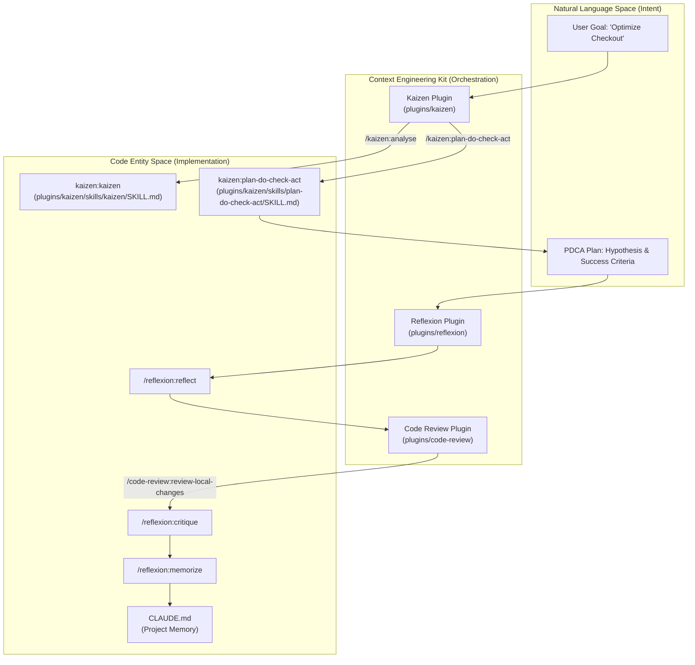
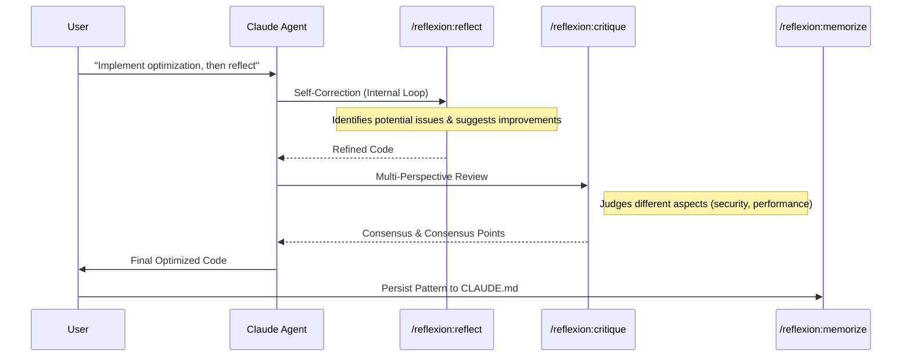

<!-- source: DeepWiki mcp.deepwiki.com · repo NeoLabHQ/context-engineering-kit · page 5.6 Code Quality Improvement · fetched 2026-10-26 -->

# Code Quality Improvement

Relevant source files

The following files were used as context for generating this wiki page:

- [docs/best-practices.md](docs/best-practices.md)
- [docs/guides/bug-investigation.md](docs/guides/bug-investigation.md)
- [docs/guides/code-quality-improvement.md](docs/guides/code-quality-improvement.md)
- [docs/guides/competitivy-generation.md](docs/guides/competitivy-generation.md)
- [docs/guides/feature-development.md](docs/guides/feature-development.md)
- [plugins/kaizen/skills/kaizen/SKILL.md](plugins/kaizen/skills/kaizen/SKILL.md)

This guide documents systematic approaches to improving code quality using the Kaizen methodology combined with Reflexion self-refinement. It focuses on identifying waste, performing root cause analysis, implementing measured improvements through PDCA (Plan-Do-Check-Act) cycles, and accumulating knowledge in `CLAUDE.md` for continuous improvement.

**Purpose**: Proactive quality improvement work including performance optimization, technical debt reduction, and architecture refinement. [docs/guides/code-quality-improvement.md:1-14]()
**Key Plugins**: Kaizen plugin for systematic analysis, Reflexion plugin for self-refinement and knowledge accumulation, Code Review plugin for multi-agent validation. [docs/guides/code-quality-improvement.md:15-20]()

## Overview

Code quality improvement in the Context Engineering Kit is treated as a continuous loop of analysis and refinement. Unlike standard feature development, it focuses on the "meta" aspects of the codebase—eliminating inefficiencies (Muda) and ensuring that the AI's internal reasoning aligns with the project's actual implementation (Gemba). [docs/guides/code-quality-improvement.md:24-73]()

| Aspect | Feature Development | Bug Fixing | Quality Improvement |
|--------|-------------------|------------|-------------------|
| **Trigger** | Requirements or issue | Visible failure | Proactive analysis |
| **Goal** | Add capability | Restore function | Eliminate waste, improve maintainability |
| **Success Metric** | Feature works | Bug fixed | Measurable improvement in metrics |
| **Methodology** | SDD / TDD | Five Whys / Root Cause | Kaizen / PDCA / Reflexion |

Sources: [docs/guides/code-quality-improvement.md:1-20](), [docs/guides/bug-investigation.md:1-20]()

## Quality Improvement Architecture

The system bridges Natural Language requirements to Code Entity space through a structured command flow that utilizes specialized agents and skills.

**Diagram: Mapping Quality Intent to Code Entities**

Sources: [docs/guides/code-quality-improvement.md:24-73](), [plugins/kaizen/skills/kaizen/SKILL.md:1-8](), [docs/guides/code-quality-improvement.md:95-101]()

## Identifying Quality Issues (Kaizen)

The Kaizen methodology focuses on "Small Change for Better." It starts with identifying "Muda" (Waste) or performing a "Gemba Walk" (observing the actual place of work/code). [plugins/kaizen/skills/kaizen/SKILL.md:6-15]()

### 1. Analysis Methods
The `/analyse` command intelligently selects the best analysis method for the target area: [docs/guides/code-quality-improvement.md:75-78]()
- **Muda Analysis**: Identifies waste such as over-processing, defects, or unnecessary complexity. [docs/guides/code-quality-improvement.md:77-78]()
- **Gemba Walk**: Code exploration to understand the current state and identify gaps between documentation and reality. [docs/guides/code-quality-improvement.md:77-78]()
- **Value Stream Mapping**: Analyzes workflows and processes to identify bottlenecks. [docs/guides/code-quality-improvement.md:77-78]()

### 2. Root Cause Analysis
Before fixing, the system must understand *why* a quality issue exists:
- **Five Whys (`/why`)**: Drills from symptoms to fundamental causes through iterative questioning to reveal systemic issues like architectural gaps. [docs/guides/bug-investigation.md:94-102]()
- **Root Cause Tracing (`/root-cause-tracing`)**: Systematically traces the bug or performance bottleneck backward through the call stack to identify the source of invalid behavior. [docs/guides/bug-investigation.md:84-92]()
- **Fishbone Analysis (`/cause-and-effect`)**: Explores causes across multiple categories to find multi-factor contributors to a problem. [docs/guides/bug-investigation.md:156-162]()

Sources: [docs/guides/code-quality-improvement.md:75-84](), [docs/guides/bug-investigation.md:84-102](), [plugins/kaizen/skills/kaizen/SKILL.md:27-29]()

## The Improvement Loop (PDCA & Reflexion)

The core of the quality workflow is the **Plan-Do-Check-Act (PDCA)** cycle, reinforced by the **Reflexion** pattern.

### PDCA Cycle Implementation
The `/plan-do-check-act` command implements a structured improvement plan: [docs/guides/code-quality-improvement.md:95-101]()
1. **Plan**: Problem definition, baseline metrics, hypothesis, and success criteria. [docs/guides/code-quality-improvement.md:104]()
2. **Do**: Specific changes to implement (applied incrementally). [docs/guides/code-quality-improvement.md:105]()
3. **Check**: How to measure results and verify the quality of implemented changes. [docs/guides/code-quality-improvement.md:106]()
4. **Act**: Standardization of the improvement or adjusting the plan based on outcomes. [docs/guides/code-quality-improvement.md:107]()

### Reflexion Pattern
Reflexion provides iterative self-improvement by allowing the agent to critique its own work. It can be triggered automatically by including the word "reflect" in a prompt (e.g., `"Apply optimizations, then reflect"`). [docs/guides/feature-development.md:71-77](), [docs/guides/bug-investigation.md:113-120]()

**Diagram: Reflexion & Critique Interaction**

Sources: [docs/guides/feature-development.md:71-77](), [docs/guides/code-quality-improvement.md:85-93](), [docs/guides/code-quality-improvement.md:131-140]()

## Pattern Memorization

The final step in quality improvement is ensuring the lesson is never forgotten. The `/memorize` command captures insights and adds them to the project's `CLAUDE.md` file. [docs/guides/code-quality-improvement.md:131-140]()

### What to Memorize:
- **Bug Patterns**: e.g., "Race conditions in Redis operations" to prevent recurrence. [docs/guides/bug-investigation.md:137-141]()
- **Performance Patterns**: Optimization techniques identified during the PDCA cycle. [docs/guides/code-quality-improvement.md:136-139]()
- **Validation Patterns**: e.g., "Email validation patterns and regex considerations." [docs/guides/feature-development.md:120-121]()

### Data Flow for Memory:
1. **Extraction**: The LLM identifies a successful pattern or an anti-pattern during the `/reflect` or `/review-local-changes` phase. [docs/guides/feature-development.md:112-124]()
2. **Persistence**: The command updates `CLAUDE.md`, building a project-specific knowledge base that guides future development sessions. [docs/guides/code-quality-improvement.md:139](), [docs/best-practices.md:57-59]()

Sources: [docs/guides/code-quality-improvement.md:131-140](), [docs/guides/bug-investigation.md:132-141](), [docs/best-practices.md:51-59]()

## Practical Example: Performance Optimization

A typical quality improvement session for a slow API endpoint:

1. **Analyze**: `> /analyse Target the checkout flow for performance optimization` [docs/guides/code-quality-improvement.md:79-81]()
2. **Root Cause**: `> /why Why is the checkout page loading slowly?` [docs/guides/code-quality-improvement.md:165-168]()
3. **Plan**: `> /plan-do-check-act Reduce API response time by 50%` [docs/guides/code-quality-improvement.md:99-101]()
4. **Implement**: `> claude "Apply the performance optimizations from the PDCA plan to the checkout flow, then reflect"` [docs/guides/code-quality-improvement.md:115-117]()
5. **Review**: `> /review-local-changes` (Ensures optimization didn't break security or introduce bugs). [docs/guides/code-quality-improvement.md:125-127]()
6. **Memorize**: `> /memorize Performance optimization patterns for checkout flow` [docs/guides/code-quality-improvement.md:136-137]()

Sources: [docs/guides/code-quality-improvement.md:75-150](), [docs/guides/bug-investigation.md:113-120]()

---

