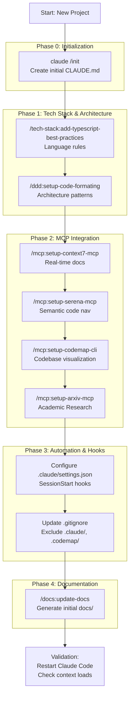
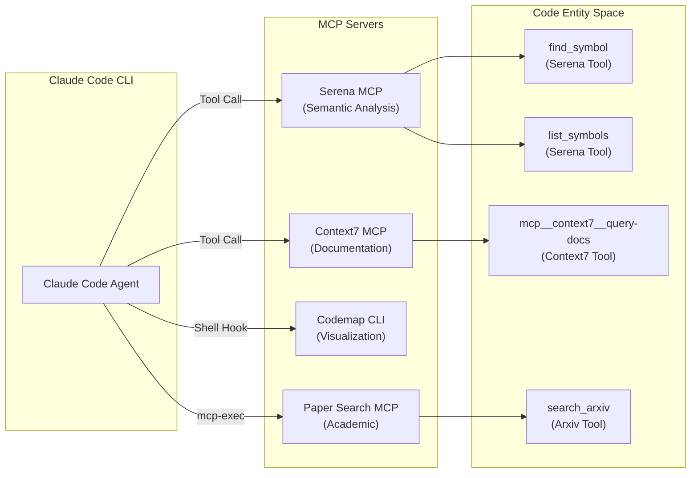

<!-- source: DeepWiki mcp.deepwiki.com · repo NeoLabHQ/context-engineering-kit · page 5.7 Project Setup & Context Enhancement · fetched 2026-10-26 -->

# Project Setup & Context Enhancement

Relevant source files

The following files were used as context for generating this wiki page:

- [CLAUDE.md](CLAUDE.md)
- [docs/plugins/mcp/README.md](docs/plugins/mcp/README.md)
- [docs/plugins/tech-stack/README.md](docs/plugins/tech-stack/README.md)
- [docs/plugins/tech-stack/typescript-best-practices.md](docs/plugins/tech-stack/typescript-best-practices.md)
- [plugins/mcp/README.md](plugins/mcp/README.md)
- [plugins/mcp/skills/setup-codemap-cli/SKILL.md](plugins/mcp/skills/setup-codemap-cli/SKILL.md)
- [plugins/tech-stack/README.md](plugins/tech-stack/README.md)

This guide covers initializing new projects with comprehensive context engineering infrastructure. It walks through configuring `CLAUDE.md` files, setting up MCP servers, enabling session hooks, and establishing best practices that persist across development sessions.

**Scope**: Initial project setup using the Context Engineering Kit. For ongoing feature development workflows, see [Feature Development Workflow](#5.1) and [Spec-Driven Development Workflow](#5.2).

Sources: [CLAUDE.md:1-84]()

---

## Prerequisites

Before setting up a new project, ensure:

- Claude Code CLI is installed and functional.
- Context Engineering Kit marketplace is added: `claude plugin marketplace add NeoLabHQ/context-engineering-kit` [CLAUDE.md:11-12]().
- Required plugins are installed (minimum: `mcp`, `tech-stack`, `ddd`, `docs`) [CLAUDE.md:29-31]().
- Project repository is initialized with Git.

Sources: [CLAUDE.md:11-31]()

---

## Project Initialization Workflow

The following diagram shows the complete setup sequence for a new project:

**Diagram: Complete Project Setup Flow**

Sources: [plugins/mcp/README.md:49-56](), [CLAUDE.md:43-56]()

---

## Step 0: Initialize Claude Code

Use the `/init` command to create the initial `CLAUDE.md` file. This file serves as the primary project-wide context for the AI assistant.

**Recommended CLAUDE.md Structure**

A standard `CLAUDE.md` should include the following sections:
- **Project Structure**: A tree view of the repository [CLAUDE.md:7-27]().
- **Available Plugins**: List of installed Context Engineering Kit plugins [CLAUDE.md:29-31]().
- **Development Commands**: Project-specific `bash` commands for building/testing [CLAUDE.md:33-42]().
- **Key Development Rules**: Coding standards and plugin design philosophy [CLAUDE.md:44-52]().

Sources: [CLAUDE.md:1-56]()

---

## Step 1: Configure Tech Stack Best Practices

The `tech-stack` plugin provides rules for language and framework-specific best practices. These rules are automatically loaded into the agent's context when working with matching file types (e.g., `**/*.ts` for TypeScript) [plugins/tech-stack/README.md:10-13]().

**Available Rules**

| Rule | File Pattern | Description |
|------|-------------|-------------|
| [TypeScript Best Practices](typescript-best-practices.md) | `**/*.ts` | Type system guidelines, code style, async patterns [plugins/tech-stack/README.md:32-34]() |

**What TypeScript Best Practices Enforces**
- **Code Style**: Strict typing, interfaces over types, enums for constants [docs/plugins/tech-stack/typescript-best-practices.md:16-16]().
- **Type System**: Prefer inference, avoid `any`, use `Record<PropertyKey, unknown>` [docs/plugins/tech-stack/typescript-best-practices.md:17-17]().
- **Library-First Approach**: Recommends established libraries like `zod` for validation or `date-fns` for time [docs/plugins/tech-stack/typescript-best-practices.md:35-46]().

Sources: [plugins/tech-stack/README.md:1-43](), [docs/plugins/tech-stack/typescript-best-practices.md:1-80]()

---

## Step 2: Set Up Architecture Patterns

Use the `ddd` plugin to establish architectural guidelines. This ensures the codebase follows Clean Architecture and SOLID principles. Setup commands update `CLAUDE.md` for persistent project context [CLAUDE.md:50-50]().

The `ddd` plugin includes 14 rules files covering topics such as `call-site-honesty`, `explicit-side-effects`, and `functional-core-imperative-shell`.

Sources: [CLAUDE.md:31-31]()

---

## Step 3: Configure MCP Servers

Integrate external tools using the Model Context Protocol (MCP) to enhance AI capabilities. Each setup command supports configuration at Project (shared), Project (personal), or User (global) levels [plugins/mcp/README.md:21-26]().

**Diagram: MCP Integration Data Flow**

Sources: [CLAUDE.md:93-138](), [plugins/mcp/README.md:13-19](), [plugins/mcp/skills/setup-codemap-cli/SKILL.md:164-172]()

### Context7 MCP: Real-time Library Documentation
**Purpose**: Fetches up-to-date documentation with code examples to eliminate hallucinations from outdated training data [CLAUDE.md:93-95]().
**Command**: `/mcp:setup-context7-mcp` [plugins/mcp/README.md:51-51]().
**Recommended Library IDs**:
- `/anthropics/claude-code` [CLAUDE.md:99-99]()
- `/websites/platform_claude` [CLAUDE.md:100-100]()
- `/anthropics/anthropic-cookbook` [CLAUDE.md:101-101]()

### Serena MCP: Semantic Code Analysis
**Purpose**: Enables precise code manipulation and symbol-based operations in large codebases [plugins/mcp/README.md:52-52]().
**Command**: `/mcp:setup-serena-mcp` [plugins/mcp/README.md:42-42]().
**Tools**: `find_symbol`, `list_symbols` [plugins/mcp/README.md:16-16]().

### Codemap CLI: Codebase Visualization
**Purpose**: Provides intelligent codebase visualization, tree views, and dependency analysis [plugins/mcp/README.md:53-53]().
**Command**: `/mcp:setup-codemap-cli` [plugins/mcp/README.md:45-45]().
**Configuration**: Updates `.claude/settings.json` with hooks like `session-start` [plugins/mcp/skills/setup-codemap-cli/SKILL.md:144-153]().

### Paper Search MCP: Academic Research
**Purpose**: Search and download academic papers from sources including arXiv, PubMed, and Semantic Scholar [CLAUDE.md:113-126]().
**Command**: `/mcp:setup-arxiv-mcp` [plugins/mcp/README.md:54-54]().
**Usage**: Call tools via `mcp-exec`, e.g., `search_arxiv` [CLAUDE.md:135-135]().

Sources: [CLAUDE.md:93-138](), [plugins/mcp/README.md:1-56](), [plugins/mcp/skills/setup-codemap-cli/SKILL.md:1-243]()

---

## Step 4: Enable Session Hooks

Configure automatic context injection via `.claude/settings.json` hooks to provide the AI with project state at every session start.

**Codemap CLI Hooks**
The setup guide for Codemap CLI recommends several hooks to maintain context:
- `SessionStart`: Runs `codemap hook session-start` for a full tree and branch diff [plugins/mcp/skills/setup-codemap-cli/SKILL.md:166-166]().
- `PreToolUse`: Runs `codemap hook pre-edit` to show who imports the file being edited [plugins/mcp/skills/setup-codemap-cli/SKILL.md:167-167]().
- `SessionEnd`: Runs `codemap hook session-stop` for an edit timeline and stats [plugins/mcp/skills/setup-codemap-cli/SKILL.md:171-171]().

Sources: [plugins/mcp/skills/setup-codemap-cli/SKILL.md:144-243]()

---

## Step 5: Document Project Setup

Use the `docs` plugin to generate and manage technical documentation.

**Command**: `/docs:update-docs`
**Purpose**: Analyzes the project to create or update documentation, utilizing the `tech-writer` agent's documentation hierarchy approach.

Sources: [CLAUDE.md:31-31]()

---

## Summary: Final State

After completing this workflow, the project will contain:
- **`CLAUDE.md`**: AI assistant configuration with coding standards, library IDs for Context7, and architecture rules.
- **`docs/`**: Initial project documentation generated by the tech-writer agent.
- **MCP Integrations**: Configured servers for real-time documentation, semantic search, and academic research.
- **`.claude/settings.json`**: Session hooks for automatic context updates (e.g., Codemap).

Sources: [CLAUDE.md:1-138](), [plugins/mcp/README.md:21-27]()

---

